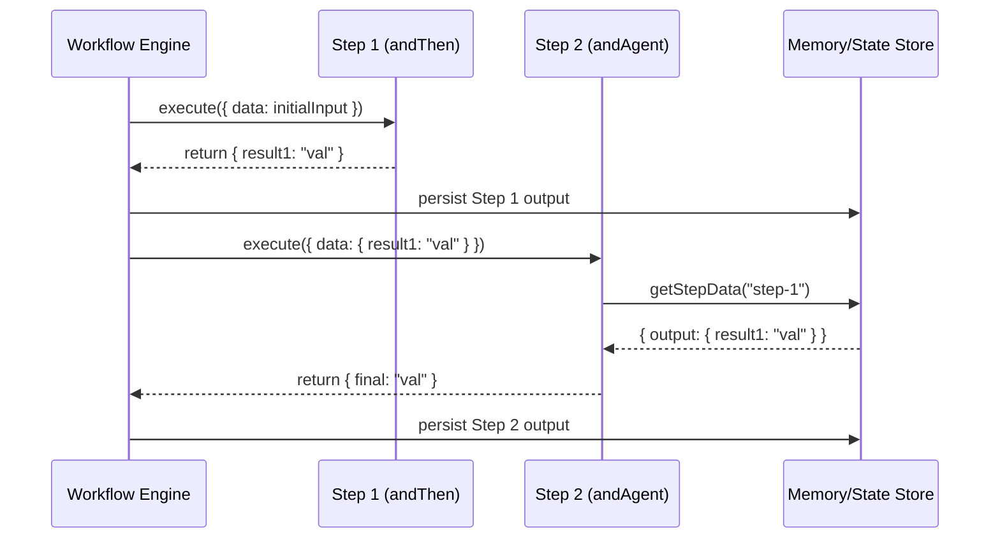

<!-- source: DeepWiki mcp.deepwiki.com · repo VoltAgent/voltagent · page 3.1 Workflow Control Flow · fetched 2026-10-26 -->

# Workflow Control Flow

<details>
<summary>Relevant source files</summary>

The following files were used as context for generating this wiki page:

- [examples/with-workflow/src/index.ts](examples/with-workflow/src/index.ts)
- [packages/core/src/agent/subagent/stream-metadata-enricher.ts](packages/core/src/agent/subagent/stream-metadata-enricher.ts)
- [packages/core/src/agent/subagent/types.ts](packages/core/src/agent/subagent/types.ts)
- [packages/core/src/test-utils/mocks/workflows.ts](packages/core/src/test-utils/mocks/workflows.ts)
- [packages/core/src/utils/streams/types.ts](packages/core/src/utils/streams/types.ts)
- [packages/core/src/workflow/chain.spec-d.ts](packages/core/src/workflow/chain.spec-d.ts)
- [packages/core/src/workflow/chain.spec.ts](packages/core/src/workflow/chain.spec.ts)
- [packages/core/src/workflow/chain.ts](packages/core/src/workflow/chain.ts)
- [packages/core/src/workflow/context.ts](packages/core/src/workflow/context.ts)
- [packages/core/src/workflow/core.spec-d.ts](packages/core/src/workflow/core.spec-d.ts)
- [packages/core/src/workflow/core.spec.ts](packages/core/src/workflow/core.spec.ts)
- [packages/core/src/workflow/core.ts](packages/core/src/workflow/core.ts)
- [packages/core/src/workflow/index.ts](packages/core/src/workflow/index.ts)
- [packages/core/src/workflow/internal/state.ts](packages/core/src/workflow/internal/state.ts)
- [packages/core/src/workflow/internal/types.ts](packages/core/src/workflow/internal/types.ts)
- [packages/core/src/workflow/internal/utils.ts](packages/core/src/workflow/internal/utils.ts)
- [packages/core/src/workflow/registry.ts](packages/core/src/workflow/registry.ts)
- [packages/core/src/workflow/steps/and-agent.spec.ts](packages/core/src/workflow/steps/and-agent.spec.ts)
- [packages/core/src/workflow/steps/and-agent.ts](packages/core/src/workflow/steps/and-agent.ts)
- [packages/core/src/workflow/steps/and-loop.spec.ts](packages/core/src/workflow/steps/and-loop.spec.ts)
- [packages/core/src/workflow/steps/and-loop.ts](packages/core/src/workflow/steps/and-loop.ts)
- [packages/core/src/workflow/steps/index.ts](packages/core/src/workflow/steps/index.ts)
- [packages/core/src/workflow/steps/types.ts](packages/core/src/workflow/steps/types.ts)
- [packages/core/src/workflow/stream.spec.ts](packages/core/src/workflow/stream.spec.ts)
- [packages/core/src/workflow/stream.ts](packages/core/src/workflow/stream.ts)
- [packages/core/src/workflow/suspend-resume.spec.ts](packages/core/src/workflow/suspend-resume.spec.ts)
- [packages/core/src/workflow/types.ts](packages/core/src/workflow/types.ts)
- [website/docs/workflows/overview.md](website/docs/workflows/overview.md)
- [website/docs/workflows/steps/and-agent.md](website/docs/workflows/steps/and-agent.md)
- [website/docs/workflows/steps/and-loop.md](website/docs/workflows/steps/and-loop.md)
- [website/docs/workflows/steps/and-then.md](website/docs/workflows/steps/and-then.md)
- [website/docs/workflows/streaming.md](website/docs/workflows/streaming.md)
- [website/docs/workflows/suspend-resume.md](website/docs/workflows/suspend-resume.md)

</details>


## Purpose and Scope

This document describes the control flow primitives available in VoltAgent's workflow system. Control flow steps determine how execution progresses through a workflow chain, enabling sequential operations, conditional branching, loops, parallel execution, and time-based delays. These primitives are implemented as builder methods on `WorkflowChain` [packages/core/src/workflow/chain.ts:111-117]() and allow declarative composition of complex multi-step processes.

## Control Flow Primitives

VoltAgent workflows provide distinct control flow step types, each exposing a builder method on `WorkflowChain`. All steps follow a consistent pattern: they accept configuration, execute logic based on the current workflow state, and return updated data that flows to subsequent steps.

| Step Type | Builder Method | Purpose | Implementation Class |
|-----------|---------------|---------|----------------------|
| Sequential | `andThen` | Execute code in order | `WorkflowStepFunc` |
| Conditional | `andWhen` | Execute if condition met | `WorkflowStepConditionalWhen` |
| Branching | `andBranch` | Route to one of multiple paths | `WorkflowStepBranch` |
| Iteration | `andForEach` | Process array elements | `WorkflowStepForEach` |
| Looping | `andDoWhile`, `andDoUntil` | Repeat until condition | `WorkflowStepLoop` |
| Mapping | `andMap` | Transform data structure | `WorkflowStepMap` |
| Delay | `andSleep`, `andSleepUntil` | Time-based pauses | `WorkflowStepSleep` |
| Delegation | `andAgent` | Call agent for structured task | `WorkflowStepAgent` |

**Sources:** [packages/core/src/workflow/steps/types.ts:15-29](), [packages/core/src/workflow/chain.ts:111-223](), [packages/core/src/workflow/index.ts:1-17]()

## Sequential Execution

### andThen

The `andThen` method executes a function and passes its output to the next step. This is the fundamental building block for workflows.

```typescript
.andThen({
  id: "step-id",
  execute: async ({ data, getStepData, state, workflowState }) => {
    // Access current data
    const value = data.someField;
    // Access previous step outputs
    const previousResult = getStepData("previous-step-id");
    // Return new or merged data
    return { ...data, newField: "result" };
  }
})
```

The `execute` function receives a `WorkflowExecuteContext` [packages/core/src/workflow/internal/types.ts:74-95](), which provides:
- `data`: Merged output from all previous steps.
- `getStepData(stepId)`: Access specific step's `WorkflowStepData` [packages/core/src/workflow/internal/utils.ts:92-99]().
- `state`: Request-scoped `WorkflowStepState` including `executionId`, `userId`, and `conversationId` [packages/core/src/workflow/internal/utils.ts:26-49]().
- `workflowState`: Persistent state shared across the entire workflow execution [packages/core/src/workflow/internal/utils.ts:114]().

**Sources:** [packages/core/src/workflow/chain.ts:79-102](), [packages/core/src/workflow/internal/utils.ts:72-119]()

## Conditional Execution

### andWhen

Executes a step only when a condition evaluates to true. If the condition returns `false`, the step is skipped and data flows unchanged to the next step [packages/core/src/workflow/steps/types.ts:101-111]().

```typescript
.andWhen({
  id: "conditional-step",
  condition: async ({ data }) => data.amount > 1000,
  step: andThen({
    id: "flag-large",
    execute: async ({ data }) => ({ ...data, large: true }),
  }),
})
```

### andBranch

Routes execution to the first matching branch in an ordered list. Branches are evaluated sequentially until one matches [packages/core/src/workflow/steps/types.ts:237-251]().

```mermaid
graph TD
    "InputData"["Input Data"] --> "andBranch"["andBranch Step"]
    "andBranch" --> "Cond1"{"Condition 1?"}
    "Cond1" -->|true| "Step1"["Execute Branch 1"]
    "Cond1" -->|false| "Cond2"{"Condition 2?"}
    "Cond2" -->|true| "Step2"["Execute Branch 2"]
    "Cond2" -->|false| "NoMatch"["Data flows unchanged"]
    "Step1" --> "Output"["Next Workflow Step"]
    "Step2" --> "Output"
    "NoMatch" --> "Output"
```

**Sources:** [packages/core/src/workflow/steps/types.ts:92-111](), [packages/core/src/workflow/steps/types.ts:237-251](), [website/docs/workflows/overview.md:160-180]()

## Iteration and Loops

### andForEach

Processes elements of an array. It supports `concurrency` control for parallel execution of the inner step across array items [packages/core/src/workflow/steps/types.ts:176-196]().

```typescript
.andForEach({
  id: "process-items",
  concurrency: 5,
  items: ({ data }) => data.items,
  step: andAgent("Summarize this item", agent, { schema: z.string() })
})
```

### Looping: andDoWhile and andDoUntil

VoltAgent provides both pre-condition (`andDoWhile`) and post-condition (`andDoUntil`) loops [packages/core/src/workflow/steps/types.ts:206-235]().

```mermaid
graph LR
    subgraph "andDoWhile"
        "DW_Start"["Start"] --> "DW_Check"{"Condition?"}
        "DW_Check" -->|true| "DW_Exec"["Execute Step"]
        "DW_Exec" --> "DW_Check"
        "DW_Check" -->|false| "DW_End"["End"]
    end
    
    subgraph "andDoUntil"
        "DU_Start"["Start"] --> "DU_Exec"["Execute Step"]
        "DU_Exec" --> "DU_Check"{"Condition?"}
        "DU_Check" -->|false| "DU_Exec"
        "DU_Check" -->|true| "DU_End"["End"]
    end
```

**Sources:** [packages/core/src/workflow/steps/types.ts:176-235]()

## Delegation

### andAgent

Delegates work to an `Agent` instance using `generateText` [packages/core/src/workflow/steps/and-agent.ts:110-117](). It supports structured output via Zod schemas or AI SDK `Output` specs [packages/core/src/workflow/steps/and-agent.ts:95-97]().

```typescript
.andAgent(
  async ({ data }) => `Analyze: ${data.text}`,
  agent,
  { schema: z.object({ sentiment: z.string() }) },
  (output, { data }) => ({ ...data, analysis: output }) // Optional mapper
)
```

**Data Flow in andAgent:**
1. **Task Resolution**: The prompt is resolved from a string or function [packages/core/src/workflow/steps/and-agent.ts:93]().
2. **Execution**: `agent.generateText` is called with the resolved prompt and schema [packages/core/src/workflow/steps/and-agent.ts:137-145]().
3. **Usage Tracking**: Token usage is automatically accumulated into the workflow's total usage [packages/core/src/workflow/steps/and-agent.ts:150-161]().
4. **Mapping**: The output is passed through an optional mapper function to merge with existing data [packages/core/src/workflow/steps/and-agent.ts:99-105]().

**Sources:** [packages/core/src/workflow/steps/and-agent.ts:69-181](), [website/docs/workflows/steps/and-agent.md:34-58]()

## System Architecture: Code to Concept

The following diagram bridges the natural language concepts of "Steps" and "Context" to the specific code entities in `@voltagent/core`.

```mermaid
graph TD
    subgraph "Natural Language Space"
        "Concept_Chain"["Workflow Chain"]
        "Concept_Step"["Step Execution"]
        "Concept_Data"["Shared State"]
    end

    subgraph "Code Entity Space"
        "WorkflowChain"["WorkflowChain Class"]
        "WorkflowExecuteContext"["WorkflowExecuteContext Interface"]
        "WorkflowState"["WorkflowState Store"]
        "WorkflowStepData"["WorkflowStepData Type"]
    end

    "Concept_Chain" --- "WorkflowChain"
    "Concept_Step" --- "WorkflowExecuteContext"
    "Concept_Data" --- "WorkflowState"
    "WorkflowChain" -->|"manages"| "WorkflowStepData"
    "WorkflowExecuteContext" -->|"accesses"| "WorkflowStepData"
    "WorkflowExecuteContext" -->|"updates"| "WorkflowState"
```

**Sources:** [packages/core/src/workflow/chain.ts:111-128](), [packages/core/src/workflow/internal/types.ts:74-95](), [packages/core/src/workflow/types.ts:354-368](), [packages/core/src/workflow/internal/state.ts:12-25]()

## Data Flow and Persistence

Workflows manage data through several mechanisms:
1. **Step Data**: Each step's input and output are stored in `WorkflowStepData` and can be retrieved by ID via `getStepData(stepId)` [packages/core/src/workflow/internal/utils.ts:92-99]().
2. **Merged Data**: By default, the `data` object passed to a step is the output of the immediately preceding step, though the chain pattern often merges results [website/docs/workflows/overview.md:197-200]().
3. **Workflow State**: Persistent key-value storage accessible via `workflowState` and updatable via `setWorkflowState` [packages/core/src/workflow/internal/utils.ts:114-115](). This state persists across steps and even across suspension/resumption [packages/core/src/workflow/core.spec.ts:83-136]().



**Sources:** [packages/core/src/workflow/core.ts:1134-1160](), [packages/core/src/workflow/internal/utils.ts:72-119](), [packages/core/src/workflow/core.spec.ts:83-136]()

## Time-Based Control

### andSleep and andSleepUntil

Workflows can pause execution using `andSleep` (duration-based) or `andSleepUntil` (timestamp-based) [packages/core/src/workflow/steps/types.ts:142-160]().

- **andSleep**: Accepts a `duration` in milliseconds or a function returning it [packages/core/src/workflow/steps/types.ts:143]().
- **andSleepUntil**: Accepts a `Date` or a function returning a `Date` [packages/core/src/workflow/steps/types.ts:153]().

These steps utilize `waitWithSignal` to ensure they can be aborted if the workflow is cancelled during the sleep period [packages/core/src/workflow/core.ts:29]().

**Sources:** [packages/core/src/workflow/steps/types.ts:142-160](), [packages/core/src/workflow/core.ts:29]()

---

