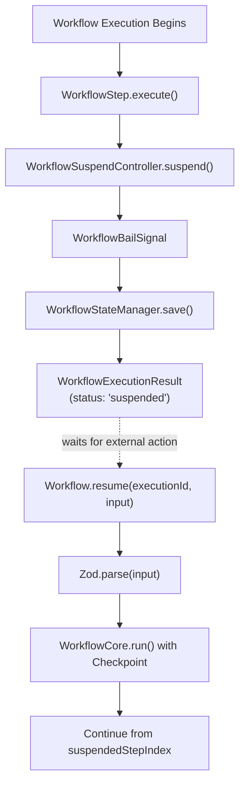
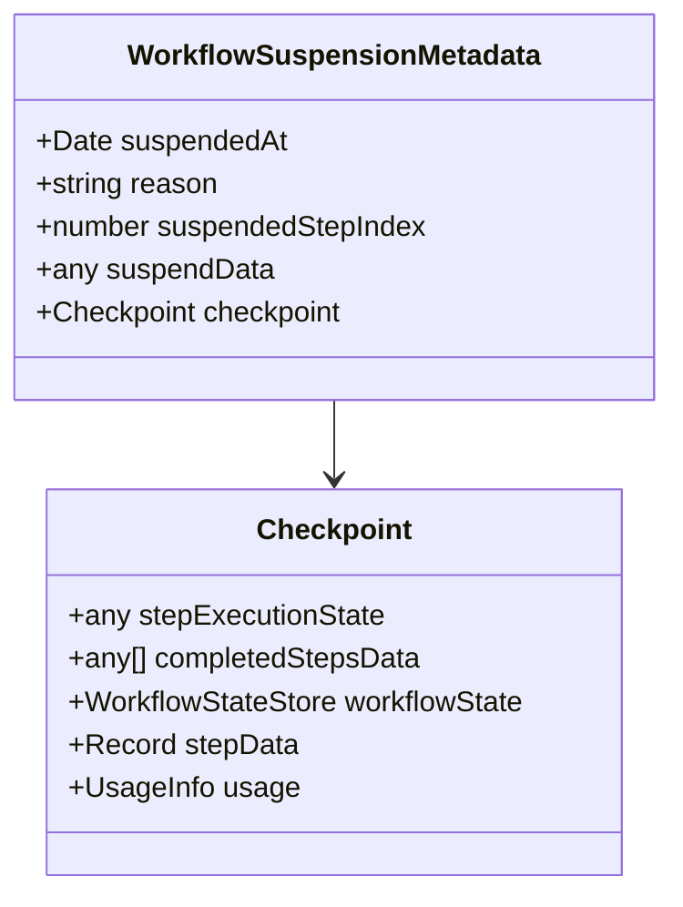

<!-- source: DeepWiki mcp.deepwiki.com · repo VoltAgent/voltagent · page 3.2 Workflow Suspend and Resume · fetched 2026-10-26 -->

# Workflow Suspend and Resume

<details>
<summary>Relevant source files</summary>

The following files were used as context for generating this wiki page:

- [examples/with-workflow/package.json](examples/with-workflow/package.json)
- [packages/core/src/agent/subagent/stream-metadata-enricher.ts](packages/core/src/agent/subagent/stream-metadata-enricher.ts)
- [packages/core/src/agent/subagent/types.ts](packages/core/src/agent/subagent/types.ts)
- [packages/core/src/utils/streams/types.ts](packages/core/src/utils/streams/types.ts)
- [packages/core/src/workflow/chain.spec.ts](packages/core/src/workflow/chain.spec.ts)
- [packages/core/src/workflow/chain.ts](packages/core/src/workflow/chain.ts)
- [packages/core/src/workflow/core.spec.ts](packages/core/src/workflow/core.spec.ts)
- [packages/core/src/workflow/core.ts](packages/core/src/workflow/core.ts)
- [packages/core/src/workflow/index.ts](packages/core/src/workflow/index.ts)
- [packages/core/src/workflow/internal/state.ts](packages/core/src/workflow/internal/state.ts)
- [packages/core/src/workflow/registry.ts](packages/core/src/workflow/registry.ts)
- [packages/core/src/workflow/steps/types.ts](packages/core/src/workflow/steps/types.ts)
- [packages/core/src/workflow/stream.spec.ts](packages/core/src/workflow/stream.spec.ts)
- [packages/core/src/workflow/stream.ts](packages/core/src/workflow/stream.ts)
- [packages/core/src/workflow/suspend-resume.spec.ts](packages/core/src/workflow/suspend-resume.spec.ts)
- [packages/core/src/workflow/types.ts](packages/core/src/workflow/types.ts)
- [website/docs/workflows/overview.md](website/docs/workflows/overview.md)
- [website/docs/workflows/streaming.md](website/docs/workflows/streaming.md)
- [website/docs/workflows/suspend-resume.md](website/docs/workflows/suspend-resume.md)

</details>


## Purpose and Scope

This document explains VoltAgent's workflow suspend and resume capability, which enables human-in-the-loop patterns where workflows pause execution to await external input, approval, or data before continuing. This feature allows workflows to exit the execution context, persist their state, and resume later with validated input.

For general workflow concepts and step types, see [Workflow Control Flow](#3.1). For execution history and observability hooks, see [Workflow Hooks and History](#3.3).

---

## Overview

Workflow suspension enables **durable, human-in-the-loop workflows** that can pause execution and resume later with external input. When a workflow suspends:

1. Execution stops at a specific step.
2. Workflow state is persisted (including execution history and data) via a `WorkflowStateStore` [packages/core/src/workflow/types.ts:35-35]().
3. Control returns to the caller with `WorkflowSuspensionMetadata` [packages/core/src/workflow/types.ts:17-41]().
4. The workflow can be resumed later with validated input using the `resume` function [packages/core/src/workflow/types.ts:161-164]().
5. Execution continues from the suspension point using persisted checkpoint data [packages/core/src/workflow/types.ts:29-40]().

This pattern supports approval workflows, form submissions, document reviews, payment confirmations, and other scenarios where workflows must wait for external events or human decisions.

**Sources:** [packages/core/src/workflow/types.ts:17-41](), [packages/core/src/workflow/types.ts:161-164](), [website/docs/workflows/overview.md:1-54]()

---

## Suspension Architecture

### Suspension Flow

The following diagram bridges the natural language requirement for "waiting" with the code entities responsible for managing the lifecycle.



**Sources:** [packages/core/src/workflow/core.ts:66-74](), [packages/core/src/workflow/suspend-controller.ts:1-50](), [packages/core/src/workflow/types.ts:161-164](), [packages/core/src/workflow/types.ts:17-41]()

### Suspension State Management

Suspension state is encapsulated in the `WorkflowSuspensionMetadata` interface, which includes the timestamp, reason, and a `checkpoint` object for restoration.



**Sources:** [packages/core/src/workflow/types.ts:17-41](), [packages/core/src/workflow/core.ts:217-228]()

---

## Suspending a Workflow

### The `suspend()` Function

Workflows suspend by calling the `suspend()` function within a step's `execute` handler. This is internally managed by the `WorkflowSuspendController` [packages/core/src/workflow/types.ts:53-82]().

**Key Properties in `WorkflowSuspensionMetadata`:**

| Property | Type | Description |
|----------|------|-------------|
| `suspendedAt` | `Date` | Timestamp when the workflow was paused [packages/core/src/workflow/types.ts:19-19]() |
| `reason` | `string` | Reason for suspension (e.g., "user-requested") [packages/core/src/workflow/types.ts:21-21]() |
| `suspendedStepIndex`| `number` | The index of the step where suspension occurred [packages/core/src/workflow/types.ts:23-23]() |
| `suspendData` | `any` | Validated data passed when suspending [packages/core/src/workflow/types.ts:27-27]() |

**Sources:** [packages/core/src/workflow/types.ts:17-41](), [packages/core/src/workflow/suspend-controller.ts:1-50]()

### Suspension Example with `createWorkflowChain`

The `WorkflowChain` class provides a fluent API for defining steps that can suspend [packages/core/src/workflow/chain.ts:111-128]().

```typescript
import { createWorkflowChain } from "@voltagent/core";
import { z } from "zod";

const workflow = createWorkflowChain({
  id: "approval-process",
  input: z.object({ amount: z.number() }),
  result: z.object({ approved: z.boolean() }),
  // Define schemas for the suspension point
  suspendSchema: z.object({ message: z.string() }),
  resumeSchema: z.object({ decision: z.boolean() })
})
  .andThen({
    id: "request-approval",
    execute: async ({ data, suspend }) => {
      if (data.amount > 100) {
        // Triggers suspension
        return suspend("Manager approval required");
      }
      return { approved: true };
    }
  });
```

**Sources:** [packages/core/src/workflow/chain.ts:111-128](), [packages/core/src/workflow/types.ts:161-164]()

---

## Resuming a Workflow

### Resume Mechanism

To resume a suspended workflow, the `resume()` method is called on the `WorkflowExecutionResult` [packages/core/src/workflow/types.ts:161-164]().

1. **Input Validation**: If a `resumeSchema` was provided in the workflow configuration, the input is validated [packages/core/src/workflow/chain.ts:116-116]().
2. **State Restoration**: The `WorkflowCore` uses `deserializeCheckpointStepData` to restore the state of previous steps [packages/core/src/workflow/core.ts:217-228]().
3. **Replay**: The engine skips already "success" status steps and begins execution from the `suspended` step [packages/core/src/workflow/core.ts:147-154]().

**Sources:** [packages/core/src/workflow/core.ts:217-228](), [packages/core/src/workflow/types.ts:161-164](), [packages/core/src/workflow/chain.ts:111-128]()

### Resume Example

```typescript
const result = await workflow.run({ amount: 500 });

if (result.status === "suspended") {
  // Resume the workflow later
  const finalResult = await result.resume({ decision: true });
  console.log(finalResult.result); // { approved: true }
}
```

**Sources:** [packages/core/src/workflow/types.ts:161-164](), [packages/core/src/workflow/core.spec.ts:59-81]()

---

## Streaming and Suspension

When using `.stream()`, the workflow emits a `workflow-suspended` event [website/docs/workflows/streaming.md:36-36](). The `WorkflowStreamResult` also provides `suspend()` and `cancel()` methods to manually trigger these states from the consumer side [packages/core/src/workflow/types.ts:196-202]().

### Workflow Stream Events during Suspension

| Event Type | Source | Description |
|------------|--------|-------------|
| `workflow-suspended` | Workflow | Emitted when the entire workflow enters suspended state [website/docs/workflows/streaming.md:36-36]() |
| `step-suspend` | Step | Emitted when a specific step triggers suspension [website/docs/workflows/streaming.md:40-40]() |

**Sources:** [website/docs/workflows/streaming.md:5-42](), [packages/core/src/workflow/types.ts:171-203]()

---

## Internal Implementation Details

### Checkpoint Logic

The core engine uses a specialized key `VOLTAGENT_RESTART_CHECKPOINT_KEY` to handle re-entry points [packages/core/src/workflow/core.ts:60-60](). Error handling during suspension uses `WorkflowBailSignal` to stop the current execution stack without marking the workflow as "failed" [packages/core/src/workflow/core.ts:66-74]().

### Data Flow for Resume

1. **Serialization**: Step errors are serialized using `serializeStepError` before storage [packages/core/src/workflow/core.ts:98-122]().
2. **Deserialization**: Upon resume, `deserializeStepError` reconstructs Error objects [packages/core/src/workflow/core.ts:124-145]().
3. **Step Status**: The engine verifies step status (e.g., `running`, `success`, `suspended`) to determine where to pick up [packages/core/src/workflow/core.ts:147-154]().

**Sources:** [packages/core/src/workflow/core.ts:60-154](), [packages/core/src/workflow/types.ts:29-40]()

---

## Best Practices

1. **Idempotency**: Ensure that steps before the suspension point are idempotent, as they may be logged or re-evaluated during state restoration [packages/core/src/workflow/core.ts:217-228]().
2. **Type Safety**: Use Zod schemas for `suspendSchema` and `resumeSchema` in `createWorkflowChain` to ensure the "Human-in-the-loop" data is valid [packages/core/src/workflow/chain.ts:115-116]().
3. **Memory Persistence**: Use a persistent storage adapter (like `LibSQLMemoryAdapter` or `PostgreSQL`) for workflows that suspend, as `InMemoryStorageAdapter` will lose suspended states on process restart [packages/core/src/workflow/chain.ts:77-77]().

**Sources:** [packages/core/src/workflow/chain.ts:66-109](), [packages/core/src/workflow/core.ts:217-228](), [packages/core/src/workflow/types.ts:161-164]()

---

