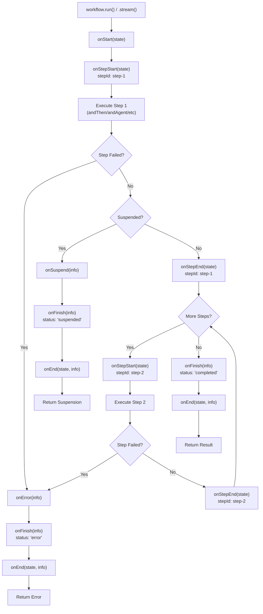
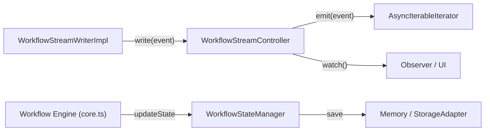

<!-- source: DeepWiki mcp.deepwiki.com · repo VoltAgent/voltagent · page 3.3 Workflow Hooks and History · fetched 2026-10-26 -->

# Workflow Hooks and History

<details>
<summary>Relevant source files</summary>

The following files were used as context for generating this wiki page:

- [examples/with-workflow-chain/package.json](examples/with-workflow-chain/package.json)
- [packages/core/src/agent/subagent/stream-metadata-enricher.ts](packages/core/src/agent/subagent/stream-metadata-enricher.ts)
- [packages/core/src/agent/subagent/types.ts](packages/core/src/agent/subagent/types.ts)
- [packages/core/src/utils/streams/types.ts](packages/core/src/utils/streams/types.ts)
- [packages/core/src/workflow/chain.spec.ts](packages/core/src/workflow/chain.spec.ts)
- [packages/core/src/workflow/chain.ts](packages/core/src/workflow/chain.ts)
- [packages/core/src/workflow/core.spec.ts](packages/core/src/workflow/core.spec.ts)
- [packages/core/src/workflow/core.ts](packages/core/src/workflow/core.ts)
- [packages/core/src/workflow/index.ts](packages/core/src/workflow/index.ts)
- [packages/core/src/workflow/internal/state.ts](packages/core/src/workflow/internal/state.ts)
- [packages/core/src/workflow/registry.ts](packages/core/src/workflow/registry.ts)
- [packages/core/src/workflow/steps/types.ts](packages/core/src/workflow/steps/types.ts)
- [packages/core/src/workflow/stream.spec.ts](packages/core/src/workflow/stream.spec.ts)
- [packages/core/src/workflow/stream.ts](packages/core/src/workflow/stream.ts)
- [packages/core/src/workflow/suspend-resume.spec.ts](packages/core/src/workflow/suspend-resume.spec.ts)
- [packages/core/src/workflow/types.ts](packages/core/src/workflow/types.ts)
- [website/docs/workflows/overview.md](website/docs/workflows/overview.md)
- [website/docs/workflows/streaming.md](website/docs/workflows/streaming.md)
- [website/docs/workflows/suspend-resume.md](website/docs/workflows/suspend-resume.md)

</details>


## Purpose and Scope

This document describes the workflow lifecycle hooks system and execution history tracking in VoltAgent workflows. Hooks provide interception points at specific stages of workflow execution (start, step boundaries, errors, completion) for logging, monitoring, debugging, and observability integration. Execution history tracks the input, output, and status of each step as the workflow progresses, enabling features like deterministic replay and time-travel debugging.

**Sources:** [packages/core/src/workflow/core.ts:43-58](), [website/docs/workflows/streaming.md:5-24]()

---

## Workflow Hook Types

VoltAgent workflows support lifecycle hooks that execute at specific points during workflow execution. These are defined within the `WorkflowHooks` interface and passed via the `hooks` property in `createWorkflowChain` or `createWorkflow`.

### Hook Signatures

| Hook | Trigger | Parameters | Purpose |
|------|---------|------------|---------|
| `onStart` | Workflow begins | `(state)` | Initialize monitoring, log start of execution. |
| `onStepStart` | Before step execution | `(state)` | Log step entry, start timers, or apply dynamic guardrails. |
| `onStepEnd` | After step succeeds | `(state)` | Log step exit, record metrics, and capture step output. |
| `onSuspend` | Workflow suspends | `(info)` | Notify on pause, persist suspension metadata for later resumption. |
| `onError` | Workflow fails | `(info)` | Alert on error, log failure details and stack traces. |
| `onFinish` | Terminal state reached | `(info)` | Record final completion status and aggregate results. |
| `onEnd` | Workflow ends (any reason) | `(state, info)` | Final processing and audit trail generation. |

**Sources:** [packages/core/src/workflow/types.ts:24-45](), [packages/core/src/workflow/core.ts:43-58]()

---

## Workflow Execution Pipeline with Hooks

The workflow engine manages the execution of steps while triggering hooks at appropriate lifecycle boundaries.

### Workflow Execution and Hook Interception Points



**Key Pipeline Stages:**
1. **Initialization**: `onStart` fires once when execution begins. [packages/core/src/workflow/core.ts:655-660]()
2. **Step Boundary**: `onStepStart` triggers before execution, and `onStepEnd` triggers after a successful return. [packages/core/src/workflow/core.ts:710-725]()
3. **Error Path**: If a step throws, `onError` is called, followed by terminal hooks. [packages/core/src/workflow/core.ts:840-855]()
4. **Suspension Path**: If a step requests suspension (e.g., via `suspend()`), `onSuspend` is triggered. [packages/core/src/workflow/core.ts:780-795]()

**Sources:** [packages/core/src/workflow/core.ts:650-860](), [packages/core/src/workflow/types.ts:143-165]()

---

## Execution History and Streaming

VoltAgent tracks execution history through `WorkflowStreamEvent` objects emitted during execution. This history is persisted in the `WorkflowStateStore` via the provided `Memory` adapter.

### Workflow Stream Event Schema

Every event emitted during workflow execution follows the `WorkflowStreamEvent` structure:

| Field | Type | Description |
|-------|------|-------------|
| `type` | `string` | Event identifier (e.g., `step-start`, `step-complete`). |
| `executionId` | `string` | Unique ID for the workflow run. |
| `from` | `string` | Source step ID or name. |
| `input` | `unknown` | Data passed into the step. |
| `output` | `unknown` | Data returned from the step. |
| `status` | `string` | `pending`, `running`, `success`, `error`, or `suspended`. |
| `stepIndex` | `number` | The ordinal index of the step in the chain. |
| `usage` | `UsageInfo` | Token usage details (for `andAgent` steps). |

**Sources:** [packages/core/src/workflow/types.ts:204-230](), [website/docs/workflows/streaming.md:7-24]()

### Data Flow: Stream Controller to History

The `WorkflowStreamController` manages real-time event emission while the `WorkflowStateManager` handles persistence to the memory adapter.



**Sources:** [packages/core/src/workflow/stream.ts:9-48](), [packages/core/src/workflow/internal/state.ts:19-45]()

---

## Time Travel and Deterministic Replay

VoltAgent supports "Time Travel" — the ability to resume or replay a workflow from a specific historical step using stored execution data.

### Time Travel Execution

When `timeTravel()` or `timeTravelStream()` is called, the engine:
1. Retrieves the historical `WorkflowState` and step checkpoints from the `Memory` adapter. [packages/core/src/workflow/core.ts:1105-1120]()
2. Reconstructs the workflow data up to the requested `stepId`. [packages/core/src/workflow/core.ts:1125-1140]()
3. Skips previously successful steps and begins execution from the target step. [packages/core/src/workflow/core.ts:1145-1160]()

### Time Travel Options

```typescript
interface WorkflowTimeTravelOptions {
  executionId: string; // The ID of the historical run
  stepId?: string;     // The step ID to start replay from
  stepIndex?: number;  // Alternatively, the step index
  input?: unknown;     // Optional new input to override history at the branch point
}
```

**Sources:** [packages/core/src/workflow/types.ts:280-295](), [website/docs/workflows/streaming.md:90-111]()

---

## State and Info Objects

Hooks and step execution contexts interact with two primary state containers: `WorkflowState` and `WorkflowExecuteContext`.

### WorkflowExecuteContext
Available within the `execute` function of a step:
- `data`: The current accumulated workflow data. [packages/core/src/workflow/internal/types.ts:11-15]()
- `workflowState`: A key-value store for custom persistent state across steps. [packages/core/src/workflow/internal/types.ts:16-20]()
- `getStepData(id)`: Retrieves the input/output of a previous step. [packages/core/src/workflow/internal/types.ts:21-25]()
- `writer`: The `WorkflowStreamWriter` for emitting custom events. [packages/core/src/workflow/internal/types.ts:26-30]()

### WorkflowStepData (Checkpoint History)
Stored for each completed step:
- `input`: The input data used for the step.
- `output`: The resulting data.
- `status`: Final status of the step.
- `error`: Serialized error if the step failed.

**Sources:** [packages/core/src/workflow/core.ts:222-228](), [packages/core/src/workflow/types.ts:57-65]()

---

## Hook Best Practices

1. **Non-Blocking Hooks**: Hooks should ideally be non-blocking. If a hook performs a long-running task (like an external API call), it should be handled asynchronously to avoid delaying the workflow pipeline. [packages/core/src/workflow/core.ts:655-670]()
2. **Error Isolation**: Errors thrown inside a hook should be caught within the hook to prevent them from crashing the main workflow execution, unless intentional.
3. **Usage Tracking**: Use `onFinish` or `onEnd` to aggregate `UsageInfo` (tokens) from `info.usage` for billing or monitoring purposes. [packages/core/src/workflow/types.ts:137-138]()
4. **Custom Events**: Leverage the `writer.write()` API within steps to emit domain-specific events (e.g., `order-validated`) that can be captured by `watch()` or streaming clients. [packages/core/src/workflow/stream.ts:232-245]()

**Sources:** [packages/core/src/workflow/stream.ts:194-214](), [website/docs/workflows/streaming.md:159-188]()

---

