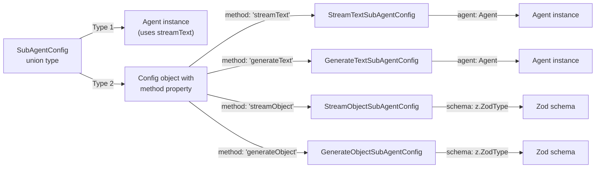
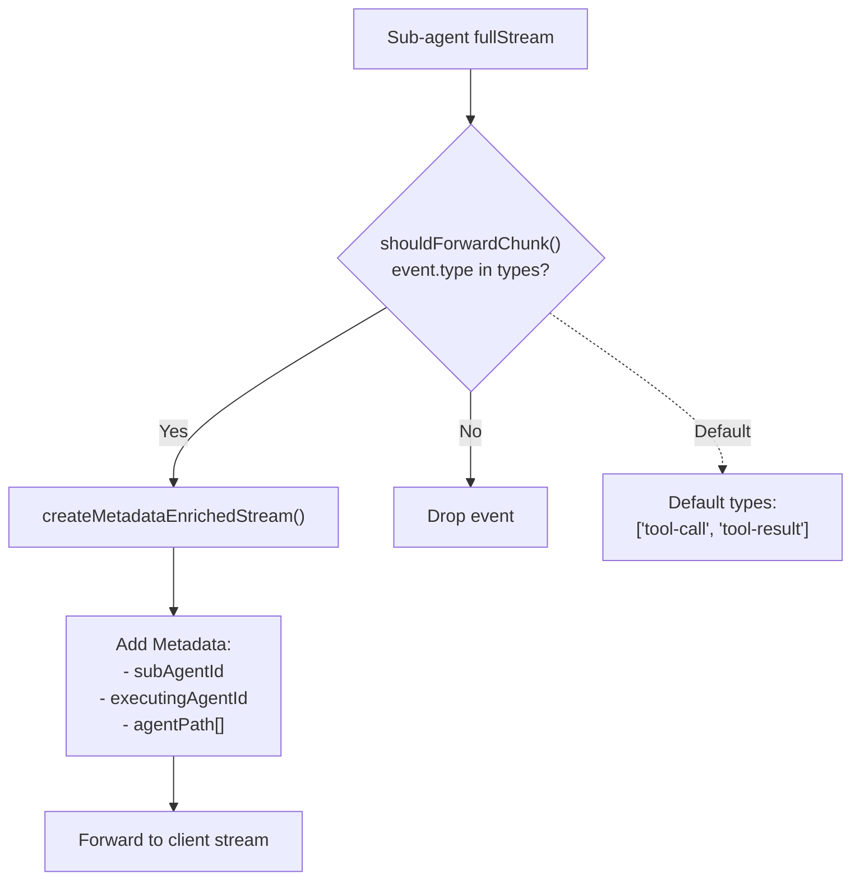

<!-- source: DeepWiki mcp.deepwiki.com · repo VoltAgent/voltagent · page 4 Sub-Agent and Supervisor Patterns · fetched 2026-10-26 -->

# Sub-Agent and Supervisor Patterns

<details>
<summary>Relevant source files</summary>

The following files were used as context for generating this wiki page:

- [examples/with-subagents/src/index.ts](examples/with-subagents/src/index.ts)
- [packages/core/src/agent/index.ts](packages/core/src/agent/index.ts)
- [packages/core/src/agent/providers/base/types.ts](packages/core/src/agent/providers/base/types.ts)
- [packages/core/src/agent/subagent/index.spec.ts](packages/core/src/agent/subagent/index.spec.ts)
- [packages/core/src/agent/subagent/index.ts](packages/core/src/agent/subagent/index.ts)
- [packages/core/src/agent/types.ts](packages/core/src/agent/types.ts)
- [packages/core/src/events/types.ts](packages/core/src/events/types.ts)
- [packages/core/src/index.ts](packages/core/src/index.ts)
- [website/docs/agents/overview.md](website/docs/agents/overview.md)
- [website/docs/agents/subagents.md](website/docs/agents/subagents.md)

</details>


## Purpose and Scope

This document describes VoltAgent's sub-agent architecture, which enables hierarchical agent systems where a supervisor agent coordinates specialized sub-agents to handle specific tasks. The system provides automatic tool generation for delegation, configurable event forwarding, and supervisor behavior customization.

**Related pages:**
- For sub-agent routing and the `delegate_task` tool, see [Sub-Agent Delegation](#4.1)
- For stream enrichment and forwarding, see [Stream Event Forwarding](#4.2)
- For basic agent creation and usage, see [Agent Fundamentals](#2.1)
- For tool creation and execution, see [Tools and Toolkits](#2.3)
- For workflow-based orchestration, see [Workflow System](#3)

---

## Architecture Overview

The sub-agent system is managed by the `SubAgentManager` class, which is instantiated within the `Agent` class when sub-agents are provided in the configuration. It handles the generation of delegation tools, system prompt augmentation, and the execution of handoffs between agents.

### Core Components Diagram

```mermaid
graph TB
    Agent["Agent class"]
    SubAgentManager["SubAgentManager"]
    SubAgentConfigs["subAgents: SubAgentConfig[]"]
    AgentRegistry["AgentRegistry.getInstance()"]
    DelegateTool["delegate_task tool<br/>(auto-generated)"]
    
    Agent -->|"this.subAgentManager"| SubAgentManager [packages/core/src/agent/subagent/index.ts:55-91]
    Agent -->|"options.supervisorConfig"| SupervisorConfig["SupervisorConfig"] [packages/core/src/agent/types.ts:70-70]
    SubAgentManager -->|"this.subAgentConfigs"| SubAgentConfigs [packages/core/src/agent/subagent/index.ts:64-64]
    SubAgentConfigs -->|"Agent instances or configs"| SubAgents["Multiple Sub-Agents"]
    
    SubAgentManager -->|"createDelegateTools()"| DelegateTool [packages/core/src/agent/subagent/index.ts:591-656]
    Agent -->|"prepareExecution()"| DelegateTool [packages/core/src/agent/agent.ts:1000-1082]
    
    SubAgentManager -->|"registerSubAgent()"| AgentRegistry [packages/core/src/registries/agent-registry.ts]
    AgentRegistry -->|"parentToChildren Map"| Relationships["Parent-Child Relationships"]
    
    SubAgentManager -->|"handoffTask()"| SubAgents [packages/core/src/agent/subagent/index.ts:317-589]
    SubAgentManager -->|"generateSupervisorSystemMessage()"| SystemMsg["Enhanced System Instructions"] [packages/core/src/agent/subagent/index.ts:235-307]
    
    SupervisorConfig -->|"configures"| SystemMsg
    SupervisorConfig -->|"fullStreamEventForwarding"| EventForwarding["Stream Event Filtering"] [packages/core/src/agent/subagent/stream-metadata-enricher.ts]
```

**Sources:**
- [packages/core/src/agent/agent.ts:832-934]()
- [packages/core/src/agent/subagent/index.ts:55-135]()
- [packages/core/src/agent/types.ts:151-221]()

---

## Sub-Agent Configuration

Sub-agents can be configured as direct `Agent` instances or via the `createSubagent` helper which allows specifying execution methods (`streamText`, `generateText`, `streamObject`, `generateObject`) and custom options.

### SubAgentConfig Types



**Configuration Examples:**

| Configuration Type | Use Case | Implementation |
|-------------------|----------|--------------|
| **Direct Agent** | Default streaming behavior | `subAgents: [researchAgent]` |
| **StreamText** | Custom streaming options | `createSubagent({ agent: writer, method: "streamText", options: { ... } })` |
| **GenerateText** | Non-streaming completion | `createSubagent({ agent: summary, method: "generateText" })` |
| **StreamObject** | Streaming structured data | `createSubagent({ agent: data, method: "streamObject", schema: mySchema })` |

For details, see [Sub-Agent Delegation](#4.1).

**Sources:**
- [packages/core/src/agent/subagent/types.ts:1-142]()
- [packages/core/src/agent/subagent/index.ts:176-207]()

---

## Supervisor System Message Generation

The `SubAgentManager` automatically enhances the supervisor's system instructions to include a registry of specialized agents. This is handled by `generateSupervisorSystemMessage`.

### Purpose vs. Instructions

VoltAgent distinguishes between what the supervisor sees and how the sub-agent acts:
- **`purpose`**: A concise description used in the supervisor's system prompt to keep it small [website/docs/agents/subagents.md:75-80]().
- **`instructions`**: The full behavior definition used when the sub-agent is actually executing.

### System Message Construction

1. **Specialized Agents**: Lists sub-agents using `extractAgentName()` and `extractAgentPurpose()` [packages/core/src/agent/subagent/index.ts:153-172]().
2. **Guidelines**: Injects default coordination guidelines (e.g., "optimize by contacting multiple agents simultaneously") and `customGuidelines` from `SupervisorConfig` [packages/core/src/agent/subagent/index.ts:250-280]().
3. **Memory**: Optionally appends `agentsMemory` if `includeAgentsMemory` is enabled [packages/core/src/agent/subagent/index.ts:290-305]().

**Sources:**
- [packages/core/src/agent/subagent/index.ts:235-307]()
- [packages/core/src/agent/subagent/index.spec.ts:143-214]()

---

## Event Forwarding and Context Inheritance

When a supervisor delegates a task, it propagates its `OperationContext` to the sub-agent, ensuring consistent `userId`, `conversationId`, and trace IDs. If the supervisor is streaming, sub-agent events can be forwarded to the client.

### Event Forwarding Pipeline



**Key Features:**
- **Metadata Enrichment**: Adds `subAgentId`, `executingAgentId`, and `agentPath` to stream parts [packages/core/src/agent/providers/base/types.ts:87-96]().
- **Context Inheritance**: Propagates `parentAgentId` and `parentOperationContext` to maintain the hierarchy [packages/core/src/agent/subagent/index.ts:393-404]().

For details, see [Stream Event Forwarding](#4.2).

**Sources:**
- [packages/core/src/agent/subagent/stream-metadata-enricher.ts:1-139]()
- [packages/core/src/agent/subagent/index.ts:407-484]()

---

## Error Handling

The supervisor's behavior during sub-agent failures is controlled by `SupervisorConfig`:
- **`throwOnStreamError`**: If `true`, sub-agent errors throw exceptions. If `false` (default), they are captured as error results [packages/core/src/agent/subagent/index.ts:486-589]().
- **`includeErrorInEmptyResponse`**: If no content is generated, the error message is returned as the result string [website/docs/agents/subagents.md:196-200]().

**Sources:**
- [packages/core/src/agent/types.ts:371-386]()
- [website/docs/agents/subagents.md:181-215]()

---

