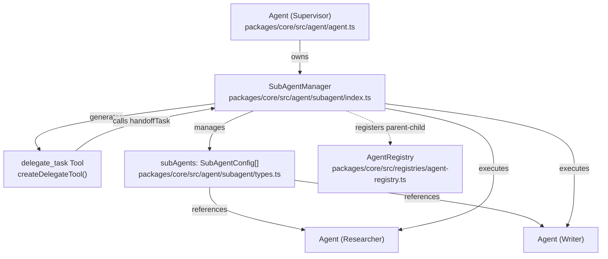
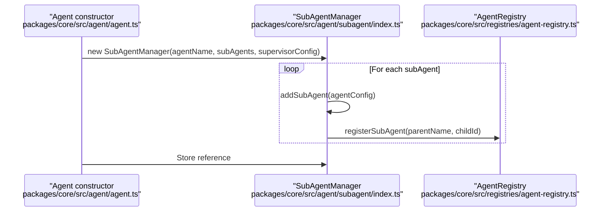
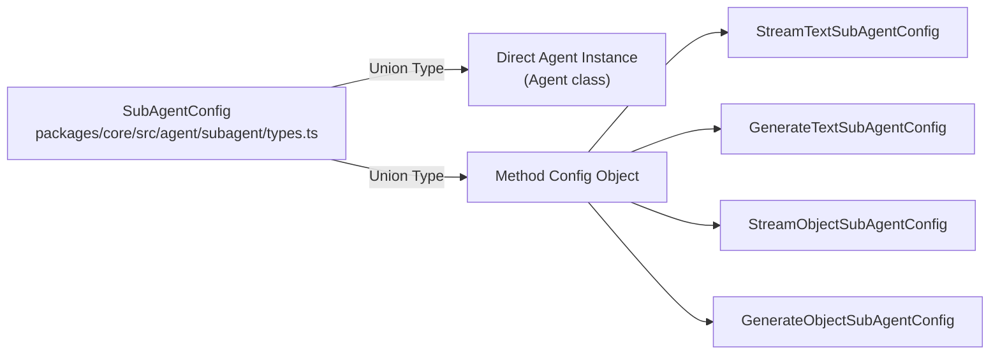
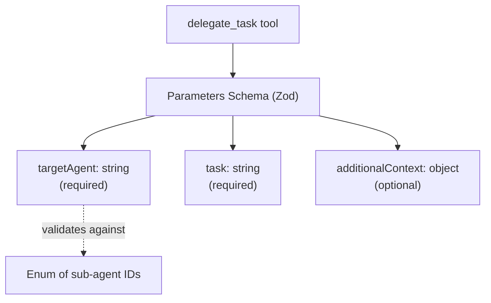
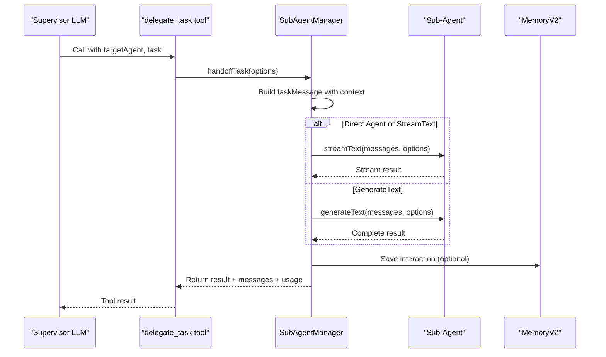

<!-- source: DeepWiki mcp.deepwiki.com · repo VoltAgent/voltagent · page 4.1 Sub-Agent Delegation · fetched 2026-10-26 -->

# Sub-Agent Delegation

<details>
<summary>Relevant source files</summary>

The following files were used as context for generating this wiki page:

- [examples/with-subagents/src/index.ts](examples/with-subagents/src/index.ts)
- [packages/core/src/agent/index.ts](packages/core/src/agent/index.ts)
- [packages/core/src/agent/providers/base/types.ts](packages/core/src/agent/providers/base/types.ts)
- [packages/core/src/agent/subagent/index.spec.ts](packages/core/src/agent/subagent/index.spec.ts)
- [packages/core/src/agent/subagent/index.ts](packages/core/src/agent/subagent/index.ts)
- [packages/core/src/agent/types.ts](packages/core/src/agent/types.ts)
- [packages/core/src/events/types.ts](packages/core/src/events/types.ts)
- [packages/core/src/index.ts](packages/core/src/index.ts)
- [website/docs/agents/overview.md](website/docs/agents/overview.md)
- [website/docs/agents/subagents.md](website/docs/agents/subagents.md)

</details>


This page explains the delegation mechanism that allows supervisor agents to hand off tasks to specialized sub-agents. It covers the `SubAgentManager` class, the `delegate_task` tool, task routing, and the execution flow from delegation to completion.

For information about configuring sub-agents and supervisor behavior patterns, see [Sub-Agent and Supervisor Patterns](#4). For stream event forwarding from sub-agents to parent streams, see [Stream Event Forwarding](#4.2).

## Purpose and Architecture

Sub-agent delegation enables a supervisor agent to coordinate multiple specialized agents by routing tasks based on capability and context. The supervisor receives a `delegate_task` tool that the LLM can call to delegate work, and the `SubAgentManager` handles the execution and result aggregation.

### System Architecture



**Sources:** [packages/core/src/agent/subagent/index.ts:53-128](), [packages/core/src/agent/agent.ts:929-934]()

### Key Components

| Component | Type | Purpose |
|-----------|------|---------|
| `SubAgentManager` | Class | Manages sub-agent lifecycle, delegation, and coordination |
| `delegate_task` | Tool | LLM-callable tool for task delegation |
| `SubAgentConfig` | Type | Configuration for sub-agent method and options |
| `handoffTask` | Method | Executes delegation to a specific sub-agent |
| `AgentRegistry` | Singleton | Tracks parent-child agent relationships |

**Sources:** [packages/core/src/agent/subagent/index.ts:55-91](), [packages/core/src/agent/subagent/types.ts:22-30]()

## SubAgentManager Class

The `SubAgentManager` class is instantiated within the `Agent` constructor when sub-agents are provided. It encapsulates all delegation logic and maintains the relationship between supervisor and sub-agents.

### Initialization



**Sources:** [packages/core/src/agent/agent.ts:929-934](), [packages/core/src/agent/subagent/index.ts:78-91]()

### Core Responsibilities

The `SubAgentManager` handles:

1. **Registration**: Tracks parent-child relationships in `AgentRegistry` for graph traversal [packages/core/src/agent/subagent/index.ts:102-103]().
2. **System Message Generation**: Creates supervisor prompts listing available sub-agents [packages/core/src/agent/subagent/index.ts:231-316]().
3. **Tool Creation**: Generates the `delegate_task` tool with proper schema and execution logic [packages/core/src/agent/subagent/index.ts:505-636]().
4. **Task Routing**: Routes delegation requests to appropriate sub-agents via `handoffTask` [packages/core/src/agent/subagent/index.ts:318-437]().
5. **Result Aggregation**: Collects results, usage, and messages from delegated tasks [packages/core/src/agent/subagent/index.ts:638-706]().

**Sources:** [packages/core/src/agent/subagent/index.ts:54-128]()

### Key Methods

| Method | Signature | Purpose |
|--------|-----------|---------|
| `addSubAgent` | `(agentConfig: SubAgentConfig) => void` | Registers a new sub-agent and updates `AgentRegistry` |
| `removeSubAgent` | `(agentId: string) => void` | Unregisters a sub-agent from the local list and registry |
| `generateSupervisorSystemMessage` | `(baseInstructions, agentsMemory?, config?) => string` | Builds supervisor prompt with `<specialized_agents>` block |
| `createDelegateTool` | `(options) => Tool` | Creates the Zod-validated `delegate_task` tool |
| `handoffTask` | `(options) => Promise<HandoffResult>` | Executes delegation to a specific sub-agent |
| `handoffToMultiple` | `(options) => Promise<HandoffResult[]>` | Executes parallel delegation to multiple sub-agents |

**Sources:** [packages/core/src/agent/subagent/index.ts:95-128](), [packages/core/src/agent/subagent/index.ts:231-316](), [packages/core/src/agent/subagent/index.ts:318-503](), [packages/core/src/agent/subagent/index.ts:505-636]()

## SubAgentConfig Types

Sub-agents can be configured in two ways: direct agent references or explicit method configurations.

### Configuration Types



**Sources:** [packages/core/src/agent/subagent/types.ts:1-200]()

### Direct Agent Configuration

When passing an `Agent` instance directly, `SubAgentManager` uses `streamText` by default [packages/core/src/agent/subagent/index.ts:406-414]():

```typescript
// Direct agent - streamText by default
const researchAgent = new Agent({ 
  name: "Researcher",
  model: "openai/gpt-4o"
});

const supervisor = new Agent({
  subAgents: [researchAgent], // Direct reference
});
```

**Sources:** [packages/core/src/agent/subagent/index.ts:177-179]()

### Method-Specific Configuration

For explicit control over which agent method to use, provide a configuration object:

| Config Type | Method | Use Case |
|------------|--------|----------|
| `StreamTextSubAgentConfig` | `streamText` | Real-time text streaming (default) |
| `GenerateTextSubAgentConfig` | `generateText` | Complete text response at once |
| `StreamObjectSubAgentConfig` | `streamObject` | Streaming structured output |
| `GenerateObjectSubAgentConfig` | `generateObject` | Complete structured response |

**Sources:** [packages/core/src/agent/subagent/types.ts:22-91](), [packages/core/src/agent/subagent/index.ts:418-452]()

### Helper: createSubagent

The `createSubagent` helper function provides type-safe configuration [packages/core/src/agent/subagent/types.ts:93-187]():

```typescript
import { createSubagent } from "@voltagent/core";

const writerConfig = createSubagent({
  agent: writerAgent,
  method: "generateText",
  options: { temperature: 0.8 }
});
```

**Sources:** [packages/core/src/agent/subagent/types.ts:93-187]()

## The delegate_task Tool

The `delegate_task` tool is automatically generated by `SubAgentManager.createDelegateTool` and exposed to the supervisor agent's LLM.

### Tool Schema



**Sources:** [packages/core/src/agent/subagent/index.ts:505-636]()

### Tool Generation

The tool is created in [packages/core/src/agent/subagent/index.ts:505-636]():

1. **Schema Definition**: Uses Zod to define `targetAgent`, `task`, and optional `additionalContext` [packages/core/src/agent/subagent/index.ts:517-531]().
2. **Enum Constraint**: `targetAgent` is constrained to registered sub-agent IDs [packages/core/src/agent/subagent/index.ts:522]().
3. **Description**: Auto-generated with list of available agents and their purposes [packages/core/src/agent/subagent/index.ts:534-546]().
4. **Execute Handler**: Calls `SubAgentManager.handoffTask` with proper context propagation [packages/core/src/agent/subagent/index.ts:548-636]().

**Sources:** [packages/core/src/agent/subagent/index.ts:505-636]()

### Execution Context

When the tool executes, it receives:

| Context Field | Type | Purpose |
|---------------|------|---------|
| `parentToolSpan` | `Span` | OpenTelemetry span for tracing [packages/core/src/agent/subagent/index.ts:555]() |
| `abortSignal` | `AbortSignal` | Cancellation signal [packages/core/src/agent/subagent/index.ts:554]() |
| `context` | `Map` | Operation context from supervisor [packages/core/src/agent/subagent/index.ts:552]() |
| `operationContext` | `OperationContext` | Full operation metadata [packages/core/src/agent/subagent/index.ts:553]() |

The tool propagates these to the sub-agent execution via `baseOptions` in [packages/core/src/agent/subagent/index.ts:393-404]().

**Sources:** [packages/core/src/agent/subagent/index.ts:548-636]()

## Task Handoff Process

The delegation flow from supervisor to sub-agent involves context preparation, method selection, execution, and result aggregation.

### Handoff Sequence



**Sources:** [packages/core/src/agent/subagent/index.ts:318-503]()

### Base Options Propagation

The `baseOptions` object in [packages/core/src/agent/subagent/index.ts:393-404]() ensures context continuity:

```typescript
const baseOptions = {
  conversationId: handoffConversationId,
  userId,
  parentAgentId: sourceAgent?.id || parentAgentId,
  parentHistoryEntryId,
  parentOperationContext,
  context, // User-defined context map
  abortSignal: parentOperationContext?.abortController?.signal,
  maxSteps,
  parentSpan, // OpenTelemetry span from delegate_task tool
};
```

**Sources:** [packages/core/src/agent/subagent/index.ts:393-404]()

### Method Selection Logic

The sub-agent execution method is determined by type guards in `SubAgentManager` [packages/core/src/agent/subagent/index.ts:406-452]():

- `isDirectAgent`: Uses `streamText` [packages/core/src/agent/subagent/index.ts:177]().
- `isStreamTextConfig`: Uses `streamText` [packages/core/src/agent/subagent/index.ts:184]().
- `isGenerateTextConfig`: Uses `generateText` [packages/core/src/agent/subagent/index.ts:191]().
- `isStreamObjectConfig`: Uses `streamObject` [packages/core/src/agent/subagent/index.ts:198]().
- `isGenerateObjectConfig`: Uses `generateObject` [packages/core/src/agent/subagent/index.ts:205]().

**Sources:** [packages/core/src/agent/subagent/index.ts:176-207](), [packages/core/src/agent/subagent/index.ts:406-452]()

## Context and Memory Inheritance

### Context Propagation

The `context` Map flows from supervisor through delegation. Sub-agents can read and modify this shared context [packages/core/src/agent/subagent/index.ts:369-374]().

**Sources:** [packages/core/src/agent/subagent/index.ts:369-374](), [packages/core/src/agent/subagent/index.ts:393-404]()

### Parent Tracking

Each sub-agent execution tracks its lineage through:

| Field | Source | Purpose |
|-------|--------|---------|
| `parentAgentId` | Supervisor agent ID | Identifies parent in traces [packages/core/src/agent/subagent/index.ts:395]() |
| `parentOperationContext` | Supervisor operation context | Access to parent state [packages/core/src/agent/subagent/index.ts:397]() |
| `parentSpan` | Tool execution span | OpenTelemetry trace continuity [packages/core/src/agent/subagent/index.ts:401]() |

**Sources:** [packages/core/src/agent/subagent/index.ts:395-403]()

### Conversation ID Strategy

The `handoffTask` method generates a unique `conversationId` for each delegation unless one is provided [packages/core/src/agent/subagent/index.ts:357]():

```typescript
const handoffConversationId = conversationId || crypto.randomUUID();
```

**Sources:** [packages/core/src/agent/subagent/index.ts:357]()

## Error Handling

Delegation errors are caught and returned as structured results rather than throwing exceptions, unless `supervisorConfig.throwOnStreamError` is enabled [packages/core/src/agent/subagent/index.ts:672-705]().

### Error Capture

```typescript
try {
  // Execute sub-agent
} catch (error) {
  const errorMessage = error instanceof Error ? error.message : String(error);
  const includeErrorMessage = config?.includeErrorInEmptyResponse !== false;
  
  return {
    result: includeErrorMessage 
      ? `Error in delegating task to ${targetAgent.name}: ${errorMessage}`
      : "",
    status: "error",
    error: errorMessage,
  };
}
```

**Sources:** [packages/core/src/agent/subagent/index.ts:672-705]()

---

