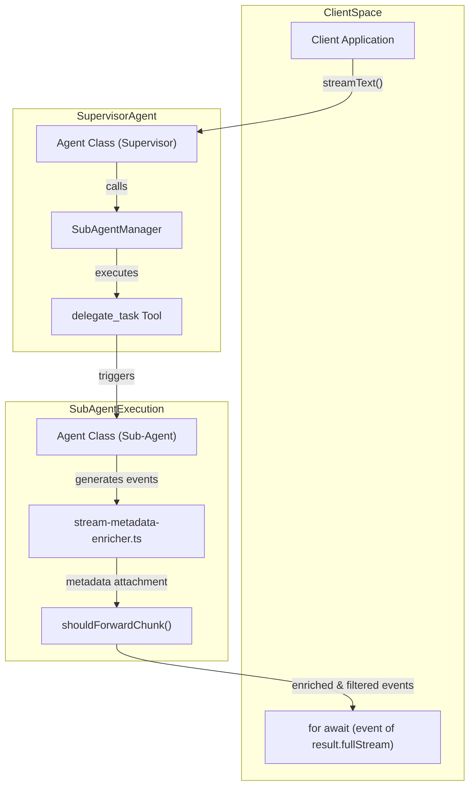
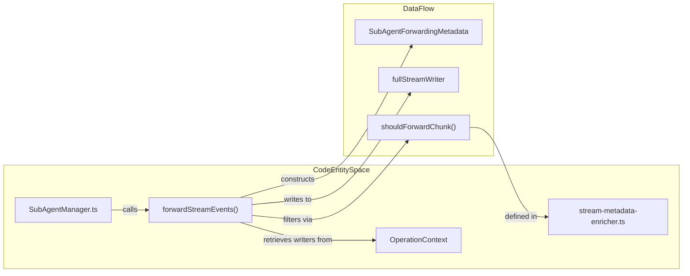

<!-- source: DeepWiki mcp.deepwiki.com · repo VoltAgent/voltagent · page 4.2 Stream Event Forwarding · fetched 2026-10-26 -->

# Stream Event Forwarding

<details>
<summary>Relevant source files</summary>

The following files were used as context for generating this wiki page:

- [examples/with-subagents/src/index.ts](examples/with-subagents/src/index.ts)
- [packages/core/src/agent/index.ts](packages/core/src/agent/index.ts)
- [packages/core/src/agent/providers/base/types.ts](packages/core/src/agent/providers/base/types.ts)
- [packages/core/src/agent/subagent/index.spec.ts](packages/core/src/agent/subagent/index.spec.ts)
- [packages/core/src/agent/subagent/index.ts](packages/core/src/agent/subagent/index.ts)
- [packages/core/src/agent/subagent/stream-metadata-enricher.ts](packages/core/src/agent/subagent/stream-metadata-enricher.ts)
- [packages/core/src/agent/subagent/types.ts](packages/core/src/agent/subagent/types.ts)
- [packages/core/src/agent/types.ts](packages/core/src/agent/types.ts)
- [packages/core/src/events/types.ts](packages/core/src/events/types.ts)
- [packages/core/src/index.ts](packages/core/src/index.ts)
- [packages/core/src/utils/streams/types.ts](packages/core/src/utils/streams/types.ts)
- [packages/core/src/workflow/chain.spec.ts](packages/core/src/workflow/chain.spec.ts)
- [packages/core/src/workflow/chain.ts](packages/core/src/workflow/chain.ts)
- [packages/core/src/workflow/core.spec.ts](packages/core/src/workflow/core.spec.ts)
- [packages/core/src/workflow/core.ts](packages/core/src/workflow/core.ts)
- [packages/core/src/workflow/index.ts](packages/core/src/workflow/index.ts)
- [packages/core/src/workflow/internal/state.ts](packages/core/src/workflow/internal/state.ts)
- [packages/core/src/workflow/registry.ts](packages/core/src/workflow/registry.ts)
- [packages/core/src/workflow/steps/types.ts](packages/core/src/workflow/steps/types.ts)
- [packages/core/src/workflow/stream.spec.ts](packages/core/src/workflow/stream.spec.ts)
- [packages/core/src/workflow/stream.ts](packages/core/src/workflow/stream.ts)
- [packages/core/src/workflow/suspend-resume.spec.ts](packages/core/src/workflow/suspend-resume.spec.ts)
- [packages/core/src/workflow/types.ts](packages/core/src/workflow/types.ts)
- [website/docs/agents/overview.md](website/docs/agents/overview.md)
- [website/docs/agents/subagents.md](website/docs/agents/subagents.md)
- [website/docs/workflows/overview.md](website/docs/workflows/overview.md)
- [website/docs/workflows/streaming.md](website/docs/workflows/streaming.md)
- [website/docs/workflows/suspend-resume.md](website/docs/workflows/suspend-resume.md)

</details>


## Purpose and Scope

Stream Event Forwarding is a filtering and metadata enrichment system that controls how streaming events from sub-agents propagate to supervisor agents and ultimately to client applications. This document covers the configuration, event types, metadata enrichment, and implementation details of stream event forwarding in multi-agent supervisor/sub-agent architectures.

For general information about sub-agents and delegation patterns, see [Sub-Agent Delegation](#4.1). For memory persistence of sub-agent interactions, see [Memory System](#2.4).

## Overview

When a supervisor agent delegates tasks to sub-agents via the `delegate_task` tool, the sub-agent executes and produces streaming events (text deltas, tool calls, tool results, etc.). Stream Event Forwarding determines:

1.  **Which event types** are forwarded from sub-agents to the supervisor's output streams.
2.  **What metadata** is attached to each forwarded event for attribution.
3.  **How events** reach client applications through `fullStream` and `toUIMessageStream()` APIs.

By default, only `tool-call` and `tool-result` events are forwarded to reduce stream noise and token costs. All other event types (including `text-delta`) are filtered unless explicitly configured.

**Sources:** [packages/core/src/agent/types.ts:328-369](), [packages/core/src/agent/subagent/index.ts:36-50]()

## Configuration

### SupervisorConfig

Stream event forwarding is configured through the `supervisorConfig.fullStreamEventForwarding` property when creating a supervisor agent:

```typescript
const supervisor = new Agent({
  name: "Coordinator",
  subAgents: [writerAgent, editorAgent],
  supervisorConfig: {
    fullStreamEventForwarding: {
      types: ['tool-call', 'tool-result', 'text-delta', 'reasoning-delta']
    }
  }
});
```

| Property | Type | Default | Description |
| :--- | :--- | :--- | :--- |
| `types` | `StreamEventType[]` | `['tool-call', 'tool-result']` | Array of event types to forward from sub-agents |

**Sources:** [packages/core/src/agent/types.ts:328-342](), [website/docs/agents/subagents.md:113-159]()

### Default Configuration

When `fullStreamEventForwarding` is omitted or `types` is undefined, the system uses the default configuration within the `SubAgentManager`:

```typescript
// Implicit default
supervisorConfig: {
  fullStreamEventForwarding: {
    types: ['tool-call', 'tool-result']
  }
}
```

This conservative default minimizes stream overhead by forwarding only tool execution events, which are typically the most important for observability.

**Sources:** [packages/core/src/agent/subagent/index.ts:622](), [packages/core/src/agent/subagent/index.ts:650-653]()

## Event Types

### Available StreamEventType Values

The following event types can be forwarded from sub-agents. These correspond to the underlying provider response types:

| Event Type | Category | Description |
| :--- | :--- | :--- |
| `text-delta` | Text | Incremental text chunk |
| `reasoning-start` | Reasoning | Model reasoning begins |
| `reasoning-delta` | Reasoning | Incremental reasoning chunk |
| `reasoning-end` | Reasoning | Model reasoning completes |
| `tool-call` | Tool | Tool invocation with arguments |
| `tool-result` | Tool | Tool execution result |
| `source` | Context | Retrieved context/sources (RAG) |
| `error` | Lifecycle | Stream error |
| `finish` | Lifecycle | Stream completes |

**Sources:** [packages/core/src/agent/types.ts:320-323](), [website/docs/agents/overview.md:82-105]()

### Common Configuration Patterns

```typescript
// Minimal: Only tool events (default)
types: ['tool-call', 'tool-result']

// Text + Tools: Include text generation
types: ['tool-call', 'tool-result', 'text-delta']

// Full Visibility: All events including reasoning
types: [
  'tool-call', 'tool-result', 
  'text-delta', 'reasoning-start', 'reasoning-delta', 'reasoning-end', 
  'source', 'error', 'finish'
]
```

**Sources:** [website/docs/agents/subagents.md:135-157]()

## Metadata Enrichment

### Enriched Event Structure

All forwarded events are enriched with metadata fields that identify the event's origin in the agent hierarchy. This is managed by `SubAgentForwardingMetadata`.

```typescript
interface EnrichedStreamEvent {
  // Original event fields (type, toolName, etc.)
  
  // Enrichment metadata
  subAgentId: string;          // ID of the sub-agent that produced the event
  subAgentName: string;        // Name of the sub-agent
  executingAgentId: string;    // ID of the executing agent
  executingAgentName: string;  // Name of the executing agent
  parentAgentId?: string;      // ID of the supervisor agent
  parentAgentName?: string;    // Name of the supervisor agent
  agentPath: string[];         // Ordered path from supervisor to executing agent
}
```

**Sources:** [packages/core/src/agent/subagent/index.ts:42-50]()

### Metadata Fields

| Field | Type | Description | Example |
| :--- | :--- | :--- | :--- |
| `subAgentId` | `string` | Unique identifier of the sub-agent | `"writer-agent-123"` |
| `subAgentName` | `string` | Display name of the sub-agent | `"Writer Agent"` |
| `executingAgentId` | `string` | ID of the agent currently running | `"writer-agent-123"` |
| `agentPath` | `string[]` | Ordered names from supervisor to sub-agent | `["Coordinator", "Writer Agent"]` |

**Sources:** [packages/core/src/agent/subagent/index.ts:42-50]()

### Diagram: Event Flow and Metadata Enrichment

This diagram maps the flow from sub-agent execution to the client-side `fullStream`.



**Sources:** [packages/core/src/agent/subagent/index.ts:602-680](), [packages/core/src/agent/subagent/stream-metadata-enricher.ts]()

## Implementation Details

### Stream Forwarding Pipeline

The forwarding pipeline consists of three main components executed during sub-agent delegation within `SubAgentManager`.

#### 1. Stream Writer Retrieval

The supervisor's `OperationContext` stores stream writers in `systemContext` for sub-agents to access via `getStreamWriters`.

```typescript
private getStreamWriters(parentOperationContext?: OperationContext) {
  const uiStreamWriter = parentOperationContext?.systemContext?.get("uiStreamWriter");
  const fullStreamWriter = parentOperationContext?.systemContext?.get("fullStreamWriter");
  return { uiStreamWriter, fullStreamWriter };
}
```

**Sources:** [packages/core/src/agent/subagent/index.ts:590-601]()

#### 2. Metadata Construction

When `handoffTask` is called, the `SubAgentManager` builds `SubAgentForwardingMetadata` from the agent context.

```typescript
const forwardingMetadata: SubAgentForwardingMetadata = {
  subAgentId: targetAgent.id,
  subAgentName: targetAgent.name,
  executingAgentId: targetAgent.id,
  executingAgentName: targetAgent.name,
  parentAgentId: agentMetadata?.agentId,
  parentAgentName: agentMetadata?.agentName,
  agentPath: [...(parentPath || []), targetAgent.name]
};
```

**Sources:** [packages/core/src/agent/subagent/index.ts:688-731]()

#### 3. Event Processing

`SubAgentManager` handles two parallel forwarding paths:

*   **UI Stream Path**: Uses `uiStreamWriter.merge()` to combine the sub-agent's UI message stream.
*   **Full Stream Path**: Iterates through `response.fullStream`, checks `shouldForwardChunk`, and writes enriched parts to `fullStreamWriter`.

**Sources:** [packages/core/src/agent/subagent/index.ts:608-680]()

### Diagram: Implementation Architecture

This diagram bridges the conceptual "Forwarding" to the internal classes and functions.



**Sources:** [packages/core/src/agent/subagent/index.ts:590-680](), [packages/core/src/agent/subagent/stream-metadata-enricher.ts]()

### Type Filtering Logic

The `shouldForwardChunk` function determines whether an event should be forwarded based on the allowed types list.

```typescript
export function shouldForwardChunk(
  chunk: VoltAgentTextStreamPart,
  allowedTypes: StreamEventType[]
): boolean {
  return allowedTypes.includes(chunk.type as StreamEventType);
}
```

**Sources:** [packages/core/src/agent/subagent/index.ts:38-39](), [packages/core/src/agent/subagent/index.ts:660]()

## Usage Patterns

### Consuming Enriched Events

Clients can filter and attribute events using the enrichment metadata provided in the stream.

```typescript
const result = await supervisor.streamText("Analyze this data");

for await (const event of result.fullStream) {
  if (event.subAgentId) {
    console.log(`[Sub-Agent: ${event.subAgentName}] Event: ${event.type}`);
    if (event.type === 'text-delta') {
      process.stdout.write(event.textDelta);
    }
  }
}
```

**Sources:** [website/docs/agents/subagents.md:286-310]()

### Integration with Memory Persistence

Sub-agent metadata is persisted alongside conversation messages. The `SUBAGENT_TOOL_CALL_METADATA_KEY` in `OperationContext.systemContext` stores metadata during tool execution, which is then serialized into message records by the `MemoryPersistQueue`.

**Sources:** [packages/core/src/agent/memory-persist-queue.ts:19](), [packages/core/src/agent/subagent/index.ts:19]()

## Error Handling

Stream errors in sub-agents are subject to the same forwarding rules. To see sub-agent errors in the supervisor's stream, `error` must be included in the `types` array.

```typescript
supervisorConfig: {
  fullStreamEventForwarding: {
    types: ['tool-call', 'tool-result', 'error']
  }
}
```

**Sources:** [website/docs/agents/subagents.md:162-248]()

---

