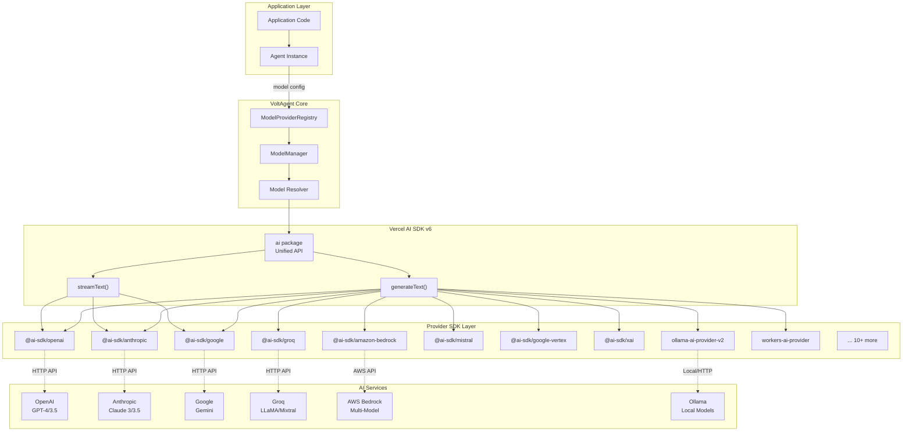
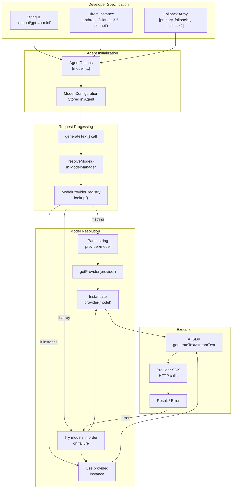
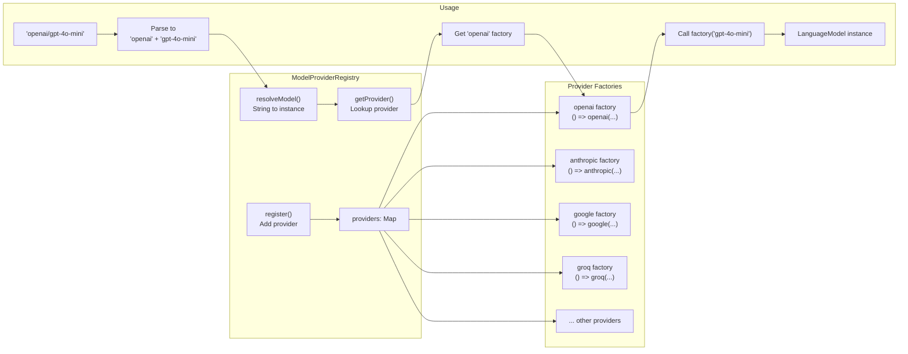
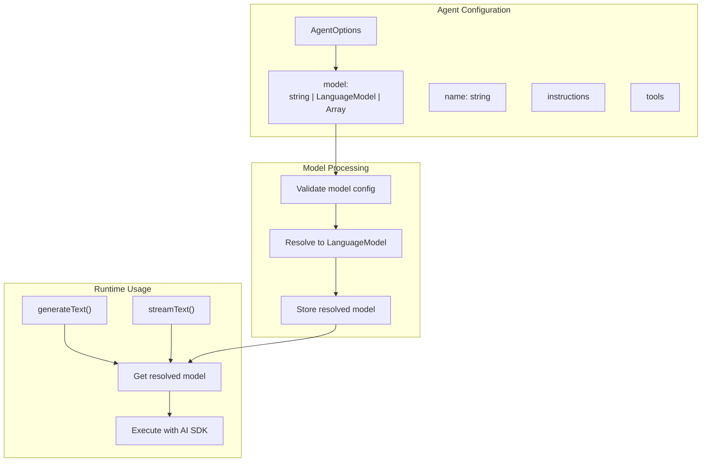

<!-- source: DeepWiki mcp.deepwiki.com · repo VoltAgent/voltagent · page 5 AI Provider Integration · fetched 2026-10-26 -->

# AI Provider Integration

<details>
<summary>Relevant source files</summary>

The following files were used as context for generating this wiki page:

- [examples/with-google-ai/package.json](examples/with-google-ai/package.json)
- [examples/with-google-vertex-ai/package.json](examples/with-google-vertex-ai/package.json)
- [examples/with-groq-ai/package.json](examples/with-groq-ai/package.json)
- [examples/with-mcp/package.json](examples/with-mcp/package.json)
- [examples/with-nextjs/package.json](examples/with-nextjs/package.json)
- [packages/core/package.json](packages/core/package.json)
- [packages/core/src/agent/agent.spec-d.ts](packages/core/src/agent/agent.spec-d.ts)
- [packages/core/src/agent/agent.spec.ts](packages/core/src/agent/agent.spec.ts)
- [packages/core/src/agent/agent.ts](packages/core/src/agent/agent.ts)
- [packages/core/src/agent/hooks/index.spec.ts](packages/core/src/agent/hooks/index.spec.ts)
- [packages/core/src/agent/hooks/index.ts](packages/core/src/agent/hooks/index.ts)
- [packages/server-core/src/handlers/agent.handlers.spec.ts](packages/server-core/src/handlers/agent.handlers.spec.ts)
- [packages/server-core/src/handlers/agent.handlers.ts](packages/server-core/src/handlers/agent.handlers.ts)
- [packages/server-core/src/schemas/agent.schemas.spec.ts](packages/server-core/src/schemas/agent.schemas.spec.ts)
- [packages/server-core/src/schemas/agent.schemas.ts](packages/server-core/src/schemas/agent.schemas.ts)
- [packages/server-core/src/utils/options.ts](packages/server-core/src/utils/options.ts)
- [packages/server-elysia/src/routes/agent.routes.ts](packages/server-elysia/src/routes/agent.routes.ts)
- [pnpm-lock.yaml](pnpm-lock.yaml)
- [website/docs/agents/context.md](website/docs/agents/context.md)
- [website/docs/agents/hooks.md](website/docs/agents/hooks.md)
- [website/docs/agents/prompts.md](website/docs/agents/prompts.md)
- [website/docs/agents/tools.md](website/docs/agents/tools.md)
- [website/docs/api/endpoints/agents.md](website/docs/api/endpoints/agents.md)
- [website/docs/ui/ai-sdk-integration.md](website/docs/ui/ai-sdk-integration.md)

</details>


This document describes VoltAgent's multi-provider AI integration architecture, which enables agents to work with 20+ AI providers through a unified interface. The system abstracts away provider-specific details through the `ModelProviderRegistry` and Vercel AI SDK v6, allowing developers to switch between providers with minimal code changes.

For detailed listings of all supported providers and their capabilities, see [Supported Providers](#5.1). For information about configuring model fallback arrays and retry strategies, see [Model Fallback and Retry](#5.2). For details on how VoltAgent builds upon Vercel AI SDK v6, see [Vercel AI SDK Integration](#5.3).

---

## Architecture Overview

VoltAgent's provider integration uses a layered architecture that decouples application code from provider-specific implementations. The `ModelProviderRegistry` serves as the central abstraction layer, translating model identifiers and instances into executable AI SDK calls.

### Provider Integration Layers



**Sources:** [packages/core/package.json:5-49](), [packages/core/src/registries/model-provider-registry.ts:61-61](), [pnpm-lock.yaml:113-136]()

---

## Model Specification Methods

VoltAgent provides three distinct methods for specifying which AI model an agent should use. Each method serves different use cases and provides varying levels of control.

### Method 1: String Identifier

The simplest approach uses string identifiers that follow the format `"provider/model-name"`. The `ModelProviderRegistry` resolves these strings to actual provider instances.

```typescript
// String identifier format
const agent = new Agent({
  name: "assistant",
  model: "openai/gpt-4o-mini",
  instructions: "You are a helpful assistant"
});
```

Common string identifiers include:
- `"openai/gpt-4o"` - OpenAI GPT-4 Optimized
- `"openai/gpt-4o-mini"` - OpenAI GPT-4 Mini
- `"anthropic/claude-3-5-sonnet-20241022"` - Anthropic Claude 3.5 Sonnet
- `"google/gemini-2.0-flash-exp"` - Google Gemini 2.0 Flash
- `"groq/llama-3.3-70b-versatile"` - Groq LLaMA 3.3

### Method 2: Direct Provider Instance

For more control over provider configuration (API keys, base URLs, headers), instantiate provider SDKs directly:

```typescript
import { anthropic } from '@ai-sdk/anthropic';
import { openai } from '@ai-sdk/openai';

const agent = new Agent({
  name: "assistant",
  model: anthropic('claude-3-5-sonnet-20241022', {
    apiKey: process.env.ANTHROPIC_API_KEY,
    headers: { 'X-Custom-Header': 'value' }
  }),
  instructions: "You are a helpful assistant"
});
```

### Method 3: Fallback Array

For production resilience, specify an array of models that the agent will try in sequence if earlier models fail:

```typescript
import { openai } from '@ai-sdk/openai';
import { anthropic } from '@ai-sdk/anthropic';

const agent = new Agent({
  name: "assistant",
  model: [
    openai('gpt-4o'),           // Primary model
    openai('gpt-4o-mini'),      // Fallback 1
    anthropic('claude-3-5-sonnet-20241022')  // Fallback 2
  ],
  instructions: "You are a helpful assistant"
});
```

See [Model Fallback and Retry](#5.2) for detailed fallback behavior and retry configuration.

**Sources:** [packages/core/src/agent/agent.ts:192-194](), [packages/core/src/agent/agent.spec-d.ts:80-88](), [packages/core/src/agent/agent.spec-d.ts:220-238]()

---

## Model Specification Flow

This diagram shows how different model specification methods flow through the `ModelProviderRegistry` to ultimately invoke AI provider APIs.



**Sources:** [packages/core/src/agent/agent.ts:60-61](), [packages/core/src/agent/agent.spec.ts:101-102](), [packages/core/src/agent/agent.spec.ts:231-235]()

---

## Provider SDK Dependencies

VoltAgent Core bundles provider SDKs as direct dependencies, allowing string-based model references without requiring developers to install provider packages separately.

### Core Provider Dependencies

The following table lists the primary provider SDK packages included in `@voltagent/core`:

| Provider SDK Package | Provider | Example Models | Dependency Type |
|---------------------|----------|----------------|-----------------|
| `@ai-sdk/openai` | OpenAI | gpt-4o, gpt-4o-mini | Direct |
| `@ai-sdk/anthropic` | Anthropic | claude-3-5-sonnet | Direct |
| `@ai-sdk/google` | Google AI | gemini-2.0-flash | Direct |
| `@ai-sdk/google-vertex` | Google Vertex AI | gemini-1.5-pro | Direct |
| `@ai-sdk/amazon-bedrock` | AWS Bedrock | Multiple AWS models | Direct |
| `@ai-sdk/groq` | Groq | llama-3.3-70b | Direct |
| `@ai-sdk/mistral` | Mistral AI | mistral-large | Direct |
| `@ai-sdk/xai` | xAI | grok-beta | Direct |
| `@ai-sdk/azure` | Azure OpenAI | Azure-hosted OpenAI | Direct |
| `@ai-sdk/cerebras` | Cerebras | llama-3.1-70b | Direct |
| `@ai-sdk/cohere` | Cohere | command-r | Direct |
| `@ai-sdk/perplexity` | Perplexity | sonar-small | Direct |
| `@ai-sdk/togetherai` | Together AI | Various open models | Direct |
| `@ai-sdk/vercel` | Vercel AI | Vercel-hosted models | Direct |
| `@ai-sdk/gateway` | Gateway | Custom gateway routing | Direct |
| `@ai-sdk/openai-compatible` | OpenAI Compatible | Custom endpoints | Direct |
| `@ai-sdk/deepinfra` | DeepInfra | Various hosted models | Direct |
| `ollama-ai-provider-v2` | Ollama | Local models | Direct |
| `workers-ai-provider` | Cloudflare Workers AI | Edge models | Direct |

**Sources:** [packages/core/package.json:6-22](), [packages/core/package.json:43-47]()

---

## Example: Multi-Provider Agent Configuration

This example demonstrates how to configure an agent that can use different providers based on runtime conditions or as fallbacks.

### String-Based Configuration

```typescript
// From examples/base
import { Agent } from '@voltagent/core';

const agent = new Agent({
  name: "base-assistant",
  model: "openai/gpt-4o-mini",
  instructions: "You are a helpful assistant"
});
```

### Provider-Specific Examples

```typescript
// Google AI - examples/with-google-ai
const googleAgent = new Agent({
  name: "gemini-assistant",
  model: "google/gemini-2.0-flash-exp",
  instructions: "You are a helpful assistant"
});

// Groq - examples/with-groq-ai
const groqAgent = new Agent({
  name: "groq-assistant",
  model: "groq/llama-3.3-70b-versatile",
  instructions: "You are a helpful assistant"
});
```

**Sources:** [examples/base/package.json:113-131](), [examples/with-google-ai/package.json:4-12](), [examples/with-groq-ai/package.json:4-12]()

---

## Provider Authentication

Each provider requires appropriate authentication credentials, typically provided through environment variables. The `ModelProviderRegistry` passes these to provider SDKs when instantiating models.

### Common Authentication Patterns

| Provider | Environment Variable | Example Value |
|----------|---------------------|---------------|
| OpenAI | `OPENAI_API_KEY` | `sk-...` |
| Anthropic | `ANTHROPIC_API_KEY` | `sk-ant-...` |
| Google AI | `GOOGLE_GENERATIVE_AI_API_KEY` | `AIza...` |
| Groq | `GROQ_API_KEY` | `gsk_...` |

**Sources:** [examples/with-google-ai/package.json:32-32](), [examples/with-groq-ai/package.json:32-32](), [examples/with-nextjs/package.json:43-43]()

---

## Model Provider Registry Implementation

The `ModelProviderRegistry` serves as the central registry for all AI providers. It maintains a mapping of provider names to their SDK functions and handles model resolution at runtime.

### Registry Structure



**Sources:** [packages/core/src/agent/agent.ts:61-61](), [packages/core/src/agent/agent.spec.ts:15-15](), [packages/core/package.json:99-99]()

---

## Integration with Agent System

Agents consume the provider integration layer through their `model` configuration option. The integration is transparent to agent logic, allowing the same agent code to work with any provider.

### Agent Model Configuration



### Model Configuration in Agent Lifecycle

During agent initialization:
1. Agent constructor receives `model` in `AgentOptions` [packages/core/src/agent/agent.ts:192-194]()
2. Model configuration is validated for type and structure [packages/core/src/agent/agent.spec-d.ts:90-106]()
3. String models are resolved via `ModelProviderRegistry` [packages/core/src/agent/agent.ts:61-61]()
4. Resolved model instances are stored for runtime use [packages/core/src/agent/agent.spec.ts:129-129]()

During agent execution:
1. `generateText()` or `streamText()` retrieves resolved model [packages/core/src/agent/agent.spec.ts:231-235]()
2. Model instance is passed to AI SDK methods [packages/core/src/agent/agent.ts:41-47]()
3. Provider SDK executes API calls
4. Results flow back through the layers to agent [packages/core/src/agent/agent.spec.ts:172-195]()

**Sources:** [packages/core/src/agent/agent.ts:41-47](), [packages/core/src/agent/agent.ts:192-194](), [packages/core/src/agent/agent.spec.ts:129-129](), [packages/core/src/agent/agent.spec.ts:231-235]()

---

