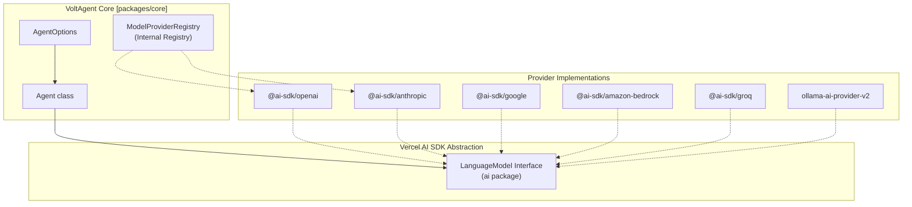
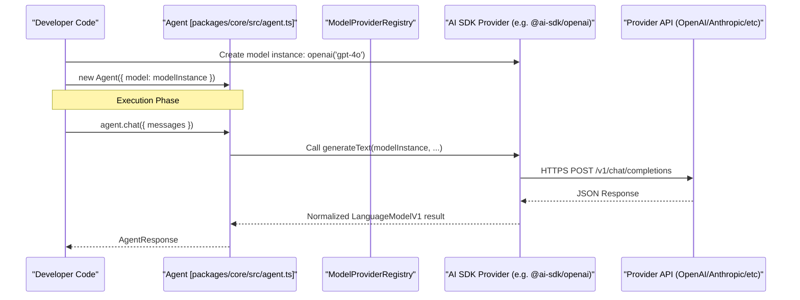

<!-- source: DeepWiki mcp.deepwiki.com · repo VoltAgent/voltagent · page 5.1 Supported Providers · fetched 2026-10-26 -->

# Supported Providers

<details>
<summary>Relevant source files</summary>

The following files were used as context for generating this wiki page:

- [examples/with-amazon-bedrock/package.json](examples/with-amazon-bedrock/package.json)
- [examples/with-anthropic/package.json](examples/with-anthropic/package.json)
- [examples/with-google-ai/package.json](examples/with-google-ai/package.json)
- [examples/with-google-vertex-ai/package.json](examples/with-google-vertex-ai/package.json)
- [examples/with-groq-ai/package.json](examples/with-groq-ai/package.json)
- [examples/with-mcp/package.json](examples/with-mcp/package.json)
- [examples/with-nextjs/package.json](examples/with-nextjs/package.json)
- [examples/with-ollama/package.json](examples/with-ollama/package.json)
- [packages/core/package.json](packages/core/package.json)
- [pnpm-lock.yaml](pnpm-lock.yaml)

</details>


This document catalogs the AI model providers supported by VoltAgent and explains how provider integration works through the Vercel AI SDK abstraction layer and the internal `ModelProviderRegistry`.

## Overview

VoltAgent does not implement its own LLM client libraries. Instead, it leverages the [Vercel AI SDK](https://sdk.vercel.ai) to provide a unified interface across multiple model providers. This design allows VoltAgent to support any provider that implements the AI SDK's `LanguageModel` interface.

The `Agent` class accepts a `model` parameter that expects an AI SDK-compatible language model instance. Provider-specific features (like prompt caching or specialized tool formats) are handled by the AI SDK provider packages.

**Sources**: [packages/core/package.json:6-23](), [packages/core/package.json:82-83]()

## Provider Integration Architecture

VoltAgent's architecture bridges the high-level agent configuration with the specific SDK implementations provided by the AI community.



**Architecture: VoltAgent uses AI SDK's provider abstraction**

The framework includes a `ModelProviderRegistry` which is used by the CLI and internal tools to manage the vast array of supported providers. This registry is often generated or updated via internal scripts.

**Sources**: [packages/core/package.json:99-99](), [packages/core/package.json:5-23]()

## Configuration and Data Flow

When a developer instantiates an `Agent`, the `LanguageModel` instance is passed into the `AgentOptions`. During execution (e.g., calling `agent.chat()`), VoltAgent delegates the actual LLM call to the AI SDK's `generateText` or `streamText` functions.



**Flow: Provider model instances are stored in Agent and invoked by AI SDK**

**Sources**: [examples/base/src/index.ts:113-136](), [packages/core/package.json:82-83]()

## Supported Providers List

VoltAgent supports a wide range of providers out-of-the-box through its dependency on the AI SDK ecosystem.

| Provider | AI SDK Package | Dependency Location |
| :--- | :--- | :--- |
| **OpenAI** | `@ai-sdk/openai` | [packages/core/package.json:17]() |
| **Anthropic** | `@ai-sdk/anthropic` | [packages/core/package.json:7]() |
| **Google Generative AI** | `@ai-sdk/google` | [packages/core/package.json:13]() |
| **Google Vertex AI** | `@ai-sdk/google-vertex` | [packages/core/package.json:14]() |
| **Amazon Bedrock** | `@ai-sdk/amazon-bedrock` | [packages/core/package.json:6]() |
| **Groq** | `@ai-sdk/groq` | [packages/core/package.json:15]() |
| **Mistral** | `@ai-sdk/mistral` | [packages/core/package.json:16]() |
| **Azure OpenAI** | `@ai-sdk/azure` | [packages/core/package.json:8]() |
| **Ollama (Local)** | `ollama-ai-provider-v2` | [packages/core/package.json:43]() |
| **Cerebras** | `@ai-sdk/cerebras` | [packages/core/package.json:9]() |
| **Cohere** | `@ai-sdk/cohere` | [packages/core/package.json:10]() |
| **DeepInfra** | `@ai-sdk/deepinfra` | [packages/core/package.json:11]() |
| **Perplexity** | `@ai-sdk/perplexity` | [packages/core/package.json:19]() |
| **Together AI** | `@ai-sdk/togetherai` | [packages/core/package.json:20]() |
| **xAI (Grok)** | `@ai-sdk/xai` | [packages/core/package.json:22]() |
| **Cloudflare Workers AI**| `workers-ai-provider` | [packages/core/package.json:47]() |

**Sources**: [packages/core/package.json:5-49]()

## Detailed Provider Implementation

### OpenAI & Azure
OpenAI is the primary reference implementation for most VoltAgent features. It supports advanced capabilities like structured output and tool calling natively.

```typescript
import { openai } from "@ai-sdk/openai";
import { Agent } from "@voltagent/core";

const agent = new Agent({
  model: openai("gpt-4o"),
  // ...
});
```
**Sources**: [examples/base/package.json:113-115](), [examples/with-nextjs/package.json:13-13]()

### Anthropic
Anthropic's Claude models are supported via `@ai-sdk/anthropic`. These are frequently used for complex reasoning tasks in VoltAgent workflows.

```typescript
import { anthropic } from "@ai-sdk/anthropic";
const agent = new Agent({
  model: anthropic("claude-3-5-sonnet-20240620"),
});
```
**Sources**: [examples/with-anthropic/package.json:4-12]()

### Google (AI & Vertex)
VoltAgent supports both the standard Google AI (Gemini) and the enterprise-grade Vertex AI.

*   **Google AI**: Uses `GOOGLE_GENERATIVE_AI_API_KEY`.
*   **Vertex AI**: Requires GCP project configuration.

**Sources**: [examples/with-google-ai/package.json:4-12](), [examples/with-google-vertex-ai/package.json:4-12]()

### Amazon Bedrock
Bedrock support allows running models like Claude or Llama within AWS infrastructure. It is configured using the `@ai-sdk/amazon-bedrock` provider.

**Sources**: [examples/with-amazon-bedrock/package.json:4-12]()

### Local & Open Source (Ollama & Groq)
For local development or high-performance open-source inference:
*   **Ollama**: Used for local LLM execution.
*   **Groq**: Used for low-latency inference of Llama 3, Mixtral, and Gemma models.

**Sources**: [examples/with-ollama/package.json:3-11](), [examples/with-groq-ai/package.json:4-12]()

## Integration with create-voltagent-app

The CLI tool `create-voltagent-app` automates the selection and configuration of these providers during project initialization. It generates the necessary environment variable templates and boilerplate code based on the user's choice.

**Sources**: [packages/core/package.json:99-99](), [examples/with-nextjs/package.json:8-12]()

## Provider-Specific Tools

VoltAgent supports "Provider-Defined Tools" where the LLM provider itself handles the tool execution (e.g., OpenAI's web search or code interpreter). These are passed through the `tools` array in the `Agent` configuration.

**Sources**: [packages/core/package.json:29](), [packages/core/package.json:56-58]()

---

