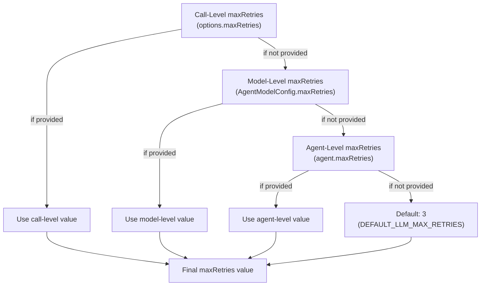
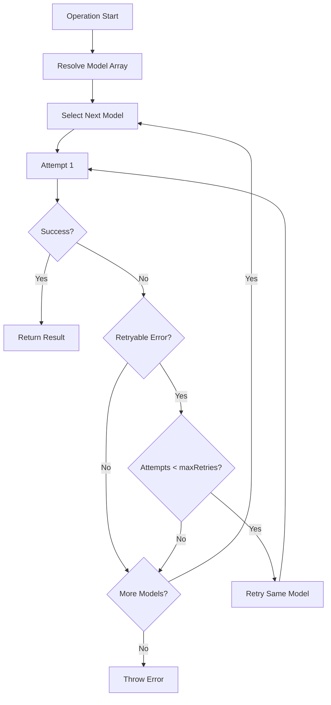
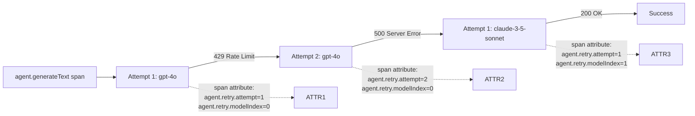

<!-- source: DeepWiki mcp.deepwiki.com · repo VoltAgent/voltagent · page 5.2 Model Fallback and Retry · fetched 2026-10-26 -->

# Model Fallback and Retry

<details>
<summary>Relevant source files</summary>

The following files were used as context for generating this wiki page:

- [examples/with-middleware/package.json](examples/with-middleware/package.json)
- [examples/with-retries-fallback/package.json](examples/with-retries-fallback/package.json)
- [examples/with-subagents/src/index.ts](examples/with-subagents/src/index.ts)
- [packages/core/src/agent/index.ts](packages/core/src/agent/index.ts)
- [packages/core/src/agent/providers/base/types.ts](packages/core/src/agent/providers/base/types.ts)
- [packages/core/src/agent/subagent/index.spec.ts](packages/core/src/agent/subagent/index.spec.ts)
- [packages/core/src/agent/subagent/index.ts](packages/core/src/agent/subagent/index.ts)
- [packages/core/src/agent/types.ts](packages/core/src/agent/types.ts)
- [packages/core/src/events/types.ts](packages/core/src/events/types.ts)
- [packages/core/src/index.ts](packages/core/src/index.ts)
- [website/docs/agents/overview.md](website/docs/agents/overview.md)
- [website/docs/agents/subagents.md](website/docs/agents/subagents.md)

</details>


This page documents VoltAgent's model fallback and retry mechanisms, which provide resilience and flexibility when calling language models. These features allow agents to automatically retry failed requests and fall back to alternative models when primary models are unavailable or exceed retry limits.

---

## Overview

VoltAgent provides three levels of resilience for model calls:

1.  **Retry Logic**: Automatically retries failed requests to the same model.
2.  **Model Fallback**: Switches to alternative models when retries are exhausted.
3.  **Error Classification**: Distinguishes between retryable and non-retryable errors.

These mechanisms work together to maximize success rates while minimizing unnecessary retries and costs.

**Sources:** [packages/core/src/agent/agent.ts:657](), [packages/core/src/agent/types.ts:241-265]()

---

## Model Configuration Options

### Single Model Configuration

The simplest configuration uses a single model reference:

```typescript
const agent = new Agent({
  name: "assistant",
  model: "openai/gpt-4o-mini",
  instructions: "Answer questions",
  maxRetries: 3, // Agent-level retry count
});
```

**Sources:** [packages/core/src/agent/types.ts:265](), [packages/core/src/agent/agent.ts:850]()

### Fallback Array Configuration

For production resilience, configure multiple models with independent retry counts using an array of `AgentModelConfig` objects [packages/core/src/agent/types.ts:241-260]().

```typescript
const agent = new Agent({
  name: "resilient-assistant",
  instructions: "Answer questions",
  model: [
    {
      id: "primary",
      model: "openai/gpt-4o",
      maxRetries: 2,
      enabled: true,
    },
    {
      id: "fallback-1",
      model: "anthropic/claude-3-5-sonnet",
      maxRetries: 2,
      enabled: true,
    },
    {
      id: "fallback-2",
      model: "openai/gpt-4o-mini",
      maxRetries: 1,
      enabled: true,
    },
  ],
  maxRetries: 3, // Default if model entry doesn't specify
});
```

Each `AgentModelConfig` entry supports:

| Field | Type | Default | Description |
| :--- | :--- | :--- | :--- |
| `id` | `string` | undefined | Optional identifier for logging |
| `model` | `AgentModelReference` | required | Model reference (string or LanguageModel) |
| `maxRetries` | `number` | agent.maxRetries | Maximum retries before fallback |
| `enabled` | `boolean` | true | Whether this model is available |

**Sources:** [packages/core/src/agent/types.ts:241-260]()

### Dynamic Model Configuration

Models can be resolved dynamically using a `ModelDynamicValue` function [packages/core/src/agent/types.ts:231-232]():

```typescript
const agent = new Agent({
  name: "dynamic-assistant",
  instructions: "Answer questions",
  model: async ({ context }) => {
    const tier = context.get("userTier");
    if (tier === "premium") {
      return "openai/gpt-4o";
    }
    return "openai/gpt-4o-mini";
  },
});
```

Dynamic model values are resolved once per operation. To use dynamic values with fallback arrays, wrap the entire array in a function.

**Sources:** [packages/core/src/agent/types.ts:231-232]()

---

## Retry Configuration Hierarchy

The system resolves the maximum number of retries for a specific model call by following a strict hierarchy.

Title: Retry Configuration Resolution Order


### Priority Levels

1.  **Call-Level** (highest priority): Override for a single operation via `GenerateTextOptions` or `StreamTextOptions`.
2.  **Model-Level**: Per-model retry count defined in the `AgentModelConfig` fallback array.
3.  **Agent-Level**: Default retry count defined in `AgentOptions`.
4.  **System Default**: 3 retries defined by `DEFAULT_LLM_MAX_RETRIES`.

**Sources:** [packages/core/src/agent/agent.ts:850](), [packages/core/src/agent/agent.ts:657](), [packages/core/src/agent/types.ts:241-260]()

---

## Fallback Execution Flow

Title: Model Fallback and Retry Execution Flow


### Execution Logic

1.  **Model Selection**: Iterate through enabled models in array order.
2.  **Retry Phase**: For each model, attempt up to `maxRetries` times.
3.  **Fallback Decision**: After exhausting retries, move to the next model in the fallback list.
4.  **Error Propagation**: If all models fail, throw the last encountered `VoltAgentError`.

**Sources:** [packages/core/src/agent/agent.ts:1000-1100](), [packages/core/src/agent/types.ts:25]()

---

## Error Classification

VoltAgent distinguishes between retryable and non-retryable errors to avoid wasting retries on permanent failures.

### Retryable Errors

These errors are transient and may succeed on retry:

| Error Type | HTTP Status | Description |
| :--- | :--- | :--- |
| Rate Limit | 429 | API rate limit exceeded |
| Server Error | 500-599 | Temporary server issues |
| Timeout | - | Request timeout |
| Network Error | - | Connection failures |

### Non-Retryable Errors

These errors are permanent and skip to fallback immediately:

| Error Type | HTTP Status | Description |
| :--- | :--- | :--- |
| Authentication | 401 | Invalid API key |
| Authorization | 403 | Insufficient permissions |
| Invalid Request | 400 | Malformed request |
| Not Found | 404 | Resource doesn't exist |
| Content Filter | 422 | Content policy violation |

The internal utility `isClientHTTPError()` checks for non-retryable HTTP status codes to facilitate this logic.

**Sources:** [packages/core/src/agent/agent.ts:98](), [packages/core/src/agent/types.ts:25]()

---

## Retry Hooks and Observability

### OnRetry Hook

The `onRetry` hook defined in `AgentHooks` provides visibility into retry attempts [packages/core/src/agent/hooks/index.ts:142-160]().

```typescript
const agent = new Agent({
  name: "monitored-agent",
  model: [
    { id: "primary", model: "openai/gpt-4o", maxRetries: 2 },
    { id: "fallback", model: "anthropic/claude-3-5-sonnet", maxRetries: 2 },
  ],
  hooks: {
    onRetry: async (args) => {
      if (args.source === "llm") {
        console.log(`[Retry] Model: ${args.modelName}`);
        console.log(`[Retry] Attempt: ${args.attempt}/${args.maxRetries}`);
        console.log(`[Retry] Error: ${args.error}`);
      }
    },
  },
});
```

**Hook Parameters:**

| Field | Type | Description |
| :--- | :--- | :--- |
| `source` | `"llm" \| "middleware"` | Retry source |
| `modelName` | `string` | Current model identifier |
| `modelIndex` | `number` | Position in fallback array |
| `attempt` | `number` | Current attempt number (1-based) |
| `maxRetries` | `number` | Maximum allowed retries |
| `error` | `unknown` | Error that triggered retry |
| `isRetryable` | `boolean` | Whether error is retryable |

**Sources:** [packages/core/src/agent/hooks/index.ts:142-160]()

---

## OpenTelemetry Integration

Retry and fallback events are automatically traced using OpenTelemetry.

Title: OpenTelemetry Span Attributes for Retry and Fallback


Span attributes recorded include `agent.model.name`, `agent.model.index`, and `agent.retry.attempt`.

**Sources:** [packages/core/src/agent/open-telemetry/trace-context.ts]()

---

## Configuration Reference

### AgentModelConfig Interface

```typescript
export type AgentModelConfig = {
  id?: string;
  model: ModelDynamicValue<AgentModelReference>;
  maxRetries?: number;
  enabled?: boolean;
};
```

**Sources:** [packages/core/src/agent/types.ts:241-260]()

### AgentOptions.model Field

```typescript
export type AgentModelValue = 
  | ModelDynamicValue<AgentModelReference>
  | AgentModelConfig[];
```

**Sources:** [packages/core/src/agent/types.ts:265]()

### Default Constants

- `DEFAULT_LLM_MAX_RETRIES`: 3 [packages/core/src/agent/agent.ts:657]()

---

## Related Features

- **[Supported Providers](#5.1)**: Complete list of available AI providers and models.
- **[Lifecycle Hooks](#2.6)**: Documentation for `AgentHooks` including retry interception.
- **[VoltOps Platform](#9)**: Telemetry and observability for tracking model performance.

**Sources:** [packages/core/src/agent/agent.ts](), [packages/core/src/agent/types.ts]()

---

