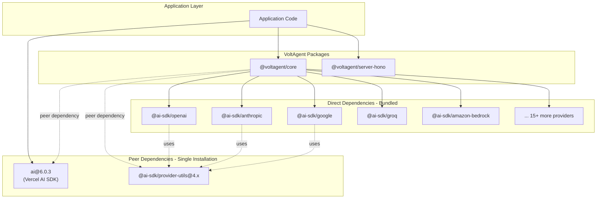
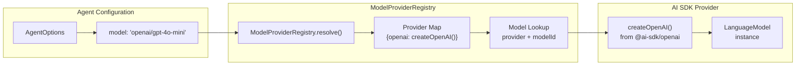
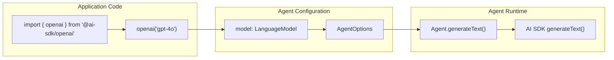
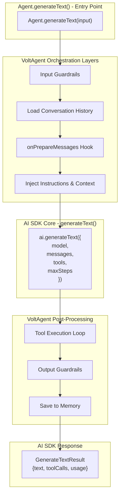
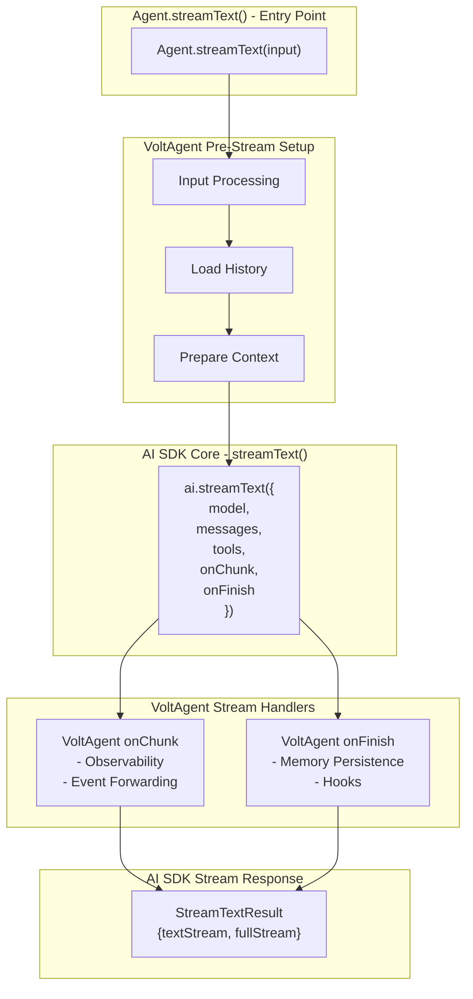
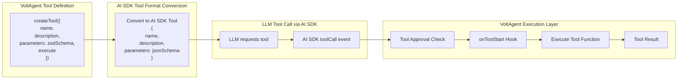
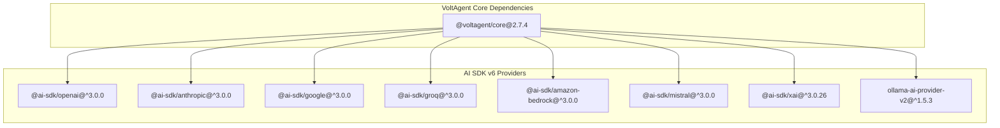

<!-- source: DeepWiki mcp.deepwiki.com · repo VoltAgent/voltagent · page 5.3 Vercel AI SDK Integration · fetched 2026-10-26 -->

# Vercel AI SDK Integration

Relevant source files

The following files were used as context for generating this wiki page:

- [examples/with-google-ai/package.json](examples/with-google-ai/package.json)
- [examples/with-google-vertex-ai/package.json](examples/with-google-vertex-ai/package.json)
- [examples/with-groq-ai/package.json](examples/with-groq-ai/package.json)
- [examples/with-mcp/package.json](examples/with-mcp/package.json)
- [examples/with-nextjs/package.json](examples/with-nextjs/package.json)
- [packages/core/package.json](packages/core/package.json)
- [packages/langfuse-exporter/CHANGELOG.md](packages/langfuse-exporter/CHANGELOG.md)
- [packages/langfuse-exporter/package.json](packages/langfuse-exporter/package.json)
- [packages/sdk/CHANGELOG.md](packages/sdk/CHANGELOG.md)
- [packages/sdk/package.json](packages/sdk/package.json)
- [packages/vercel-ai-exporter/CHANGELOG.md](packages/vercel-ai-exporter/CHANGELOG.md)
- [packages/vercel-ai-exporter/package.json](packages/vercel-ai-exporter/package.json)
- [pnpm-lock.yaml](pnpm-lock.yaml)

This document explains how VoltAgent integrates with and builds upon the Vercel AI SDK v6 to provide multi-provider AI capabilities. VoltAgent uses the AI SDK as its foundational abstraction layer for interacting with language models, while adding orchestration, memory, observability, and agent-specific features on top.

For information about specific AI providers supported, see [Supported Providers](#5.1). For model fallback and retry strategies, see [Model Fallback and Retry](#5.2).

## Purpose and Scope

VoltAgent maintains a strict peer dependency on `ai` (Vercel AI SDK) version `^6.0.0` and includes direct dependencies on 20+ provider-specific packages from the `@ai-sdk/*` namespace. This architectural choice enables:

- **Provider-agnostic model specification** - Models can be referenced via string identifiers without importing provider SDKs.
- **Unified streaming interface** - All providers expose consistent streaming APIs through AI SDK.
- **Standardized tool calling** - Tool execution follows AI SDK conventions across all providers.
- **Type safety** - Provider utilities ensure compile-time validation of model configurations.

## Dependency Architecture

### Core Package Dependencies

The `@voltagent/core` package declares AI SDK dependencies as follows:

| Dependency Type | Package | Version Constraint | Purpose |
|----------------|---------|-------------------|---------|
| Peer Dependency | `ai` | `^6.0.0` | Core AI SDK runtime |
| Peer Dependency | `@ai-sdk/provider-utils` | `4.x` | Provider implementation utilities |
| Dependency | `@ai-sdk/openai` | `^3.0.0` | OpenAI provider |
| Dependency | `@ai-sdk/anthropic` | `^3.0.0` | Anthropic provider |
| Dependency | `@ai-sdk/google` | `^3.0.0` | Google AI provider |
| Dependency | `@ai-sdk/groq` | `^3.0.0` | Groq provider |
| Dependency | `@ai-sdk/amazon-bedrock` | `^3.0.0` | AWS Bedrock provider |
| Dependency | Additional 15+ provider packages | Various | Extended provider support |

**Sources:** [packages/core/package.json:79-84](), [packages/core/package.json:6-26]()

### Peer Dependency Rationale

**Diagram: VoltAgent AI SDK Dependency Structure**

The peer dependency pattern ensures that:
- Only one copy of `ai` exists in the application's `node_modules`.
- All VoltAgent packages share the same AI SDK instance.
- Applications can import directly from `ai` without version conflicts.
- Provider SDKs (`@ai-sdk/*`) are bundled with core to enable string-based model lookup.

**Sources:** [packages/core/package.json:79-89](), [pnpm-lock.yaml:131-133]()

## ModelProviderRegistry Integration

### String-Based Model Resolution

VoltAgent's `ModelProviderRegistry` enables model specification via strings like `"openai/gpt-4o-mini"` without explicit provider imports. The core package includes scripts to maintain this registry across a wide array of AI SDK providers.

**Diagram: String-Based Model Resolution Flow**

The registry maintains a mapping of provider names to factory functions that instantiate AI SDK provider instances. This pattern abstracts away the complexity of provider initialization while maintaining full compatibility with AI SDK's native model interfaces.

**Sources:** [packages/core/package.json:6-26](), [packages/core/package.json:99]()

### Direct Model Instance Support

Applications can also bypass the registry by providing direct AI SDK model instances, which is common in Next.js or React-based frontend integrations.

**Diagram: Direct Model Instance Usage**

This approach provides maximum flexibility for advanced use cases requiring custom provider configuration, custom headers, or specialized model settings.

**Sources:** [examples/base/package.json:113-115](), [examples/next-js-chatbot-starter-template/package.json:227-229]()

## AI SDK Feature Integration

### generateText Wrapper

VoltAgent agents wrap AI SDK's `generateText` function to add orchestration layers. In VoltAgent 2.x (aligned with AI SDK v6), structured output is handled by `generateText` using `Output.object(...)` instead of the deprecated `generateObject`.

**Diagram: Agent generateText Orchestration Over AI SDK**

The agent's `generateText` method delegates to AI SDK's `generateText` but injects VoltAgent-specific functionality before and after the LLM call. This preserves full compatibility with AI SDK while enabling advanced features like memory management, observability, and guardrails.

**Sources:** [packages/core/package.json:56](), [packages/langfuse-exporter/CHANGELOG.md:25-28]()

### streamText Integration

Streaming follows an identical pattern, wrapping AI SDK's `streamText` while adding VoltAgent-specific event handlers. VoltAgent 2.x supports AI SDK v6's streaming capabilities, including UI hooks via `@ai-sdk/react`.

**Diagram: Agent streamText Orchestration Over AI SDK**

VoltAgent's stream handlers intercept AI SDK events to inject observability traces, forward events to clients, and trigger lifecycle hooks without disrupting the streaming flow.

**Sources:** [packages/core/package.json:56](), [packages/langfuse-exporter/CHANGELOG.md:44]()

### Tool Calling Integration

VoltAgent tools are compatible with AI SDK's tool format but add approval workflows and lifecycle hooks. VoltAgent 2.x specifically supports provider-defined tools (e.g., `openai.tools.webSearch()`) by passing through provider tool metadata untouched.

**Diagram: Tool Calling Flow with AI SDK Integration**

VoltAgent maintains AI SDK's tool interface specification while layering approval logic, observability, and error handling on top. The `parameters` field uses Zod schemas which are automatically converted to JSON Schema format expected by AI SDK.

**Sources:** [packages/core/package.json:56-58](), [packages/langfuse-exporter/CHANGELOG.md:81-84]()

## Observability and Exporters

VoltAgent provides specialized OpenTelemetry exporters to bridge AI SDK traces with external platforms like Langfuse or VoltOps.

| Exporter Package | Purpose | AI SDK Dependency |
|------------------|---------|-------------------|
| `@voltagent/vercel-ai-exporter` | Automated tracing for Vercel AI SDK | `ai: ^6.0.0` |
| `@voltagent/langfuse-exporter` | Mapping AI SDK spans to Langfuse | `ai: ^6.0.0` |

**Sources:** [packages/vercel-ai-exporter/package.json:2-9](), [packages/langfuse-exporter/package.json:2-9]()

### Attribute Mapping

The `@voltagent/langfuse-exporter` performs robust attribute mapping to align AI SDK span attributes with observability platform fields:

- **Usage tokens**: Maps `gen_ai.usage.*` from AI SDK.
- **Model params**: Prefers `gen_ai.request.*` or `ai.model.*`.
- **Input/Output**: Maps `ai.prompt.messages` and `ai.response.text`.
- **Tools**: Maps `tool.arguments` and `tool.result`.

**Sources:** [packages/langfuse-exporter/CHANGELOG.md:148-154]()

## Version Compatibility

### AI SDK Version Locking

All VoltAgent 2.x packages and examples use `ai: "^6.0.0"` to ensure compatibility with AI SDK v6's breaking changes.

| VoltAgent Version | AI SDK Requirement | Provider Utils Version |
|------------------|-------------------|----------------------|
| v2.7.x | `^6.0.0` | `4.x` |
| v2.0.x | `^6.0.0` | `4.x` |

**Sources:** [packages/core/package.json:79-84](), [packages/langfuse-exporter/CHANGELOG.md:13-28]()

### Provider SDK Versions

VoltAgent core maintains compatibility with latest stable provider SDK versions compatible with AI SDK v6.

**Diagram: Provider SDK Version Matrix**

**Sources:** [packages/core/package.json:6-22](), [packages/core/package.json:43]()

---

