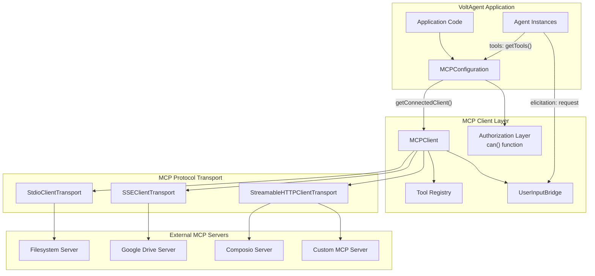
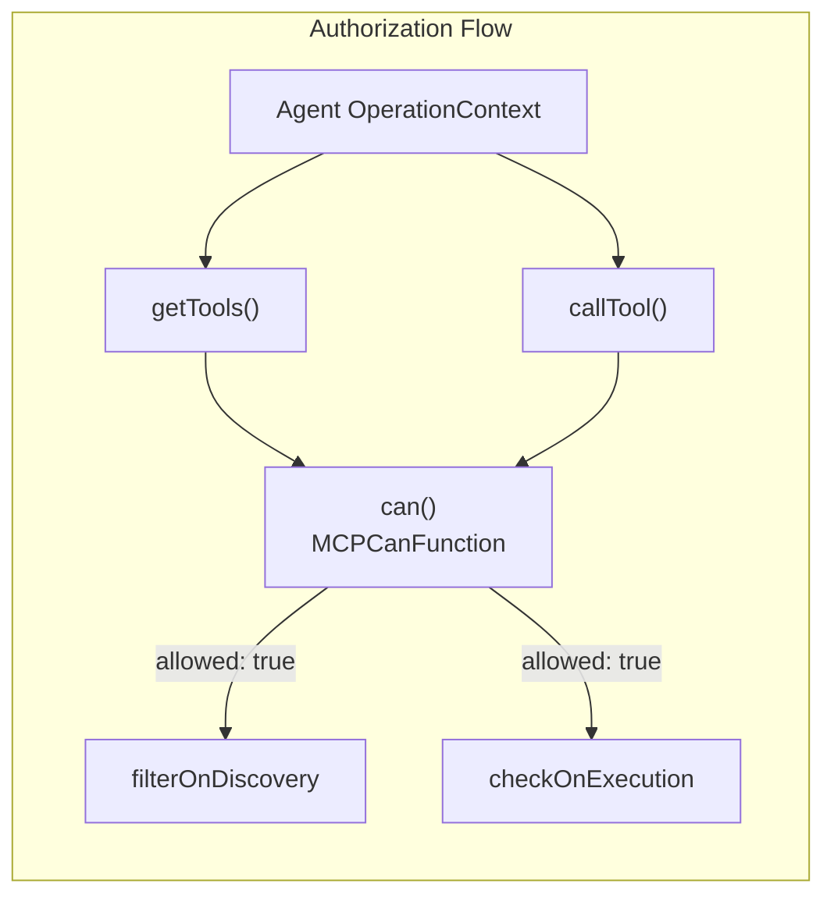
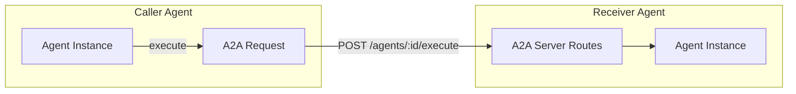

<!-- source: DeepWiki mcp.deepwiki.com · repo VoltAgent/voltagent · page 6 Protocol Integrations · fetched 2026-10-26 -->

# Protocol Integrations

<details>
<summary>Relevant source files</summary>

The following files were used as context for generating this wiki page:

- [examples/with-a2a-server/package.json](examples/with-a2a-server/package.json)
- [examples/with-mcp-elicitation/README.md](examples/with-mcp-elicitation/README.md)
- [examples/with-mcp-elicitation/go-server/go.mod](examples/with-mcp-elicitation/go-server/go.mod)
- [examples/with-mcp-elicitation/go-server/go.sum](examples/with-mcp-elicitation/go-server/go.sum)
- [examples/with-mcp-elicitation/go-server/main.go](examples/with-mcp-elicitation/go-server/main.go)
- [examples/with-mcp-elicitation/src/index.ts](examples/with-mcp-elicitation/src/index.ts)
- [packages/core/src/mcp/client/index.spec.ts](packages/core/src/mcp/client/index.spec.ts)
- [packages/core/src/mcp/client/index.ts](packages/core/src/mcp/client/index.ts)
- [packages/core/src/mcp/client/user-input-bridge.ts](packages/core/src/mcp/client/user-input-bridge.ts)
- [packages/core/src/mcp/index.ts](packages/core/src/mcp/index.ts)
- [packages/core/src/mcp/registry/index.spec.ts](packages/core/src/mcp/registry/index.spec.ts)
- [packages/core/src/mcp/registry/index.ts](packages/core/src/mcp/registry/index.ts)
- [packages/core/src/mcp/types.ts](packages/core/src/mcp/types.ts)
- [website/docs/agents/mcp/mcp.md](website/docs/agents/mcp/mcp.md)

</details>


This document covers VoltAgent's support for standard protocols that enable interoperability with external systems and agents. VoltAgent integrates two major protocols: **Model Context Protocol (MCP)** for exposing and consuming context servers, and **Agent-to-Agent (A2A) Protocol** for inter-agent communication.

For information about AI provider integrations (OpenAI, Anthropic, etc.), see [AI Provider Integration](#5). For server deployment and API endpoints, see [API Server Architecture](#7).

---

## Overview

VoltAgent implements protocol support through dedicated client and server packages:

| Protocol | Role | Package | Purpose |
|----------|------|---------|---------|
| **MCP** | Client | `@voltagent/core` | Connect to MCP servers and use their tools/resources |
| **MCP** | Server | `@voltagent/core` (via server packages) | Expose agents as MCP servers |
| **A2A** | Server | `@voltagent/a2a-server` | Enable agent-to-agent communication via HTTP |

**Sources:** [packages/core/src/mcp/index.ts:1-27](), [examples/with-a2a-server/package.json:1-11]()

---

## MCP Architecture Overview

The following diagram shows how VoltAgent integrates with MCP servers through the `MCPConfiguration` and `MCPClient` classes:



**Sources:** [packages/core/src/mcp/client/index.ts:46-194](), [packages/core/src/mcp/registry/index.ts:43-125](), [packages/core/src/mcp/client/user-input-bridge.ts:43-140]()

---

## MCPConfiguration and Server Discovery

The `MCPConfiguration` class manages connections to multiple MCP servers and exposes their tools to agents.

### Basic Configuration

```typescript
import { MCPConfiguration } from "@voltagent/core";

const mcp = new MCPConfiguration({
  servers: {
    filesystem: {
      type: "stdio",
      command: "npx",
      args: ["-y", "@modelcontextprotocol/server-filesystem", "/workspace"],
    },
    expenses: {
      type: "http",
      url: "http://localhost:3142/mcp",
    },
    gdrive: {
      type: "sse",
      url: "https://mcp.example.com/gdrive/sse",
    },
  },
});
```

### Server Types and Transports

VoltAgent supports four transport types, including automatic fallback for standard HTTP connections.

| Type | Transport | Use Case |
|------|-----------|----------|
| `stdio` | `StdioClientTransport` | Local process, subprocess execution [packages/core/src/mcp/client/index.ts:178-185]() |
| `http` | `StreamableHTTPClientTransport` | Attempts streamable HTTP first, falls back to SSE [packages/core/src/mcp/client/index.ts:160-165]() |
| `sse` | `SSEClientTransport` | Explicit Server-Sent Events transport [packages/core/src/mcp/client/index.ts:166-171]() |
| `streamable-http` | `StreamableHTTPClientTransport` | Direct streamable HTTP without fallback [packages/core/src/mcp/client/index.ts:172-177]() |

### Retrieving Clients

```typescript
const clients = await mcp.getClients();
const fsClient = clients.filesystem;
```

**Sources:** [packages/core/src/mcp/registry/index.ts:43-66](), [packages/core/src/mcp/types.ts:151-285](), [website/docs/agents/mcp/mcp.md:10-18]()

---

## Tool Integration with Agents

MCP tools are retrieved from servers and converted into VoltAgent `Tool` objects.

```typescript
import { Agent, MCPConfiguration } from "@voltagent/core";

const mcp = new MCPConfiguration({
  servers: {
    demo: { type: "http", url: "http://localhost:3142/mcp" },
  },
});

const tools = await mcp.getTools();

const agent = new Agent({
  name: "MCP Agent",
  model: "openai/gpt-4o",
  tools: tools,
});
```

**Sources:** [packages/core/src/mcp/registry/index.ts:101-125](), [examples/with-mcp-elicitation/src/index.ts:14-35]()

---

## MCP Authorization Layer

The authorization layer controls tool discovery and execution through a `can` function provided in the `MCPAuthorizationConfig`.



### Authorization Configuration

```typescript
const mcp = new MCPConfiguration({
  servers: { /* ... */ },
  authorization: {
    can: async ({ toolName, action, userId, context }) => {
      if (toolName === "delete_customer" && action === "execution") {
        return userId === "admin";
      }
      return true;
    },
    filterOnDiscovery: true,
    checkOnExecution: true,
  },
});
```

**Sources:** [packages/core/src/mcp/registry/index.ts:55-66](), [packages/core/src/mcp/registry/index.ts:157-198](), [packages/core/src/mcp/authorization.ts:1-50]()

---

## Elicitation Handling

MCP servers can request user input during tool execution (e.g., for confirmations). VoltAgent handles this via the `UserInputBridge`.

### Handling Flow

1. **Server Request**: Server sends `elicitation/create`.
2. **Bridge Processing**: `UserInputBridge` receives the request.
3. **Normalization**: If `message` is empty, the bridge extracts a prompt from the `requestedSchema` [packages/core/src/mcp/client/user-input-bridge.ts:175-225]().
4. **Handler Execution**: The registered `UserInputHandler` is called.

### Setting Handlers

```typescript
// Persistent handler
mcpClient.elicitation.setHandler(async (request) => {
  return { action: "accept", content: { confirmed: true } };
});

// One-time handler
mcpClient.elicitation.once(async (request) => {
  return { action: "accept", content: { approved: true } };
});
```

**Sources:** [packages/core/src/mcp/client/user-input-bridge.ts:43-140](), [examples/with-mcp-elicitation/src/index.ts:41-51]()

---

## Agent-to-Agent (A2A) Protocol

The `@voltagent/a2a-server` package enables agents to communicate over HTTP using a standardized interface.



### A2A Server Setup

The A2A server is typically integrated with a Hono-based server to expose agent endpoints for remote execution.

**Sources:** [examples/with-a2a-server/package.json:1-11](), [packages/core/src/mcp/types.ts:1-10]()

---

## Summary

VoltAgent's protocol integration layer provides:

1. **MCP Client Support**: Multi-transport connections (`stdio`, `http`, `sse`) via `MCPConfiguration` [packages/core/src/mcp/registry/index.ts:43-66]().
2. **Dynamic Tooling**: Automatic conversion of MCP server tools into agent-ready `Tool` objects [packages/core/src/mcp/registry/index.ts:101-125]().
3. **Authorization**: Middleware-style `can` functions to restrict tool discovery and execution [packages/core/src/mcp/authorization.ts:1-50]().
4. **Elicitation**: Advanced user-input handling with schema-based fallback prompts [packages/core/src/mcp/client/user-input-bridge.ts:175-225]().
5. **A2A Communication**: Standardized HTTP routes for agent-to-agent delegation [examples/with-a2a-server/package.json:1-11]().

For implementation details of MCP client usage, see [Model Context Protocol (MCP)](#6.1). For A2A server setup, see [Agent-to-Agent (A2A) Protocol](#6.2).

---

