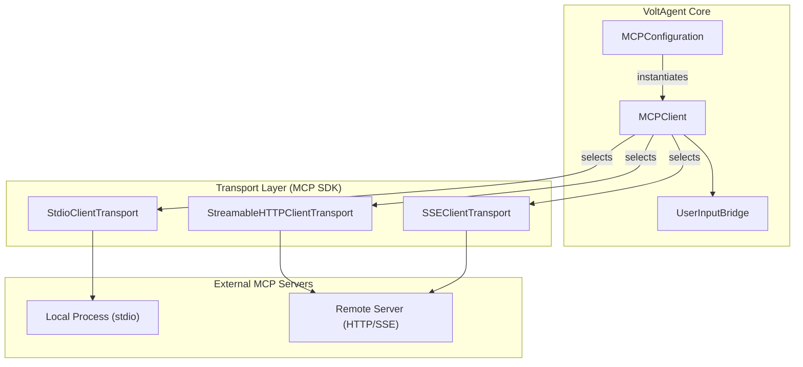
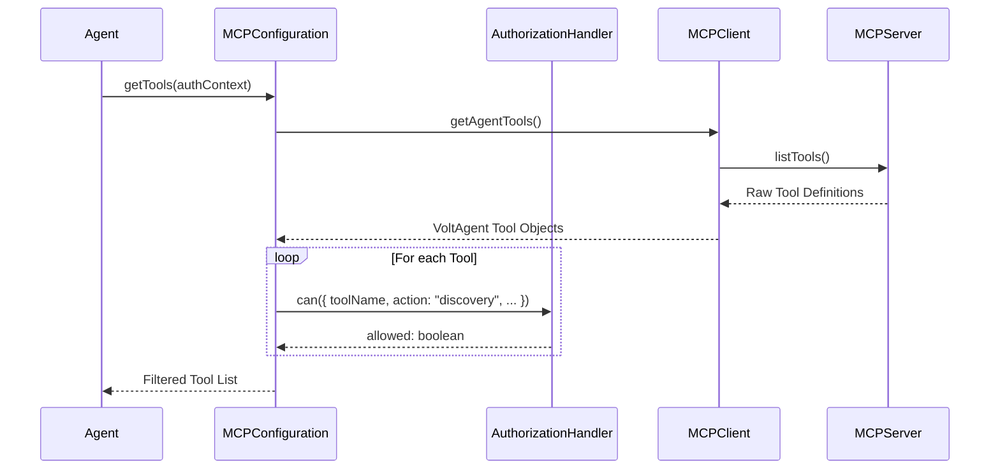
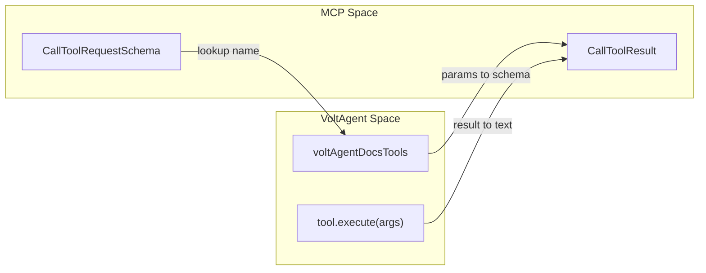
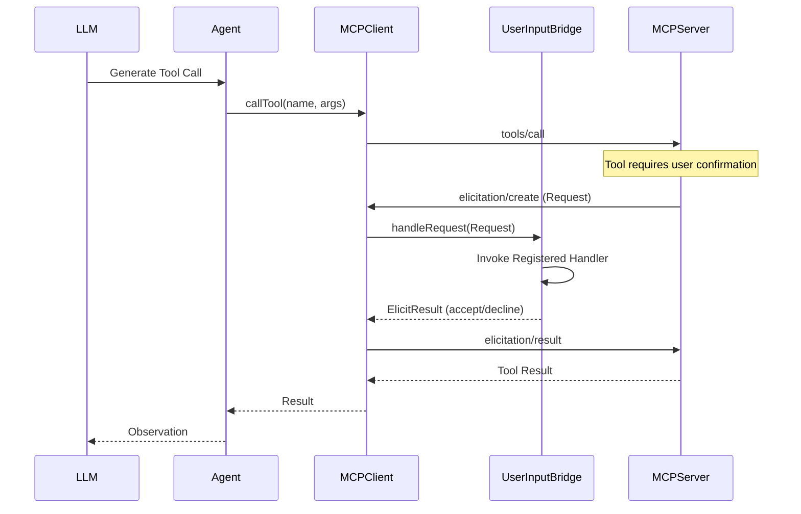

<!-- source: DeepWiki mcp.deepwiki.com · repo VoltAgent/voltagent · page 6.1 Model Context Protocol (MCP) · fetched 2026-10-26 -->

# Model Context Protocol (MCP)

<details>
<summary>Relevant source files</summary>

The following files were used as context for generating this wiki page:

- [.syncpackrc](.syncpackrc)
- [examples/with-mcp-elicitation/README.md](examples/with-mcp-elicitation/README.md)
- [examples/with-mcp-elicitation/go-server/go.mod](examples/with-mcp-elicitation/go-server/go.mod)
- [examples/with-mcp-elicitation/go-server/go.sum](examples/with-mcp-elicitation/go-server/go.sum)
- [examples/with-mcp-elicitation/go-server/main.go](examples/with-mcp-elicitation/go-server/main.go)
- [examples/with-mcp-elicitation/package.json](examples/with-mcp-elicitation/package.json)
- [examples/with-mcp-elicitation/src/index.ts](examples/with-mcp-elicitation/src/index.ts)
- [examples/with-mcp-server/package.json](examples/with-mcp-server/package.json)
- [packages/cli/src/commands/mcp.ts](packages/cli/src/commands/mcp.ts)
- [packages/core/src/mcp/client/index.spec.ts](packages/core/src/mcp/client/index.spec.ts)
- [packages/core/src/mcp/client/index.ts](packages/core/src/mcp/client/index.ts)
- [packages/core/src/mcp/client/user-input-bridge.ts](packages/core/src/mcp/client/user-input-bridge.ts)
- [packages/core/src/mcp/index.ts](packages/core/src/mcp/index.ts)
- [packages/core/src/mcp/registry/index.spec.ts](packages/core/src/mcp/registry/index.spec.ts)
- [packages/core/src/mcp/registry/index.ts](packages/core/src/mcp/registry/index.ts)
- [packages/core/src/mcp/types.ts](packages/core/src/mcp/types.ts)
- [packages/create-voltagent-app/src/utils/mcp-config.ts](packages/create-voltagent-app/src/utils/mcp-config.ts)
- [packages/docs-mcp/CHANGELOG.md](packages/docs-mcp/CHANGELOG.md)
- [packages/docs-mcp/README.md](packages/docs-mcp/README.md)
- [packages/docs-mcp/package.json](packages/docs-mcp/package.json)
- [packages/docs-mcp/src/index.ts](packages/docs-mcp/src/index.ts)
- [packages/docs-mcp/src/tools.ts](packages/docs-mcp/src/tools.ts)
- [packages/docs-mcp/tsup.config.ts](packages/docs-mcp/tsup.config.ts)
- [packages/server-hono/src/routes/path-params.ts](packages/server-hono/src/routes/path-params.ts)
- [packages/server-hono/src/zod-openapi-compat.ts](packages/server-hono/src/zod-openapi-compat.ts)
- [website/docs/agents/mcp/mcp.md](website/docs/agents/mcp/mcp.md)

</details>


This document covers VoltAgent's integration with the Model Context Protocol (MCP), including client implementation, server connections, authorization layer, and elicitation handling. VoltAgent leverages the official MCP SDK to provide a standardized interface for agents to interact with external tool servers.

---

## Overview

### What is MCP

The Model Context Protocol (MCP) is a standard protocol for connecting AI agents to external tool servers. VoltAgent implements a high-level `MCPClient` that wraps the official SDK to provide simplified connection management, automatic tool discovery, and advanced user-input handling.

**Key capabilities:**
- **Multi-Transport Support**: Connect via `stdio`, `http`, `sse`, or `streamable-http` [packages/core/src/mcp/client/index.ts:160-190]().
- **Automatic Tool Normalization**: Converts MCP JSON schemas into Zod schemas for VoltAgent tool compatibility [packages/core/src/mcp/client/index.ts:18-19]().
- **Elicitation Layer**: Handles server-side requests for user input (e.g., confirmations, credentials) [packages/core/src/mcp/client/user-input-bridge.ts:1-133]().
- **Authorization**: Granular control over tool discovery and execution [packages/core/src/mcp/authorization/index.ts:1-74]().

### Core Classes

| Class | Purpose | Location |
|-------|---------|----------|
| `MCPConfiguration` | Manages multiple MCP server connections and registry | [packages/core/src/mcp/registry/index.ts:43]() |
| `MCPClient` | Wraps `@modelcontextprotocol/sdk` for individual connections | [packages/core/src/mcp/client/index.ts:46]() |
| `UserInputBridge` | Manages elicitation request handlers for a client | [packages/core/src/mcp/client/user-input-bridge.ts:25]() |

Sources: [packages/core/src/mcp/index.ts:1-27](), [packages/core/src/mcp/types.ts:95-146]()

---

## MCP Client Configuration

### Server Connection Architecture


Sources: [packages/core/src/mcp/client/index.ts:1-40](), [packages/core/src/mcp/registry/index.ts:43-66]()

### Configuration Setup

The `MCPConfiguration` class manages the lifecycle of multiple MCP connections. It supports automatic fallback for HTTP connections (trying streamable HTTP first, then SSE) [packages/core/src/mcp/client/index.ts:160-165]().

```typescript
import { MCPConfiguration } from "@voltagent/core";

const mcp = new MCPConfiguration({
  servers: {
    // stdio transport (local process)
    filesystem: {
      type: "stdio",
      command: "npx",
      args: ["-y", "@modelcontextprotocol/server-filesystem", "/path/to/files"],
    },
    // HTTP transport with automatic fallback to SSE
    api: {
      type: "http",
      url: "https://mcp.example.com",
    },
  },
});
```

**Transport Options:**
- **stdio**: Uses `StdioClientTransport` with process isolation [packages/core/src/mcp/client/index.ts:178-185]().
- **http**: Uses `StreamableHTTPClientTransport` with optional SSE fallback [packages/core/src/mcp/client/index.ts:160-165]().
- **sse**: Explicitly uses `SSEClientTransport` [packages/core/src/mcp/client/index.ts:166-171]().
- **streamable-http**: Explicitly uses `StreamableHTTPClientTransport` with session support [packages/core/src/mcp/client/index.ts:172-177]().

Sources: [packages/core/src/mcp/types.ts:149-285](), [packages/core/src/mcp/client/index.ts:123-194]()

---

## Authorization Layer

VoltAgent provides a robust authorization layer to filter tools during discovery and prevent unauthorized execution.

### Authorization Workflow


Sources: [packages/core/src/mcp/registry/index.ts:101-125](), [packages/core/src/mcp/registry/index.ts:157-198]()

### Implementing the `can` Function

The `can` function receives `MCPCanParams` including `toolName`, `serverName`, `action` (`discovery` or `execution`), and the `userId`/`context` from the `OperationContext` [packages/core/src/mcp/authorization/index.ts:31-48]().

```typescript
const mcp = new MCPConfiguration({
  servers: { ... },
  authorization: {
    can: async ({ toolName, action, context }) => {
      const userRole = context?.get("role");
      if (toolName.includes("admin") && userRole !== "admin") {
        return { allowed: false, reason: "Insufficient permissions" };
      }
      return true;
    },
    filterOnDiscovery: true, // Hide tools user can't access
    checkOnExecution: true,  // Verify permissions before calling
  }
});
```
Sources: [packages/core/src/mcp/registry/index.ts:119-122](), [packages/core/src/mcp/authorization/index.ts:1-25]()

---

## Elicitation Handling

Elicitation allows MCP servers to request additional information from the user during tool execution. VoltAgent manages this via the `UserInputBridge` [packages/core/src/mcp/client/user-input-bridge.ts:25]().

### The Elicitation Bridge

The `UserInputBridge` maintains a registry of handlers and integrates with the MCP SDK's `ElicitRequestSchema` [packages/core/src/mcp/client/index.ts:148-153]().

| Method | Description |
|--------|-------------|
| `setHandler(handler)` | Registers a persistent handler for user input [packages/core/src/mcp/client/user-input-bridge.ts:46-51](). |
| `once(handler)` | Registers a one-time handler that unregisters after use [packages/core/src/mcp/client/user-input-bridge.ts:58-62](). |
| `removeHandler()` | Clears the current handler [packages/core/src/mcp/client/user-input-bridge.ts:67-70](). |

### Handling a Request

When a server sends an `elicit` request, the bridge invokes the registered handler. If no handler is present, it defaults to a `cancel` action [packages/core/src/mcp/client/user-input-bridge.ts:114-118]().

```typescript
mcpClient.elicitation.setHandler(async (request) => {
  // request.message contains the server's prompt
  // request.requestedSchema describes expected data
  const userInput = await myUI.showPrompt(request.message);
  
  return {
    action: "accept",
    content: { value: userInput }
  };
});
```
Sources: [packages/core/src/mcp/client/user-input-bridge.ts:88-132](), [packages/core/src/mcp/types.ts:11-16]()

---

## MCP Server Implementation

VoltAgent provides the `@voltagent/mcp-server` package (and tools in `@voltagent/docs-mcp`) to expose local capabilities as MCP tools.

### Tool Mapping

The `voltagent-docs-mcp` server maps VoltAgent `Tool` objects to MCP-compliant definitions using `z.toJSONSchema()` [packages/docs-mcp/src/index.ts:10-14]().


Sources: [packages/docs-mcp/src/index.ts:50-86](), [packages/docs-mcp/src/tools.ts:7-12]()

### Starting the Server

The server uses `StdioServerTransport` to communicate with MCP clients [packages/docs-mcp/src/index.ts:89-91]().

```typescript
// From packages/docs-mcp/src/index.ts
const server = new Server({ name: "voltagent-docs-mcp", version: "0.0.1" }, {
  capabilities: { tools: {} }
});

server.setRequestHandler(ListToolsRequestSchema, async () => ({
  tools: mcpTools // Pre-mapped VoltAgent tools
}));

const transport = new StdioServerTransport();
await server.connect(transport);
```
Sources: [packages/docs-mcp/src/index.ts:24-48](), [packages/docs-mcp/package.json:5-10]()

---

## Data Flow: Tool Call with Elicitation


Sources: [packages/core/src/mcp/client/index.ts:208-215](), [packages/core/src/mcp/client/user-input-bridge.ts:88-132](), [packages/docs-mcp/src/index.ts:51-86]()

---

