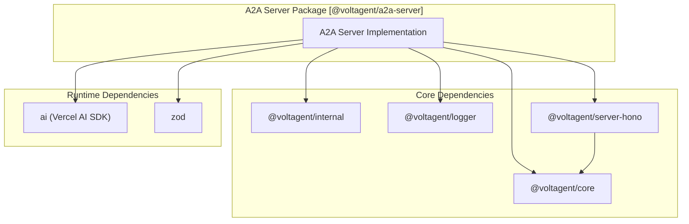
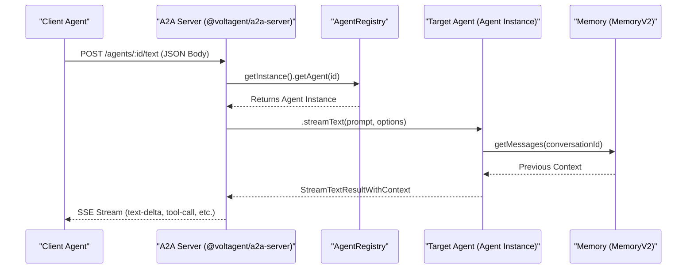
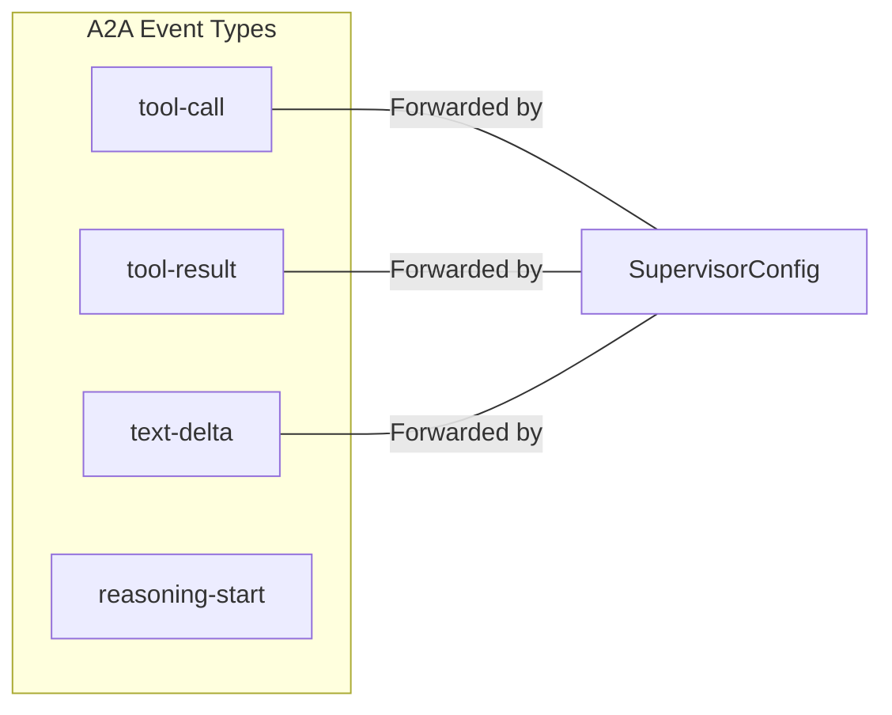

<!-- source: DeepWiki mcp.deepwiki.com · repo VoltAgent/voltagent · page 6.2 Agent-to-Agent (A2A) Protocol · fetched 2026-10-26 -->

# Agent-to-Agent (A2A) Protocol

<details>
<summary>Relevant source files</summary>

The following files were used as context for generating this wiki page:

- [examples/with-a2a-server/package.json](examples/with-a2a-server/package.json)
- [examples/with-subagents/src/index.ts](examples/with-subagents/src/index.ts)
- [packages/core/src/agent/index.ts](packages/core/src/agent/index.ts)
- [packages/core/src/agent/providers/base/types.ts](packages/core/src/agent/providers/base/types.ts)
- [packages/core/src/agent/subagent/index.spec.ts](packages/core/src/agent/subagent/index.spec.ts)
- [packages/core/src/agent/subagent/index.ts](packages/core/src/agent/subagent/index.ts)
- [packages/core/src/agent/types.ts](packages/core/src/agent/types.ts)
- [packages/core/src/events/types.ts](packages/core/src/events/types.ts)
- [packages/core/src/index.ts](packages/core/src/index.ts)
- [website/docs/agents/overview.md](website/docs/agents/overview.md)
- [website/docs/agents/subagents.md](website/docs/agents/subagents.md)

</details>


## Purpose and Scope

The Agent-to-Agent (A2A) Protocol provides a standardized communication mechanism for VoltAgent instances to interact with each other over a network. This enables multi-agent architectures where agents can discover, query, and collaborate with other agents across different processes or physical machines.

This document covers the A2A server implementation (`@voltagent/a2a-server`) and its integration with the VoltAgent framework. For internal agent delegation within a single instance, see [Sub-Agent Delegation](). For Model Context Protocol integration, see [Model Context Protocol (MCP)]().

---

## Package Architecture

The A2A protocol is implemented as a specialized server package that wraps the core agent orchestration logic into a standardized communication interface.

### Package Structure



**Sources:** [examples/with-a2a-server/package.json:1-11]()

### Dependency Requirements

| Package | Version | Purpose |
|---------|---------|---------|
| `@voltagent/core` | ^2.7.4 | Agent orchestration, `Agent` class, and memory management |
| `@voltagent/server-hono` | ^2.0.13 | HTTP server foundation using Hono |
| `@voltagent/internal` | ^1.0.3 | Shared internal utilities and `safeStringify` |
| `@voltagent/logger` | ^2.0.2 | Structured logging via `createPinoLogger` |
| `ai` | ^6.0.0 | Vercel AI SDK v6 for streaming and model protocols |
| `zod` | ^3.25.76 | Runtime schema validation for agent inputs/outputs |

**Sources:** [examples/with-a2a-server/package.json:3-10]()

---

## Agent-to-Agent Communication Flow

The A2A protocol bridges "Natural Language Space" (the agent's intent) to "Code Entity Space" (the HTTP server and agent methods).

### Data Flow: Remote Invocation



**Sources:** [packages/core/src/agent/agent.ts:44-55](), [packages/core/src/agent/subagent/index.ts:102-104](), [website/docs/agents/overview.md:61-64]()

---

## Implementation Details

The A2A server leverages the `Agent` class methods to fulfill remote requests. It specifically handles the translation of HTTP requests into `GenerateTextOptions` or `StreamTextOptions`.

### Key Functions and Classes

| Entity | Location | Role |
|--------|----------|------|
| `Agent` | [packages/core/src/agent/agent.ts:1]() | The primary executor that handles instructions, tools, and model calls. |
| `AgentRegistry` | [packages/core/src/agent/subagent/index.ts:6]() | A singleton that tracks available agent instances for routing requests. |
| `SubAgentManager` | [packages/core/src/agent/subagent/index.ts:55]() | Manages delegation logic if the target agent needs to call further sub-agents. |
| `honoServer` | [examples/with-subagents/src/index.ts:11]() | The factory function that initializes the Hono-based HTTP transport. |

**Sources:** [packages/core/src/index.ts:43-55](), [packages/core/src/agent/subagent/index.ts:55-81]()

### Remote Tool Execution
Agents communicating via A2A often expose their capabilities as tools. The protocol supports forwarding these through `fullStreamEventForwarding`.



**Sources:** [packages/core/src/agent/subagent/index.ts:67-70](), [website/docs/agents/subagents.md:127-140]()

---

## Example Server Setup

A typical A2A server setup involves registering agents and starting the Hono-based listener.

```typescript
// Example from with-subagents demonstrating server registration
new VoltAgent({
  agents: {
    supervisorAgent, // Instance of Agent
    formatterAgent,
    contentCreatorAgent,
  },
  logger,
  server: honoServer(), // Starts the A2A-compatible HTTP server
  observability: new VoltAgentObservability({
    storage: new LibSQLObservabilityAdapter(),
  }),
});
```

**Sources:** [examples/with-subagents/src/index.ts:70-82]()

---

## Protocol Features

### 1. Resumable Streaming
The A2A protocol supports `fullStream` which provides detailed events including reasoning steps and tool execution status. This is critical for agents that need to observe the "thought process" of another agent.

### 2. Context Inheritance
When an agent calls another via the A2A server, it can pass `OperationContext` data. This ensures that `traceId` and `userId` are preserved across the network boundary for consistent observability.

### 3. Schema Enforcement
By using `zod` schemas in the `Agent` configuration, the A2A server can validate that incoming requests for structured data (`streamObject`) match the expected format before the LLM is even invoked.

**Sources:** [packages/core/src/agent/types.ts:202-221](), [packages/core/src/agent/providers/base/types.ts:101-117](), [website/docs/agents/overview.md:188-197]()

---

## Comparison with MCP

| Feature | A2A Protocol | Model Context Protocol (MCP) |
|---------|--------------|------------------------------|
| **Primary Actor** | Agent-to-Agent | Model-to-Tool/Resource |
| **Transport** | HTTP (REST/SSE) | stdio or SSE |
| **Discovery** | AgentRegistry | MCP Client/Server handshake |
| **State** | Stateful (MemoryV2) | Generally Stateless |
| **VoltAgent Package** | `@voltagent/a2a-server` | Built-in MCP Client in `@voltagent/core` |

**Sources:** [packages/core/src/index.ts:170-177](), [examples/with-a2a-server/package.json:1-11]()

---

