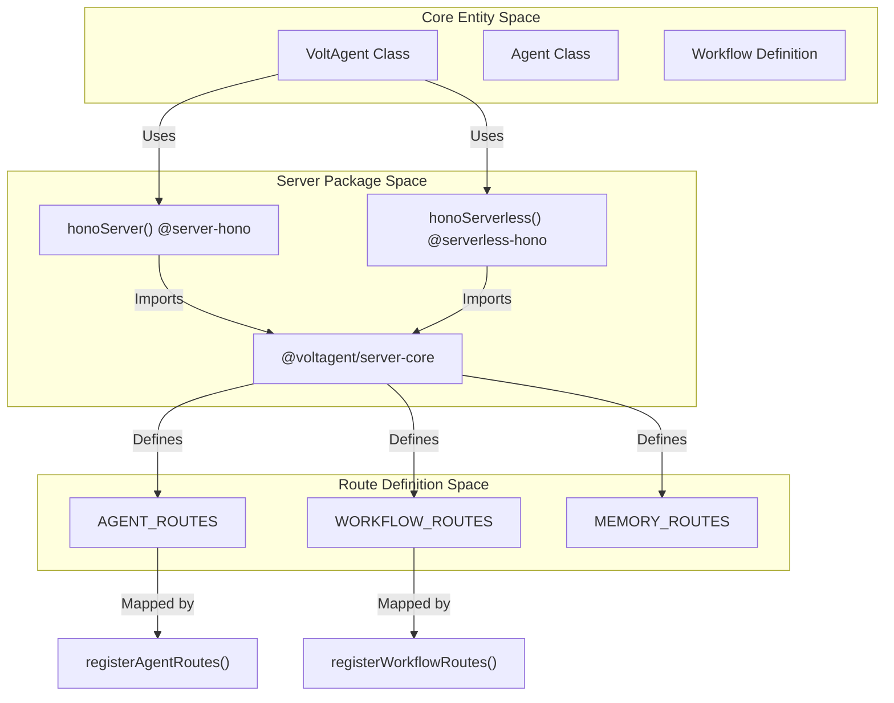
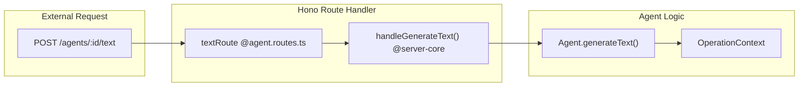

<!-- source: DeepWiki mcp.deepwiki.com · repo VoltAgent/voltagent · page 7 API Server Architecture · fetched 2026-10-26 -->

# API Server Architecture

Relevant source files

The following files were used as context for generating this wiki page:

- [packages/server-core/CHANGELOG.md](packages/server-core/CHANGELOG.md)
- [packages/server-core/package.json](packages/server-core/package.json)
- [packages/server-core/src/auth/defaults.spec.ts](packages/server-core/src/auth/defaults.spec.ts)
- [packages/server-core/src/auth/defaults.ts](packages/server-core/src/auth/defaults.ts)
- [packages/server-core/src/edge.ts](packages/server-core/src/edge.ts)
- [packages/server-core/src/handlers/workflow.handlers.ts](packages/server-core/src/handlers/workflow.handlers.ts)
- [packages/server-core/src/handlers/workflow.stream-attach.handlers.spec.ts](packages/server-core/src/handlers/workflow.stream-attach.handlers.spec.ts)
- [packages/server-core/src/routes/definitions.ts](packages/server-core/src/routes/definitions.ts)
- [packages/server-elysia/src/routes/workflow.routes.ts](packages/server-elysia/src/routes/workflow.routes.ts)
- [packages/server-hono/package.json](packages/server-hono/package.json)
- [packages/server-hono/src/routes/agent.routes.ts](packages/server-hono/src/routes/agent.routes.ts)
- [packages/server-hono/src/routes/index.ts](packages/server-hono/src/routes/index.ts)
- [packages/serverless-hono/src/routes.ts](packages/serverless-hono/src/routes.ts)
- [website/docs/api/overview.md](website/docs/api/overview.md)

## Purpose and Scope

This document covers the HTTP server layer of VoltAgent, which exposes agents and workflows as REST API endpoints. It describes the framework-agnostic core and the specific server packages (`@voltagent/server-hono` and `@voltagent/serverless-hono`), their architectural differences, and how they integrate with the Hono web framework to provide HTTP access to VoltAgent functionality.

For detailed information about specific API endpoints and their request/response formats, see [API Endpoints Reference](#7.1). For resumable streaming architecture, see [Resumable Streaming](#7.2). For authentication patterns, see [Authentication and Security](#7.3).

## Server Packages Overview

VoltAgent provides a pluggable server architecture centered around a framework-agnostic core [website/docs/api/overview.md:8-17]().

| Package | Runtime | Role | Key Dependencies |
|---------|---------|------|------------------|
| `@voltagent/server-core` | Universal | Core route definitions, handlers, and schemas | `ai`, `ws`, `zod-from-json-schema` |
| `@voltagent/server-hono` | Node.js, Bun | Official implementation for persistent servers | `hono`, `@hono/node-server`, `openapi3-ts` |
| `@voltagent/serverless-hono` | Edge / Lambda | Optimized for Cloudflare Workers, Vercel Edge | `hono`, `@voltagent/server-core` |

The `server-core` package defines the standard `AGENT_ROUTES`, `WORKFLOW_ROUTES`, and `MEMORY_ROUTES` used across all implementations [packages/server-core/src/edge.ts:3-11]().

**Sources:** [packages/server-core/package.json:1-14](), [packages/server-hono/package.json:1-17](), [website/docs/api/overview.md:12-17]()

## Architecture Overview

The following diagram bridges the high-level concepts to the specific code entities responsible for the server lifecycle.

### Code-to-System Mapping: Server Initialization

**Sources:** [packages/server-hono/src/routes/index.ts:1-74](), [packages/server-core/src/edge.ts:3-11](), [website/docs/api/overview.md:20-39]()

## HTTP Endpoint Structure

The server maps Agent and Workflow methods to standard REST endpoints. Handlers in `server-core` process these requests by interacting with the underlying Agent instances.

### Code-to-System Mapping: Request Handling

### Core Endpoint Categories
- **Agent Endpoints**: `/agents/:id/text`, `/agents/:id/stream`, `/agents/:id/chat`, `/agents/:id/object` [packages/server-hono/src/routes/index.ts:97-203]().
- **Workflow Endpoints**: `/workflows/:id/execute`, `/workflows/:id/stream`, `/workflows/:id/executions/:executionId/resume` [packages/server-elysia/src/routes/workflow.routes.ts:178-233]().
- **Memory Endpoints**: `/api/memory/conversations`, `/api/memory/search`, `/api/memory/conversations/:conversationId/working-memory` [website/docs/api/overview.md:117-130]().

**Sources:** [packages/server-hono/src/routes/index.ts:70-230](), [website/docs/api/overview.md:91-148](), [packages/server-core/src/routes/definitions.ts:35-203]()

## Server Package Implementation Details

### @voltagent/server-hono
This package is designed for long-running Node.js or Bun environments. It includes built-in support for Swagger UI and OpenAPI documentation generation [packages/server-hono/package.json:6-7]().

- **Swagger UI**: Accessible at `/ui` [website/docs/api/overview.md:83]().
- **OpenAPI Spec**: Raw JSON available at `/doc` [website/docs/api/overview.md:89]().
- **Dynamic Headers**: The server passes request headers (like `authorization` or `x-tenant-id`) into the agent's dynamic configuration functions [packages/server-core/CHANGELOG.md:31-40]().

### @voltagent/serverless-hono
Optimized for edge runtimes like Cloudflare Workers. It provides helper functions to merge serverless environment variables into the VoltAgent `OperationContext` [packages/serverless-hono/src/routes.ts:172-213]().

- **Context Injection**: Uses `mergeContextWithServerlessEnv` to ensure platform secrets are available to tools and models [packages/serverless-hono/src/routes.ts:172-192]().
- **A2A Support**: Implements Agent-to-Agent protocol routes for cross-agent communication [packages/serverless-hono/src/routes.ts:27-36]().

**Sources:** [packages/server-hono/package.json:1-17](), [packages/serverless-hono/src/routes.ts:1-86](), [packages/server-core/CHANGELOG.md:31-40]()

## Authentication and Security

VoltAgent implements an "Opt-In" authentication model. Routes are categorized into `DEFAULT_PUBLIC_ROUTES` and `PROTECTED_ROUTES` [packages/server-core/src/auth/defaults.ts:8-146]().

- **Public Routes**: Includes discovery endpoints like `/agents`, `/workflows`, and `/doc` [packages/server-core/src/auth/defaults.ts:8-32]().
- **Protected Routes**: Includes execution endpoints like `/agents/:id/text` and all `/api/memory/*` paths [packages/server-core/src/auth/defaults.ts:88-146]().
- **Path Matching**: Uses `pathMatches` to validate request paths against patterns, supporting parameters (e.g., `:id`) and wildcards (e.g., `/*`) [packages/server-core/src/auth/defaults.ts:166-203]().

For details, see [Authentication and Security](#7.3).

**Sources:** [packages/server-core/src/auth/defaults.ts:1-203](), [packages/server-core/src/auth/defaults.spec.ts:5-150]()

## Advanced Capabilities

### Resumable Streaming
The server supports resuming interrupted SSE streams via the `/agents/:id/chat/:conversationId/stream` endpoint [packages/server-hono/src/routes/index.ts:150-159](). This requires a persistence layer like Redis.

For details, see [Resumable Streaming](#7.2).

### Workspace Management
Agents can expose their sandboxed filesystem and skills over HTTP via `/agents/:id/workspace` endpoints [packages/server-hono/src/routes/index.ts:221-230]().

**Sources:** [packages/server-hono/src/routes/index.ts:150-230](), [packages/server-core/src/routes/definitions.ts:158-188]()

---

