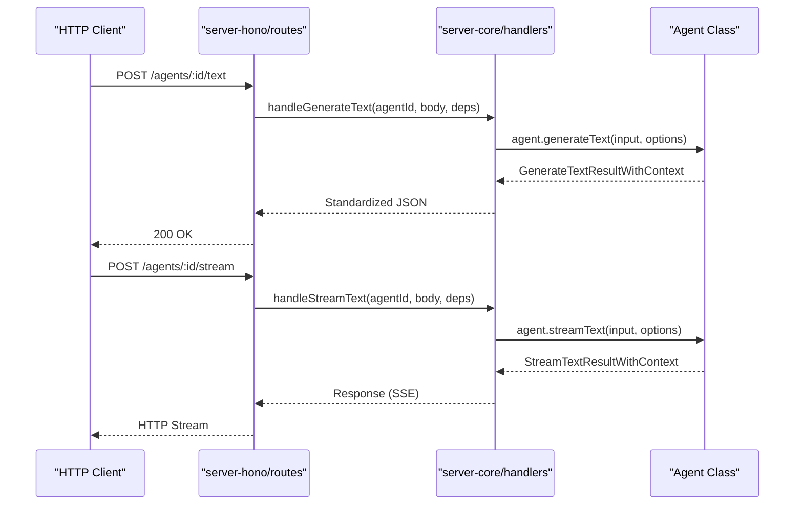
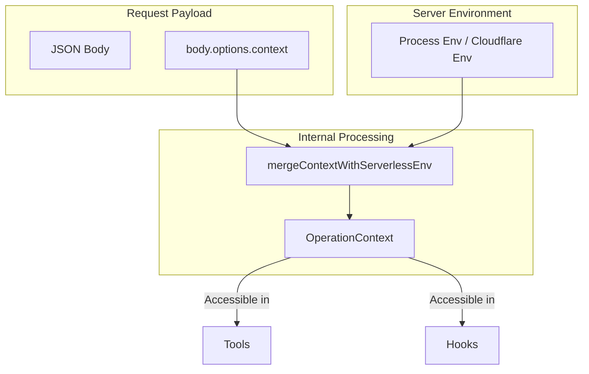

<!-- source: DeepWiki mcp.deepwiki.com · repo VoltAgent/voltagent · page 7.1 API Endpoints Reference · fetched 2026-10-26 -->

# API Endpoints Reference

Relevant source files

The following files were used as context for generating this wiki page:

- [packages/core/src/agent/agent.spec-d.ts](packages/core/src/agent/agent.spec-d.ts)
- [packages/core/src/agent/agent.spec.ts](packages/core/src/agent/agent.spec.ts)
- [packages/core/src/agent/agent.ts](packages/core/src/agent/agent.ts)
- [packages/core/src/agent/hooks/index.spec.ts](packages/core/src/agent/hooks/index.spec.ts)
- [packages/core/src/agent/hooks/index.ts](packages/core/src/agent/hooks/index.ts)
- [packages/server-core/src/auth/defaults.spec.ts](packages/server-core/src/auth/defaults.spec.ts)
- [packages/server-core/src/auth/defaults.ts](packages/server-core/src/auth/defaults.ts)
- [packages/server-core/src/edge.ts](packages/server-core/src/edge.ts)
- [packages/server-core/src/handlers/agent.handlers.spec.ts](packages/server-core/src/handlers/agent.handlers.spec.ts)
- [packages/server-core/src/handlers/agent.handlers.ts](packages/server-core/src/handlers/agent.handlers.ts)
- [packages/server-core/src/handlers/workflow.handlers.ts](packages/server-core/src/handlers/workflow.handlers.ts)
- [packages/server-core/src/handlers/workflow.stream-attach.handlers.spec.ts](packages/server-core/src/handlers/workflow.stream-attach.handlers.spec.ts)
- [packages/server-core/src/routes/definitions.ts](packages/server-core/src/routes/definitions.ts)
- [packages/server-core/src/schemas/agent.schemas.spec.ts](packages/server-core/src/schemas/agent.schemas.spec.ts)
- [packages/server-core/src/schemas/agent.schemas.ts](packages/server-core/src/schemas/agent.schemas.ts)
- [packages/server-core/src/utils/options.ts](packages/server-core/src/utils/options.ts)
- [packages/server-elysia/src/routes/agent.routes.ts](packages/server-elysia/src/routes/agent.routes.ts)
- [packages/server-elysia/src/routes/workflow.routes.ts](packages/server-elysia/src/routes/workflow.routes.ts)
- [packages/server-hono/src/routes/agent.routes.ts](packages/server-hono/src/routes/agent.routes.ts)
- [packages/server-hono/src/routes/index.ts](packages/server-hono/src/routes/index.ts)
- [packages/serverless-hono/src/routes.ts](packages/serverless-hono/src/routes.ts)
- [website/docs/agents/context.md](website/docs/agents/context.md)
- [website/docs/agents/hooks.md](website/docs/agents/hooks.md)
- [website/docs/agents/prompts.md](website/docs/agents/prompts.md)
- [website/docs/agents/tools.md](website/docs/agents/tools.md)
- [website/docs/api/endpoints/agents.md](website/docs/api/endpoints/agents.md)
- [website/docs/api/overview.md](website/docs/api/overview.md)
- [website/docs/ui/ai-sdk-integration.md](website/docs/ui/ai-sdk-integration.md)

## Purpose and Scope

This document provides a complete technical reference for the REST API endpoints exposed by VoltAgent's HTTP server packages (`@voltagent/server-hono`, `@voltagent/serverless-hono`, and `@voltagent/server-elysia`). These endpoints allow agents and workflows to be invoked over HTTP from any client application using standard formats like JSON and Server-Sent Events (SSE).

VoltAgent 1.x introduces a pluggable server architecture where route definitions and handlers are decoupled from the underlying framework [website/docs/api/overview.md:10-17]().

---

## Server Initialization and Routing

The server architecture is built on a shared set of route definitions and handlers defined in `@voltagent/server-core` [packages/serverless-hono/src/routes.ts:1-86](). When a `VoltAgent` instance is initialized, it binds these handlers to the specific server implementation (e.g., Hono) [website/docs/api/overview.md:22-38]().

### Request Handling Flow

The following diagram bridges the HTTP request space to the internal class methods.

**HTTP to Code Entity Mapping**

**Sources:** [packages/server-hono/src/routes/index.ts:98-133](), [packages/server-core/src/handlers/agent.handlers.ts:1-100]()

---

## Agent Endpoints

All agent endpoints follow the pattern `/agents/:id/*` [website/docs/api/endpoints/agents.md:8-9]().

### POST `/agents/:id/text`
Generates a complete text response synchronously. It maps to the `handleGenerateText` handler [packages/server-hono/src/routes/index.ts:98-119]().

**Request Body Schema:**
Defined by `GenerateOptionsSchema` [packages/server-core/src/schemas/agent.schemas.ts:228-265]().
*   `input`: `string | UIMessage[] | ModelMessage[]` [website/docs/api/endpoints/agents.md:175-180]()
*   `options`: Includes `memory`, `maxSteps`, `temperature`, `maxOutputTokens`, and `context` [website/docs/api/endpoints/agents.md:183-221]().

### POST `/agents/:id/stream`
Streams raw `fullStream` events via SSE. This endpoint provides granular visibility into the execution pipeline, including tool calls and reasoning [website/docs/api/ui/ai-sdk-integration.md:23-26](). It uses the `handleStreamText` handler [packages/server-hono/src/routes/index.ts:122-133]().

### POST `/agents/:id/chat`
A specialized streaming endpoint optimized for Vercel AI SDK's `useChat` hook [website/docs/api/ui/ai-sdk-integration.md:22-25](). It returns a stream of `UIMessage` objects rather than raw protocol events [website/docs/api/ui/ai-sdk-integration.md:41-53]().

### POST `/agents/:id/object`
Generates structured JSON data validated against a provided Zod or JSON schema [packages/server-core/src/schemas/agent.schemas.ts:122-135](). It maps to `handleGenerateObject` [packages/server-hono/src/routes/index.ts:162-182]().

---

## Data Flow and Context Injection

VoltAgent handles complex context merging, especially in serverless environments where environment variables need to be injected into the agent's operation context.

**Context Propagation Diagram**

**Sources:** [packages/serverless-hono/src/routes.ts:172-192](), [website/docs/agents/context.md:12-22]()

---

## Memory and Persistence Endpoints

VoltAgent provides a comprehensive suite of endpoints for managing conversation history and "Working Memory" (scratchpads).

| Endpoint | Method | Purpose | Handler |
| :--- | :--- | :--- | :--- |
| `/api/memory/conversations` | `GET` | List all conversations | `handleListMemoryConversations` |
| `/api/memory/conversations/:id` | `GET` | Get specific conversation | `handleGetMemoryConversation` |
| `/api/memory/conversations/:id/working-memory` | `GET` | Get agent scratchpad | `handleGetMemoryWorkingMemory` |
| `/api/memory/search` | `GET` | Vector/Semantic search | `handleSearchMemory` |

**Sources:** [packages/serverless-hono/src/routes.ts:29-32](), [website/docs/api/overview.md:117-130]()

---

## Implementation Details: `@voltagent/server-core`

The core logic for every endpoint resides in "Handlers". These are framework-blind functions that take a `ServerProviderDeps` object (containing the agent and workflow registries) and return a standardized response [packages/server-hono/src/routes/index.ts:1-35]().

### Key Handler Functions
*   `handleGenerateText`: Orchestrates input validation using Zod schemas, retrieves the agent from the `AgentRegistry`, and executes `agent.generateText()` [packages/server-core/src/handlers/agent.handlers.ts]().
*   `handleChatStream`: Converts the `AsyncIterableStream` from the agent into a `Response` object compatible with SSE headers [packages/server-core/src/handlers/agent.handlers.ts]().
*   `withServerlessEnvInOptions`: Middleware-like utility that ensures environment-specific secrets are available to tools during execution [packages/serverless-hono/src/routes.ts:194-213]().

### Validation Schemas
The server uses `zod` to enforce strict request shapes:
*   `GenerateOptionsSchema`: Validates LLM parameters and memory configurations [packages/server-core/src/schemas/agent.schemas.ts:228-265]().
*   `MemoryPersistenceOptionsSchema`: Controls how and when messages are saved (e.g., `mode: "step"` vs `"finish"`) [packages/server-core/src/schemas/agent.schemas.ts:201-218]().

**Sources:** [packages/server-core/src/schemas/agent.schemas.ts:1-265](), [packages/server-hono/src/routes/index.ts:70-230]()

---

