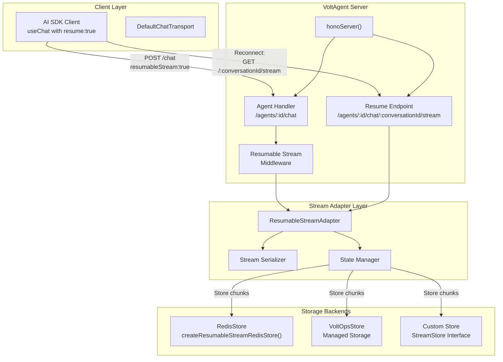
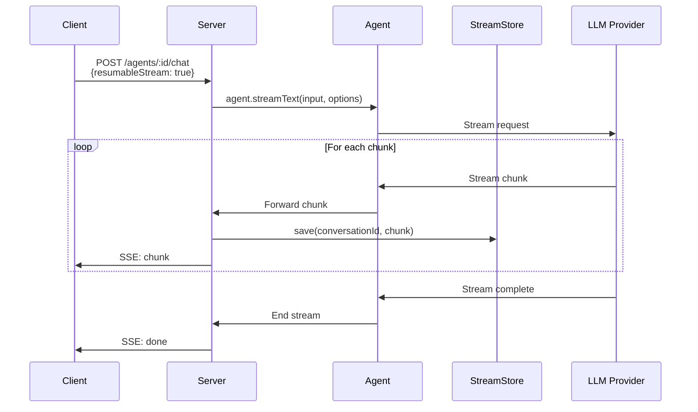
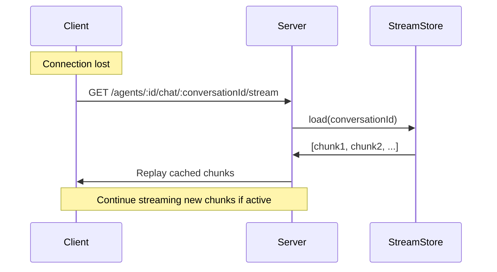

<!-- source: DeepWiki mcp.deepwiki.com · repo VoltAgent/voltagent · page 7.2 Resumable Streaming · fetched 2026-10-26 -->

# Resumable Streaming

<details>
<summary>Relevant source files</summary>

The following files were used as context for generating this wiki page:

- [examples/with-nextjs-resumable-stream/package.json](examples/with-nextjs-resumable-stream/package.json)
- [examples/with-resumable-streams/package.json](examples/with-resumable-streams/package.json)
- [examples/with-voltops-resumable-streams/package.json](examples/with-voltops-resumable-streams/package.json)

</details>


## Purpose and Scope

Resumable Streaming enables VoltAgent agents to persist in-flight stream responses and allow clients to reconnect and resume receiving the stream after network interruptions or browser refreshes. This capability is critical for production chat applications where users expect uninterrupted conversations despite temporary connection losses.

This document covers the resumable streaming architecture, storage backends (Redis and VoltOps Managed), server configuration, and client integration patterns.

**Sources:** [examples/with-resumable-streams/package.json:2-3](), [examples/with-voltops-resumable-streams/package.json:2-3]()

---

## Architecture Overview

Resumable streaming consists of four layers: a persistent storage backend, a stream adapter that manages serialization, server middleware that exposes resumption endpoints, and client logic that detects disconnections and reconnects.

### System Architecture



**Key Components:**

| Component | Responsibility |
|-----------|---------------|
| `ResumableStreamAdapter` | Wraps agent streams, persists chunks to storage |
| `StreamStore` | Interface for storage backends (Redis, VoltOps, custom) |
| `resumableStream` middleware | Intercepts requests with `resumableStream: true` |
| Resume endpoint | Serves stored chunks to reconnecting clients |
| `DefaultChatTransport` | AI SDK client transport with reconnection logic |

**Sources:** [examples/with-resumable-streams/package.json:7-11](), [examples/with-nextjs-resumable-stream/package.json:20-26]()

---

## Storage Backends

Resumable streaming requires a persistent store to buffer stream chunks during transmission. VoltAgent provides built-in implementations and a `StreamStore` interface for custom backends.

### Redis Store

The Redis store uses a Redis instance to persist stream chunks with automatic TTL expiration. Suitable for Node.js and Bun deployments.

```typescript
import { createResumableStreamRedisStore } from "@voltagent/resumable-streams";

const streamStore = await createResumableStreamRedisStore({
  url: process.env.REDIS_URL,
  ttl: 3600, // Stream state expires after 1 hour
});
```

### VoltOps Managed Store

The VoltOps managed store is hosted and requires no infrastructure setup. Recommended for serverless and edge deployments where Redis is unavailable.

```typescript
import { createVoltOpsStreamStore } from "@voltagent/resumable-streams";

const streamStore = createVoltOpsStreamStore({
  publicKey: process.env.VOLTAGENT_PUBLIC_KEY,
  secretKey: process.env.VOLTAGENT_SECRET_KEY,
});
```

**Sources:** [examples/with-resumable-streams/package.json:9](), [examples/with-voltops-resumable-streams/package.json:9]()

---

## Server Configuration

Enable resumable streaming by passing a `resumableStream` adapter to `honoServer()` or `serverlessHono()`.

### Basic Server Setup

```typescript
import { Agent, VoltAgent } from "@voltagent/core";
import { honoServer } from "@voltagent/server-hono";
import {
  createResumableStreamAdapter,
  createResumableStreamRedisStore,
} from "@voltagent/resumable-streams";

// 1. Create storage backend
const streamStore = await createResumableStreamRedisStore({
  url: process.env.REDIS_URL,
});

// 2. Create resumable stream adapter
const resumableStream = await createResumableStreamAdapter({ 
  streamStore 
});

// 3. Start server with resumable streaming enabled
new VoltAgent({
  agents: { assistant: agent },
  server: honoServer({
    resumableStream: { adapter: resumableStream },
  }),
});
```

**Sources:** [examples/with-resumable-streams/package.json:9-10](), [examples/with-nextjs-resumable-stream/package.json:23-24]()

---

## Client Integration

Clients must opt into resumable streaming by setting `resumableStream: true` in request options and configuring reconnection logic.

### AI SDK React Integration

The AI SDK provides automatic resumption through `DefaultChatTransport`. The `useChat` hook from `@ai-sdk/react` can be configured to use this transport.

```typescript
import { useChat } from "@ai-sdk/react";
import { DefaultChatTransport } from "ai";

const { messages, sendMessage } = useChat({
  id: chatId,
  resume: true, // Enable automatic resumption
  transport: new DefaultChatTransport({
    api: "/api/chat",
    
    // Configure initial request
    prepareSendMessagesRequest: ({ id, messages }) => ({
      body: {
        message: messages[messages.length - 1],
        options: {
          conversationId: id,
          resumableStream: true, // Server-side flag
        },
      },
    }),
    
    // Configure reconnection endpoint
    prepareReconnectToStreamRequest: ({ id }) => ({
      api: `/api/chat/${id}/stream`,
    }),
  }),
});
```

**Sources:** [examples/with-nextjs-resumable-stream/package.json:5](), [examples/with-nextjs-resumable-stream/package.json:26]()

---

## Request/Response Flow

### Initial Stream Request



### Reconnection Flow



**Sources:** [examples/with-resumable-streams/package.json:2-3](), [examples/with-nextjs-resumable-stream/package.json:23]()

---

## State Management

### Storage Key Structure

Resumable streams are typically keyed by `conversationId`. In a Redis store, these keys often follow a standard prefix pattern.

```
resumable-stream:{conversationId}
```

### Cleanup Strategies

| Strategy | Implementation | Use Case |
|----------|----------------|----------|
| **TTL Expiration** | Redis native TTL | Automatic cleanup after inactivity |
| **Manual** | Explicit cleanup API call | Custom retention policies |
| **VoltOps Managed** | Platform Cleanup | Serverless environments |

**Sources:** [examples/with-resumable-streams/package.json:9](), [examples/with-voltops-resumable-streams/package.json:9]()

---

## Example Implementation

See the following examples for complete, runnable implementations:

- **[examples/with-resumable-streams/package.json]()** - Basic resumable streaming with Hono.
- **[examples/with-voltops-resumable-streams/package.json]()** - Resumable streaming using VoltOps managed store.
- **[examples/with-nextjs-resumable-stream/package.json]()** - Full-stack Next.js integration with AI SDK.

**Sources:** [examples/with-resumable-streams/package.json:2-3](), [examples/with-voltops-resumable-streams/package.json:2-3](), [examples/with-nextjs-resumable-stream/package.json:2-3]()

---

