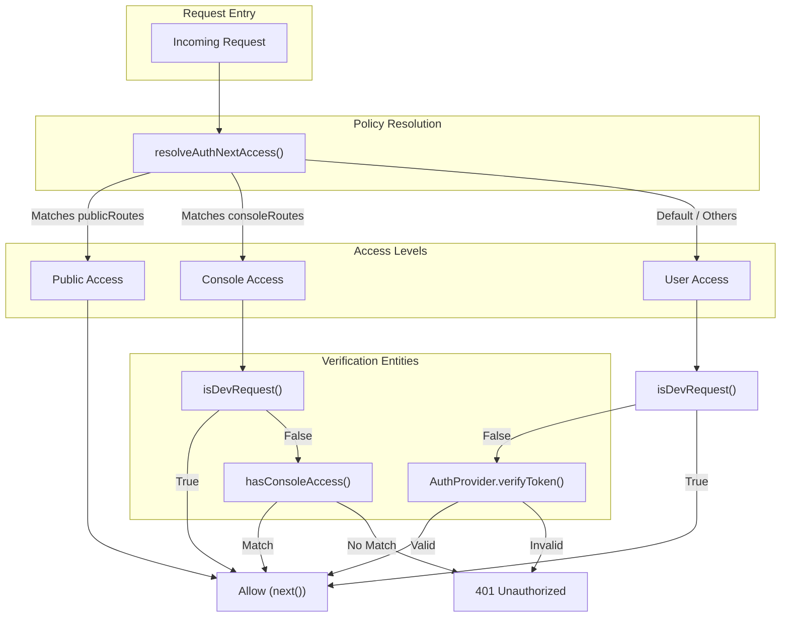
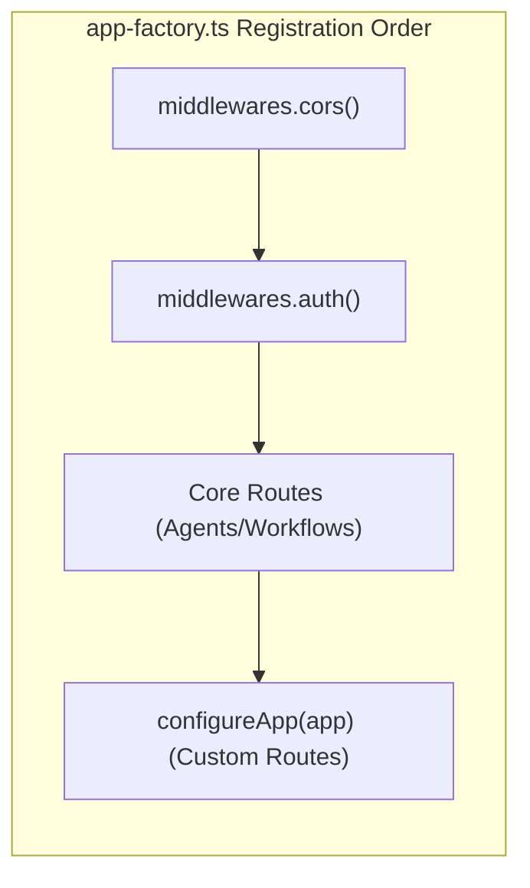

<!-- source: DeepWiki mcp.deepwiki.com · repo VoltAgent/voltagent · page 7.3 Authentication and Security · fetched 2026-10-26 -->

# Authentication and Security

<details>
<summary>Relevant source files</summary>

The following files were used as context for generating this wiki page:

- [examples/with-auth/package.json](examples/with-auth/package.json)
- [examples/with-auth/src/index.ts](examples/with-auth/src/index.ts)
- [examples/with-cerbos/package.json](examples/with-cerbos/package.json)
- [packages/server-core/src/auth/index.ts](packages/server-core/src/auth/index.ts)
- [packages/server-core/src/auth/next.spec.ts](packages/server-core/src/auth/next.spec.ts)
- [packages/server-core/src/auth/next.ts](packages/server-core/src/auth/next.ts)
- [packages/server-core/src/auth/utils.spec.ts](packages/server-core/src/auth/utils.spec.ts)
- [packages/server-core/src/auth/utils.ts](packages/server-core/src/auth/utils.ts)
- [packages/server-core/src/websocket/setup.ts](packages/server-core/src/websocket/setup.ts)
- [packages/server-hono/src/app-factory.spec.ts](packages/server-hono/src/app-factory.spec.ts)
- [packages/server-hono/src/app-factory.ts](packages/server-hono/src/app-factory.ts)
- [packages/server-hono/src/auth/index.ts](packages/server-hono/src/auth/index.ts)
- [packages/server-hono/src/auth/middleware.spec.ts](packages/server-hono/src/auth/middleware.spec.ts)
- [packages/server-hono/src/auth/middleware.ts](packages/server-hono/src/auth/middleware.ts)
- [packages/server-hono/src/index.ts](packages/server-hono/src/index.ts)
- [packages/server-hono/src/routes/tool.routes.ts](packages/server-hono/src/routes/tool.routes.ts)
- [packages/server-hono/src/types.ts](packages/server-hono/src/types.ts)
- [website/docs/api/authentication.md](website/docs/api/authentication.md)
- [website/docs/api/custom-endpoints.md](website/docs/api/custom-endpoints.md)

</details>


This document covers authentication mechanisms, security patterns, and authorization controls in VoltAgent applications. It focuses on securing API endpoints via the `authNext` policy model, managing credentials, and implementing fine-grained access control for tools and resources.

## Overview

VoltAgent applications handle authentication and security at multiple layers:

| Layer | Mechanism | Purpose |
|-------|-----------|---------|
| **Provider Authentication** | API keys (environment variables) | Authenticate with AI providers (OpenAI, Anthropic, etc.) |
| **Console Access** | `VOLTAGENT_CONSOLE_ACCESS_KEY` | Secure management, observability, and docs endpoints |
| **User Authentication** | `authNext` (JWT/Custom) | Secure agent and workflow execution endpoints |
| **Development Bypass** | `x-voltagent-dev` header | Allow unauthenticated access during local development |
| **Tool Authorization** | MCP authorization layer | Control tool discovery and execution based on user identity |

Sources: [website/docs/api/authentication.md:72-78](), [packages/server-hono/src/types.ts:140-152]()

---

## Authentication Architecture

VoltAgent uses a policy-driven authentication model called `authNext`. It separates requests into three categories: **public**, **console**, and **user**.

### Authentication Flow

The following diagram illustrates how the `createAuthNextMiddleware` in `packages/server-hono/src/auth/middleware.ts` processes incoming requests.



Sources: [packages/server-hono/src/auth/middleware.ts:109-189](), [packages/server-core/src/auth/utils.ts:33-91](), [website/docs/api/authentication.md:83-88]()

---

## The authNext Policy Model

The `authNext` configuration allows developers to protect everything by default while explicitly carving out public and management access.

### Configuration Structure

The `HonoServerConfig` interface defines the `authNext` property which accepts an `AuthNextConfig`.

```typescript
// packages/server-hono/src/types.ts
export interface HonoServerConfig {
  authNext?: AuthNextConfig;
  // ...
}
```

**Key Properties:**
- `provider`: An `AuthProvider` (e.g., `jwtAuth`) responsible for token extraction and verification.
- `publicRoutes`: An array of route patterns (e.g., `GET /health`) that bypass all checks.
- `consoleRoutes`: (Optional) Overrides the default list of management routes requiring the Console Access Key.

### Implementation Example

```typescript
import { jwtAuth } from "@voltagent/server-core";
import { honoServer } from "@voltagent/server-hono";

new VoltAgent({
  server: honoServer({
    authNext: {
      provider: jwtAuth({
        secret: process.env.JWT_SECRET!,
      }),
      publicRoutes: ["GET /health", "POST /webhooks/*"],
    },
  }),
});
```

Sources: [packages/server-hono/src/types.ts:140-152](), [website/docs/api/authentication.md:34-49](), [website/docs/api/authentication.md:193-201]()

---

## Access Control Layers

### 1. Console Access Key
Management endpoints (like `/agents`, `/doc`, `/observability/*`) are protected by a static key. 
- **Env Var**: `VOLTAGENT_CONSOLE_ACCESS_KEY`
- **Header**: `x-console-access-key`
- **Query Param**: `?key=...` (often used for WebSockets)

The `hasConsoleAccess` function in `packages/server-core/src/auth/utils.ts` handles this logic.

Sources: [packages/server-core/src/auth/utils.ts:74-91](), [website/docs/api/authentication.md:75-75]()

### 2. User Context Injection
When a user is authenticated via `authNext`, the middleware injects the user object into the request context and the Hono context (`c.set("authenticatedUser", user)`). It also intercepts `c.req.json()` to automatically append user data to the agent's operation context.

```typescript
// packages/server-hono/src/auth/middleware.ts
function injectUserContext(c: Context, user: any) {
  c.set("authenticatedUser", user);
  // Intercepts body to inject context.user and userId
}
```

Sources: [packages/server-hono/src/auth/middleware.ts:191-217]()

### 3. Development Bypass
To improve Developer Experience (DX), VoltAgent allows bypassing authentication if `NODE_ENV` is not `production` and the `x-voltagent-dev: true` header is present. This is verified by `isDevRequest`.

Sources: [packages/server-core/src/auth/utils.ts:33-47](), [website/docs/api/authentication.md:77-77]()

---

## Security in Custom Endpoints

When adding custom routes via `configureApp`, these routes are **protected by default** if `authNext` is configured. The middleware is registered before custom routes in the `createApp` factory.



Sources: [packages/server-hono/src/app-factory.ts:110-135](), [packages/server-hono/src/app-factory.spec.ts:162-181]()

---

## CORS Configuration

Cross-Origin Resource Sharing (CORS) is managed via the `cors` property in the server configuration.

| Mode | Configuration | Result |
|------|---------------|--------|
| **Default** | (Empty) | Allows all origins (`*`) |
| **Custom** | `cors: { origin: "..." }` | Applies specific Hono CORS middleware |
| **Disabled** | `cors: false` | Disables global CORS; allows route-specific config in `configureApp` |

Sources: [packages/server-hono/src/types.ts:70-70](), [packages/server-hono/src/app-factory.ts:77-81](), [website/docs/api/custom-endpoints.md:131-135]()

---

## WebSocket Security

WebSockets require a different authentication approach because headers cannot always be sent during the handshake. VoltAgent supports passing tokens via query parameters.

- **Endpoint**: `/ws`
- **Auth**: `?token=<JWT>` or `?key=<CONSOLE_KEY>`
- **Handler**: `setupWebSocketUpgrade` in `packages/server-core/src/websocket/setup.ts` validates the upgrade request before the connection is established.

Sources: [packages/server-core/src/websocket/setup.ts:225-233](), [website/docs/api/authentication.md:111-112]()

---

## MCP Tool Authorization

Beyond API security, the Model Context Protocol (MCP) integration includes an authorization layer to control tool usage.

```typescript
const mcp = new MCPConfiguration({
  authorization: {
    can: async ({ toolName, userId }) => {
      // Logic to check if user has access to this tool
      return userId === "admin";
    },
    filterOnDiscovery: true, // Hide tools from the list if unauthorized
    checkOnExecution: true   // Verify again before running the tool
  }
});
```

Sources: [packages/server-hono/src/routes/tool.routes.ts:137-151](), [website/docs/api/authentication.md:101-101]()

---

## Security Checklist

1. **Environment Variables**: Ensure `VOLTAGENT_CONSOLE_ACCESS_KEY` is set in production.
2. **authNext**: Use `authNext` instead of the legacy `auth` for default-private security.
3. **CORS**: Restrict `origin` in production environments.
4. **JWT Secrets**: Use strong, unique secrets for `jwtAuth`.
5. **Tool Permissions**: Implement `can` handlers in `MCPConfiguration` for sensitive tools.

Sources: [website/docs/api/authentication.md:8-10](), [website/docs/api/custom-endpoints.md:80-93]()

---

