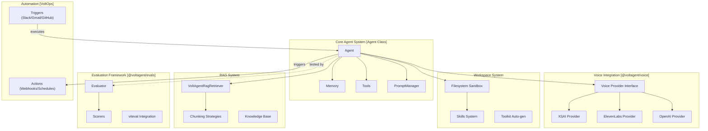
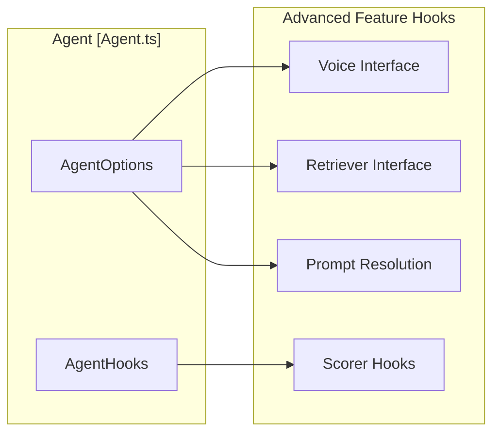

<!-- source: DeepWiki mcp.deepwiki.com · repo VoltAgent/voltagent · page 8 Advanced Features · fetched 2026-10-26 -->

# Advanced Features

Relevant source files

The following files were used as context for generating this wiki page:

- [CHANGELOG.md](CHANGELOG.md)
- [changelog.sh](changelog.sh)
- [examples/base/src/index.ts](examples/base/src/index.ts)
- [packages/cli/package.json](packages/cli/package.json)
- [packages/create-voltagent-app/CHANGELOG.md](packages/create-voltagent-app/CHANGELOG.md)
- [packages/create-voltagent-app/package.json](packages/create-voltagent-app/package.json)
- [packages/voice/CHANGELOG.md](packages/voice/CHANGELOG.md)
- [packages/voice/package.json](packages/voice/package.json)
- [website/docs/index.md](website/docs/index.md)
- [website/observability/mcp.md](website/observability/mcp.md)
- [website/sidebars.ts](website/sidebars.ts)
- [website/src/data/tweets.json](website/src/data/tweets.json)

This document provides an overview of VoltAgent's advanced capabilities that extend beyond basic agent operations. These features enable specialized functionality including voice interaction, retrieval-augmented generation (RAG), persistent memory storage, and evaluation frameworks.

For core agent functionality, see [Core Agent System](#2). For workflow orchestration, see [Workflow System](#3). For protocol integrations (MCP, A2A), see [Protocol Integrations](#6).

---

## Scope and Organization

VoltAgent's advanced features are organized into categories that provide deep integration with the core runtime while maintaining a modular package structure.

| Feature Category | Package(s) | Primary Use Case |
|-----------------|-----------|------------------|
| **Voice Integration** | `@voltagent/voice` | Speech-to-text, text-to-speech, voice-enabled agents |
| **RAG and Retrieval** | Core retriever system | Semantic search, vector database integration |
| **Evaluation System** | `@voltagent/evals` | Testing, scoring, and quality assurance |
| **Workspace System** | Core / CLI | Filesystem sandboxing, skills, and tool auto-generation |
| **Prompt Management** | Core / CLI | Offline-first prompt versioning and local resolution |
| **Actions & Triggers** | Core / VoltOps | Automating agent responses to external events |

Each category has dedicated documentation pages (sections 8.1-8.7) that provide implementation details, configuration options, and usage examples.

---

## Advanced Features Architecture

**Sources:** [website/sidebars.ts:51-262](), [packages/voice/package.json:1-10](), [CHANGELOG.md:1-15](), [examples/base/src/index.ts:1-32]()

---

## Voice Integration

The `@voltagent/voice` package enables agents to process speech input and generate voice output through multiple provider integrations.

### Supported Providers
- **XSAI**: Provides speech generation and transcription support via `@xsai/generate-speech` and `@xsai/generate-transcription` [packages/voice/package.json:6-7]().
- **OpenAI**: Native support for Whisper (STT) and TTS models [packages/voice/package.json:9]().
- **ElevenLabs**: High-fidelity text-to-speech with support for models like `scribe_v2` [packages/voice/CHANGELOG.md:7-9]().

For detailed implementation examples, see [Voice Integration](#8.1).

---

## RAG and Vector Retrieval

The retrieval system provides semantic search capabilities through the `VoltAgentRagRetriever`. It supports advanced chunking strategies (Token, Sentence, Recursive, Markdown, Semantic, etc.) to optimize context injection [website/sidebars.ts:237-262]().

### Core Components
- **Knowledge Base**: Centralized integration for document indexing.
- **Retrieval Patterns**: Strategies for fetching relevant context during the `Agent` execution lifecycle.

For implementation details, see [RAG and Vector Retrieval](#8.2).

---

## Evaluation System

The evaluation framework enables technical teams to measure agent performance using standardized scorers and datasets.

- **Scorers**: Built-in and custom logic to grade agent outputs.
- **viteval Integration**: Seamless testing patterns for AI agents.
- **CLI Integration**: Run evaluations via `volt evals` [packages/cli/package.json:9]().

For complete evaluation workflows, see [Evaluation System](#8.3).

---

## Workspace and Prompt Management

VoltAgent includes advanced systems for managing the agent's environment and instructions.

### Workspace System
Provides a sandboxed `Filesystem` for agents to read/write files, a `Skills` system for modular capability injection, and automatic `Toolkit` generation from code entities [website/sidebars.ts:108-148]().

### Prompt Management
VoltAgent 2.0.10 introduced an **offline-first** prompt resolution system [CHANGELOG.md:7-15]().
- **Local Resolution**: Prompts are stored in `.voltagent/prompts/<name>/<version>.md`.
- **Versioning**: Supports version and label (e.g., `production`) selection in `Agent` instructions [CHANGELOG.md:32-48]().
- **CLI Sync**: Use `volt prompts pull` and `volt prompts push` to sync with VoltOps [CHANGELOG.md:18-28]().

For details, see [Workspace System](#8.4) and [Prompt Management](#8.5).

---

## Actions and Triggers

Automate agent behavior by responding to external events or scheduling tasks.

- **Triggers**: Connect agents to events from Gmail, Slack, Airtable, and GitHub [website/sidebars.ts:221-223]().
- **Actions**: Define webhooks or schedules that the agent can execute or respond to [website/sidebars.ts:225-228]().

For implementation details, see [Actions and Triggers](#8.6).

---

## Plan Agent (Experimental)

The `PlanAgent` is an advanced orchestration pattern for multi-step task planning [website/sidebars.ts:65-74]().
- **Planning DSL**: Uses a domain-specific language for task decomposition.
- **Filesystem Integration**: Deep integration with workspaces for complex file-based tasks.

For details, see [Plan Agent](#8.7).

---

## Integration with Core System

Advanced features integrate with the core `Agent` and `VoltAgent` classes through the `AgentOptions` and the `VoltOpsClient` for observability.

**Sources:** [examples/base/src/index.ts:20-25](), [CHANGELOG.md:32-48](), [website/sidebars.ts:93-94]()

---

