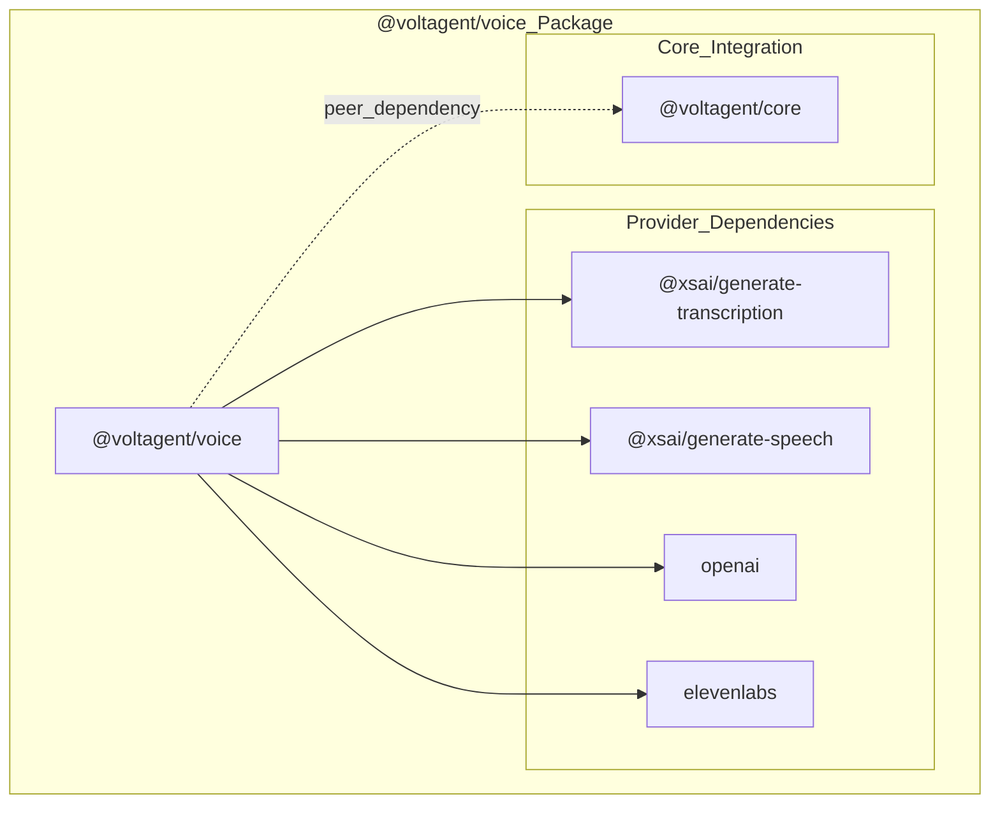
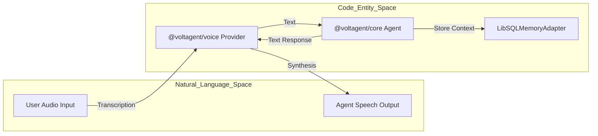

<!-- source: DeepWiki mcp.deepwiki.com · repo VoltAgent/voltagent · page 8.1 Voice Integration · fetched 2026-10-26 -->

# Voice Integration

Relevant source files

The following files were used as context for generating this wiki page:

- [CHANGELOG.md](CHANGELOG.md)
- [changelog.sh](changelog.sh)
- [examples/base/package.json](examples/base/package.json)
- [examples/base/src/index.ts](examples/base/src/index.ts)
- [examples/github-repo-analyzer/package.json](examples/github-repo-analyzer/package.json)
- [examples/with-rag-chatbot/package.json](examples/with-rag-chatbot/package.json)
- [examples/with-retrieval/package.json](examples/with-retrieval/package.json)
- [examples/with-subagents/package.json](examples/with-subagents/package.json)
- [examples/with-supabase/package.json](examples/with-supabase/package.json)
- [examples/with-tools/package.json](examples/with-tools/package.json)
- [examples/with-vercel-ai/package.json](examples/with-vercel-ai/package.json)
- [examples/with-voice-elevenlabs/package.json](examples/with-voice-elevenlabs/package.json)
- [examples/with-voice-openai/package.json](examples/with-voice-openai/package.json)
- [examples/with-voice-xsai/package.json](examples/with-voice-xsai/package.json)
- [packages/cli/package.json](packages/cli/package.json)
- [packages/create-voltagent-app/CHANGELOG.md](packages/create-voltagent-app/CHANGELOG.md)
- [packages/create-voltagent-app/package.json](packages/create-voltagent-app/package.json)
- [packages/voice/CHANGELOG.md](packages/voice/CHANGELOG.md)
- [packages/voice/package.json](packages/voice/package.json)

The `@voltagent/voice` package provides speech-to-text (transcription) and text-to-speech (generation) capabilities for VoltAgent agents. It supports multiple voice service providers including OpenAI, ElevenLabs, and XS.ai through a unified interface.

This page documents the voice package architecture, provider integrations, and usage patterns for building voice-enabled agents.

## Package Overview

The `@voltagent/voice` package provides voice capabilities through three primary provider integrations. It is built as part of the VoltAgent monorepo and designed to work seamlessly with `@voltagent/core`.

**Package Structure:**

| Provider | Transcription | Speech Generation | Key Dependencies |
|----------|---------------|-------------------|-----------------|
| **XS.ai** | ✓ | ✓ | `@xsai/generate-transcription`, `@xsai/generate-speech` |
| **OpenAI** | ✓ | ✓ | `openai` |
| **ElevenLabs** | ✗ | ✓ | `elevenlabs` |

**Sources:** [packages/voice/package.json:1-51](), [examples/with-voice-openai/package.json:1-42](), [examples/with-voice-xsai/package.json:1-42]()

## Exports and Module Structure

The voice package exports dual formats (CommonJS and ESM) with full TypeScript support using `tsup` for bundling.

**Export Structure:**

| Export Type | Path | Description |
|-------------|------|-------------|
| ESM Types | `./dist/index.d.mts` | TypeScript declarations for ESM |
| ESM Module | `./dist/index.mjs` | JavaScript ESM export |
| CJS Types | `./dist/index.d.ts` | TypeScript declarations for CommonJS |
| CJS Module | `./dist/index.js` | JavaScript CommonJS export |

**Sources:** [packages/voice/package.json:19-50]()

## Provider Integrations

### OpenAI Voice
OpenAI integration utilizes the official `openai` SDK to provide Whisper-based transcription and high-quality TTS.

- **Transcription:** `whisper-1` model.
- **Speech:** `tts-1` and `tts-1-hd` models.
- **Voices:** `alloy`, `echo`, `fable`, `onyx`, `nova`, `shimmer`.

**Sources:** [examples/with-voice-openai/package.json:10-13]()

### ElevenLabs Voice
ElevenLabs provides industry-leading text-to-speech with a focus on natural prosody and voice cloning.

- **Capabilities:** Speech generation only.
- **Features:** Supports streaming audio for low-latency agent responses.
- **Fixes:** Improved stream handling for edge cases in recent versions.

**Sources:** [examples/with-voice-elevenlabs/package.json:10-13](), [packages/voice/CHANGELOG.md:177-181]()

### XS.ai Voice
XS.ai integration uses specialized beta packages for high-performance audio processing.

- **Packages:** `@xsai/generate-transcription` and `@xsai/generate-speech`.
- **Updates:** Version `0.4.0-beta.1` added support for file-based processing and reasoning features.

**Sources:** [packages/voice/package.json:6-7](), [packages/voice/CHANGELOG.md:31-31]()

## Implementation and Data Flow

Voice integration bridges the gap between raw audio signals (Natural Language Space) and the agent's logic (Code Entity Space).

**Voice Processing Pipeline:**

**Sources:** [examples/with-voice-openai/package.json:6-10](), [examples/with-voice-xsai/package.json:6-10]()

## Example Applications

The framework provides reference implementations for each voice provider to demonstrate setup and tool usage.

### Standard Dependencies
All voice examples share a common core stack:
- `@voltagent/core`: Framework orchestration.
- `@voltagent/server-hono`: HTTP interface for streaming audio.
- `@voltagent/libsql`: Local SQLite-based memory for conversation history.
- `ai`: Vercel AI SDK for model communication.

**Sources:** [examples/with-voice-openai/package.json:4-15](), [examples/with-voice-elevenlabs/package.json:4-13]()

### Development Workflow
Examples are managed via standard npm scripts:
- `pnpm dev`: Runs `tsx watch --env-file=.env ./src` for rapid iteration.
- `pnpm build`: Compiles TypeScript via `tsc`.
- `pnpm volt`: Accesses the VoltAgent CLI for prompt management and debugging.

**Sources:** [examples/with-voice-openai/package.json:35-40](), [examples/with-voice-xsai/package.json:35-40]()

## Testing and Quality Assurance

The voice package maintains high reliability through a comprehensive testing suite and strict linting.

| Tool | Purpose |
|------|---------|
| **Vitest** | Unit testing for providers and audio stream handling. |
| **Biome** | Linting and formatting to ensure codebase consistency. |
| **Publint** | Validating `package.json` exports for compatibility. |
| **TypeScript** | Strict type checking across the provider interface. |

**Sources:** [packages/voice/package.json:11-18](), [packages/voice/package.json:40-49]()

---

