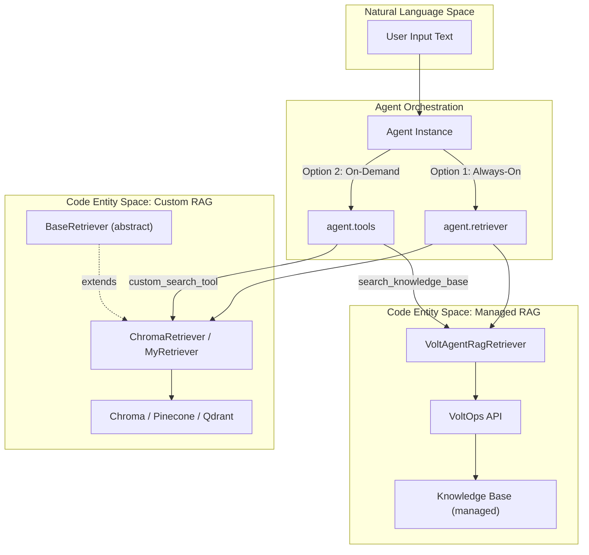
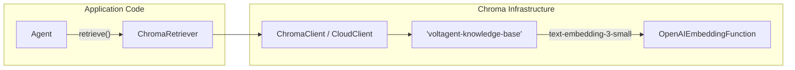

<!-- source: DeepWiki mcp.deepwiki.com · repo VoltAgent/voltagent · page 8.2 RAG and Vector Retrieval · fetched 2026-10-26 -->

# RAG and Vector Retrieval

<details>
<summary>Relevant source files</summary>

The following files were used as context for generating this wiki page:

- [examples/with-chroma/.env.example](examples/with-chroma/.env.example)
- [examples/with-chroma/.gitignore](examples/with-chroma/.gitignore)
- [examples/with-chroma/README.md](examples/with-chroma/README.md)
- [examples/with-chroma/package.json](examples/with-chroma/package.json)
- [examples/with-chroma/src/index.ts](examples/with-chroma/src/index.ts)
- [examples/with-chroma/src/retriever/index.ts](examples/with-chroma/src/retriever/index.ts)
- [examples/with-chroma/tsconfig.json](examples/with-chroma/tsconfig.json)
- [examples/with-pinecone/package.json](examples/with-pinecone/package.json)
- [examples/with-qdrant/package.json](examples/with-qdrant/package.json)
- [website/blog/2025-04-24-rag-chatbot/index.md](website/blog/2025-04-24-rag-chatbot/index.md)
- [website/docs/rag/chroma.md](website/docs/rag/chroma.md)
- [website/docs/rag/overview.md](website/docs/rag/overview.md)
- [website/docs/rag/voltagent.md](website/docs/rag/voltagent.md)
- [website/src/components/blog-widgets/RetrieverMethodHelper/index.tsx](website/src/components/blog-widgets/RetrieverMethodHelper/index.tsx)

</details>


## Purpose and Scope

This document describes VoltAgent's Retrieval Augmented Generation (RAG) capabilities for grounding agent responses in external knowledge bases. RAG enables agents to retrieve relevant context from large document collections using semantic search, augmenting responses with facts beyond what fits in the training data or immediate conversation buffer.

VoltAgent provides two primary RAG approaches:

**1. VoltAgent Knowledge Base (Managed RAG)**
- `VoltAgentRagRetriever` connects to VoltAgent Knowledge Bases hosted in VoltOps Console.
- Zero infrastructure setup—upload documents via Console, query via API.
- Automatic chunking, embedding generation, and vector search.
- Recommended for most production use cases.

**2. Custom RAG Implementation**
- Implement `BaseRetriever` to connect to any database (Chroma, Pinecone, Qdrant, etc.).
- Full control over embedding models, chunking strategies, and retrieval logic.
- Integration via direct attachment or as an agent tool.

Sources: [website/docs/rag/overview.md:6-109](), [website/docs/rag/voltagent.md:16-27]()

---

## RAG Architecture Overview

The following diagram illustrates the flow from a user query to retrieved context using both managed and custom paths.



Sources: [website/docs/rag/overview.md:52-109](), [website/docs/rag/voltagent.md:96-155]()

---

## VoltAgentRagRetriever (Managed RAG)

### Overview

`VoltAgentRagRetriever` is the fastest way to add RAG. It handles document ingestion, chunking, and semantic search via the VoltOps platform [website/docs/rag/voltagent.md:16-17]().

**Key Features:**
- **Supported Formats**: PDF, DOCX, XLSX, CSV, HTML, MD, JSON, and more [website/docs/rag/voltagent.md:31-39]().
- **Smart Chunking**: Supports "Flat Mode" (delimiter-based) and "Parent-Child Mode" (hierarchical context) [website/docs/rag/voltagent.md:41-57]().
- **Semantic Search**: Uses `e5-mistral-7b-it` (4096 dimensions) and `pgvector` [website/docs/rag/voltagent.md:58-63]().

### Configuration and Usage

```typescript
import { Agent, VoltAgentRagRetriever } from "@voltagent/core";

const retriever = new VoltAgentRagRetriever({
  knowledgeBaseName: "my-docs", // From VoltOps Console
  topK: 8,
  includeSources: true,
});

const agent = new Agent({
  name: "Support Bot",
  retriever, // Automatic injection
});
```

| Option | Type | Default | Description |
| :--- | :--- | :--- | :--- |
| `knowledgeBaseName` | `string` | **required** | Name of your KB in Console [website/docs/rag/voltagent.md:168]() |
| `topK` | `number` | `8` | Number of chunks to retrieve [website/docs/rag/voltagent.md:169]() |
| `tagFilters` | `array` | `null` | Filter results by custom tags [website/docs/rag/voltagent.md:170]() |
| `includeSources` | `boolean` | `true` | Include document names in response [website/docs/rag/voltagent.md:172]() |

Sources: [website/docs/rag/voltagent.md:100-177]()

---

## Custom Retriever Implementation

To connect to your own data source, extend the `BaseRetriever` class [website/docs/rag/overview.md:83-84]().

### The BaseRetriever Contract

```typescript
import { BaseRetriever, type BaseMessage, type RetrieveOptions } from "@voltagent/core";

class MyRetriever extends BaseRetriever {
  async retrieve(input: string | BaseMessage[], options: RetrieveOptions): Promise<string> {
    // 1. Extract query from input
    const query = typeof input === "string" ? input : input[input.length - 1].content;
    
    // 2. Perform search in your DB
    const results = await this.myDatabase.search(query);
    
    // 3. (Optional) Track sources in context
    if (options.context) {
      options.context.set("sources", results.map(r => r.source));
    }

    return results.map(r => r.content).join("\n\n");
  }
}
```

Sources: [website/docs/rag/overview.md:86-103](), [website/blog/2025-04-24-rag-chatbot/index.md:131-152]()

### Chroma Integration Example

VoltAgent provides specific examples for ChromaDB, which can run locally without Docker or Python using the bundled CLI [website/docs/rag/chroma.md:17-18]().



**Implementation Details:**
- **Initialization**: Use `chromaClient.getOrCreateCollection` with an `embeddingFunction` [examples/with-chroma/src/retriever/index.ts:23-26]().
- **Querying**: Use `collection.query` and the `.rows()` method for data access [examples/with-chroma/src/retriever/index.ts:67-73]().
- **Context Mapping**: The `ChromaRetriever` maps distances and metadata to the operation context [examples/with-chroma/src/retriever/index.ts:128-137]().

Sources: [website/docs/rag/chroma.md:162-194](), [examples/with-chroma/src/retriever/index.ts:5-154]()

---

## RAG Patterns: Always-On vs. On-Demand

VoltAgent allows you to choose how the agent interacts with the retriever.

### 1. Direct Attachment (Always-On)
The retriever runs automatically **before every** LLM call. This is ideal for support bots where context is almost always needed [website/docs/rag/overview.md:56-66]().

```typescript
const agent = new Agent({
  retriever: myRetriever,
});
```

### 2. Tool-Based (On-Demand)
The LLM decides **when** to search. This is more efficient for general assistants where retrieval is only needed for specific queries [website/docs/rag/overview.md:68-76]().

```typescript
const agent = new Agent({
  tools: [myRetriever.tool], // Automatically exposes search_knowledge_base
});
```

### Decision Matrix

| Factor | Direct Attachment | Tool-Based |
| :--- | :--- | :--- |
| **Execution** | Every request | Only when LLM chooses |
| **Efficiency** | Lower (always calls DB) | Higher (selective calls) |
| **Control** | Developer-defined | LLM-defined |
| **Best For** | Documentation bots | Complex multi-step workflows |

Sources: [website/docs/rag/overview.md:52-76](), [website/src/components/blog-widgets/RetrieverMethodHelper/index.tsx:48-83](), [website/docs/rag/voltagent.md:157-162]()

---

## Vector Database Support

VoltAgent is database-agnostic. While `VoltAgentRagRetriever` is the managed option, the community and core provide examples for several providers:

| Provider | Integration Type | Best For |
| :--- | :--- | :--- |
| **Chroma** | Local/Cloud | Local development and open-source stacks [website/docs/rag/chroma.md:8-18]() |
| **Pinecone** | Managed | Production-ready serverless scaling [website/docs/rag/pinecone.md:192-194]() |
| **Qdrant** | Open Source/Cloud | Production stacks requiring advanced filtering [website/docs/rag/qdrant.md:205-208]() |
| **LanceDB** | Embedded | Serverless/Edge environments without API keys [website/docs/rag/lancedb.md:215-218]() |

Sources: [website/docs/rag/overview.md:113-118](), [examples/with-chroma/package.json:14](), [examples/with-pinecone/package.json:5](), [examples/with-qdrant/package.json:5]()

---

## Chunking and Source Tracking

### Metadata and References
When a retriever finds relevant documents, it can pass metadata back to the agent's context. This allows the agent to cite its sources [website/docs/rag/overview.md:39]().

In `ChromaRetriever`, references are set as:
```typescript
options.context.set("references", results.map((doc, index) => ({
  id: doc.id,
  title: doc.metadata.title || `Document ${index + 1}`,
  source: "Chroma Knowledge Base",
  distance: doc.distance,
})));
```
Sources: [examples/with-chroma/src/retriever/index.ts:128-137]()

### Managed Chunking Strategies
VoltAgent Knowledge Base provides two primary strategies:
1. **Flat Mode**: Splits text on delimiters (e.g., `\n\n`) with configurable chunk sizes (100-4000 characters) and overlap [website/docs/rag/voltagent.md:45-49]().
2. **Parent-Child Mode**: Hierarchical chunking where "parent" chunks provide broad context and "child" chunks provide precise semantic matching [website/docs/rag/voltagent.md:51-56]().

Sources: [website/docs/rag/voltagent.md:41-57]()

---

