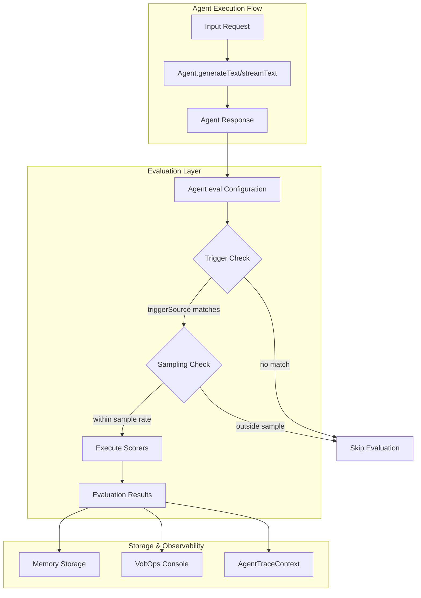
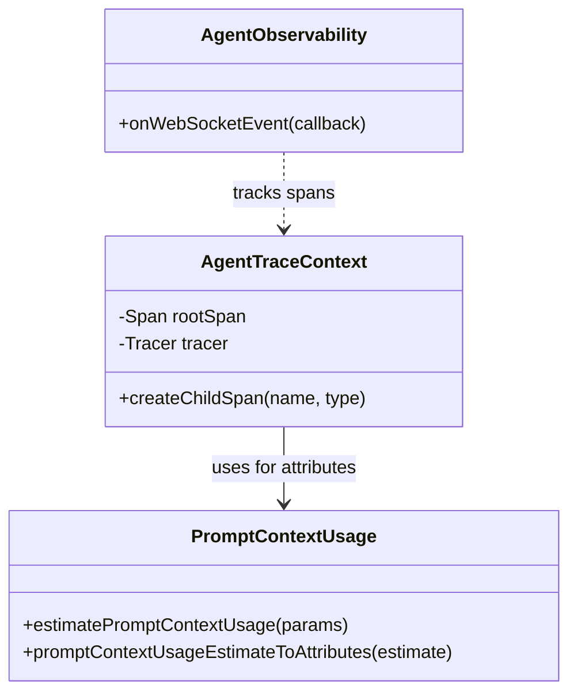

<!-- source: DeepWiki mcp.deepwiki.com · repo VoltAgent/voltagent · page 8.3 Evaluation System · fetched 2026-10-26 -->

# Evaluation System

<details>
<summary>Relevant source files</summary>

The following files were used as context for generating this wiki page:

- [examples/README.md](examples/README.md)
- [examples/with-offline-evals/package.json](examples/with-offline-evals/package.json)
- [examples/with-openrouter/.env.example](examples/with-openrouter/.env.example)
- [examples/with-openrouter/.gitignore](examples/with-openrouter/.gitignore)
- [examples/with-openrouter/README.md](examples/with-openrouter/README.md)
- [examples/with-openrouter/src/index.ts](examples/with-openrouter/src/index.ts)
- [examples/with-openrouter/tsconfig.json](examples/with-openrouter/tsconfig.json)
- [examples/with-research-assistant/package.json](examples/with-research-assistant/package.json)
- [examples/with-viteval/package.json](examples/with-viteval/package.json)
- [packages/core/src/agent/agent-observability.spec.ts](packages/core/src/agent/agent-observability.spec.ts)
- [packages/core/src/agent/open-telemetry/trace-context.ts](packages/core/src/agent/open-telemetry/trace-context.ts)
- [packages/core/src/agent/prompt-context-usage.spec.ts](packages/core/src/agent/prompt-context-usage.spec.ts)
- [packages/core/src/agent/prompt-context-usage.ts](packages/core/src/agent/prompt-context-usage.ts)

</details>


## Purpose and Scope

The Evaluation System enables automated testing of agent outputs during development and production. It provides a framework for defining scorers that validate agent responses against quality, safety, and correctness criteria. Evaluations can be sampled and triggered based on environment, helping teams catch issues before they impact users.

This document covers evaluation configuration on agents, scorer implementation, sampling strategies, and integration with the `viteval` testing framework. For information about general observability and monitoring, see [Telemetry Architecture](9.2). For guardrails that block requests in real-time, see [Guardrails and Middleware](2.7).

---

## Evaluation Architecture

The evaluation layer sits between the agent output and the storage/observability systems. It intercepts agent responses to run configured scorers based on sampling logic.

### Data Flow Diagram



**Sources:** [packages/core/src/agent/open-telemetry/trace-context.ts:58-63](), [packages/core/src/agent/agent-observability.spec.ts:183-210]()

---

## Agent Evaluation Configuration

Evaluations are configured at the agent level through the `eval` property in `AgentOptions`. This configuration determines when evaluations run, what they test, and how results are stored.

### Configuration Structure

```typescript
const agent = new Agent({
  name: "support-agent",
  instructions: "Answer customer questions about products.",
  model: openai("gpt-4o"),
  eval: {
    triggerSource: "production",
    environment: "prod-us-east",
    sampling: { type: "ratio", rate: 0.1 },
    scorers: {
      moderation: {
        scorer: createModerationScorer({
          model: openai("gpt-4o-mini"),
          threshold: 0.5,
        }),
      },
    },
  },
});
```

### Configuration Properties

| Property | Type | Description |
|----------|------|-------------|
| `triggerSource` | `string` | Environment identifier (e.g., "production", "staging", "development") |
| `environment` | `string` | Deployment region or instance (e.g., "prod-us-east", "staging-eu") |
| `sampling` | `object` | Sampling strategy configuration (e.g., `{ type: "ratio", rate: 0.1 }`) |
| `scorers` | `Record<string, ScorerConfig>` | Named scorers to execute on agent outputs |

**Sources:** [examples/with-offline-evals/package.json:7-8](), [packages/core/src/agent/agent-observability.spec.ts:187-210]()

---

## Observability and Token Estimation

Evaluations often rely on token usage metrics to assess cost and efficiency. VoltAgent provides utility functions to estimate prompt context usage before and after execution.

### Token Estimation Functions

The system uses `estimatePromptContextUsage` to calculate token counts for system messages, user messages, and tool definitions [packages/core/src/agent/prompt-context-usage.ts:32-35](). These estimates are then mapped to OpenTelemetry span attributes using `promptContextUsageEstimateToAttributes` [packages/core/src/agent/prompt-context-usage.ts:81-83]().

| Attribute | Source |
|-----------|--------|
| `usage.prompt_context.system_tokens_estimated` | System message length [packages/core/src/agent/prompt-context-usage.ts:85]() |
| `usage.prompt_context.tool_tokens_estimated` | Tool definition schemas [packages/core/src/agent/prompt-context-usage.ts:89]() |
| `usage.prompt_context.total_tokens_estimated` | Aggregate of messages and tools [packages/core/src/agent/prompt-context-usage.ts:90]() |

**Sources:** [packages/core/src/agent/prompt-context-usage.ts:5-15](), [packages/core/src/agent/prompt-context-usage.spec.ts:9-48]()

---

## Scorers

Scorers are functions that evaluate agent outputs against specific criteria. VoltAgent supports both built-in scorers and custom implementations.

### Built-in Scorers

The `@voltagent/scorers` package provides standard implementations for common evaluation tasks [examples/with-offline-evals/package.json:8]().

#### Moderation Scorer
Detects harmful content in agent outputs using LLM-based moderation. It typically compares the model's output against a defined threshold.

### Custom Scorer Implementation

Teams can implement custom scorers by following the scorer interface. These are executed during the agent's generation lifecycle, often within the context of a child span managed by `AgentTraceContext` [packages/core/src/agent/open-telemetry/trace-context.ts:194-205]().

```typescript
// Example of custom logic integrated via AgentTraceContext
const childSpan = traceContext.createChildSpan("custom-scorer", "guardrail");
// ... logic to evaluate output ...
childSpan.end();
```

**Sources:** [packages/core/src/agent/open-telemetry/trace-context.ts:194-205](), [packages/core/src/agent/agent-observability.spec.ts:187-197]()

---

## Testing Framework Integration

VoltAgent provides deep integration with modern testing and evaluation tools like `viteval` and `vitest`.

### Viteval Integration

The `with-viteval` example demonstrates how to use `viteval` for systematic evaluation workflows [examples/with-viteval/package.json:22]().

```json
{
  "scripts": {
    "eval": "viteval"
  },
  "devDependencies": {
    "viteval": "^0.5.3"
  }
}
```

**Sources:** [examples/with-viteval/package.json:22-41]()

### Offline Evaluations

The `with-offline-evals` package allows running evaluations against historical data or pre-generated outputs without requiring a live agent connection for every test run [examples/with-offline-evals/package.json:1-12]().

---

## Trace and Cost Analysis

Evaluations are often used to monitor costs. The `AgentTraceContext` ensures that usage and cost attributes from providers like OpenRouter are propagated to the root spans for analysis [packages/core/src/agent/agent-observability.spec.ts:156-170]().

### Provider Cost Mapping

When using providers like OpenRouter, the evaluation system captures detailed cost metrics [packages/core/src/agent/agent-observability.spec.ts:44-56]():

| Attribute | Description |
|-----------|-------------|
| `usage.cost` | Total cost of the generation [packages/core/src/agent/agent-observability.spec.ts:193]() |
| `usage.cost_details.upstream_inference_input_cost` | Cost of input tokens [packages/core/src/agent/agent-observability.spec.ts:196]() |
| `usage.cost_details.upstream_inference_output_cost` | Cost of output tokens [packages/core/src/agent/agent-observability.spec.ts:197]() |

### Evaluation Context Hierarchy



**Sources:** [packages/core/src/agent/open-telemetry/trace-context.ts:79-189](), [packages/core/src/agent/prompt-context-usage.ts:32-80](), [packages/core/src/agent/agent-observability.spec.ts:5-63]()

---

## Best Practices

### 1. Sampling Strategy Selection
- **Development**: Use `rate: 1.0` to evaluate every request during local testing.
- **Production**: Use a lower ratio (e.g., `0.01` to `0.1`) to monitor quality without excessive LLM costs for scorers.

### 2. Token Estimation
Always use `estimatePromptContextUsage` before calling expensive models to implement budget-based guardrails [packages/core/src/agent/prompt-context-usage.ts:32-79]().

### 3. Observability
Ensure `AgentTraceContext` is initialized to properly link evaluation results to the original agent request [packages/core/src/agent/open-telemetry/trace-context.ts:85-130]().

**Sources:** [packages/core/src/agent/prompt-context-usage.ts:5-30](), [packages/core/src/agent/open-telemetry/trace-context.ts:101-130]()

---

