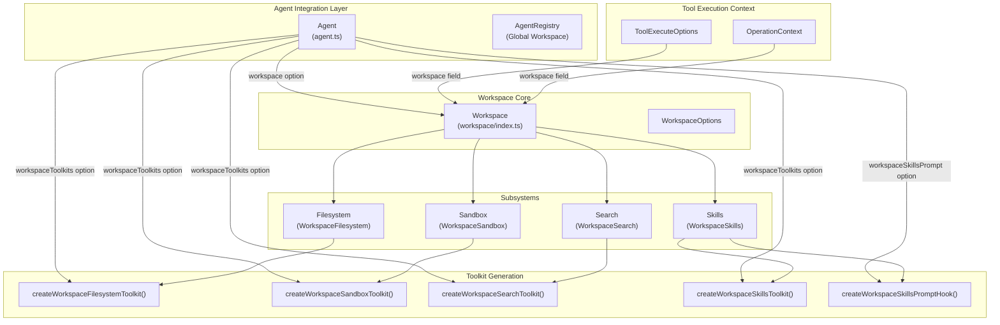
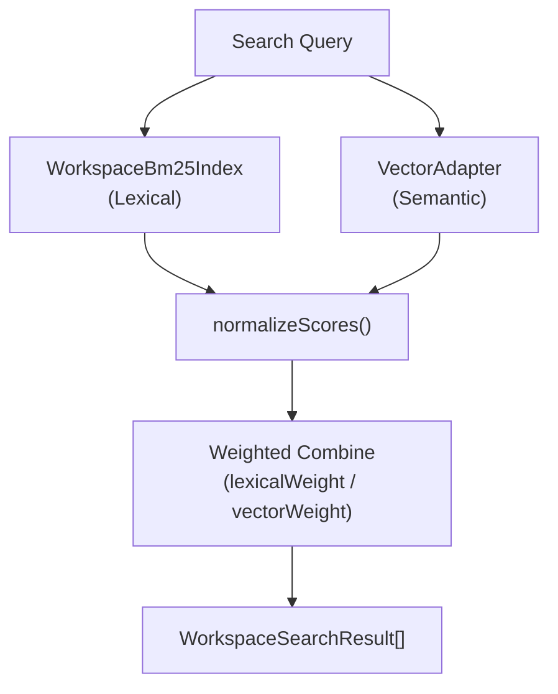
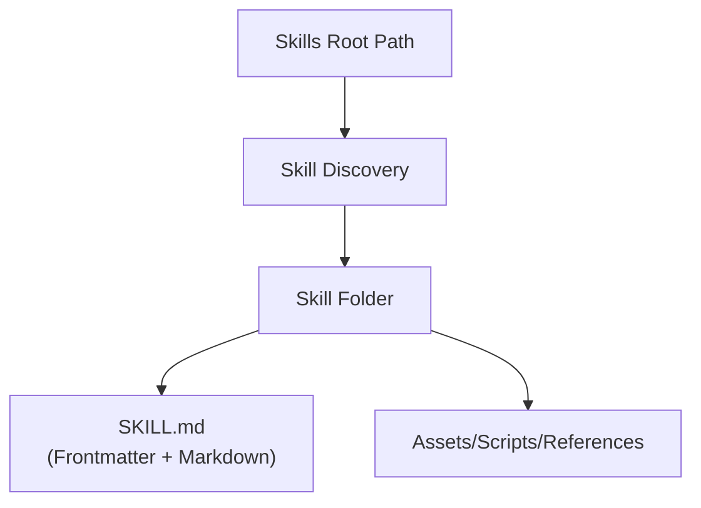

<!-- source: DeepWiki mcp.deepwiki.com · repo VoltAgent/voltagent · page 8.4 Workspace System · fetched 2026-10-26 -->

# Workspace System

<details>
<summary>Relevant source files</summary>

The following files were used as context for generating this wiki page:

- [.gitignore](.gitignore)
- [examples/with-workspace/package.json](examples/with-workspace/package.json)
- [packages/core/src/workspace/index.ts](packages/core/src/workspace/index.ts)
- [packages/core/src/workspace/sandbox/index.ts](packages/core/src/workspace/sandbox/index.ts)
- [packages/core/src/workspace/sandbox/toolkit.spec.ts](packages/core/src/workspace/sandbox/toolkit.spec.ts)
- [packages/core/src/workspace/sandbox/toolkit.ts](packages/core/src/workspace/sandbox/toolkit.ts)
- [packages/core/src/workspace/sandbox/types.ts](packages/core/src/workspace/sandbox/types.ts)
- [packages/core/src/workspace/search/index.spec.ts](packages/core/src/workspace/search/index.spec.ts)
- [packages/core/src/workspace/search/index.ts](packages/core/src/workspace/search/index.ts)
- [packages/core/src/workspace/search/types.ts](packages/core/src/workspace/search/types.ts)
- [packages/core/src/workspace/skills/index.spec.ts](packages/core/src/workspace/skills/index.spec.ts)
- [packages/core/src/workspace/skills/index.ts](packages/core/src/workspace/skills/index.ts)
- [packages/core/src/workspace/skills/types.ts](packages/core/src/workspace/skills/types.ts)
- [website/docs/workspaces/filesystem.md](website/docs/workspaces/filesystem.md)
- [website/docs/workspaces/overview.md](website/docs/workspaces/overview.md)
- [website/docs/workspaces/sandbox.md](website/docs/workspaces/sandbox.md)
- [website/docs/workspaces/search.md](website/docs/workspaces/search.md)
- [website/docs/workspaces/security.md](website/docs/workspaces/security.md)
- [website/docs/workspaces/skills.md](website/docs/workspaces/skills.md)

</details>


The Workspace System provides agents with a persistent, structured environment for file management, code execution, vector search, and skill discovery. It serves as a unified abstraction over filesystem operations, sandbox execution, content indexing, and skill-based prompt augmentation. Agents automatically receive workspace-aware tools when configured with a `Workspace` instance.

For general tool creation and usage patterns, see [Tools and Toolkits](#2.3). For agent configuration fundamentals, see [Agent Fundamentals](#2.1). For operation context propagation, see [Operation Context](#2.2).

---

## System Architecture

The Workspace System consists of four primary subsystems that integrate through a unified `Workspace` class. Each subsystem can be independently configured or disabled.

### Component Overview



**Sources:** [packages/core/src/workspace/index.ts:128-161](), [packages/core/src/workspace/index.ts:224-255](), [website/docs/workspaces/overview.md:12-42]()

---

## Workspace Configuration

A `Workspace` instance accepts configuration for all four subsystems. The agent automatically generates toolkits from the enabled subsystems.

### Basic Workspace Instantiation

```typescript
const workspace = new Workspace({
  id: "demo-workspace",
  operationTimeoutMs: 30000,
  filesystem: {
    // Defaults to in-memory backend
  },
  sandbox: new LocalSandbox({
    rootDir: "/tmp/voltagent",
  }),
  search: {
    autoIndexPaths: ["/"],
    embedding: "openai:text-embedding-3-small",
    vector: new InMemoryVectorAdapter(),
  },
  skills: {
    rootPaths: ["/skills"],
  },
});
```

The `Workspace` class acts as a coordinator, initializing the `WorkspaceFilesystem`, `WorkspaceSandbox`, `WorkspaceSearch`, and `WorkspaceSkills` instances based on the provided `WorkspaceConfig`.

**Sources:** [packages/core/src/workspace/index.ts:142-161](), [website/docs/workspaces/overview.md:16-34]()

---

## Filesystem Subsystem

The filesystem subsystem provides file operations through an abstraction that supports both in-memory and persistent backends. It is implemented in the `WorkspaceFilesystem` class.

### Backend Options

| Backend | Implementation | Use Case |
|---------|----------------|----------|
| **In-Memory** | `InMemoryFilesystemBackend` | Testing, ephemeral workspaces |
| **Node.js** | `NodeFilesystemBackend` | Disk persistence for local development |
| **Custom** | `FilesystemBackendFactory` | Dynamic routing (e.g., per-tenant storage) |

### Runtime Context Routing

The filesystem backend can be dynamically resolved using a factory function that receives the `OperationContext`. This enables multi-tenant storage patterns:

```typescript
const workspace = new Workspace({
  filesystem: {
    backend: ({ operationContext }) => {
      const tenantId = operationContext?.context.get("tenantId") ?? "default";
      return new NodeFilesystemBackend({ rootDir: `./.workspace/${tenantId}` });
    },
  },
});
```

**Sources:** [packages/core/src/workspace/index.ts:146](), [website/docs/workspaces/filesystem.md:14-49]()

---

## Sandbox Subsystem

The sandbox subsystem executes shell commands in an isolated environment. The primary implementation is `LocalSandbox`, which supports OS-level isolation on macOS (`sandbox-exec`) and Linux (`bwrap`).

### Command Execution Flow

When an agent calls `execute_command`, the `WorkspaceSandbox` implementation handles the execution and returns a `WorkspaceSandboxResult`.


### Sandbox Result Handling

Large outputs are automatically truncated or evicted to the workspace filesystem to prevent context window overflow.

- **Truncation**: Appends `... [output truncated]` if output exceeds limits.
- **Eviction**: Stores large stdout/stderr in `/sandbox_results` and returns the file path to the agent.

**Sources:** [packages/core/src/workspace/sandbox/toolkit.ts:21-65](), [packages/core/src/workspace/sandbox/toolkit.ts:113-146](), [website/docs/workspaces/sandbox.md:12-53]()

---

## Search Subsystem

The search subsystem (`WorkspaceSearch`) provides BM25 (lexical), vector (semantic), and hybrid search capabilities over indexed workspace content.

### Hybrid Search Implementation

The system combines BM25 scores from `WorkspaceBm25Index` and vector scores from a `VectorAdapter`. Scores are normalized to a 0-1 range and combined using a weighted average.



### Search Parameters

The `workspace_search` tool supports:
- `mode`: "bm25", "vector", or "hybrid".
- `top_k`: Number of results (default 5).
- `min_score`: Minimum threshold (0-1).
- `include_content`: Whether to return the full file content.

**Sources:** [packages/core/src/workspace/search/index.ts:207-230](), [packages/core/src/workspace/search/index.ts:36-41](), [website/docs/workspaces/search.md:107-129]()

---

## Skills Subsystem

The skills subsystem (`WorkspaceSkills`) manages reusable instructions stored as `SKILL.md` files. These files contain YAML frontmatter for metadata and Markdown for instructions.

### Skill Layout and Discovery

Skills are organized in folders under a root path. The discovery process identifies these folders and parses the `SKILL.md` file.



### Skill Tools

The `WorkspaceSkills` toolkit provides tools for:
- `workspace_list_skills`: Discovery of available capabilities.
- `workspace_activate_skill`: Mark a skill as active for prompt injection.
- `workspace_read_skill`: Retrieve the full markdown instructions.
- `workspace_read_skill_asset`: Access files associated with a skill.

**Sources:** [website/docs/workspaces/skills.md:14-28](), [website/docs/workspaces/skills.md:144-156](), [packages/core/src/workspace/index.ts:154-159]()

---

## Workspace Lifecycle and Utilities

The `Workspace` class provides lifecycle methods to manage the state of its subsystems.

| Method | Implementation Detail |
|--------|------------------------|
| `init()` | Sequentially initializes filesystem, starts sandbox, and runs auto-indexing/discovery for search and skills. |
| `destroy()` | Sets status to `destroyed` and calls `destroy()` on all subsystems to release resources (e.g., local sandbox directories). |
| `getInfo()` | Aggregates status and configuration data from all subsystems into a `WorkspaceInfo` object. |
| `getPathContext()` | Returns a `WorkspacePathContext` containing instructions for the filesystem and sandbox. |

**Sources:** [packages/core/src/workspace/index.ts:163-204](), [packages/core/src/workspace/index.ts:206-218](), [packages/core/src/workspace/index.ts:224-255]()

---

## Security and Isolation

Workspace security is managed through tool policies and sandbox isolation providers.

### Tool Policies

`WorkspaceToolPolicies` allow developers to control tool access at a granular level:
- `enabled`: Disable specific tools (e.g., `delete_file`).
- `needsApproval`: Require human-in-the-loop for destructive operations.
- `requireReadBeforeWrite`: Enforce that an agent must read a file before editing it.

### Sandbox Isolation

The `LocalSandbox` supports multiple isolation levels:
- `sandbox-exec`: macOS seatbelt profiles.
- `bwrap`: Linux bubblewrap containers with unprivileged user namespaces.
- `none`: Standard process execution (no isolation).

**Sources:** [packages/core/src/workspace/index.ts:107-126](), [website/docs/workspaces/sandbox.md:38-53](), [website/docs/workspaces/filesystem.md:87-113]()

---

