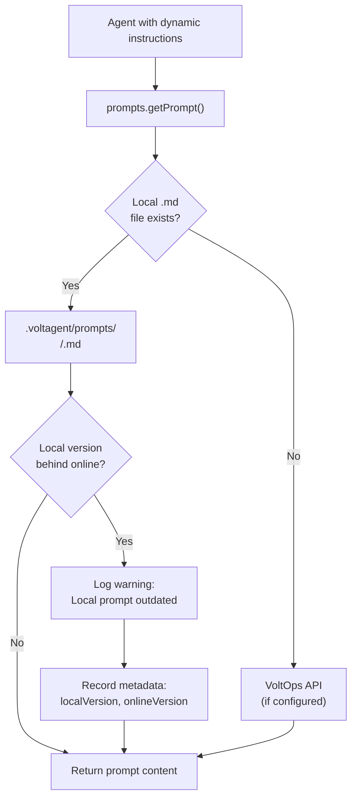
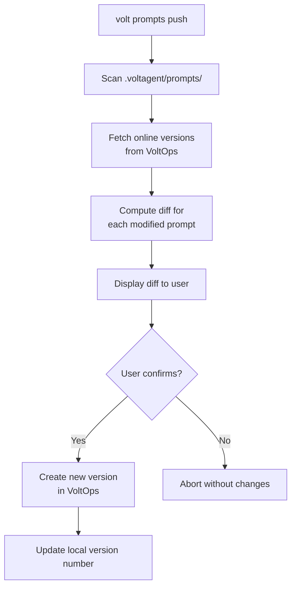
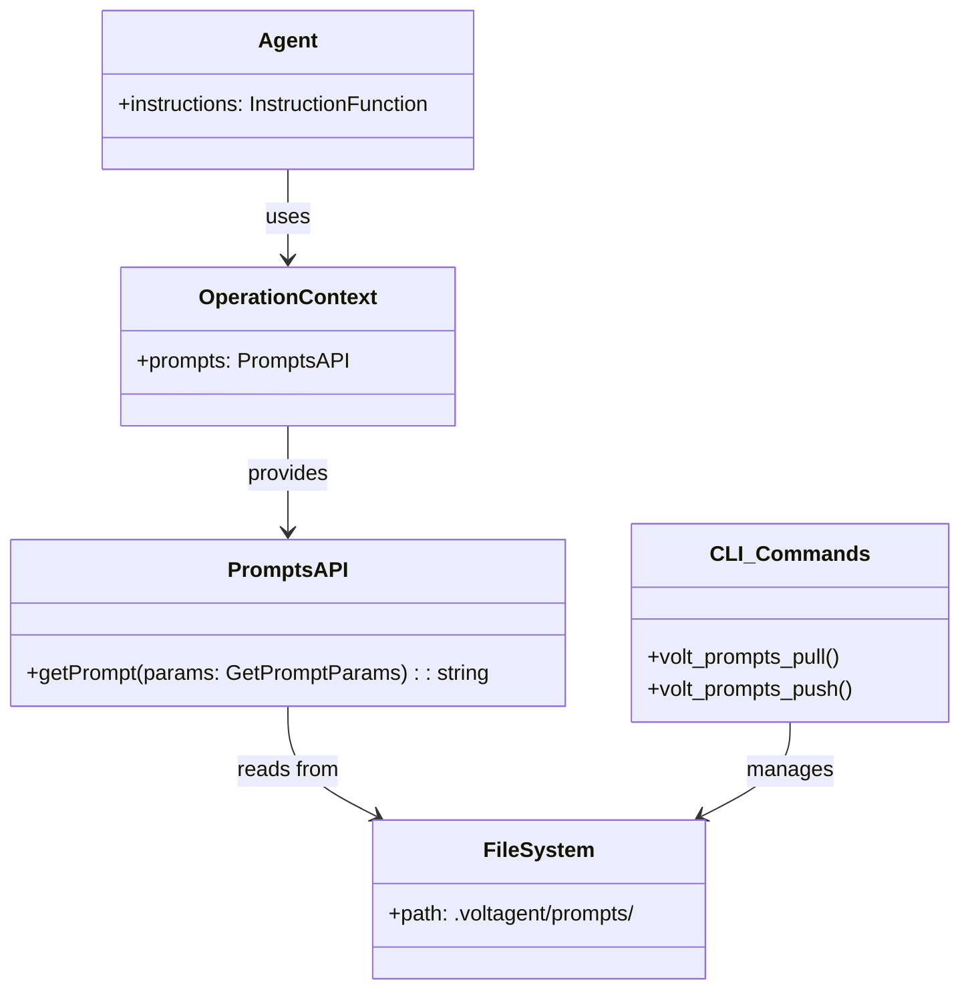
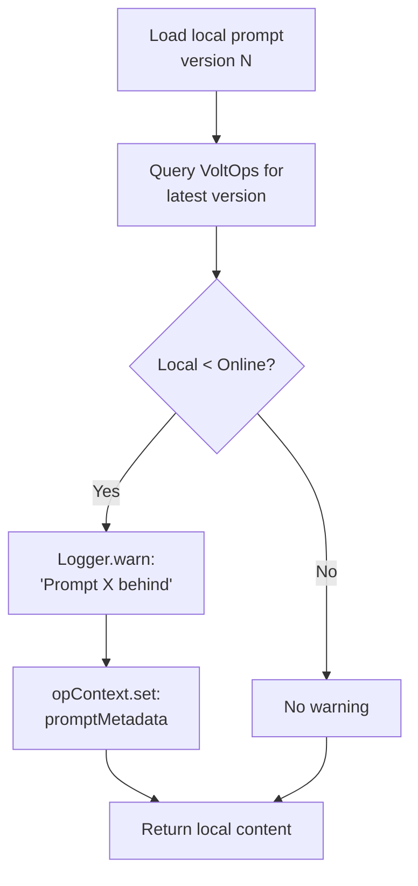

<!-- source: DeepWiki mcp.deepwiki.com · repo VoltAgent/voltagent · page 8.5 Prompt Management · fetched 2026-10-26 -->

# Prompt Management

<details>
<summary>Relevant source files</summary>

The following files were used as context for generating this wiki page:

- [CHANGELOG.md](CHANGELOG.md)
- [changelog.sh](changelog.sh)
- [examples/base/src/index.ts](examples/base/src/index.ts)
- [examples/with-dynamic-prompts/package.json](examples/with-dynamic-prompts/package.json)
- [packages/cli/package.json](packages/cli/package.json)
- [packages/create-voltagent-app/CHANGELOG.md](packages/create-voltagent-app/CHANGELOG.md)
- [packages/create-voltagent-app/package.json](packages/create-voltagent-app/package.json)
- [packages/voice/CHANGELOG.md](packages/voice/CHANGELOG.md)
- [packages/voice/package.json](packages/voice/package.json)

</details>


## Purpose and Scope

Prompt Management provides an **offline-first** system for storing, versioning, and retrieving agent instructions. Prompts are stored as Markdown files in `.voltagent/prompts/<promptName>/<version>.md`, enabling version control integration, local development, and optional synchronization with VoltOps Console. This document covers the file structure, CLI commands (`volt prompts pull`, `volt prompts push`), and agent integration via the `prompts.getPrompt()` API.

For information about dynamic instructions and instruction functions, see [Agent Fundamentals](2.1). For VoltOps platform integration, see [VoltOps Console Integration](9.3).

---

## Architecture Overview

The prompt management system operates on an **offline-first** principle: local Markdown files are resolved first, and VoltOps is only queried when a local prompt is missing. This design enables fully offline development after an initial pull, supports version control workflows (Git commits, branches), and provides warnings when local prompts fall behind the online version.

### Prompt Resolution Flow



**Sources:** [CHANGELOG.md:7-57]()

---

## File Structure

Prompts are organized in a hierarchical directory structure under `.voltagent/prompts/`, with each prompt having its own subdirectory and versioned Markdown files.

### Directory Layout

```
.voltagent/
└── prompts/
    ├── support-agent/
    │   ├── 1.md
    │   ├── 2.md
    │   ├── 3.md
    │   └── 4.md
    ├── sales-agent/
    │   ├── 1.md
    │   └── 2.md
    └── research-agent/
        └── 1.md
```

### File Naming Convention

| Pattern | Description | Example |
|---------|-------------|---------|
| `<promptName>/<version>.md` | Numeric version | `support-agent/4.md` |
| `<promptName>/latest.md` | Symbolic link or copy of latest | `support-agent/latest.md` |

Each Markdown file contains the full instruction text for that version. The version number is an integer that increments with each update.

**Sources:** [CHANGELOG.md:10-12]()

---

## CLI Commands

The `volt` CLI provided by `@voltagent/cli` includes commands for synchronizing prompts between local storage and VoltOps Console.

### `volt prompts pull`

Downloads prompts from VoltOps and stores them locally. By default, pulls the latest version of all prompts.

#### Basic Usage

```bash
# Pull latest versions of all prompts
volt prompts pull

# Pull specific prompt by name
volt prompts pull --names support-agent

# Pull multiple prompts
volt prompts pull --names support-agent,sales-agent

# Pull specific version
volt prompts pull --names support-agent --prompt-version 4

# Pull by label (e.g., production, staging, dev)
volt prompts pull --names support-agent --label production
```

#### Options Table

| Option | Type | Description | Example |
|--------|------|-------------|---------|
| `--names` | `string` | Comma-separated prompt names | `--names support-agent,sales-agent` |
| `--prompt-version` | `number` | Specific version number | `--prompt-version 4` |
| `--label` | `string` | Environment label | `--label production` |

**Sources:** [CHANGELOG.md:16-28](), [packages/cli/package.json:5-7]()

### `volt prompts push`

Compares local prompt files with online versions and creates new versions after confirmation. The CLI performs a diff to show changes before pushing.

#### Basic Usage

```bash
# Compare local prompts with online and push after confirmation
volt prompts push

# The CLI will:
# 1. Detect modified prompts
# 2. Show a diff of changes
# 3. Prompt for confirmation
# 4. Create new versions in VoltOps
```

#### Push Workflow Diagram



**Sources:** [CHANGELOG.md:25-28]()

---

## Agent Usage

Agents retrieve prompts dynamically at runtime using the `prompts` parameter in instruction functions.

### Basic Pattern

The `instructions` option in the `Agent` class accepts a function that receives a `prompts` object with a `getPrompt()` method:

```typescript
import { Agent } from "@voltagent/core";

const agent = new Agent({
  name: "Support Agent",
  model: "openai/gpt-4o-mini",
  instructions: async ({ prompts }) => {
    return await prompts.getPrompt({
      promptName: "support-agent",
      version: 4,
    });
  },
});
```

**Sources:** [CHANGELOG.md:30-39](), [examples/base/src/index.ts:20-25]()

### `getPrompt()` API

```typescript
interface GetPromptParams {
  promptName: string;
  version?: number;
  label?: string;
}

interface PromptsAPI {
  getPrompt(params: GetPromptParams): Promise<string>;
}
```

#### Parameter Priority

| Scenario | Parameters | Resolution |
|----------|------------|------------|
| Version specified | `{ promptName, version }` | `.voltagent/prompts/<name>/<version>.md` |
| Label specified | `{ promptName, label }` | Query VoltOps for version tagged with label, then local |
| Neither specified | `{ promptName }` | Latest local version |

**Sources:** [CHANGELOG.md:30-48]()

---

## Code Entity Mapping

The following diagram bridges the natural language concept of "Prompt Management" to the specific code entities in the `@voltagent/core` and `@voltagent/cli` packages.



**Sources:** [CHANGELOG.md:7-15](), [packages/cli/package.json:5-7](), [examples/base/src/index.ts:20-25]()

---

## Version Staleness Detection

When a local prompt is behind the online version, VoltAgent logs a warning and records metadata for observability.

### Staleness Warning Flow



### Metadata Structure

The `OperationContext` stores prompt metadata when staleness is detected:

```typescript
interface PromptMetadata {
  promptName: string;
  localVersion: number;
  onlineVersion: number;
  outdated: boolean;
}
```

This metadata is available in hooks and traces for monitoring prompt version drift across agents.

**Sources:** [CHANGELOG.md:12-14]()

---

## Environment Configuration

### `VOLTAGENT_PROMPTS_PATH`

Overrides the default `.voltagent/prompts` directory. Useful for monorepos or custom directory structures.

```bash
# .env file
VOLTAGENT_PROMPTS_PATH="./.voltagent/prompts"
```

**Sources:** [CHANGELOG.md:50-56]()

### VoltOps API Keys

Required for `volt prompts pull` and `volt prompts push`. These are typically passed to the `VoltOpsClient` in the `VoltAgent` configuration.

```typescript
import { VoltAgent, VoltOpsClient } from "@voltagent/core";

new VoltAgent({
  // ...
  voltOpsClient: new VoltOpsClient({
    publicKey: process.env.VOLTAGENT_PUBLIC_KEY || "",
    secretKey: process.env.VOLTAGENT_SECRET_KEY || "",
  }),
});
```

**Sources:** [packages/create-voltagent-app/CHANGELOG.md:117-144]()

---

## Summary

| Feature | Implementation | Benefit |
|---------|---------------|---------|
| **Offline-first** | Local `.md` files | Works without network |
| **Versioning** | Integer versions (1, 2, 3...) | Track prompt evolution |
| **Labels** | VoltOps label → version mapping | Environment-specific prompts |
| **Git integration** | Plain text Markdown | Version control with code |
| **Staleness detection** | Local vs online comparison | Detect version drift |
| **CLI sync** | `pull` and `push` commands | Bidirectional sync with VoltOps |
| **Dynamic loading** | `prompts.getPrompt()` API | Per-request prompt selection |

**Sources:** [CHANGELOG.md:7-57]()

---

