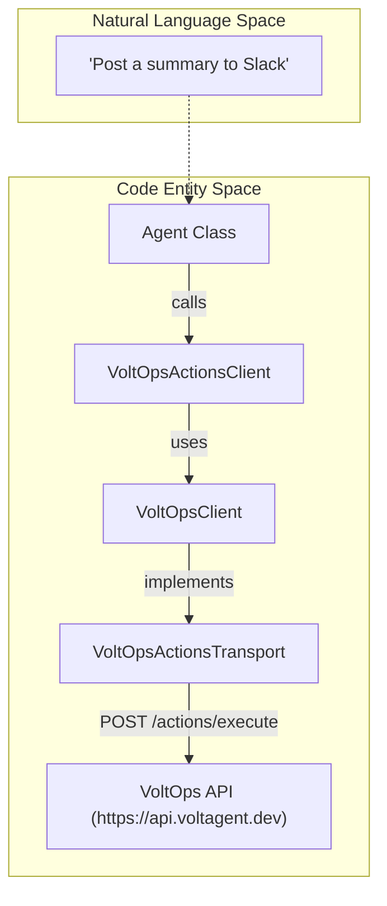
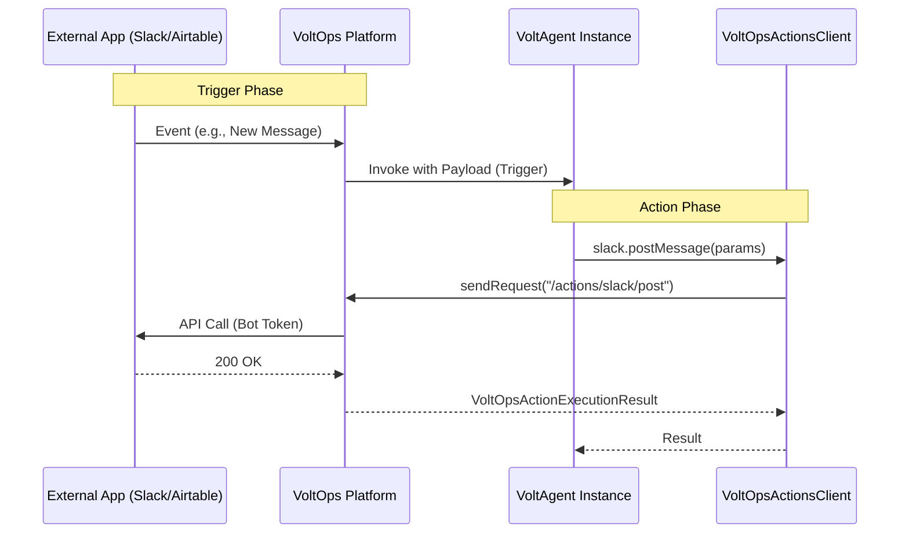

<!-- source: DeepWiki mcp.deepwiki.com · repo VoltAgent/voltagent · page 8.6 Actions and Triggers · fetched 2026-10-26 -->

# Actions and Triggers

<details>
<summary>Relevant source files</summary>

The following files were used as context for generating this wiki page:

- [examples/with-airtable/package.json](examples/with-airtable/package.json)
- [examples/with-slack/package.json](examples/with-slack/package.json)
- [examples/with-voltagent-actions/package.json](examples/with-voltagent-actions/package.json)
- [packages/core/src/triggers/catalog-data/default-trigger-catalog.ts](packages/core/src/triggers/catalog-data/default-trigger-catalog.ts)
- [packages/core/src/voltops/actions/client.ts](packages/core/src/voltops/actions/client.ts)
- [packages/core/src/voltops/client.spec.ts](packages/core/src/voltops/client.spec.ts)
- [packages/core/src/voltops/client.ts](packages/core/src/voltops/client.ts)
- [packages/core/src/voltops/index.ts](packages/core/src/voltops/index.ts)
- [packages/core/src/voltops/types.ts](packages/core/src/voltops/types.ts)
- [packages/sdk/src/client/index.spec.ts](packages/sdk/src/client/index.spec.ts)
- [packages/sdk/src/client/index.ts](packages/sdk/src/client/index.ts)
- [packages/sdk/src/index.ts](packages/sdk/src/index.ts)
- [packages/sdk/src/types.ts](packages/sdk/src/types.ts)
- [website/observability/overview.md](website/observability/overview.md)
- [website/sidebarsObservability.ts](website/sidebarsObservability.ts)

</details>


VoltAgent provides a robust system for automating agent responses and external service interactions through **VoltOps Actions** and **Triggers**. This system allows agents to move beyond text-based chat into functional automation, interacting with platforms like Slack, Gmail, Airtable, and GitHub.

## Overview of Automation
The automation architecture is split into two primary directions:
1.  **Triggers (Inbound):** External events (schedules, webhooks, or third-party app events) that initiate an agent's execution.
2.  **Actions (Outbound):** Pre-configured API wrappers that allow an agent to perform side effects in external systems.

## VoltOps Actions
VoltOps Actions are managed API integrations provided by the `@voltagent/core` and `@voltagent/sdk` packages. They abstract complex OAuth flows and API-specific payloads into standardized TypeScript methods.

### Action Client Architecture
The `VoltOpsActionsClient` serves as the primary interface for executing these actions. It is instantiated within the `VoltOpsClient` [packages/core/src/voltops/client.ts:110-110]() and can also be used independently via the SDK [packages/sdk/src/client/index.ts:104-104]().

### Supported Action Providers
| Provider | Key Capabilities | Code Reference |
| :--- | :--- | :--- |
| **Airtable** | Create, Update, Delete, List, and Get Records | [packages/core/src/voltops/actions/client.ts:94-108]() |
| **Slack** | Post Messages, Delete Messages, Search | [packages/core/src/voltops/actions/client.ts:109-117]() |
| **Gmail** | Send, Reply, Search, Get Threads | [packages/core/src/voltops/actions/client.ts:155-161]() |
| **Discord** | Channels, Messages, Reactions, Webhooks | [packages/core/src/voltops/actions/client.ts:118-154]() |
| **Google Calendar** | Event CRUD operations | [packages/core/src/voltops/actions/client.ts:162-174]() |
| **Google Drive** | File/Folder management, Upload/Download | [packages/core/src/voltops/actions/client.ts:175-187]() |

### Data Flow: Action Execution
When an agent or workflow calls an action, the data flows through a transport layer to the VoltOps API, which handles the final authentication and request to the third-party provider.

**Natural Language to Code Entity Space: Actions**

*Sources: [packages/core/src/voltops/actions/client.ts:93-187](), [packages/core/src/voltops/client.ts:75-110]()*

## Triggers
Triggers are definitions that tell the VoltOps platform when to wake up an agent. While the `default-trigger-catalog.ts` contains the definitions, the execution is managed by the VoltOps orchestrator.

### Trigger Types
1.  **Schedules:** Cron-based execution (e.g., "Every Monday at 9 AM").
2.  **Webhooks:** Generic HTTP endpoints that trigger agents on `POST` requests.
3.  **App Triggers:** Event-based triggers from integrated apps (e.g., "New Row in Airtable", "New Message in Slack Channel").

### Trigger Configuration
Triggers are often defined using Zod schemas for input validation, ensuring that the data passed from the external event to the agent's `OperationContext` is well-formed.

## Implementation Example
The following demonstrates how to initialize a client to perform an Airtable action:

```typescript
import { VoltOpsClient } from "@voltagent/sdk";

const client = new VoltOpsClient({
  publicKey: process.env.VOLTAGENT_PUBLIC_KEY,
  secretKey: process.env.VOLTAGENT_SECRET_KEY,
});

// Executing an action directly
const result = await client.actions.airtable.createRecord({
  baseId: "app123",
  tableId: "tbl456",
  fields: { "Status": "Done", "Notes": "Processed by AI" }
});
```
*Sources: [packages/sdk/src/client/index.ts:88-132](), [packages/core/src/voltops/actions/client.ts:95-97]()*

## Data Structures
### VoltOpsActionExecutionResult
Every action returns a standardized result object containing the execution metadata and the raw response from the provider.

| Property | Type | Description |
| :--- | :--- | :--- |
| `actionId` | `string` | Unique identifier for the action type |
| `provider` | `string` | The service provider (e.g., "slack") |
| `requestPayload` | `Record<string, unknown>` | Data sent to the provider |
| `responsePayload` | `unknown` | Raw response from the provider API |

*Sources: [packages/core/src/voltops/types.ts:201-207]()*

## System Integration Diagram
This diagram illustrates how Actions and Triggers bridge the gap between the local Agent code and the external SaaS ecosystem.

**Code Entity Space: Automation Pipeline**

*Sources: [packages/core/src/voltops/actions/client.ts:55-68](), [packages/core/src/voltops/client.ts:110-110](), [packages/sdk/src/client/index.ts:213-224]()*

## Error Handling
The `VoltOpsActionError` class is used to handle failures during action execution, providing the HTTP status code and specific error details from the provider [packages/core/src/voltops/actions/client.ts:59-68](). Common errors include `401 Unauthorized` (invalid credentials) or `408 Request Timeout` [packages/sdk/src/client/index.ts:145-147]().

Sources:
- [packages/core/src/voltops/types.ts:201-250]()
- [packages/core/src/voltops/client.ts:75-164]()
- [packages/core/src/voltops/actions/client.ts:55-187]()
- [packages/sdk/src/client/index.ts:80-224]()
- [examples/with-voltagent-actions/package.json:1-38]()

---

