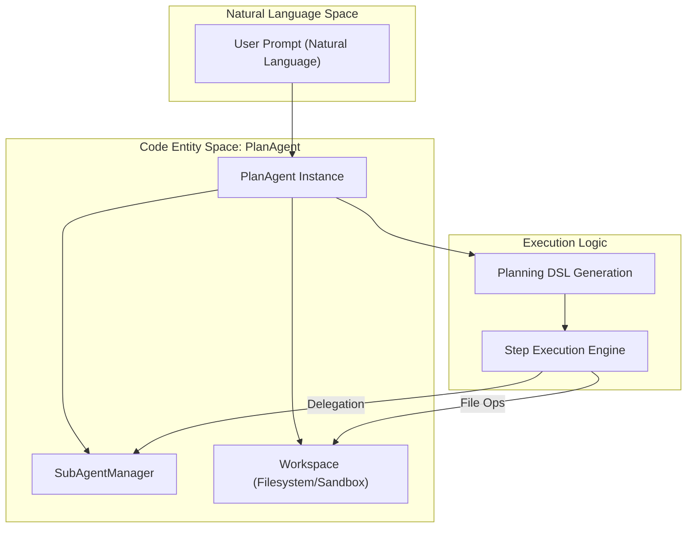
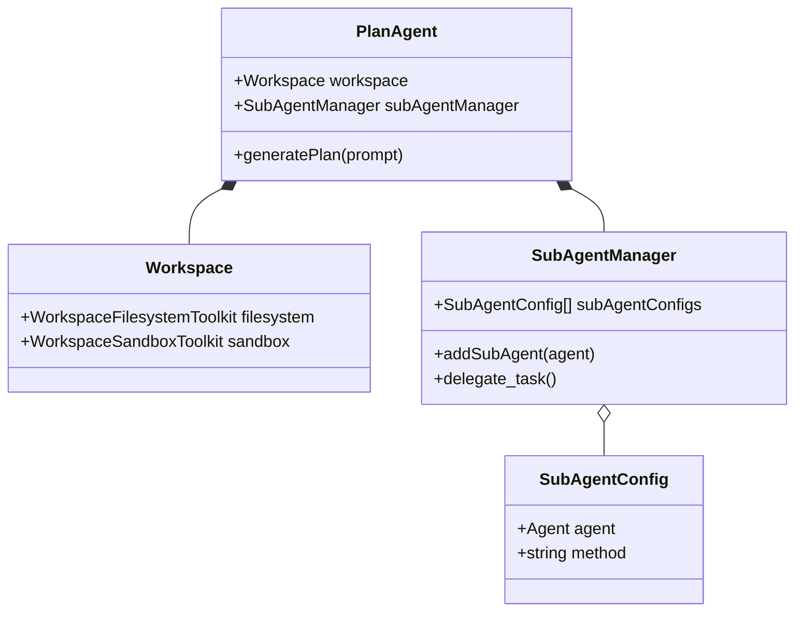

<!-- source: DeepWiki mcp.deepwiki.com · repo VoltAgent/voltagent · page 8.7 Plan Agent · fetched 2026-10-26 -->

# Plan Agent

<details>
<summary>Relevant source files</summary>

The following files were used as context for generating this wiki page:

- [examples/with-planagents/package.json](examples/with-planagents/package.json)
- [examples/with-subagents/src/index.ts](examples/with-subagents/src/index.ts)
- [packages/core/src/agent/index.ts](packages/core/src/agent/index.ts)
- [packages/core/src/agent/providers/base/types.ts](packages/core/src/agent/providers/base/types.ts)
- [packages/core/src/agent/subagent/index.spec.ts](packages/core/src/agent/subagent/index.spec.ts)
- [packages/core/src/agent/subagent/index.ts](packages/core/src/agent/subagent/index.ts)
- [packages/core/src/agent/types.ts](packages/core/src/agent/types.ts)
- [packages/core/src/events/types.ts](packages/core/src/events/types.ts)
- [packages/core/src/index.ts](packages/core/src/index.ts)
- [website/docs/agents/overview.md](website/docs/agents/overview.md)
- [website/docs/agents/subagents.md](website/docs/agents/subagents.md)

</details>


The `PlanAgent` is an experimental agentic pattern in VoltAgent designed for complex, multi-step task planning and execution [packages/core/src/index.ts:56-56](). It extends the standard agent capabilities with a specialized planning Domain Specific Language (DSL) and deep integration with the VoltAgent Workspace system for filesystem and sandbox operations [packages/core/src/agent/types.ts:48-56]().

## Overview

Unlike standard agents that operate in a loop of thought and action, the `PlanAgent` focuses on generating a structured plan before execution. It is particularly suited for tasks requiring:
*   **Filesystem Operations**: Creating, reading, and modifying files within a managed workspace [packages/core/src/agent/types.ts:131-136]().
*   **Multi-step Reasoning**: Breaking down complex goals into sequential or parallel sub-tasks.
*   **Tool-Augmented Planning**: Using specialized toolkits (Filesystem, Sandbox, Search, Skills) to inform the planning process [packages/core/src/agent/types.ts:131-136]().

### Plan Agent Architecture

The following diagram illustrates how the `PlanAgent` bridges natural language requests to structured execution within the VoltAgent ecosystem.

**Plan Agent Execution Flow**

Sources: [packages/core/src/agent/subagent/index.ts:55-70](), [packages/core/src/agent/types.ts:48-56](), [packages/core/src/agent/agent.ts:24-24]()

## Core Components

### 1. Workspace Integration
The `PlanAgent` relies on the `Workspace` system to provide a persistent environment for its operations. This includes:
*   **Filesystem**: A virtualized or local filesystem toolkit [packages/core/src/agent/types.ts:132-132]().
*   **Sandbox**: Secure execution environments for running code generated during the planning phase [packages/core/src/agent/types.ts:133-133]().
*   **Skills**: A set of pre-defined capabilities or toolkits auto-generated for the workspace [packages/core/src/agent/types.ts:135-135]().

### 2. Sub-Agent Management
The `PlanAgent` utilizes the `SubAgentManager` to delegate specific plan steps to specialized agents [packages/core/src/agent/subagent/index.ts:55-64](). This allows the planner to remain high-level while sub-agents handle domain-specific implementation details (e.g., a "Coder" sub-agent writing actual implementation files).

**Component Association Map**

Sources: [packages/core/src/agent/subagent/index.ts:55-64](), [packages/core/src/agent/types.ts:131-136](), [packages/core/src/agent/subagent/types.ts:29-30]()

## Implementation and Data Flow

The planning process follows a distinct lifecycle where the agent first analyzes the `OperationContext` and then uses the model to generate a plan.

### Planning DSL
The agent uses a specialized DSL to define its intent. While the exact schema is experimental, it typically involves:
*   `steps`: An array of discrete actions.
*   `dependencies`: Requirements that must be met before a step can execute.
*   `tools`: Specific workspace tools required for the step.

### Key Functions and Types

| Entity | Description | Location |
| :--- | :--- | :--- |
| `WorkspaceToolkitOptions` | Configuration for filesystem, sandbox, and skills toolkits. | [packages/core/src/agent/types.ts:131-136]() |
| `SubAgentManager` | Handles registration and task routing for delegated sub-tasks. | [packages/core/src/agent/subagent/index.ts:55-91]() |
| `delegate_task` | The internal tool used by the supervisor/planner to trigger sub-agents. | [packages/core/src/agent/subagent/index.ts:53-53]() |
| `AgentFullState` | Captures the complete state of the agent, including sub-agents and tools. | [packages/core/src/agent/types.ts:202-221]() |

### Stream Event Forwarding
During plan execution, the `PlanAgent` (acting as a supervisor) manages the flow of events from sub-agents back to the primary stream [packages/core/src/agent/subagent/index.ts:67-69](). This is governed by `fullStreamEventForwarding` settings, which determine if `text-delta`, `tool-call`, or `reasoning` events from the sub-agents are visible to the end-user [website/docs/agents/subagents.md:114-142]().

Sources: [packages/core/src/agent/subagent/index.ts:36-40](), [packages/core/src/agent/types.ts:202-221](), [website/docs/agents/subagents.md:114-142]()

## Configuration Example

A `PlanAgent` is typically configured with a `Workspace` and a set of specialized sub-agents.

```typescript
import { Agent, Memory } from "@voltagent/core";

const planAgent = new Agent({
  name: "ProjectPlanner",
  instructions: "Plan and execute complex software tasks.",
  model: "openai/gpt-4o",
  subAgents: [
    new Agent({ name: "Architect", instructions: "Design system structures." }),
    new Agent({ name: "Developer", instructions: "Write and test code." })
  ],
  workspace: {
    filesystem: { baseDir: "./workdir" },
    sandbox: { provider: "docker" }
  }
});
```
Sources: [packages/core/src/agent/types.ts:131-136](), [website/docs/agents/subagents.md:50-63](), [examples/with-subagents/src/index.ts:38-67]()

---

