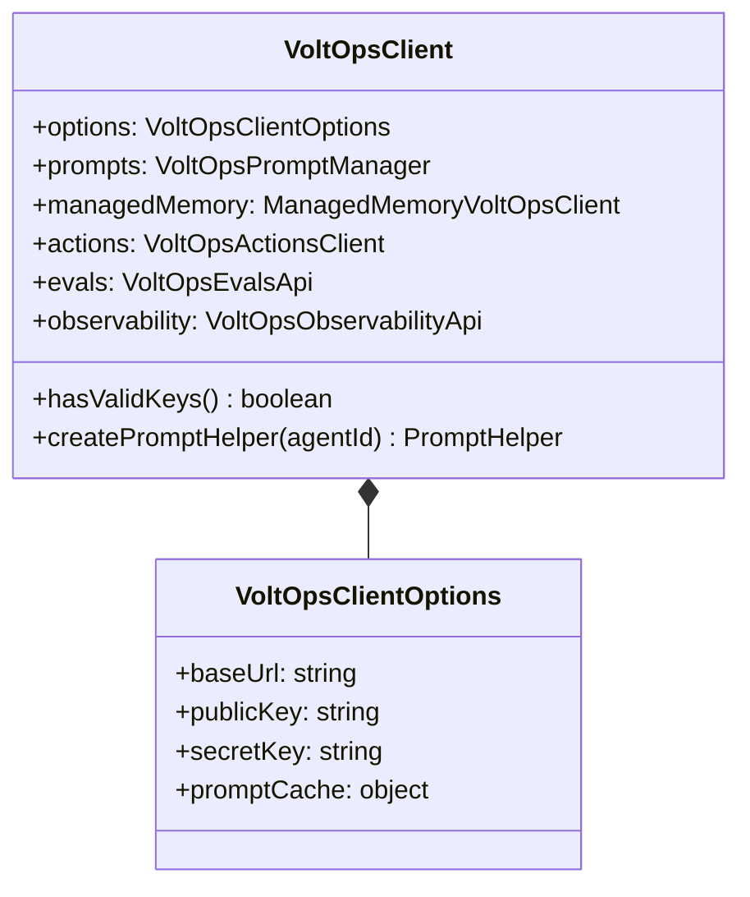

<!-- source: DeepWiki mcp.deepwiki.com · repo VoltAgent/voltagent · page 9 VoltOps Platform · fetched 2026-10-26 -->

# VoltOps Platform

<details>
<summary>Relevant source files</summary>

The following files were used as context for generating this wiki page:

- [CONSOLE.md](CONSOLE.md)
- [packages/core/src/tool/manager/BaseToolManager.ts](packages/core/src/tool/manager/BaseToolManager.ts)
- [packages/core/src/tool/manager/ToolkitManager.ts](packages/core/src/tool/manager/ToolkitManager.ts)
- [packages/core/src/triggers/catalog-data/default-trigger-catalog.ts](packages/core/src/triggers/catalog-data/default-trigger-catalog.ts)
- [packages/core/src/voltops/actions/client.ts](packages/core/src/voltops/actions/client.ts)
- [packages/core/src/voltops/client.spec.ts](packages/core/src/voltops/client.spec.ts)
- [packages/core/src/voltops/client.ts](packages/core/src/voltops/client.ts)
- [packages/core/src/voltops/index.ts](packages/core/src/voltops/index.ts)
- [packages/core/src/voltops/types.ts](packages/core/src/voltops/types.ts)
- [packages/sdk/src/client/index.spec.ts](packages/sdk/src/client/index.spec.ts)
- [packages/sdk/src/client/index.ts](packages/sdk/src/client/index.ts)
- [packages/sdk/src/index.ts](packages/sdk/src/index.ts)
- [packages/sdk/src/types.ts](packages/sdk/src/types.ts)
- [website/docs/getting-started/manual-setup.md](website/docs/getting-started/manual-setup.md)
- [website/docs/getting-started/overview.md](website/docs/getting-started/overview.md)
- [website/docs/getting-started/quick-start.md](website/docs/getting-started/quick-start.md)
- [website/observability/overview.md](website/observability/overview.md)
- [website/sidebarsObservability.ts](website/sidebarsObservability.ts)
- [website/src/components/docs-widgets/EnterpriseCard.tsx](website/src/components/docs-widgets/EnterpriseCard.tsx)
- [website/src/components/docs-widgets/WorkflowDiagramFlow.tsx](website/src/components/docs-widgets/WorkflowDiagramFlow.tsx)
- [website/src/theme/DocHeaderMobile/index.tsx](website/src/theme/DocHeaderMobile/index.tsx)
- [website/src/theme/DocRoot/Layout/Main/index.tsx](website/src/theme/DocRoot/Layout/Main/index.tsx)
- [website/src/theme/DocRoot/Layout/Main/styles.module.css](website/src/theme/DocRoot/Layout/Main/styles.module.css)
- [website/src/theme/Navbar/Content/index.js](website/src/theme/Navbar/Content/index.js)
- [website/src/theme/Navbar/index.js](website/src/theme/Navbar/index.js)
- [website/tailwind.config.js](website/tailwind.config.js)

</details>


## Purpose and Scope

The **VoltOps Platform** is a framework-agnostic LLM observability and operations console designed to monitor, debug, and improve AI agents [CONSOLE.md:20-21](). While VoltAgent provides the core orchestration framework, VoltOps serves as the production-grade management layer, offering visual workflow monitoring, real-time debugging, and managed infrastructure services [CONSOLE.md:41-53]().

This page provides a high-level overview of the platform's capabilities and its integration with the VoltAgent ecosystem.

## Platform Architecture

VoltOps bridges the gap between raw execution logs and high-level agent logic. It visualizes non-deterministic AI behaviors as interactive flowcharts, allowing developers to see exactly how an agent arrived at a decision [CONSOLE.md:21, 45]().

```mermaid
graph TB
    subgraph "Local Runtime"
        direction TB
        VA["VoltAgent Server"]
        AG["Agent Instances"]
        WF["Workflows"]
        OTEL["OpenTelemetry SDK"]
    end

    subgraph "VoltOps Console (Browser)"
        direction TB
        DASH["Dashboard"]
        FLOW["Visual Flowchart"]
        TRACER["Trace Viewer"]
    end

    subgraph "VoltOps Cloud API"
        direction TB
        PROMPTS["Prompt Manager"]
        MEM["Managed Memory"]
        ACT["Actions Engine"]
    end

    VA --> AG
    VA --> WF
    AG --> OTEL
    WF --> OTEL
    
    %% Local connection for dev
    VA -- "Direct Connection (Port 3141)" --> DASH [CONSOLE.md:128-132]
    
    %% Cloud integrations
    VA -- "VoltOpsClient" --> PROMPTS [packages/core/src/voltops/client.ts:78]
    VA -- "VoltOpsClient" --> MEM [packages/core/src/voltops/client.ts:79]
    VA -- "VoltOpsClient" --> ACT [packages/core/src/voltops/client.ts:80]
```

**Sources:** [CONSOLE.md:20-53](), [packages/core/src/voltops/client.ts:75-83](), [website/docs/getting-started/quick-start.md:149-162]()

## Core Capabilities

### LLM Observability
VoltOps transforms "black-box" agent interactions into transparent workflows. It tracks tool execution sequences, parent-child agent relationships, and performance metrics like latency and token usage [CONSOLE.md:49-53]().
- **Visual Tracing**: Real-time waterfall and node-based views of agent decision-making [website/sidebarsObservability.ts:42-44]().
- **Framework-Agnostic**: Supports VoltAgent natively but also integrates with Vercel AI SDK via `@voltagent/vercel-ai-exporter` [CONSOLE.md:133-142]().

For details, see [Telemetry Architecture](#9.2).

### Managed Actions and Triggers
The platform allows agents to react to external events (Triggers) and perform tasks in third-party services (Actions) without custom "plumbing" code [website/docs/getting-started/overview.md:173-180]().
- **Triggers**: Listen for GitHub webhooks, Slack events, or Cron schedules [website/docs/getting-started/quick-start.md:191-198]().
- **Actions**: Pre-built clients for Airtable, Discord, Slack, Gmail, Google Drive, and more [packages/core/src/voltops/actions/client.ts:94-186]().

For details, see [Actions and Triggers](#8.6).

### Prompt Management
VoltOps provides a centralized, versioned repository for prompts. The `VoltOpsClient` can fetch prompts by name, version, or label (e.g., `production`, `staging`), enabling prompt updates without redeploying application code [packages/core/src/voltops/types.ts:28-43, 115-123]().

### Evaluation and Feedback
The platform includes an evaluation system to track agent performance over time.
- **Scorers**: Create and manage metrics for agent accuracy and relevance [packages/core/src/voltops/client.ts:118-120]().
- **Feedback Loop**: Generate feedback tokens for human-in-the-loop validation of traces [packages/core/src/voltops/types.ts:143-170]().

## Integration Components

The primary interface for these services is the `VoltOpsClient` class, which unifies telemetry, prompt management, and managed memory access.



**Sources:** [packages/core/src/voltops/client.ts:75-149](), [packages/core/src/voltops/types.ts:73-123]()

## Deployment and Tiers

VoltOps is available in several tiers to support different scales of development:
- **Developer**: Free tier for local development and testing [CONSOLE.md:96-126]().
- **Core/Pro/Enterprise**: Paid tiers offering increased trace retention, SSO, higher action limits, and managed RAG capabilities [website/docs/getting-started/overview.md:81-84]().

For details, see [Platform Features and Pricing](#9.1).

## Managed Memory Integration

For serverless and edge deployments (like Cloudflare Workers or Vercel Edge) where local persistence is unavailable, VoltOps provides **Managed Memory**. This service hosts conversation history, vector embeddings, and workflow states in a managed cloud environment [packages/core/src/voltops/client.ts:109]().

For details, see [Managed Memory Integration](#9.4).

## Getting Started

1. **Create an Account**: Visit [console.voltagent.dev](https://console.voltagent.dev).
2. **Configure Keys**: Add `VOLTAGENT_PUBLIC_KEY` and `VOLTAGENT_SECRET_KEY` to your `.env` file [packages/core/src/voltops/types.ts:83-111]().
3. **Initialize Client**: Use `createVoltOpsClient` to connect your application to the platform [packages/core/src/voltops/client.ts:3]().
4. **Local Dev**: When running `npm run dev`, the console automatically connects to your local server on port `3141` for zero-latency debugging [website/docs/getting-started/quick-start.md:149-162]().

For details, see [VoltOps Console Integration](#9.3).

**Sources:** [CONSOLE.md:88-126](), [website/docs/getting-started/quick-start.md:177-182]()

---

