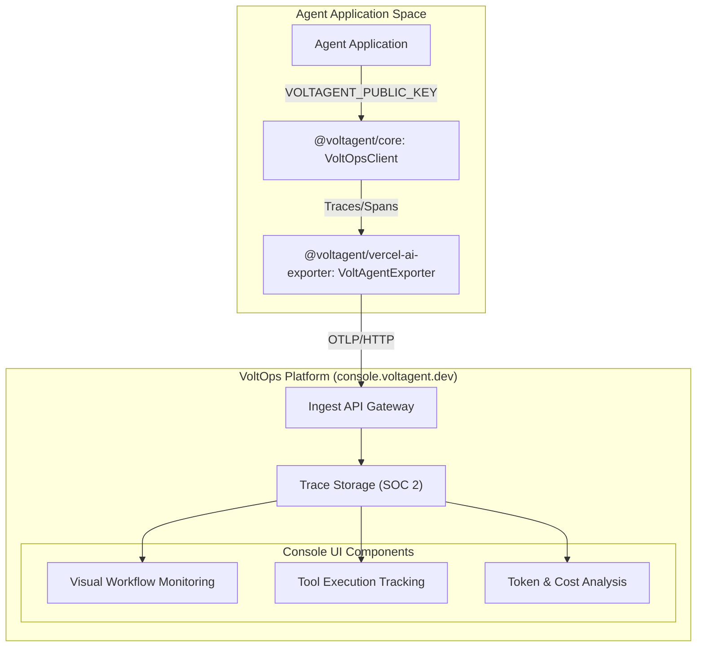
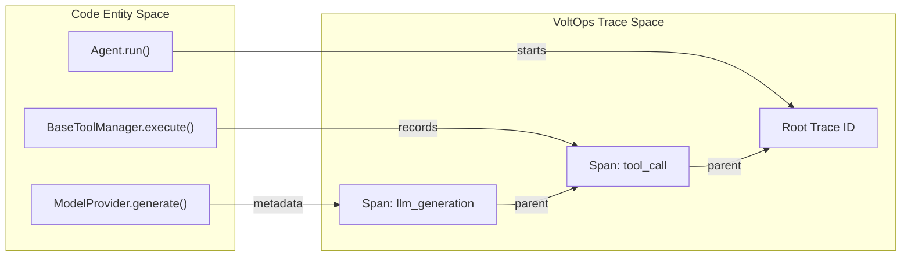

<!-- source: DeepWiki mcp.deepwiki.com · repo VoltAgent/voltagent · page 9.1 Platform Features and Pricing · fetched 2026-10-26 -->

# Platform Features and Pricing

Relevant source files

The following files were used as context for generating this wiki page:

- [CONSOLE.md](CONSOLE.md)
- [packages/core/src/tool/manager/BaseToolManager.ts](packages/core/src/tool/manager/BaseToolManager.ts)
- [packages/core/src/tool/manager/ToolkitManager.ts](packages/core/src/tool/manager/ToolkitManager.ts)
- [website/docs/getting-started/comparison.mdx](website/docs/getting-started/comparison.mdx)
- [website/docs/getting-started/manual-setup.md](website/docs/getting-started/manual-setup.md)
- [website/docs/getting-started/overview.md](website/docs/getting-started/overview.md)
- [website/docs/getting-started/quick-start.md](website/docs/getting-started/quick-start.md)
- [website/src/components/ComparisonTable.tsx](website/src/components/ComparisonTable.tsx)
- [website/src/components/console/PricingCalculatorModal.module.css](website/src/components/console/PricingCalculatorModal.module.css)
- [website/src/components/console/PricingCalculatorModal.tsx](website/src/components/console/PricingCalculatorModal.tsx)
- [website/src/components/console/PricingSection.tsx](website/src/components/console/PricingSection.tsx)
- [website/src/components/docs-widgets/EnterpriseCard.tsx](website/src/components/docs-widgets/EnterpriseCard.tsx)
- [website/src/components/docs-widgets/WorkflowDiagramFlow.tsx](website/src/components/docs-widgets/WorkflowDiagramFlow.tsx)
- [website/src/components/live-preview/index.tsx](website/src/components/live-preview/index.tsx)
- [website/src/components/supervisor-agent/workflow-code-example.tsx](website/src/components/supervisor-agent/workflow-code-example.tsx)
- [website/src/components/two-blocks-pricing/index.tsx](website/src/components/two-blocks-pricing/index.tsx)
- [website/src/components/two-blocks/index.tsx](website/src/components/two-blocks/index.tsx)
- [website/src/pages/pricing.tsx](website/src/pages/pricing.tsx)
- [website/src/theme/DocHeaderMobile/index.tsx](website/src/theme/DocHeaderMobile/index.tsx)
- [website/src/theme/DocRoot/Layout/Main/index.tsx](website/src/theme/DocRoot/Layout/Main/index.tsx)
- [website/src/theme/DocRoot/Layout/Main/styles.module.css](website/src/theme/DocRoot/Layout/Main/styles.module.css)
- [website/src/theme/Navbar/Content/index.js](website/src/theme/Navbar/Content/index.js)
- [website/src/theme/Navbar/index.js](website/src/theme/Navbar/index.js)
- [website/tailwind.config.js](website/tailwind.config.js)

## Purpose and Scope

This document provides a technical overview of the **VoltOps LLM Observability Platform**, detailing its architecture, pricing tiers (Developer, Core, Pro, and Enterprise), and feature set. VoltOps is a commercial, framework-agnostic platform designed for monitoring, tracing, and automating AI agents. While the VoltAgent Core Framework is used for building agents, VoltOps provides the production-grade infrastructure for observability, evaluation, and deployment.

---

## VoltOps vs VoltAgent Core

The ecosystem is divided into the open-source development framework and the commercial observability platform.

| Aspect | VoltAgent Core Framework | VoltOps LLM Observability |
|--------|-------------------------|---------------------------|
| **Purpose** | Development & orchestration of AI agents | Production monitoring & observability |
| **License** | Free and open-source [website/src/components/two-blocks-pricing/index.tsx:41-42]() | Commercial SaaS platform [website/src/pages/pricing.tsx:21-21]() |
| **Scope** | Agent classes, Memory, Tools, Workflows, MCP [website/src/components/two-blocks-pricing/index.tsx:75-88]() | Tracing, debugging, cost analysis, evals [website/src/pages/pricing.tsx:29-31]() |
| **Frameworks** | VoltAgent framework only | 14+ frameworks (LangChain, LlamaIndex, Vercel AI, etc.) [website/src/components/two-blocks-pricing/index.tsx:142-164]() |
| **Deployment** | Self-hosted within your app | Cloud SaaS or Enterprise self-hosting [website/src/pages/pricing.tsx:44-46]() |

**Sources:** [website/src/components/two-blocks-pricing/index.tsx:18-132](), [website/src/pages/pricing.tsx:17-53]()

---

## Platform Architecture

VoltOps utilizes an OpenTelemetry-based architecture to ingest telemetry data from distributed agent applications.

### Data Flow and Code Entities

**Implementation Details:**
- **Integration:** VoltAgent applications use `createVoltOpsClient` to initialize communication with the platform [website/docs/getting-started/overview.md:182-187]().
- **Telemetry:** Data is exported via OpenTelemetry OTLP protocols. For Vercel AI SDK users, the `VoltAgentExporter` from `@voltagent/vercel-ai-exporter` handles the mapping of AI SDK events to VoltOps spans [CONSOLE.md:133-142]().
- **Zero Configuration:** For standard VoltAgent apps, observability is enabled by default when running `npm run dev`, exposing a local server on port `3141` that the Console connects to [CONSOLE.md:96-126]().

**Sources:** [CONSOLE.md:37-53](), [website/docs/getting-started/overview.md:182-199](), [website/src/pages/pricing.tsx:39-42]()

---

## Pricing Tiers and Feature Comparison

VoltOps offers four tiers designed to scale from individual developers to large enterprises.

### Tier Comparison Table

| Feature | Developer | Core | Pro | Enterprise |
|---------|-----------|------|-----|------------|
| **Monthly Cost** | $0 [website/src/pages/pricing.tsx:58-58]() | $50 [website/src/pages/pricing.tsx:83-83]() | $250 [website/src/pages/pricing.tsx:109-109]() | Custom |
| **Seats** | 1 | Up to 3 | Up to 20 | Unlimited |
| **Monthly Traces** | 250 | 50,000 | 250,000 | Unlimited |
| **Data Retention** | 7 days | 90 days | 90 days | Unlimited |
| **Evals/month** | - | 5,000 | 20,000 | Unlimited |
| **Actions/month** | 100 | 5,000 | 20,000 | Unlimited |
| **Triggers/month** | 100 | 5,000 | 20,000 | Unlimited |
| **Resumable Streams**| 1 concurrent | 100 concurrent | 1,000 concurrent | Custom |
| **Tunnel URLs** | Random | Persistent | Persistent | Persistent |
| **SSO / Support** | - | - | SSO / Priority | Slack / Custom MSA |

**Sources:** [website/src/pages/pricing.tsx:55-143](), [website/src/components/console/PricingSection.tsx:22-89]()

### RAG and Knowledge Base Limits

| Feature | Developer | Core | Pro |
|---------|-----------|------|-----|
| **Knowledge Bases** | 1 | 50 | Unlimited |
| **Docs per KB** | 2 | 10 | 20 |
| **RAG Requests/min**| 10 | 100 | 1,000 |

**Sources:** [website/src/pages/pricing.tsx:71-73](), [website/src/pages/pricing.tsx:97-99](), [website/src/pages/pricing.tsx:124-126]()

---

## Technical Trace Architecture

A **Trace** represents a single end-to-end execution flow. In VoltOps, these are visualized as interactive flowcharts rather than flat text logs [CONSOLE.md:20-21]().

### Code-to-Platform Trace Mapping

**Key Trace Components:**
- **LLM Metadata:** Includes prompt, response, model version, and token counts [website/src/pages/pricing.tsx:29-31]().
- **Tool Spans:** Captures inputs, outputs, and performance metrics for tool execution [CONSOLE.md:50-50]().
- **Multi-Agent Hierarchies:** Visualizes parent-child relationships when a supervisor agent delegates to sub-agents [CONSOLE.md:49-49]().

**Sources:** [CONSOLE.md:43-53](), [website/src/pages/pricing.tsx:29-32]()

---

## Advanced Platform Features

### 1. Actions and Triggers
VoltOps provides a managed infrastructure for event-driven agents.
- **Triggers:** Listen for external events like GitHub webhooks, Slack messages, or cron schedules [website/docs/getting-started/quick-start.md:195-196]().
- **Actions:** Managed integrations (e.g., Airtable, Discord) that agents can invoke without custom plumbing [website/docs/getting-started/overview.md:173-179]().
- **Usage:** Developers can copy generated SDK snippets from the VoltOps Console and paste them into their agent code [website/docs/getting-started/overview.md:178-179]().

### 2. Evaluations (Evals)
The platform includes an evaluation framework to measure agent performance.
- **Scorers:** Built-in and custom scoring functions for agent outputs [website/docs/getting-started/comparison.mdx:176-181]().
- **Datasets:** Manage golden sets and run experiments to track improvement over time [website/docs/getting-started/comparison.mdx:169-174]().

### 3. Resumable Streaming
VoltOps supports high-concurrency resumable streams, allowing clients to reconnect to in-flight LLM responses [website/docs/getting-started/overview.md:69-72]().
- **Core Plan:** Supports up to 100 concurrent resumable streams [website/src/pages/pricing.tsx:173-173]().
- **Pro Plan:** Supports up to 1,000 concurrent resumable streams [website/src/pages/pricing.tsx:174-174]().

### 4. Managed Memory
For serverless deployments (Cloudflare Workers, Vercel Edge), VoltOps provides managed memory adapters that persist conversation state across stateless requests [website/docs/getting-started/overview.md:63-66]().

**Sources:** [website/docs/getting-started/overview.md:173-199](), [website/src/pages/pricing.tsx:171-176](), [CONSOLE.md:45-51]()

---

