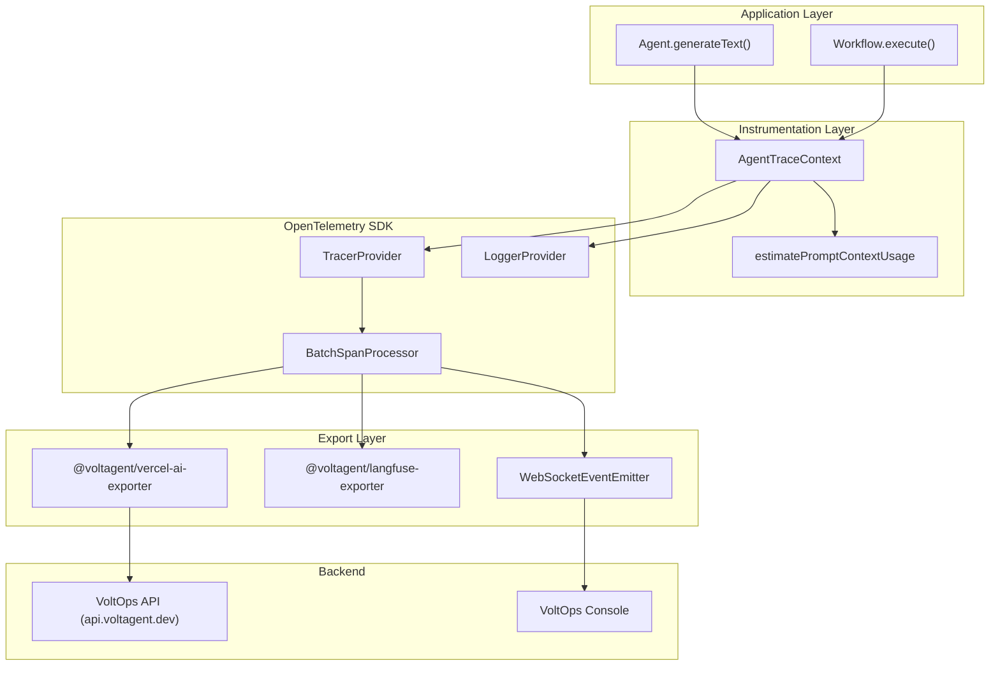
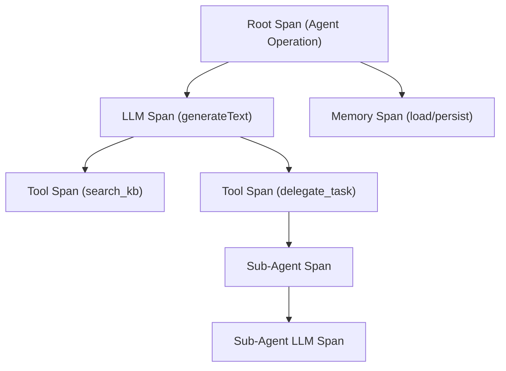

<!-- source: DeepWiki mcp.deepwiki.com · repo VoltAgent/voltagent · page 9.2 Telemetry Architecture · fetched 2026-10-26 -->

# Telemetry Architecture

Relevant source files

The following files were used as context for generating this wiki page:

- [examples/README.md](examples/README.md)
- [examples/with-openrouter/.env.example](examples/with-openrouter/.env.example)
- [examples/with-openrouter/.gitignore](examples/with-openrouter/.gitignore)
- [examples/with-openrouter/README.md](examples/with-openrouter/README.md)
- [examples/with-openrouter/src/index.ts](examples/with-openrouter/src/index.ts)
- [examples/with-openrouter/tsconfig.json](examples/with-openrouter/tsconfig.json)
- [packages/core/src/agent/agent-observability.spec.ts](packages/core/src/agent/agent-observability.spec.ts)
- [packages/core/src/agent/open-telemetry/trace-context.ts](packages/core/src/agent/open-telemetry/trace-context.ts)
- [packages/core/src/agent/prompt-context-usage.spec.ts](packages/core/src/agent/prompt-context-usage.spec.ts)
- [packages/core/src/agent/prompt-context-usage.ts](packages/core/src/agent/prompt-context-usage.ts)
- [packages/core/src/triggers/catalog-data/default-trigger-catalog.ts](packages/core/src/triggers/catalog-data/default-trigger-catalog.ts)
- [packages/core/src/voltops/actions/client.ts](packages/core/src/voltops/actions/client.ts)
- [packages/core/src/voltops/client.spec.ts](packages/core/src/voltops/client.spec.ts)
- [packages/core/src/voltops/client.ts](packages/core/src/voltops/client.ts)
- [packages/core/src/voltops/index.ts](packages/core/src/voltops/index.ts)
- [packages/core/src/voltops/types.ts](packages/core/src/voltops/types.ts)
- [packages/langfuse-exporter/CHANGELOG.md](packages/langfuse-exporter/CHANGELOG.md)
- [packages/langfuse-exporter/package.json](packages/langfuse-exporter/package.json)
- [packages/sdk/CHANGELOG.md](packages/sdk/CHANGELOG.md)
- [packages/sdk/package.json](packages/sdk/package.json)
- [packages/sdk/src/client/index.spec.ts](packages/sdk/src/client/index.spec.ts)
- [packages/sdk/src/client/index.ts](packages/sdk/src/client/index.ts)
- [packages/sdk/src/index.ts](packages/sdk/src/index.ts)
- [packages/sdk/src/types.ts](packages/sdk/src/types.ts)
- [packages/vercel-ai-exporter/CHANGELOG.md](packages/vercel-ai-exporter/CHANGELOG.md)
- [packages/vercel-ai-exporter/package.json](packages/vercel-ai-exporter/package.json)
- [website/observability/overview.md](website/observability/overview.md)
- [website/sidebarsObservability.ts](website/sidebarsObservability.ts)

This page documents VoltAgent's telemetry architecture built on OpenTelemetry, which provides distributed tracing and logging for AI agent operations. It explains the trace structure, span hierarchy, automatic instrumentation, and runtime-specific implementations for Node.js and edge environments. For information about the VoltOps platform features and UI, see page 9.1. For managed memory observability, see page 9.4.

## OpenTelemetry Integration Overview

VoltAgent uses OpenTelemetry (OTel) as its observability backbone, implementing traces, spans, and structured logs to capture agent execution details. The framework automatically instruments all agent operations (`generateText`, `streamText`, `generateObject`, `streamObject`) with zero configuration required.

### Architecture Components

| Component | Location | Purpose |
|-----------|---------|---------|
| `VoltOpsClient` | [packages/core/src/voltops/client.ts:75-75]() | Unified client for telemetry, prompts, and managed services |
| `AgentTraceContext` | [packages/core/src/agent/open-telemetry/trace-context.ts:79-79]() | Manages trace context and span hierarchy for agent operations |
| `VoltAgentObservability` | [packages/core/src/observability/index.ts:1-20]() | Abstract class for environment-specific OTel providers |
| `NodeVoltAgentObservability` | [packages/core/src/observability/node.ts:1-20]() | Node.js provider with full instrumentation |
| `AgentRegistry` | [packages/core/src/registries/agent-registry.ts:1-30]() | Tracks agents for telemetry correlation |

### Telemetry Architecture Diagram

**Sources:** [packages/core/src/agent/open-telemetry/trace-context.ts:79-189](), [packages/core/src/voltops/client.ts:122-126](), [packages/core/src/agent/prompt-context-usage.ts:32-79]()

## Automatic Instrumentation

VoltAgent automatically instruments agent operations without requiring manual span creation. The `AgentTraceContext` class handles span lifecycle management, attribute setting, and context propagation [packages/core/src/agent/open-telemetry/trace-context.ts:1-9]().

### Zero-Configuration Telemetry

When `VoltOpsClient` is provided to the framework, all operations are automatically instrumented. The client initializes the `observability` API which manages trace listing and export [packages/core/src/voltops/client.ts:122-126]().

### Instrumented Operations

| Operation | Span Name | Key Attributes |
|-----------|-----------|----------------|
| `agent.generateText()` | `"agent:{agentName}"` | `entity.id`, `entity.type`, `user.id`, `operation.id` |
| `agent.streamText()` | `"agent:{agentName}"` | Same as generateText |
| Tool execution | `"tool:{toolName}"` | `tool.name`, `tool.input`, `tool.output` |
| Sub-agent delegation | `"subagent:{agentName}"` | `subagent.id`, `subagent.name`, `voltagent.is_subagent` |
| Memory operations | `"memory:{operation}"` | `memory.operation`, `memory.adapter` |

**Sources:** [packages/core/src/agent/open-telemetry/trace-context.ts:102-130](), [packages/core/src/agent/open-telemetry/trace-context.ts:194-206]()

### Span Attribute Enrichment

`AgentTraceContext` automatically enriches spans with common attributes [packages/core/src/agent/open-telemetry/trace-context.ts:102-132]():
- `entity.id`: The agent ID [packages/core/src/agent/open-telemetry/trace-context.ts:125-125]().
- `entity.type`: Always set to `"agent"` [packages/core/src/agent/open-telemetry/trace-context.ts:126-126]().
- `user.id`: Inherited from operation options [packages/core/src/agent/open-telemetry/trace-context.ts:103-103]().
- `conversation.id`: Tracks the thread across turns [packages/core/src/agent/open-telemetry/trace-context.ts:104-104]().

## Trace Structure and Span Hierarchy

VoltAgent creates a hierarchical span structure representing the complete agent execution flow.

### Trace and Span Hierarchy Diagram

**Sources:** [packages/core/src/agent/open-telemetry/trace-context.ts:194-206](), [packages/core/src/agent/open-telemetry/trace-context.ts:155-155]()

### Prompt Context Usage Estimation

VoltAgent includes a utility to estimate token usage before sending requests to providers. The `estimatePromptContextUsage` function calculates tokens for system messages, user messages, and tool definitions [packages/core/src/agent/prompt-context-usage.ts:32-79](). These estimates are converted to OTel attributes via `promptContextUsageEstimateToAttributes` [packages/core/src/agent/prompt-context-usage.ts:81-94]():

- `usage.prompt_context.system_tokens_estimated` [packages/core/src/agent/prompt-context-usage.ts:85-85]()
- `usage.prompt_context.tool_count` [packages/core/src/agent/prompt-context-usage.ts:92-92]()
- `usage.prompt_context.total_tokens_estimated` [packages/core/src/agent/prompt-context-usage.ts:90-90]()

## Specialized Exporters

VoltAgent provides dedicated exporters for different observability platforms.

### Vercel AI Exporter
The `@voltagent/vercel-ai-exporter` package provides OpenTelemetry export specifically for applications using the Vercel AI SDK [packages/vercel-ai-exporter/package.json:2-3](). It depends on `@opentelemetry/sdk-trace-base` [packages/vercel-ai-exporter/package.json:8-8]().

### Langfuse Exporter
The `@voltagent/langfuse-exporter` package sends VoltAgent traces directly to Langfuse [packages/langfuse-exporter/package.json:2-3](). It utilizes the `langfuse` SDK to map OTel spans to Langfuse traces [packages/langfuse-exporter/package.json:8-8]().

## VoltOps Client Integration

The `VoltOpsClient` serves as the gateway for observability data. It manages:
- **API Keys**: Validates `pk_` (public) and `sk_` (secret) keys [packages/core/src/voltops/client.ts:129-135]().
- **Trace Management**: Provides an API to list traces via `this.observability.traces.list` [packages/core/src/voltops/client.ts:123-125]().
- **Feedback**: Allows creating feedback tokens and records for specific traces [packages/core/src/voltops/types.ts:150-170]().

### Feedback Loop
Users can attach feedback to traces using the `VoltOpsFeedbackCreateInput` structure [packages/core/src/voltops/types.ts:158-170](), which includes:
- `traceId`: The OTel trace identifier [packages/core/src/voltops/types.ts:159-159]().
- `score`: Numeric or boolean evaluation [packages/core/src/voltops/types.ts:162-162]().
- `comment`: Freeform text feedback [packages/core/src/voltops/types.ts:165-165]().

**Sources:** [packages/core/src/voltops/client.ts:75-164](), [packages/core/src/voltops/types.ts:158-187]()

## Real-time Observability

For local development, VoltAgent uses a `WebSocketEventEmitter` to stream span events in real-time [packages/core/src/agent/agent-observability.spec.ts:5-5]().
- `span:start`: Emitted when a new operation begins [packages/core/src/agent/agent-observability.spec.ts:105-105]().
- `span:end`: Emitted when an operation completes, including usage and cost metadata [packages/core/src/agent/agent-observability.spec.ts:183-185]().

### Provider Cost Tracking
When using providers like OpenRouter, the system extracts cost metadata and attaches it to spans [packages/core/src/agent/agent-observability.spec.ts:156-169]():
- `usage.cost`: Total dollar amount [packages/core/src/agent/agent-observability.spec.ts:193-193]().
- `usage.cost_details.upstream_inference_cost` [packages/core/src/agent/agent-observability.spec.ts:195-195]().

**Sources:** [packages/core/src/agent/agent-observability.spec.ts:68-210](), [packages/core/src/agent/prompt-context-usage.ts:1-30]()

---

