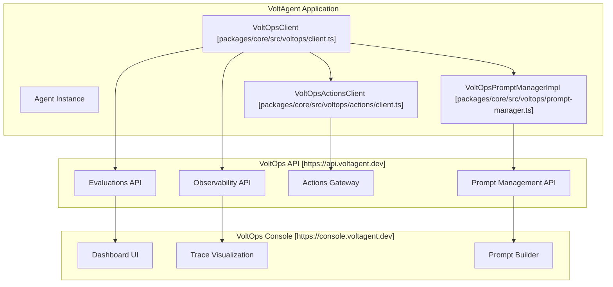
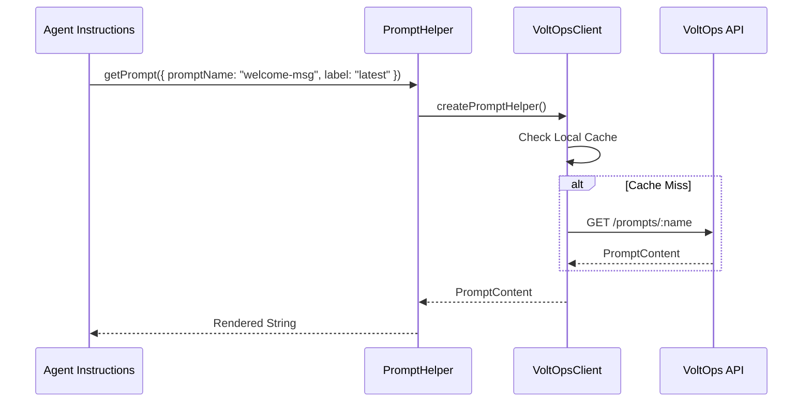
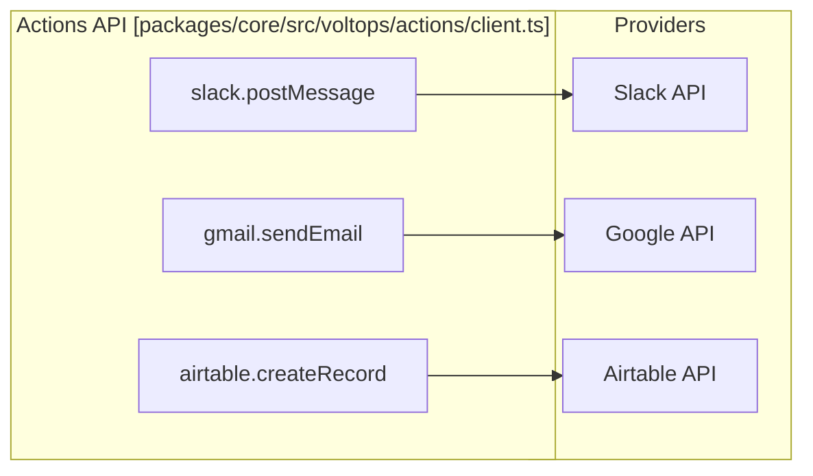

<!-- source: DeepWiki mcp.deepwiki.com · repo VoltAgent/voltagent · page 9.3 VoltOps Console Integration · fetched 2026-10-26 -->

# VoltOps Console Integration

<details>
<summary>Relevant source files</summary>

The following files were used as context for generating this wiki page:

- [examples/with-langfuse/package.json](examples/with-langfuse/package.json)
- [examples/with-voltagent-exporter/package.json](examples/with-voltagent-exporter/package.json)
- [packages/core/src/triggers/catalog-data/default-trigger-catalog.ts](packages/core/src/triggers/catalog-data/default-trigger-catalog.ts)
- [packages/core/src/voltops/actions/client.ts](packages/core/src/voltops/actions/client.ts)
- [packages/core/src/voltops/client.spec.ts](packages/core/src/voltops/client.spec.ts)
- [packages/core/src/voltops/client.ts](packages/core/src/voltops/client.ts)
- [packages/core/src/voltops/index.ts](packages/core/src/voltops/index.ts)
- [packages/core/src/voltops/types.ts](packages/core/src/voltops/types.ts)
- [packages/sdk/src/client/index.spec.ts](packages/sdk/src/client/index.spec.ts)
- [packages/sdk/src/client/index.ts](packages/sdk/src/client/index.ts)
- [packages/sdk/src/index.ts](packages/sdk/src/index.ts)
- [packages/sdk/src/types.ts](packages/sdk/src/types.ts)
- [website/observability/overview.md](website/observability/overview.md)
- [website/sidebarsObservability.ts](website/sidebarsObservability.ts)

</details>


This document describes how to integrate VoltAgent applications with the VoltOps Console, a platform for observability, prompt management, and automated actions. It covers the `VoltOpsClient` setup, dashboard features, and trace visualization.

**Scope**: This page focuses on the client-side integration using `VoltOpsClient` and console UI features. For telemetry architecture details, see [Telemetry Architecture](9.2). For managed memory configuration, see [Managed Memory Integration](9.4).

---

## VoltOpsClient Architecture

The `VoltOpsClient` class is the primary interface for interacting with the VoltOps platform. It provides unified access to managed memory, prompt management, evaluations, and automated actions.



**Sources**: [packages/core/src/voltops/client.ts:75-83](), [packages/core/src/voltops/index.ts:1-96](), [packages/sdk/src/client/index.ts:80-132]()

---

## Client Setup

### Basic Configuration

The `VoltOpsClient` requires a public key and a secret key obtained from the VoltOps Console. These keys must follow specific prefix formats: `pk_` for public and `sk_` for secret.

| Option | Format | Purpose |
|--------|--------|---------|
| `publicKey` | `pk_...` | Public identifier for API authentication and prompt management. [packages/core/src/voltops/types.ts:77-93]() |
| `secretKey` | `sk_...` | Secret key for secure operations and analytics. [packages/core/src/voltops/types.ts:95-111]() |

```typescript
import { VoltOpsClient } from "@voltagent/core";

const voltops = new VoltOpsClient({
  publicKey: process.env.VOLTAGENT_PUBLIC_KEY,
  secretKey: process.env.VOLTAGENT_SECRET_KEY,
  promptCache: {
    enabled: true,
    ttl: 300, // 5 minutes
  }
});
```

**Sources**: [packages/core/src/voltops/client.ts:89-164](), [packages/core/src/voltops/types.ts:73-123](), [packages/core/src/voltops/client.spec.ts:73-147]()

---

## Prompt Management Integration

The console allows developers to manage prompts centrally. The `VoltOpsClient` fetches these prompts and provides a `PromptHelper` for use within agent instructions.

### Prompt Reference and Helper

Prompts are identified by name and can be pinned to a specific `version` or a `label` (e.g., "production").



**Key Entities**:
- `PromptReference`: Defines the prompt name, version, and variables. [packages/core/src/voltops/types.ts:28-43]()
- `getPrompt`: Function provided by `PromptHelper` to retrieve content. [packages/core/src/voltops/client.ts:169-188]()

**Sources**: [packages/core/src/voltops/client.ts:169-188](), [packages/core/src/voltops/types.ts:28-51]()

---

## Trace Visualization and Observability

VoltOps turns execution logs into visual traces. While the raw data is exported via OpenTelemetry, the `VoltOpsClient` provides methods to query these traces back for display or programmatic analysis.

### Trace List API

The `observability.traces.list` method allows retrieving historical traces from the platform.

| Parameter | Type | Description |
|-----------|------|-------------|
| `limit` | `number` | Number of traces to return. |
| `offset` | `number` | Pagination offset. |
| `sortOrder` | `asc` \| `desc` | Order by creation time. |

**Sources**: [packages/core/src/voltops/client.ts:122-126](), [packages/sdk/src/client/index.ts:127-131](), [packages/core/src/voltops/types.ts:44-48]()

---

## Automated Actions

The `VoltOpsActionsClient` enables agents to interact with third-party services like Slack, Discord, and Google Drive through the VoltOps Action Gateway.



### Supported Action Groups
- **Slack**: `postMessage`, `deleteMessage`, `searchMessages`. [packages/core/src/voltops/actions/client.ts:109-117]()
- **Discord**: `sendMessage`, `createChannel`, `addReaction`. [packages/core/src/voltops/actions/client.ts:118-154]()
- **Gmail**: `sendEmail`, `replyToEmail`, `searchEmail`. [packages/core/src/voltops/actions/client.ts:155-161]()
- **Google Calendar/Drive**: List, get, create, and delete resources. [packages/core/src/voltops/actions/client.ts:162-187]()

**Sources**: [packages/core/src/voltops/actions/client.ts:93-187](), [packages/core/src/voltops/types.ts:201-207]()

---

## Evaluation Integration

The console serves as a dashboard for evaluation runs. The `evals` API in `VoltOpsClient` tracks the lifecycle of an evaluation experiment.

### Eval Run Lifecycle

1. **Create Run**: `evals.runs.create(payload)` initializes a new run in the console. [packages/sdk/src/client/index.ts:107]()
2. **Append Results**: `evals.runs.appendResults(runId, payload)` streams individual test case results. [packages/sdk/src/client/index.ts:108]()
3. **Complete/Fail**: Marks the run as finished with summary metrics or error details. [packages/sdk/src/client/index.ts:109-110]()

**Sources**: [packages/sdk/src/client/index.ts:105-126](), [packages/sdk/src/client/index.spec.ts:62-234]()

---

## Feedback Loop

The platform supports a feedback system where users or automated scorers can attach scores and comments to specific traces.

- `VoltOpsFeedbackCreateInput`: Schema for submitting feedback, including `score`, `comment`, and `correction`. [packages/core/src/voltops/types.ts:158-170]()
- `VoltOpsFeedbackToken`: A temporary token used to allow external users to provide feedback on a specific trace without full API access. [packages/core/src/voltops/types.ts:143-148]()

**Sources**: [packages/core/src/voltops/types.ts:125-187](), [website/sidebarsObservability.ts:34-37]()

---

