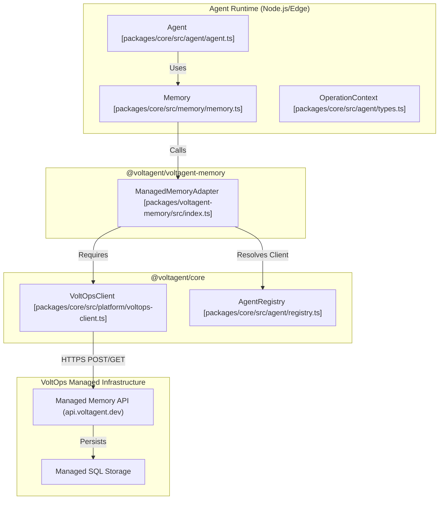
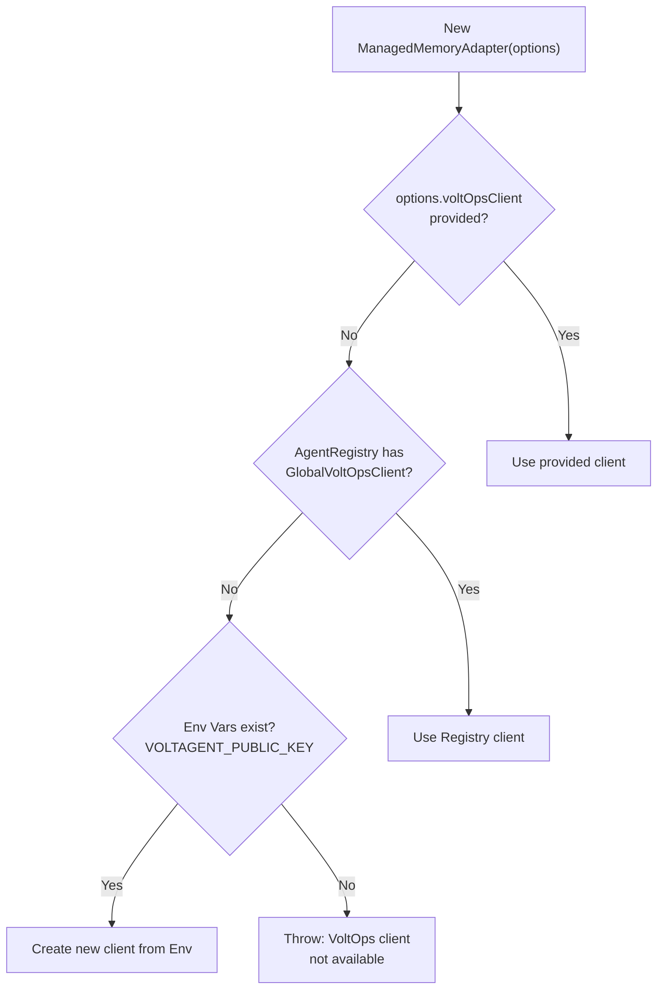

<!-- source: DeepWiki mcp.deepwiki.com · repo VoltAgent/voltagent · page 9.4 Managed Memory Integration · fetched 2026-10-26 -->

# Managed Memory Integration

<details>
<summary>Relevant source files</summary>

The following files were used as context for generating this wiki page:

- [examples/with-voltagent-managed-memory/package.json](examples/with-voltagent-managed-memory/package.json)
- [packages/cloudflare-d1/src/memory-adapter.spec.ts](packages/cloudflare-d1/src/memory-adapter.spec.ts)
- [packages/cloudflare-d1/src/memory-adapter.ts](packages/cloudflare-d1/src/memory-adapter.ts)
- [packages/core/src/memory/adapters/storage/in-memory.spec.ts](packages/core/src/memory/adapters/storage/in-memory.spec.ts)
- [packages/core/src/memory/adapters/storage/in-memory.ts](packages/core/src/memory/adapters/storage/in-memory.ts)
- [packages/libsql/src/memory-core.ts](packages/libsql/src/memory-core.ts)
- [packages/libsql/src/memory-v2-adapter.spec.ts](packages/libsql/src/memory-v2-adapter.spec.ts)
- [packages/libsql/src/memory-v2-adapter.ts](packages/libsql/src/memory-v2-adapter.ts)
- [packages/postgres/src/index.integration.test.ts](packages/postgres/src/index.integration.test.ts)
- [packages/postgres/src/memory-adapter.spec.ts](packages/postgres/src/memory-adapter.spec.ts)
- [packages/postgres/src/memory-adapter.ts](packages/postgres/src/memory-adapter.ts)
- [packages/supabase/src/memory-adapter.spec.ts](packages/supabase/src/memory-adapter.spec.ts)
- [packages/supabase/src/memory-adapter.ts](packages/supabase/src/memory-adapter.ts)
- [packages/voltagent-memory/src/index.ts](packages/voltagent-memory/src/index.ts)

</details>


## Purpose and Scope

VoltOps Managed Memory provides a cloud-hosted, serverless storage solution for AI agent conversation history, workflow states, and vector embeddings. It is designed to eliminate the operational overhead of provisioning and maintaining databases like PostgreSQL or LibSQL in serverless environments (e.g., Cloudflare Workers, Vercel Edge). Managed Memory is accessible via the `ManagedMemoryAdapter`, which implements the standard `StorageAdapter` interface, ensuring seamless integration with the VoltAgent `Memory` system.

For local development or self-hosted alternatives, see [Memory Storage Adapters](2.5). For broader platform features, see [VoltOps Console Integration](9.3).

---

## System Architecture

Managed Memory bridges the gap between the local agent runtime and the VoltOps cloud infrastructure. It uses the `VoltOpsClient` to communicate with regional API endpoints that manage persistent storage.

### Data Flow and Code Entities

The following diagram illustrates how natural language requests trigger data persistence through specific code entities in the `@voltagent/voltagent-memory` and `@voltagent/core` packages.



**Sources**: [packages/voltagent-memory/src/index.ts:35-56](), [packages/voltagent-memory/src/index.ts:174-184](), [packages/core/src/agent/registry.ts:1-20]()

---

## Implementation Details

### ManagedMemoryAdapter

The `ManagedMemoryAdapter` is the primary interface for managed storage. Unlike local adapters (e.g., `InMemoryStorageAdapter`), it does not interact with a local file or socket; instead, it proxies all `StorageAdapter` methods to the VoltOps API.

**Key Functions:**
- `initialize()`: Fetches available databases using the `VoltOpsClient` and matches the target by `databaseId` or `databaseName` [packages/voltagent-memory/src/index.ts:71-108]().
- `addMessage()`: Sends a single `UIMessage` to the managed backend [packages/voltagent-memory/src/index.ts:174-184]().
- `getMessages()`: Retrieves conversation history with support for filters like `limit`, `before`, `after`, and `roles` [packages/voltagent-memory/src/index.ts:205-223]().
- `saveConversationSteps()`: Persists internal agent reasoning steps for observability [packages/voltagent-memory/src/index.ts:225-234]().

### Credential Resolution

The adapter employs an automatic resolution strategy to find `VoltOpsClient` credentials (Public/Secret keys).



**Sources**: [packages/voltagent-memory/src/index.ts:58-69](), [packages/voltagent-memory/src/index.ts:131-147]()

---

## Comparison with Self-Hosted Adapters

While `ManagedMemoryAdapter` communicates over the network, it implements the same core logic for handling `UIMessage` and `WorkflowStateEntry` as local adapters.

| Feature | `ManagedMemoryAdapter` | `PostgreSQLMemoryAdapter` | `LibSQLMemoryAdapter` |
| :--- | :--- | :--- | :--- |
| **Storage Engine** | VoltOps Cloud (SQL) | PostgreSQL Pool | SQLite / Turso |
| **Initialization** | API Metadata Fetch | `CREATE TABLE IF NOT EXISTS` | `CREATE TABLE IF NOT EXISTS` |
| **Schema Management** | Managed by VoltOps | Managed via code [packages/postgres/src/memory-adapter.ts:132-220]() | Managed via code [packages/libsql/src/memory-core.ts:113-217]() |
| **Edge Compatibility** | High (HTTPS Only) | Medium (Requires TCP/TLS) | High (LibSQL Edge Client) |
| **Retry Logic** | Internal to API | `executeWithRetry` [packages/postgres/src/memory-adapter.ts:104-108]() | `executeWithRetry` [packages/libsql/src/memory-core.ts:75-108]() |

**Sources**: [packages/postgres/src/memory-adapter.ts:74-99](), [packages/libsql/src/memory-core.ts:52-70](), [packages/voltagent-memory/src/index.ts:35-56]()

---

## Configuration and Usage

### Basic Setup
In serverless environments, you typically rely on environment variables and the `databaseName` defined in the VoltOps Console.

```typescript
import { ManagedMemoryAdapter } from "@voltagent/voltagent-memory";
import { Memory, Agent } from "@voltagent/core";

const storage = new ManagedMemoryAdapter({
  databaseName: "my-production-db",
  debug: true
});

const memory = new Memory({ storage });
```

### Advanced: Explicit Client
For multi-tenant applications where you might switch keys dynamically:

```typescript
const voltOpsClient = new VoltOpsClient({
  publicKey: "pk_...",
  secretKey: "sk_..."
});

const storage = new ManagedMemoryAdapter({
  databaseId: "db_12345",
  voltOpsClient
});
```

**Sources**: [packages/voltagent-memory/src/index.ts:28-33](), [examples/with-voltagent-managed-memory/package.json:1-12]()

---

## Integration Lifecycle

The `ManagedMemoryAdapter` handles initialization asynchronously to prevent blocking the constructor.

1.  **Constructor**: Sets up the `VoltOpsClient` and checks for valid keys [packages/voltagent-memory/src/index.ts:46-56]().
2.  **Ensure Initialized**: Every data operation (e.g., `addMessage`) calls `ensureInitialized()`. If not yet ready, it performs a one-time fetch of database metadata [packages/voltagent-memory/src/index.ts:131-147]().
3.  **Context Wrapper**: Operations use `withClientContext` to ensure the `databaseId` is resolved before making API calls [packages/voltagent-memory/src/index.ts:149-166]().

**Sources**: [packages/voltagent-memory/src/index.ts:71-108](), [packages/voltagent-memory/src/index.ts:149-166]()

---

