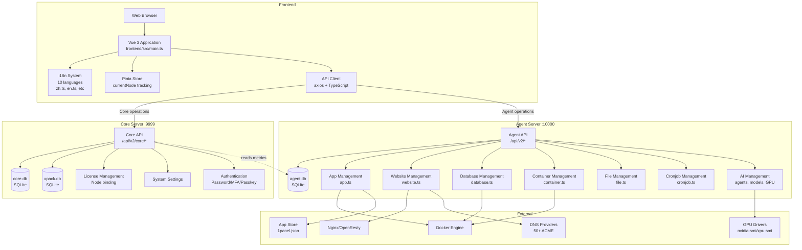
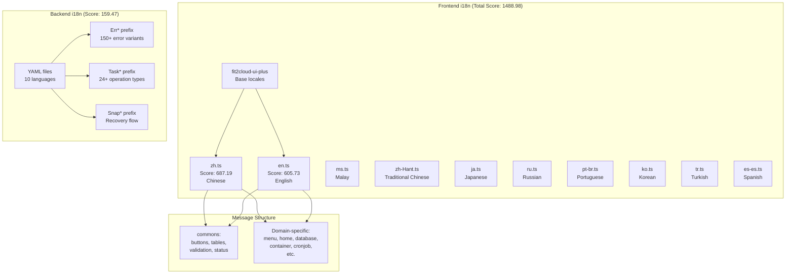
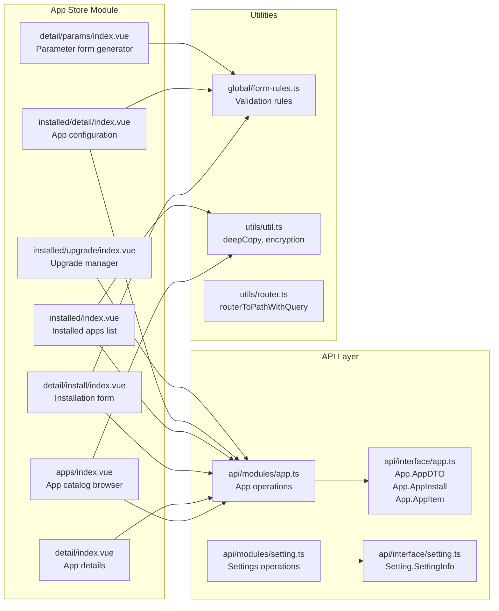
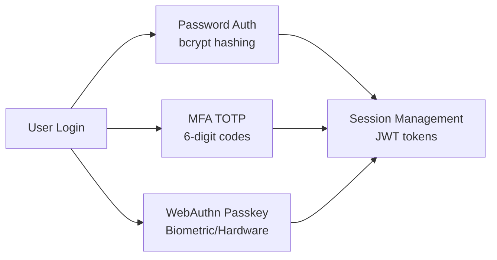

<!-- source: DeepWiki mcp.deepwiki.com · repo 1Panel-dev/1Panel · page 1 1Panel Overview · fetched 2026-10-29 -->

# 1Panel Overview

<details>
<summary>Relevant source files</summary>

The following files were used as context for generating this wiki page:

- [Makefile](Makefile)
- [agent/utils/common/sqlite.go](agent/utils/common/sqlite.go)
- [core/middleware/operation.go](core/middleware/operation.go)
- [core/utils/common/sqlite.go](core/utils/common/sqlite.go)
- [frontend/src/lang/modules/en.ts](frontend/src/lang/modules/en.ts)
- [frontend/src/lang/modules/es-es.ts](frontend/src/lang/modules/es-es.ts)
- [frontend/src/lang/modules/ja.ts](frontend/src/lang/modules/ja.ts)
- [frontend/src/lang/modules/ko.ts](frontend/src/lang/modules/ko.ts)
- [frontend/src/lang/modules/ms.ts](frontend/src/lang/modules/ms.ts)
- [frontend/src/lang/modules/pt-br.ts](frontend/src/lang/modules/pt-br.ts)
- [frontend/src/lang/modules/ru.ts](frontend/src/lang/modules/ru.ts)
- [frontend/src/lang/modules/tr.ts](frontend/src/lang/modules/tr.ts)
- [frontend/src/lang/modules/zh-Hant.ts](frontend/src/lang/modules/zh-Hant.ts)
- [frontend/src/lang/modules/zh.ts](frontend/src/lang/modules/zh.ts)

</details>


## Purpose and Scope

This document provides a comprehensive overview of 1Panel, an open-source Linux server management panel. It covers the system's architecture, technology stack, core components, and major functional domains. This overview serves as an entry point for understanding how the system is structured and how its components interact.

For detailed information on specific subsystems, see:
- Architecture and Core Systems: [#2](#2)
- Internationalization: [#3](#3)
- Website Management: [#5](#5)
- Application Management: [#6](#6)
- Infrastructure Management: [#7](#7)

**Sources:** [frontend/package.json:1-80](), [frontend/src/main.ts:1-50](), [frontend/src/views/app-store/apps/index.vue:1-50]()

## What is 1Panel?

1Panel is a comprehensive web-based management platform for Linux servers that provides unified control over server management tasks including application deployment, website hosting, container orchestration, database administration, file management, and AI/ML infrastructure. The platform is built on a three-tier architecture with a Vue 3 frontend, dual Go-based backend services (Core and Agent), and integration with external systems like Docker, Nginx/OpenResty, database engines, and GPU infrastructure.

The system features AI capabilities including agent management, model deployment (Ollama integration), GPU/XPU monitoring (nvidia-smi, xpu-smi), and MCP (Model Context Protocol) server management. It supports 10 languages through a comprehensive i18n system and uses a task-based async execution system for long-running operations with real-time progress updates.

**Architecture Highlights:**
- **Core Server** (port 9999): Authentication, licensing, system settings
- **Agent Server** (port 10000): Resource operations, infrastructure management
- **Multi-Node Support**: Master/agent topology with distributed deployments
- **Three SQLite Databases**: `core.db`, `xpack.db`, `agent.db`

**Sources:** [frontend/package.json:1-10](), [frontend/src/lang/modules/zh.ts:362-392](), [frontend/src/lang/modules/en.ts:375-406]()

## Technology Stack

### Frontend Stack (Vue 3 + TypeScript)

| Technology | Version | Purpose |
|------------|---------|---------|
| `vue` | 3.4.27 | Core UI framework with Composition API |
| `typescript` | 5.3.3 | Type safety and interfaces |
| `vite` | 5.0.x | Build tool with fast HMR |
| `element-plus` | 2.11.9 | UI component library |
| `pinia` | 2.1.7 | State management with persistence |
| `axios` | 1.7.2 | HTTP client for API communication |
| `monaco-editor` | 0.53.0 | Code editor (10+ file tabs) |
| `@xterm/xterm` | 5.5.0 | Terminal emulator |
| `echarts` | 5.5.0 | Charts via v-charts wrapper |
| `vue-i18n` | Latest | Internationalization (10 languages) |
| `fit2cloud-ui-plus` | 1.2.4 | Base component library |

**Sources:** [frontend/package.json:22-58]()

### Backend Stack (Go 1.22)

**Core Server Dependencies:**
- `gin-gonic/gin`: Web framework for HTTP routing
- `gorm.io/gorm`: ORM for database operations
- `glebarez/sqlite`: SQLite3 driver for `core.db` and `xpack.db`
- `golang-jwt/jwt`: JWT token generation and validation
- `robfig/cron/v3`: Scheduler for cronjobs

**Agent Server Dependencies:**
- `gin-gonic/gin`: Web framework
- `gorm.io/gorm`: ORM layer
- `glebarez/sqlite`: SQLite3 driver for `agent.db`
- `docker/docker`: Docker SDK for container management
- Custom Nginx parser for config manipulation
- `go-acme/lego`: ACME client supporting 50+ DNS providers
- GPU integration: nvidia-smi, xpu-smi CLI tools

**Build Configuration:**
```makefile
# From Makefile
GOCMD=go
GOBUILD=$(GOCMD) build
BUILD_PATH=$(BASE_PATH)/build
CORE_NAME=1panel-core
AGENT_NAME=1panel-agent

# Cross-compilation support
build_core_on_linux: CGO_ENABLED=0 GOOS=$(GOOS) GOARCH=$(GOARCH)
build_agent_on_linux: CGO_ENABLED=0 GOOS=$(GOOS) GOARCH=$(GOARCH)
```

**Sources:** [frontend/package.json:22-58](), [Makefile:1-50](), [core/utils/common/sqlite.go:42-68](), [agent/utils/common/sqlite.go:62-91]()

## System Architecture

### Core/Agent Split Architecture

1Panel implements a dual-server architecture separating system-wide concerns from operational tasks:



**Key Architecture Decisions:**
- **Core Server**: Stateless operations, authentication, license enforcement, cross-node aggregation
- **Agent Server**: Stateful resource management, infrastructure operations, task execution
- **Database Separation**: Three SQLite databases via `glebarez/sqlite` driver
  - `core.db`: System settings, users, licenses (via [core/utils/common/sqlite.go:15-68]())
  - `xpack.db`: Extended features, node management
  - `agent.db`: Resource state, operational data (via [agent/utils/common/sqlite.go:16-105]())
- **SQLite Configuration**: 4 max open connections, 1 idle, 15min idle timeout, 1hr max lifetime

**Sources:** [core/utils/common/sqlite.go:15-68](), [agent/utils/common/sqlite.go:16-105](), [frontend/src/main.ts:1-50](), [frontend/src/api/modules/setting.ts:1-30](), [frontend/src/api/modules/app.ts:1-30]()

### Request-Response Flow

```mermaid
sequenceDiagram
    participant User
    participant VueComponent["Vue Component<br/>e.g., apps/index.vue"]
    participant APIModule["API Module<br/>e.g., app.ts"]
    participant BackendAPI["Backend API<br/>/api/v2/*"]
    participant TaskSystem["Task System"]
    participant ExternalSystem["External System"]
    
    User->>VueComponent: "Trigger action"
    VueComponent->>VueComponent: "Validate form data<br/>form-rules.ts"
    VueComponent->>APIModule: "Call API method"
    APIModule->>APIModule: "Base64 encode secrets"
    APIModule->>BackendAPI: "HTTP request with DTO"
    
    alt Short Operation
        BackendAPI->>ExternalSystem: "Execute directly"
        ExternalSystem-->>BackendAPI: "Result"
        BackendAPI-->>APIModule: "Response"
        APIModule-->>VueComponent: "Data"
        VueComponent->>User: "Show result (MsgSuccess)"
    else Long Operation
        BackendAPI->>TaskSystem: "Create task with UUID"
        TaskSystem-->>BackendAPI: "Task ID"
        BackendAPI-->>APIModule: "Task ID response"
        APIModule-->>VueComponent: "Task ID"
        VueComponent->>VueComponent: "Open TaskLog dialog"
        
        par Async Execution
            TaskSystem->>ExternalSystem: "Execute steps"
            ExternalSystem-->>TaskSystem: "Progress updates"
        and UI Polling
            VueComponent->>BackendAPI: "Poll task status"
            BackendAPI->>TaskSystem: "Query task"
            TaskSystem-->>BackendAPI: "Status/logs"
            BackendAPI-->>VueComponent: "Real-time updates"
        end
        
        TaskSystem->>TaskSystem: "Complete"
        VueComponent->>User: "Show completion"
    end
```

**Sources:** [frontend/src/api/modules/app.ts:1-150](), [frontend/src/global/form-rules.ts:1-50](), [frontend/src/utils/util.ts:1-100]()

## Major Functional Domains

1Panel organizes functionality into nine major domains:

### 1. Infrastructure Management

Real-time monitoring with GPU support:
- **Dashboard**: CPU/Memory/Disk/Network metrics via `/dashboard/current/:io/:net` endpoint
- **System Info**: Hostname, OS version, kernel, uptime (from `/proc`, `/sys`)
- **GPU Monitoring**: NVIDIA/XPU metrics via nvidia-smi/xpu-smi integration
- **Process Tracking**: CPU and memory top 5 processes

**i18n Keys**: `home.*` (from [frontend/src/lang/modules/zh.ts:394-464](), [frontend/src/lang/modules/en.ts:408-478]())

### 2. Application Ecosystem

One-click Docker Compose deployments:
- **App Store**: Browse/search remote catalog, tags for categorization
- **Installation**: Dynamic parameter form generation via `AppInstallForm`
- **Runtime Environments**: PHP/Node/Python/Go version management
- **Installed Apps**: Start/stop/update, parameter reconfiguration

**Code Entities**: `App.AppDTO`, `App.AppInstall`, `SearchAppReq` from [frontend/src/api/interface/app.ts:1-100]()  
**i18n Keys**: `apps.*` from [frontend/src/lang/modules/zh.ts:654-800]()

### 3. Container Platform

Full Docker functionality via Docker SDK:
- **Container Operations**: Create/start/stop with resource limits
- **Image Management**: Pull/push/build with multi-tag support
- **Network Management**: Bridge/host/custom networks
- **Volume Management**: Persistent storage, NFS support
- **Docker Compose**: Multi-container orchestration

**i18n Keys**: `container.*` from [frontend/src/lang/modules/zh.ts:801-1094]()

### 4. Web Services

Nginx configuration with automated SSL:
- **6 Website Types**: static, runtime, deployment, proxy, stream, subsite
- **Nginx Config**: Rewrite rules, proxy settings, custom scopes
- **SSL Certificates**: ACME automation with 50+ DNS providers (via go-acme/lego)
- **Domain Management**: Multi-domain, wildcard support

**i18n Keys**: `website.*` from language files

### 5. Data Services

Multi-DBMS support with unified backup:
- **MySQL/MariaDB**: Cluster support, performance tuning
- **PostgreSQL**: Replication, super user binding
- **Redis**: CLI integration, persistence configuration
- **MongoDB**: Basic operations
- **Database Backup**: Auto retention, encrypted backups

**i18n Keys**: `database.*` from [frontend/src/lang/modules/zh.ts:477-653]()

### 6. AI/ML Infrastructure

AI agent deployment and GPU monitoring:
- **AI Agents**: Chat integration with Feishu/Lark channels
- **Model Management**: Ollama integration, OpenAI API support
- **GPU Monitoring**: NVIDIA/XPU metrics (temperature, memory, utilization)
- **MCP Servers**: stdio/SSE/HTTP transport mechanisms
- **AI Proxy**: Load balancing with IP whitelist

**i18n Keys**: `aiTools.*` from [frontend/src/lang/modules/zh.ts:654-800]()

### 7. Storage & Files

Web-based file management with code editor:
- **File Browser**: Multi-tab interface (7 tabs max)
- **Code Editor**: Monaco with 10+ file tabs, syntax highlighting
- **File Operations**: Compress/upload/convert (40+ operations)
- **Backup Management**: Snapshots with restore/rollback

**i18n Keys**: `file.*` from language files

### 8. Automation

Scheduled tasks with robust execution:
- **Cronjobs**: 10 task types (shell, backup, database, snapshot, cleanup, etc.)
- **Script Library**: Bash/Python script management
- **Task Logging**: Real-time progress via SSE
- **System Snapshots**: Full backup/rollback capabilities

**Scheduler**: `robfig/cron/v3` for cron expression parsing  
**i18n Keys**: `cronjob.*` from [frontend/src/lang/modules/zh.ts:1095-1200]()

### 9. System Administration

Multi-factor authentication and settings:
- **Settings**: Network/security/API configuration
- **User Management**: MFA (TOTP 6-digit), Passkey (WebAuthn)
- **License System**: Node-level binding with feature gating
- **System Updates**: Version management, upgrade workflow

**i18n Keys**: `settings.*`, `login.*` from [frontend/src/lang/modules/zh.ts:192-220]()

**Sources:** [frontend/src/lang/modules/zh.ts:362-1200](), [frontend/src/lang/modules/en.ts:375-800](), [frontend/src/api/interface/app.ts:1-100]()

## Internationalization Architecture

1Panel supports 10 languages through a dual-layer i18n system:



**Language Files:**
- Primary: `zh.ts` (Chinese), `en.ts` (English)
- Additional: `ms.ts`, `zh-Hant.ts`, `ja.ts`, `ru.ts`, `pt-br.ts`, `ko.ts`, `tr.ts`, `es-es.ts`

**Message Organization:**
```typescript
// Example structure from zh.ts and en.ts
{
  commons: {
    button: { create, edit, delete, ... },
    table: { name, type, status, ... },
    status: { running, stopped, error, ... },
    rule: { validation patterns }
  },
  menu: { home, apps, website, database, ... },
  database: { manage, create, backup, ... },
  container: { image, network, volume, ... },
  // ... domain-specific messages
}
```

**Sources:** [frontend/src/lang/modules/zh.ts:1-100](), [frontend/src/lang/modules/en.ts:1-100](), [frontend/src/lang/modules/ms.ts:1-50](), [frontend/src/lang/modules/zh-Hant.ts:1-50](), [frontend/src/lang/modules/ja.ts:1-50]()

## Frontend Component Architecture

### Core Components Mapping



**Sources:** [frontend/src/views/app-store/apps/index.vue:1-70](), [frontend/src/views/app-store/installed/index.vue:1-150](), [frontend/src/api/modules/app.ts:1-80](), [frontend/src/api/interface/app.ts:1-100]()

### State Management

1Panel uses Pinia for state management with persistent state plugin:

**Dependencies:**
- `pinia` (^2.1.7) - Core state management
- `pinia-plugin-persistedstate` (^1.6.1) - State persistence

**Sources:** [frontend/package.json:49-50]()

## Key Features Overview

### 1. Application Store System

**Importance Score:** 351.06

Manages application discovery, installation, and lifecycle:
- Remote/local/custom app repositories
- Dynamic parameter form generation (`params/index.vue`)
- Multi-node deployment support
- Dependency injection
- Backup/restore operations

**Key Components:**
- `App.AppDTO` - Application metadata
- `App.AppInstall` - Installation configuration
- `AppInstallForm` - Dynamic form component

**Sources:** [frontend/src/views/app-store/apps/index.vue:1-150](), [frontend/src/views/app-store/detail/install/index.vue:1-100](), [frontend/src/api/interface/app.ts:1-100]()

### 2. Website Management System

**Importance Score:** 485.43 (combined)

Comprehensive website hosting with:
- 6 website types (deployment, runtime, static, proxy, subsite, stream)
- OpenResty/Nginx configuration engine
- SSL automation (ACME/manual/CA)
- Domain management

See [Website Management System](#5) for details.

### 3. Settings & Configuration

**Importance Score:** 429.82

Central configuration system handling:
- Global settings
- License management with node binding
- Authentication (password, MFA, passkey)
- API security (keys, IP whitelist)
- Panel SSL configuration
- Upgrade management
- Snapshot configuration

**API Endpoints:**
```typescript
// From setting.ts
uploadLicense(oldLicense: string, params: FormData)
searchLicense(params: ReqPage)
deleteLicense(params: { ids: number })
// ... additional setting operations
```

**Sources:** [frontend/src/api/modules/setting.ts:1-100](), [frontend/src/api/interface/setting.ts:1-100]()

### 4. File Management System

**Importance Score:** 233.02

Advanced file browser with:
- Multi-tab support (7 tabs max)
- Monaco editor integration for code editing
- 40+ file operations (CRUD, compress, upload)
- Terminal integration
- Navigation history and breadcrumbs
- Favorites management

### 5. Container Management

**Importance Score:** 193.34

Docker integration providing:
- Container operations (create, start, stop, delete)
- Image management (pull, build, push, prune)
- Network and volume handling
- Docker Compose orchestration
- Resource statistics and monitoring

### 6. Database Management

**Importance Score:** 152.85

Multi-DBMS support:
- MySQL/MariaDB, Redis, PostgreSQL
- Local and remote connections
- Performance tuning and configuration editing
- Terminal access
- Backup and restore operations

### 7. Cronjob System

**Importance Score:** 162.08

Scheduled automation with:
- 12 job types (shell, backup, database, snapshot, cleanup, etc.)
- `robfig/cron/v3` scheduler
- Execution tracking and logs
- Snapshot system integration

## Build Configuration

The frontend uses Vite with specific optimization:

```typescript
// Key build configuration
{
  "scripts": {
    "dev": "node --max-old-space-size=8192 ./node_modules/.bin/vite --host",
    "build:dev": "vite build --mode development",
    "build:pro": "vite build --mode production"
  }
}
```

**Build Features:**
- Development server with hot module replacement
- Production optimization with code splitting
- Environment-specific builds (dev/test/production)
- Monaco editor integration
- TypeScript type checking

**Sources:** [frontend/package.json:6-12](), [frontend/vite.config.ts:1-100]()

## Theming System

1Panel supports light and dark modes:

**Theme Variables:**
- `--panel-color-primary` - Primary brand color
- Light mode: Default Element Plus theme
- Dark mode: Custom theme variables (`element-dark.scss`)

**Sources:** [frontend/src/styles/element-dark.scss:1-100]()

## Security Architecture

1Panel implements defense-in-depth security across six layers:

### Authentication Mechanisms



**Code References:**
- Password validation: bcrypt hashing for secure storage
- MFA: TOTP-based 6-digit verification codes
- Passkey: WebAuthn API for biometric/hardware key authentication
- JWT: Token-based session management

**i18n Keys**: `login.mfaTitle`, `login.passkey`, `login.passkeyNotSupported` from [frontend/src/lang/modules/zh.ts:207-219]()

### Network Security Layers

1. **Safe Entrance**: SSH command required to view panel entry (`1pctl user-info`)
2. **IP Whitelist**: Per-panel and per-API-key IP restrictions
3. **Domain Binding**: Restrict access to specific domains
4. **Firewall Rules**: Port management and traffic control

**i18n Keys**: `login.safeEntrance1`, `login.errIP1`, `login.errDomain1` from [frontend/src/lang/modules/zh.ts:201-205]()

### Application Security

1. **Captcha System**: Brute force protection on login
2. **Password Policy**: Complexity enforcement (8-30 chars, letters+numbers+symbols)
3. **API Key System**: Programmatic access with per-key IP restrictions
4. **Operation Logging**: All API calls logged via [core/middleware/operation.go:28-171]()

**Validation Rules**: Defined in [frontend/src/global/form-rules.ts:1-50]() including:
- `complexityPassword`: 8-30 length, 2+ character types
- `commonPassword`: 6+ characters minimum
- `authBasicPassword`: 1-72 characters with special char support

### Data Security

1. **Encrypted Backups**: AES encryption for sensitive data
2. **Secret Management**: Base64 encoding in transit via [frontend/src/utils/util.ts:1-100]()
3. **SSL Certificates**: ACME automation with 50+ DNS providers
4. **Privileged Container Warnings**: Security alerts for dangerous operations

### Audit & Monitoring

All operations logged with structured data:
```go
// From core/middleware/operation.go:40-47
record := &model.OperationLog{
    Source:    source,
    Node:      currentNode,
    IP:        c.ClientIP(),
    Method:    strings.ToLower(c.Request.Method),
    Path:      pathItem,
    UserAgent: c.Request.UserAgent(),
}
```

**Log Types**:
- API operation logs (success/failure)
- Task execution logs (async operations)
- Login attempts (success/failure tracking)
- Resource changes (create/update/delete)

**Sources:** [core/middleware/operation.go:40-171]()

### License & Node Management

1. **License Binding**: Node-level enforcement with unique identifiers
2. **Node Management**: Master/agent topology for distributed deployments
3. **SMS Quota**: Usage tracking for notifications
4. **Feature Gating**: Pro vs Community edition differentiation

**Sources:** [frontend/src/utils/util.ts:1-100](), [frontend/src/lang/modules/zh.ts:192-220](), [frontend/src/api/modules/setting.ts:1-50](), [core/middleware/operation.go:28-171](), [frontend/src/global/form-rules.ts:1-50]()

## Conclusion

1Panel is a comprehensive server management platform built on modern web technologies (Vue 3, Go) with a focus on ease of use, multilingual support, and extensive feature coverage. Its modular architecture allows for independent development and scaling of different functional domains while maintaining a unified user experience through consistent API patterns and a robust internationalization system.

The system's design emphasizes:
- **Task-based async operations** for long-running processes
- **Real-time updates** through polling mechanisms
- **Type safety** with TypeScript interfaces
- **Component reusability** through a shared component library
- **Multilingual support** across 10 languages
- **External system integration** (Docker, Nginx, databases)

For detailed information on specific subsystems, refer to the corresponding sections in this wiki.

---

