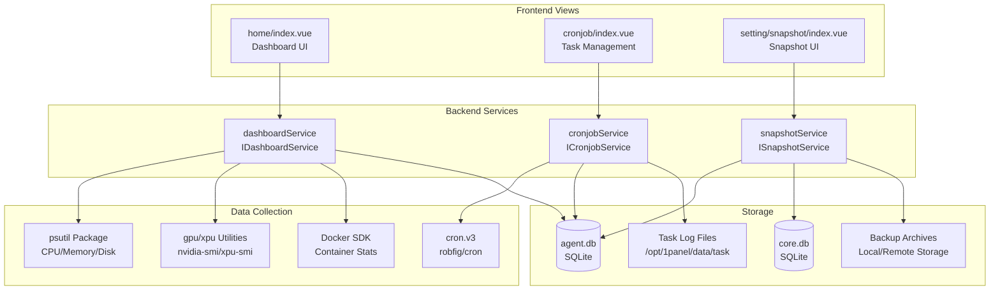
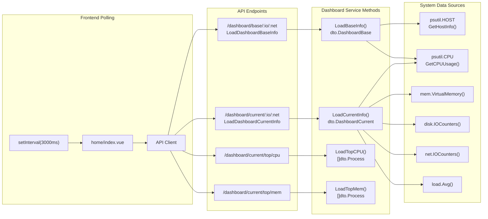
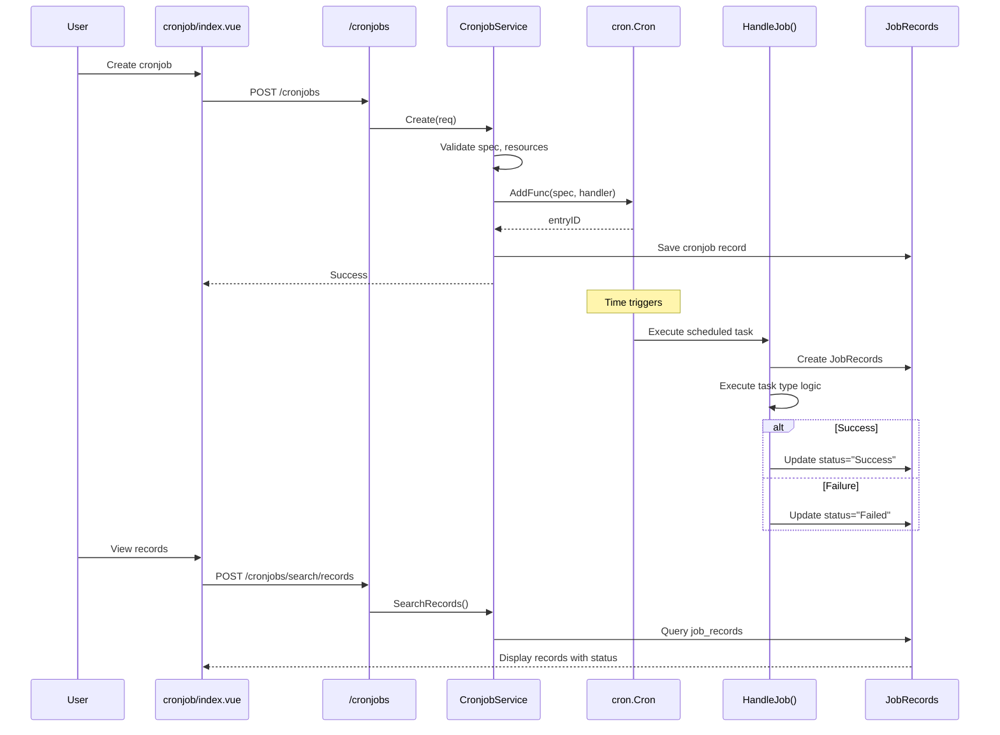
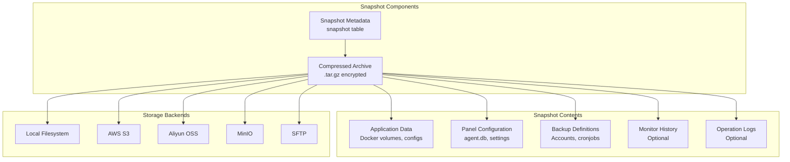

<!-- source: DeepWiki mcp.deepwiki.com · repo 1Panel-dev/1Panel · page 10 System Operations · fetched 2026-10-29 -->

# System Operations

<details>
<summary>Relevant source files</summary>

The following files were used as context for generating this wiki page:

- [agent/app/api/v2/cronjob.go](agent/app/api/v2/cronjob.go)
- [agent/app/api/v2/dashboard.go](agent/app/api/v2/dashboard.go)
- [agent/app/dto/cronjob.go](agent/app/dto/cronjob.go)
- [agent/app/dto/dashboard.go](agent/app/dto/dashboard.go)
- [agent/app/model/app_launcher.go](agent/app/model/app_launcher.go)
- [agent/app/model/cronjob.go](agent/app/model/cronjob.go)
- [agent/app/repo/app_launcher.go](agent/app/repo/app_launcher.go)
- [agent/app/service/cronjob.go](agent/app/service/cronjob.go)
- [agent/app/service/dashboard.go](agent/app/service/dashboard.go)
- [agent/router/ro_cronjob.go](agent/router/ro_cronjob.go)
- [agent/router/ro_dashboard.go](agent/router/ro_dashboard.go)
- [frontend/src/api/interface/cronjob.ts](frontend/src/api/interface/cronjob.ts)
- [frontend/src/api/interface/dashboard.ts](frontend/src/api/interface/dashboard.ts)
- [frontend/src/api/interface/setting.ts](frontend/src/api/interface/setting.ts)
- [frontend/src/api/modules/cronjob.ts](frontend/src/api/modules/cronjob.ts)
- [frontend/src/api/modules/dashboard.ts](frontend/src/api/modules/dashboard.ts)
- [frontend/src/api/modules/setting.ts](frontend/src/api/modules/setting.ts)
- [frontend/src/views/cronjob/cronjob/index.vue](frontend/src/views/cronjob/cronjob/index.vue)
- [frontend/src/views/cronjob/cronjob/operate/index.vue](frontend/src/views/cronjob/cronjob/operate/index.vue)
- [frontend/src/views/cronjob/cronjob/record/index.vue](frontend/src/views/cronjob/cronjob/record/index.vue)
- [frontend/src/views/cronjob/index.vue](frontend/src/views/cronjob/index.vue)
- [frontend/src/views/home/app/index.vue](frontend/src/views/home/app/index.vue)
- [frontend/src/views/home/index.vue](frontend/src/views/home/index.vue)
- [frontend/src/views/home/status/index.vue](frontend/src/views/home/status/index.vue)
- [frontend/src/views/setting/snapshot/index.vue](frontend/src/views/setting/snapshot/index.vue)

</details>


## Purpose and Scope

This document covers the operational monitoring, automation, and backup capabilities within 1Panel. System Operations encompasses three primary subsystems that enable administrators to monitor system health, automate routine tasks, and manage system snapshots.

**Related Documentation:**
- For infrastructure resource management (containers, databases, files), see [Infrastructure Management](#8)
- For application lifecycle operations, see [Application Management System](#6)
- For system configuration and settings, see [Settings and Configuration Management](#5)

**Subsystems Covered:**
- **Dashboard and Monitoring** - Real-time system metrics, resource visualization, and quick actions ([see details](#10.1))
- **Scheduled Tasks and Cronjobs** - Automated task execution with 10 task types and flexible scheduling ([see details](#10.2))
- **Backup and Snapshot System** - Full system snapshots, incremental backups, and recovery workflows ([see details](#10.3))

---

## System Operations Architecture

The System Operations layer implements a polling-based monitoring architecture combined with cron-scheduled task execution and snapshot-based backup management. All three subsystems share common infrastructure for task logging, progress tracking, and multi-node coordination.

### Component Overview



**Sources:** [agent/app/service/dashboard.go:35-56](), [agent/app/service/cronjob.go:25-51](), [frontend/src/views/home/index.vue:1-50]()

---

## Dashboard and Monitoring System

The dashboard provides real-time system metrics through a polling architecture that queries system resources every 3 seconds. The implementation separates base information (CPU model, cores, etc.) from current metrics (CPU usage, memory, I/O, network).

### Dashboard Service Architecture



**Sources:** [agent/app/service/dashboard.go:143-181](), [agent/app/service/dashboard.go:183-266](), [agent/app/api/v2/dashboard.go:117-144](), [frontend/src/views/home/index.vue:676-709]()

### Key Data Structures

| Structure | Purpose | Key Fields |
|-----------|---------|------------|
| `dto.DashboardBase` | Static system information | `Hostname`, `Platform`, `CPUModelName`, `CPUCores`, `QuickJumps[]` |
| `dto.DashboardCurrent` | Real-time metrics snapshot | `CPUUsedPercent`, `MemoryUsedPercent`, `IOReadBytes`, `NetBytesSent`, `DiskData[]`, `GPUData[]` |
| `dto.DiskInfo` | Per-mount disk metrics | `Path`, `Device`, `Total`, `Used`, `UsedPercent`, `InodesUsedPercent` |
| `dto.GPUInfo` | GPU telemetry | `ProductName`, `GpuUtil`, `Temperature`, `MemoryUsage` |

**Sources:** [agent/app/dto/dashboard.go:5-30](), [agent/app/dto/dashboard.go:80-128]()

### Dashboard Caching Strategy

The frontend implements intelligent caching to reduce API load while maintaining responsiveness:

```typescript
const DASHBOARD_CACHE_TTL = {
    safeStatus: 10 * 60 * 1000,    // 10 minutes
    netOptions: 60 * 60 * 1000,     // 1 hour
    ioOptions: 60 * 60 * 1000       // 1 hour
};
```

Cache keys stored in localStorage include:
- `netOptions` - Available network interfaces
- `ioOptions` - Available disk devices
- `dashboard_show` - Disk/GPU panel expansion state

**Sources:** [frontend/src/views/home/index.vue:464-468](), [frontend/src/utils/dashboardCache.ts:1-50]()

### Quick Jump System

The dashboard includes customizable quick jump shortcuts for rapid navigation. Users can configure which shortcuts appear (min 1, max 4 visible):

**Database Schema:**
```
quick_jump table:
- id, name, alias, title, detail, recommend, is_show, router
```

**Default Shortcuts:**
- Website (`/websites`)
- Database (`/databases`)
- Cronjob (`/cronjobs`)
- AppInstalled (`/apps/installed`)

**Sources:** [agent/app/repo/app_launcher.go:74-91](), [agent/app/model/app_launcher.go:8-17](), [frontend/src/views/home/quick/index.vue:1-100]()

### App Launcher Widget

The dashboard sidebar displays a configurable list of installed applications with quick action buttons (start/stop/restart). The `app_launcher` table stores which apps are visible:

**Service Methods:**
- `LoadAppLauncher()` - Returns apps with installation details
- `ChangeShow(req.Key, req.Value)` - Toggle app visibility
- `ListLauncherOption()` - Get all installed apps with show status

**Sources:** [agent/app/service/dashboard.go:276-339](), [frontend/src/views/home/app/index.vue:1-50](), [frontend/src/views/home/app/index.vue:206-233]()

---

## Scheduled Tasks and Cronjobs

The cronjob system provides automated task execution with 10 task types, flexible cron scheduling, and comprehensive logging. Built on `robfig/cron` v3, it supports both standard cron syntax and custom intervals (e.g., `@every 30s`).

### Cronjob Task Types

| Type | Description | Key Configuration |
|------|-------------|-------------------|
| `shell` | Execute shell scripts | `Executor`, `Script`, `ContainerName`, `User` |
| `website` | Backup website files | `Website` (IDs or "all") |
| `database` | Backup MySQL/PostgreSQL/Redis | `DBType`, `DBName`, `Args` |
| `directory` | Backup files/directories | `IsDir`, `SourceDir`, `ExclusionRules` |
| `curl` | HTTP requests | `URL` (array of URLs) |
| `app` | Backup installed apps | `AppID` (IDs or "all") |
| `snapshot` | Full system snapshot | `SnapshotRule` (with ignore apps) |
| `log` | Clean system logs | `Scopes[]` (system/ssh/website logs) |
| `cutWebsiteLog` | Rotate website logs | `Website` (IDs or "all") |
| `ntp` | Sync system time | No additional config |
| `cleanLog` | Clean specific log types | `CleanLogConfig.Scopes[]` |

**Sources:** [agent/app/model/cronjob.go:7-49](), [agent/app/dto/cronjob.go:19-63]()

### Cronjob Lifecycle and Execution Flow



**Sources:** [agent/app/service/cronjob.go:552-600](), [agent/app/service/cronjob.go:540-550](), [frontend/src/views/cronjob/cronjob/index.vue:1-50]()

### Cron Specification System

The system supports two spec modes controlled by `SpecCustom` boolean:

**Standard Mode (SpecCustom=false):**
- Users select `specType` from predefined options: `perWeek`, `perMonth`, `perNDay`, `perNHour`, `perNMinute`, `perNSecond`
- Frontend converts to cron syntax (e.g., `0 2 * * 1` for weekly Monday 2:00 AM)
- Multiple specs joined with `&&` for multi-schedule tasks

**Custom Mode (SpecCustom=true):**
- Users enter raw cron expressions
- Supports standard 5-field cron: `minute hour day month weekday`
- Supports `@every` syntax: `@every 30s`, `@every 5m`

**Spec Preview:**
```typescript
// POST /cronjobs/next
loadNextHandle(spec: string): Promise<string[]>
// Returns next 5 execution times
```

**Sources:** [agent/app/service/cronjob.go:449-482](), [frontend/src/views/cronjob/cronjob/operate/index.vue:98-233]()

### Task Execution and Logging

Each cronjob execution creates a `JobRecords` entry with:

```go
type JobRecords struct {
    CronjobID   uint
    TaskID      string      // UUID for tracking
    StartTime   time.Time
    Interval    float64     // Execution duration (ms)
    Records     string      // Log file path
    Status      string      // Waiting/Success/Failed/Unexecuted
    Message     string      // Error message if failed
}
```

**Log Storage:**
- Path: `/opt/1panel/data/task/{cronjobID}/{timestamp}.log`
- Real-time streaming via SSE for long-running tasks
- Retention controlled per cronjob or global cleanup

**Sources:** [agent/app/model/cronjob.go:51-63](), [agent/app/service/cronjob.go:484-497]()

### Backup Account Integration

Cronjobs that produce backup files use the backup account system:

**Configuration:**
- `SourceAccountIDs` - Comma-separated IDs of backup destinations
- `DownloadAccountID` - Primary account for downloads (starred in UI)
- `RetainCopies` - Number of backups to keep per account
- `Secret` - Encryption password for backup archives

**Backup Process:**
1. Execute backup operation (database dump, file tar, etc.)
2. Upload to all `SourceAccountIDs` storage backends in parallel
3. Create `backup_record` entries linked via `cronjob_id`
4. Rotate old backups when `RetainCopies` exceeded

**Sources:** [agent/app/service/cronjob.go:72-73](), [frontend/src/views/cronjob/cronjob/operate/index.vue:667-720]()

### Cronjob Groups and Import/Export

**Group Management:**
Groups organize cronjobs, stored in `cronjob_group` table. The "Default" group is auto-created.

**Export Format (JSON):**
```json
{
  "name": "Backup MySQL",
  "type": "database",
  "spec": "0 2 * * *",
  "dbType": "mysql",
  "dbNames": [{"name": "mysql-local", "detailName": "wordpress_db"}],
  "sourceAccounts": ["localhost", "oss-backup"],
  "retainCopies": 7
}
```

**Import Logic:**
- Attempts to resolve resource references (apps, databases, websites) by name
- Sets `status=Pending` if resources not found, `status=Disable` otherwise
- Creates associated alert configurations if `alertCount > 0`

**Sources:** [agent/app/service/cronjob.go:117-213](), [agent/app/service/cronjob.go:215-403]()

### Alert Integration

Cronjobs integrate with the alert system for failure notifications:

**Alert Configuration:**
- `AlertCount` - Max consecutive failures before alert
- `AlertTitle` - Alert subject line
- `AlertMethod` - Comma-separated methods (email, webhook, wechat, dingtalk)

**Tracking:**
The `alert` table stores alert status per cronjob, linked by `type={cronjobType}` and `project={cronjobID}`.

**Sources:** [agent/app/service/cronjob.go:73-82](), [agent/app/service/cronjob.go:97-114]()

---

## Backup and Snapshot System

The snapshot system creates full-state backups of the 1Panel installation, including application data, panel configuration, and optional system-level data. Snapshots support encryption, multi-account storage, and atomic recovery/rollback operations.

### Snapshot Data Structure



**Sources:** [frontend/src/api/interface/setting.ts:156-228](), [agent/app/model/setting.go:1-100]()

### Snapshot Creation Workflow

**Frontend UI:**
- Tree selection for `appData[]`, `panelData[]`, `backupData[]`
- Checkboxes for `withMonitorData`, `withLoginLog`, `withOperationLog`
- Optional encryption password (`secret`)
- Multi-account upload (`sourceAccountIDs`, `downloadAccountID`)

**Backend Process:**
1. Create snapshot record with `status=Waiting`
2. Generate async task with subtasks
3. Collect selected data into staging directory
4. Tar and optionally encrypt archive
5. Upload to all source accounts in parallel
6. Update status to `Success` or `Failed`

**Task Tracking:**
- Frontend opens task log viewer immediately after creation
- Real-time progress via SSE: `/tasks/logs/:taskID`
- Retry on failure: `snapshotRecreate(id)`

**Sources:** [frontend/src/views/setting/snapshot/create/index.vue:1-100](), [frontend/src/api/modules/setting.ts:166-193]()

### Snapshot Recovery System

Recovery restores system state from a snapshot archive. The system validates architecture compatibility and disk space before proceeding.

**Recovery States:**
```
recoverStatus: "" → "Waiting" → "Success" / "Failed"
```

**Recovery Process:**
1. **Pre-validation:**
   - Check `kernelArch` matches (prevent ARM→AMD64 restore)
   - Verify `freeSize > snapshot.size`
   - Decrypt if `secret` provided

2. **Download (if remote):**
   - Stream from `downloadAccount`
   - Progress tracked in task log

3. **Extraction:**
   - Untar to temporary directory
   - Validate data tree structure

4. **Application:**
   - Stop affected services (Docker, Nginx)
   - Restore database files
   - Restore application data
   - Update configuration files

5. **Restart:**
   - Restart services
   - Validate health

**Rollback Capability:**
If recovery fails mid-process, the `rollbackStatus` field tracks rollback operations. The system creates a pre-recovery snapshot automatically for safe rollback.

**Sources:** [frontend/src/views/setting/snapshot/recover/index.vue:1-100](), [frontend/src/api/modules/setting.ts:184-189]()

### Snapshot Import/Export

**Import:**
Users can import external snapshot archives by:
1. Uploading to backup account
2. Selecting snapshot names from account
3. System indexes and validates archives
4. Adds to snapshot list as `status=Success`

**Export:**
Snapshots automatically exist in configured backup accounts. Users download via:
- Direct download button (for local storage)
- Copy from remote storage (S3/OSS/etc.)

**Sources:** [frontend/src/views/setting/snapshot/import/index.vue:1-100](), [frontend/src/api/modules/setting.ts:169-177]()

---

## Integration Points and Cross-System Dependencies

### Task Execution Framework

All three subsystems share a common asynchronous task execution framework:

**Task Model:**
```go
type Task struct {
    ID          string      // UUID
    Type        string      // "Snapshot", "CronjobBackup", etc.
    Status      string      // Waiting/Running/Success/Failed
    LogFile     string      // Real-time log path
    Progress    int         // Percentage (0-100)
    Subtasks    []Subtask   // Parallel operations
}
```

**Progress Tracking:**
- Tasks write to structured log files
- Frontend streams via SSE: `GET /tasks/logs/:taskID`
- Progress parser extracts percentage from log patterns

**Sources:** [agent/app/service/task.go:1-200](), [frontend/src/components/log/task/index.vue:1-100]()

### Multi-Node Coordination

In multi-node deployments, system operations respect node boundaries:

**Dashboard:**
- Master node can read `agent.db` from all nodes
- Aggregates metrics for fleet-wide monitoring
- Node selector in UI for targeted operations

**Cronjobs:**
- Each node maintains its own `cron.Cron` instance
- Cronjobs scoped to creating node
- Cross-node job execution not supported (by design)

**Snapshots:**
- Node-specific snapshots include node identity
- Recovery only to same architecture
- Cross-node snapshot migration requires manual steps

**Sources:** [Multi-Node Architecture Diagram](#2.2), [agent/app/service/dashboard.go:107-141]()

### Backup Account Abstraction

All backup operations use the `backup_account` table for storage destination abstraction:

**Supported Types:**
- `local` - Local filesystem
- `sftp` - SFTP/SSH
- `s3` - AWS S3 compatible
- `oss` - Aliyun OSS
- `cos` - Tencent COS
- `kodo` - Qiniu Kodo
- `minio` - MinIO
- `onedrive` - Microsoft OneDrive

**Service Interface:**
```go
type IBackupService interface {
    Upload(accountID uint, file string) error
    Download(accountID uint, file string) error
    Delete(accountID uint, file string) error
}
```

**Sources:** [agent/app/service/backup.go:1-100](), [agent/app/model/backup_account.go:1-50]()

---

## API Reference Summary

### Dashboard APIs

| Endpoint | Method | Purpose |
|----------|--------|---------|
| `/dashboard/base/:io/:net` | GET | Load base system info + current metrics |
| `/dashboard/current/:io/:net` | GET | Load current metrics only (3s polling) |
| `/dashboard/current/top/cpu` | GET | Top 10 CPU processes |
| `/dashboard/current/top/mem` | GET | Top 10 memory processes |
| `/dashboard/quick/option` | GET | List quick jump shortcuts |
| `/dashboard/quick/change` | POST | Update quick jump configuration |
| `/dashboard/app/launcher` | GET | Load app launcher list |
| `/dashboard/app/launcher/show` | POST | Toggle app visibility |

**Sources:** [agent/router/ro_dashboard.go:10-27]()

### Cronjob APIs

| Endpoint | Method | Purpose |
|----------|--------|---------|
| `/cronjobs` | POST | Create new cronjob |
| `/cronjobs/search` | POST | Search cronjobs with pagination |
| `/cronjobs/update` | POST | Update cronjob configuration |
| `/cronjobs/del` | POST | Delete cronjobs (with data cleanup) |
| `/cronjobs/status` | POST | Enable/disable cronjob |
| `/cronjobs/handle` | POST | Execute once immediately |
| `/cronjobs/next` | POST | Preview next 5 execution times |
| `/cronjobs/search/records` | POST | Search execution records |
| `/cronjobs/records/log` | POST | Fetch execution log content |
| `/cronjobs/records/clean` | POST | Clean execution records |
| `/cronjobs/import` | POST | Import cronjobs from JSON |
| `/cronjobs/export` | POST | Export cronjobs to JSON |

**Sources:** [agent/router/ro_cronjob.go:10-31]()

### Snapshot APIs

| Endpoint | Method | Purpose |
|----------|--------|---------|
| `/settings/snapshot` | POST | Create new snapshot |
| `/settings/snapshot/search` | POST | Search snapshots with pagination |
| `/settings/snapshot/load` | GET | Load snapshot data tree |
| `/settings/snapshot/recover` | POST | Recover from snapshot |
| `/settings/snapshot/rollback` | POST | Rollback failed recovery |
| `/settings/snapshot/recreate` | POST | Retry failed snapshot |
| `/settings/snapshot/del` | POST | Delete snapshots |
| `/settings/snapshot/import` | POST | Import external snapshots |
| `/settings/snapshot/description/update` | POST | Update snapshot description |

**Sources:** [frontend/src/api/modules/setting.ts:165-192]()

---

This completes the System Operations overview. For detailed information on specific subsystems, see the child pages: [Dashboard and Monitoring](#10.1), [Scheduled Tasks and Cronjobs](#10.2), and [Backup and Snapshot System](#10.3).

---

