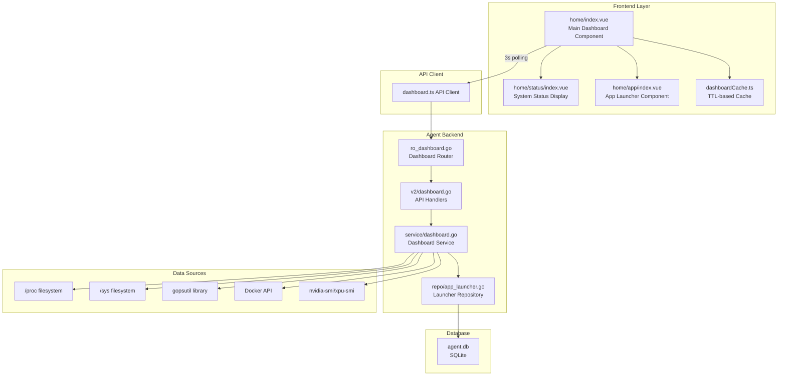
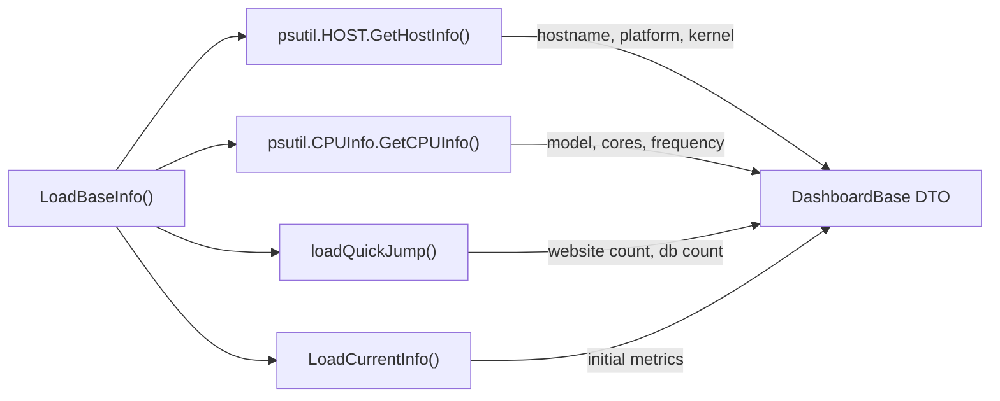
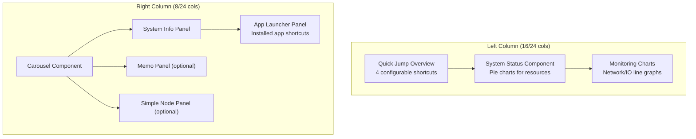
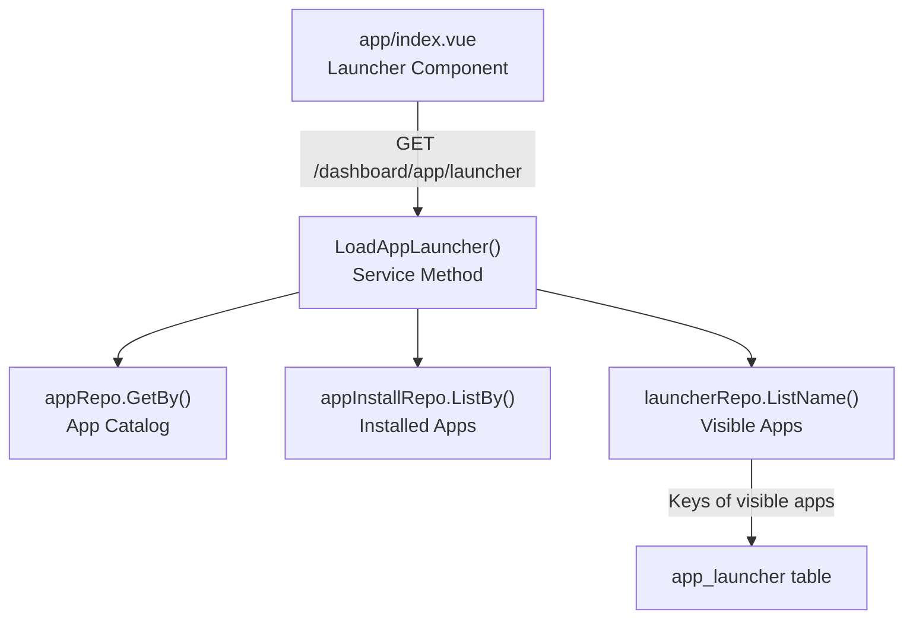
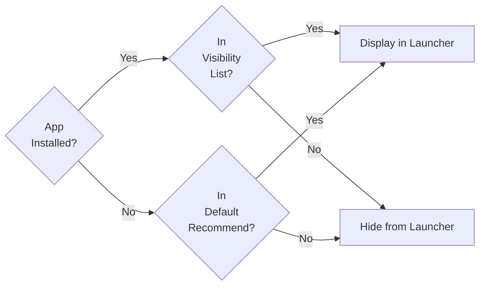
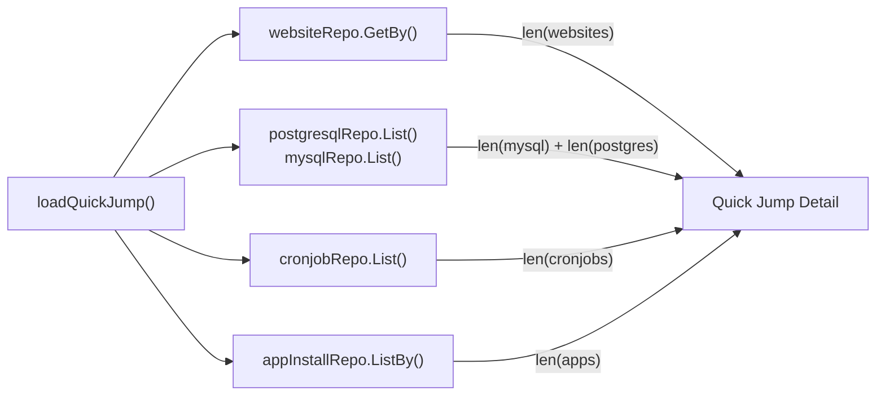
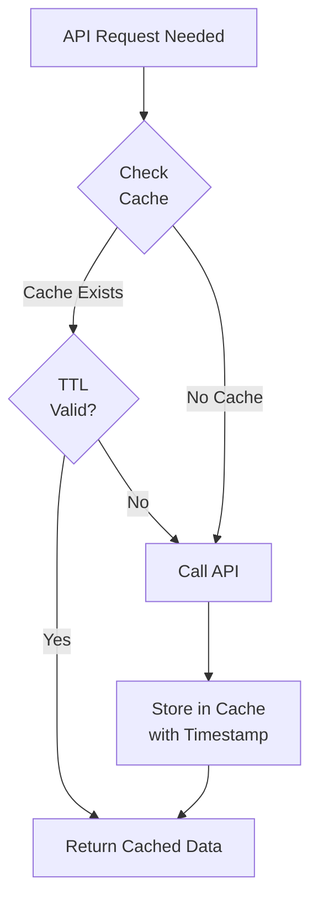
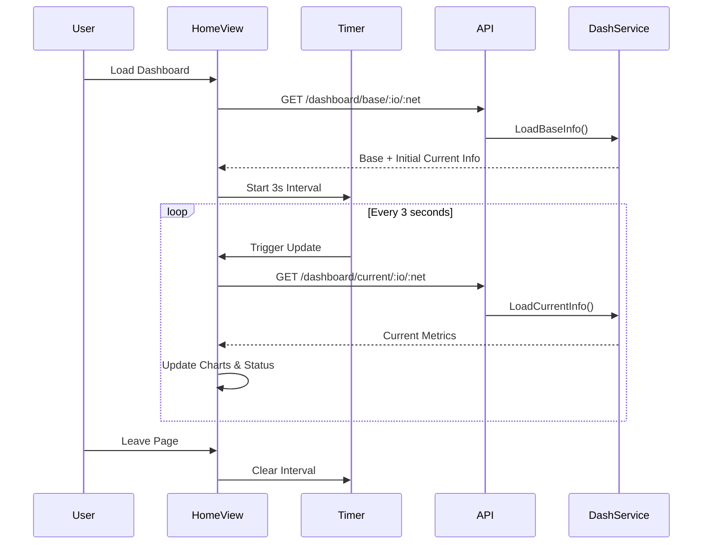
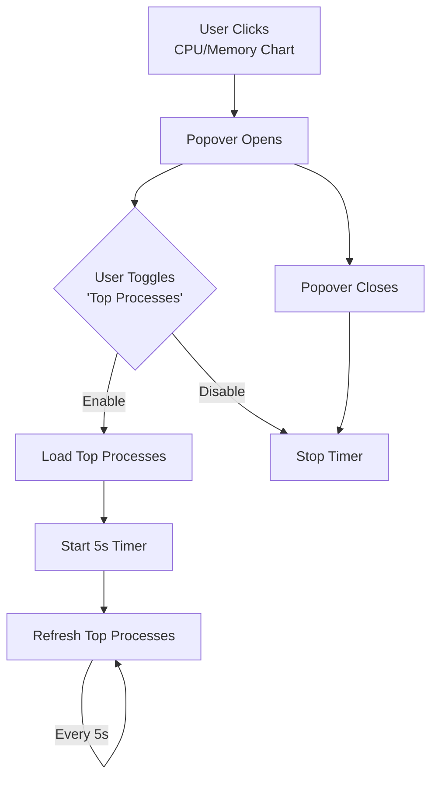

<!-- source: DeepWiki mcp.deepwiki.com · repo 1Panel-dev/1Panel · page 10.1 Dashboard and Monitoring · fetched 2026-10-29 -->

# Dashboard and Monitoring

<details>
<summary>Relevant source files</summary>

The following files were used as context for generating this wiki page:

- [agent/app/api/v2/dashboard.go](agent/app/api/v2/dashboard.go)
- [agent/app/dto/dashboard.go](agent/app/dto/dashboard.go)
- [agent/app/model/app_launcher.go](agent/app/model/app_launcher.go)
- [agent/app/repo/app_launcher.go](agent/app/repo/app_launcher.go)
- [agent/app/service/dashboard.go](agent/app/service/dashboard.go)
- [agent/router/ro_dashboard.go](agent/router/ro_dashboard.go)
- [frontend/src/api/interface/dashboard.ts](frontend/src/api/interface/dashboard.ts)
- [frontend/src/api/modules/dashboard.ts](frontend/src/api/modules/dashboard.ts)
- [frontend/src/views/home/app/index.vue](frontend/src/views/home/app/index.vue)
- [frontend/src/views/home/index.vue](frontend/src/views/home/index.vue)
- [frontend/src/views/home/status/index.vue](frontend/src/views/home/status/index.vue)

</details>


This document describes the dashboard and monitoring system in 1Panel, which provides real-time visibility into system resources, installed applications, and quick access to common operations. The dashboard serves as the main landing page after login and automatically updates system metrics every 3 seconds.

For information about GPU/XPU monitoring details, see [GPU Monitoring and XPU Support](#9.2). For settings management, see [Settings and Configuration Management](#5).

---

## System Architecture Overview

The dashboard system follows a client-server architecture with polling-based real-time updates. The frontend polls the Agent API every 3 seconds to fetch current system metrics, while implementing intelligent caching for semi-static data like network interface and disk device lists.



**Sources:** [frontend/src/views/home/index.vue:1-1831](), [agent/app/service/dashboard.go:1-645](), [agent/router/ro_dashboard.go:1-28]()

---

## Real-time Metrics Collection

The system collects metrics from multiple sources using the `gopsutil` library and direct filesystem reads. Metrics are grouped into base info (static) and current info (dynamic).

### API Endpoints

| Endpoint | Purpose | Update Frequency |
|----------|---------|------------------|
| `GET /dashboard/base/:ioOption/:netOption` | Base system info + initial metrics | Once on load |
| `GET /dashboard/current/:ioOption/:netOption` | Current resource utilization | Every 3 seconds |
| `GET /dashboard/current/top/cpu` | Top CPU-consuming processes | On-demand (5s when popover open) |
| `GET /dashboard/current/top/mem` | Top memory-consuming processes | On-demand (5s when popover open) |

**Sources:** [agent/router/ro_dashboard.go:14-25](), [agent/app/api/v2/dashboard.go:118-202]()

### Base Info Collection

Base info includes static system information that rarely changes:



**Implementation details:**
- Hostname, OS platform, kernel version from [agent/app/service/dashboard.go:143-181]()
- CPU model name, core counts from [agent/app/service/dashboard.go:170-177]()
- IPv4 address via UDP connection test to `8.8.8.8:80` [agent/app/service/dashboard.go:599-609]()
- HTTP proxy detection from environment variables [agent/app/service/dashboard.go:164-166]()

**Sources:** [agent/app/service/dashboard.go:143-181](), [agent/app/dto/dashboard.go:5-30]()

### Current Info Collection

Current metrics are collected every 3 seconds via a polling mechanism:

**Collected Metrics:**
- **CPU**: Usage percent per core, total usage, detailed breakdown (user, system, nice, idle, iowait, irq, softirq, steal)
- **Memory**: Total, used, free, available, cache, shared, usage percent
- **Swap**: Total, used, free, usage percent
- **Load Average**: 1-minute, 5-minute, 15-minute averages
- **Disk I/O**: Read/write bytes, operation counts, read/write time
- **Network**: Bytes sent/received per interface
- **Disk Usage**: Per mount point with inode statistics
- **GPU/XPU**: Utilization, temperature, power, memory usage

**Sources:** [agent/app/service/dashboard.go:183-266](), [agent/app/dto/dashboard.go:80-128]()

---

## Dashboard UI Components

The dashboard page consists of three main sections arranged in a responsive grid layout:



**Sources:** [frontend/src/views/home/index.vue:43-415]()

### System Status Component

The `SystemStatus` component displays real-time resource metrics as pie charts with detailed popovers:

**Display Elements:**
- **Load Average**: Pie chart showing load vs capacity, popover with 1/5/15-minute averages
- **CPU**: Pie chart with per-core breakdown, detailed percent breakdown (user/system/idle/etc)
- **Memory**: Pie chart with used/free/cache breakdown, swap memory details
- **Disk**: Per-mount-point pie charts with inode statistics
- **GPU/XPU**: Per-device pie charts with temperature, power, memory usage

**Interactive Features:**
- Clicking CPU/Memory popovers reveals top processes table [frontend/src/views/home/status/index.vue:582-654]()
- Top processes refresh every 5 seconds when popover is open [frontend/src/views/home/status/index.vue:589-619]()
- "Kill Process" action available in top processes table [frontend/src/views/home/status/index.vue:546-559]()
- Clicking disk charts navigates to file manager at mount point [frontend/src/views/home/status/index.vue:289]()
- Clicking GPU charts navigates to GPU monitoring page [frontend/src/views/home/status/index.vue:574-576]()

**Sources:** [frontend/src/views/home/status/index.vue:1-722](), [frontend/src/api/interface/dashboard.ts:70-159]()

### Monitoring Charts

Time-series charts display network and I/O metrics over the last 20 data points (approximately 60 seconds):

**Chart Types:**
- **Network Chart**: Upload/download speeds in KB/s, selectable network interface
- **IO Chart**: Read/write speeds in MB/s, R/W operations per second, I/O delay

**Implementation:**
- Charts use `v-charts` wrapper around ECharts [frontend/src/views/home/index.vue:143-161]()
- Data arrays maintain 20-point sliding window [frontend/src/views/home/index.vue:755-798]()
- Delta calculations compute speed from cumulative byte counts [frontend/src/views/home/index.vue:750-789]()
- Time intervals adjust based on actual uptime delta [frontend/src/views/home/index.vue:749]()

**Sources:** [frontend/src/views/home/index.vue:76-164](), [frontend/src/views/home/index.vue:745-802]()

### Carousel Components

The right column carousel rotates between multiple panels based on configuration:

**Panel Types:**

| Panel | Visibility Condition | Storage Key |
|-------|---------------------|-------------|
| System Info | Always visible | N/A |
| Memo | `DashboardMemoVisible` setting = "Enable" | Setting in database |
| Simple Node | `DashboardSimpleNodeVisible` = "Enable" AND is master node with agent nodes | Setting in database |

**System Info Panel Features:**
- Displays hostname, platform, kernel, IP address, uptime
- Sensitive info toggle button masks hostname/IP [frontend/src/views/home/index.vue:726-728]()
- Copy button exports all system info as text [frontend/src/views/home/index.vue:804-839]()
- Refresh button clears cache and reloads [frontend/src/views/home/index.vue:730-736]()

**Memo Panel:**
- Markdown-rendered notes with edit mode [frontend/src/views/home/index.vue:323-363]()
- 500 character limit with word count [frontend/src/views/home/index.vue:350]()
- Saves to `SystemMemo` setting [frontend/src/views/home/index.vue:853-862]()

**Sources:** [frontend/src/views/home/index.vue:166-411](), [frontend/src/views/home/index.vue:518-524]()

---

## App Launcher System

The App Launcher provides quick access to frequently-used installed applications with one-click start/stop/restart controls.

### Architecture



**Sources:** [agent/app/service/dashboard.go:276-339](), [frontend/src/views/home/app/index.vue:1-386]()

### Display Logic

The launcher displays apps based on a priority system:

1. **Show installed apps that are in visibility list** (user explicitly enabled)
2. **Show default recommended apps that are NOT installed** (for easy installation)



**Sources:** [agent/app/service/dashboard.go:326-329]()

### Launcher Configuration

Users can control which apps appear in the launcher via a settings popover:

**Features:**
- Filter search box for app keys [frontend/src/views/home/app/index.vue:5-6]()
- Toggle switches per app [frontend/src/views/home/app/index.vue:11-16]()
- Settings stored in `app_launcher` table [agent/app/model/app_launcher.go:3-6]()
- Changes saved via `POST /dashboard/app/launcher/show` [frontend/src/api/modules/dashboard.ts:20-22]()

**Database Operations:**
- Enable: Creates record in `app_launcher` [agent/app/service/dashboard.go:343-346]()
- Disable: Deletes record from `app_launcher` [agent/app/service/dashboard.go:348-351]()

**Sources:** [frontend/src/views/home/app/index.vue:5-23](), [agent/app/service/dashboard.go:341-354]()

### App Operations

For installed apps, the launcher provides quick controls:

**Available Operations:**
- **Start/Stop/Restart**: Calls `installedOp` API [frontend/src/views/home/app/index.vue:261-287]()
- **Directory Access**: Opens file manager at installation path [frontend/src/views/home/app/index.vue:103]()
- **Web UI Links**: Opens application web interface if configured [frontend/src/views/home/app/index.vue:107-155]()

**Multi-Instance Support:**
- If app has multiple instances, dropdown menu selects active instance [frontend/src/views/home/app/index.vue:46-62]()
- Each instance shows name, version, status [frontend/src/views/home/app/index.vue:48-58]()

**Sources:** [frontend/src/views/home/app/index.vue:27-176]()

---

## Quick Jump Configuration

The Quick Jump section displays 4 configurable shortcuts to commonly-accessed pages with dynamic counts.

### Default Configuration

When no configuration exists, the system uses these defaults:

| Name | Title | Router | Recommend |
|------|-------|--------|-----------|
| Website | menu.website | /websites | 10 |
| Database | menu.database | /databases | 30 |
| Cronjob | menu.cronjob | /cronjobs | 50 |
| AppInstalled | home.appInstalled | /apps/installed | 70 |

**Sources:** [agent/app/repo/app_launcher.go:82-87]()

### Dynamic Detail Calculation

The detail field (count) is dynamically calculated on each dashboard load:



**Sources:** [agent/app/service/dashboard.go:611-644]()

### Customization

Users can customize Quick Jump shortcuts via settings dialog:

**Configuration Options:**
- **Visibility**: Enable/disable each shortcut (minimum 1, maximum 4 visible) [agent/app/service/dashboard.go:379-384]()
- **Alias**: Custom display name instead of count [agent/app/dto/dashboard.go:39]()
- **Detail Override**: Custom text instead of dynamic count [agent/app/dto/dashboard.go:41]()

**Validation:**
- At least 1 shortcut must be visible [agent/app/service/dashboard.go:379-381]()
- Maximum 4 shortcuts can be visible [agent/app/service/dashboard.go:382-384]()
- Changes saved via `POST /dashboard/quick/change` [frontend/src/api/modules/dashboard.ts:11-12]()

**Storage:**
- Configuration stored in `quick_jump` table [agent/app/model/app_launcher.go:8-17]()
- Updates use transaction to ensure atomicity [agent/app/repo/app_launcher.go:92-106]()

**Sources:** [agent/app/service/dashboard.go:356-387](), [agent/app/repo/app_launcher.go:74-106]()

---

## Caching Strategy

The dashboard implements a TTL-based caching system to reduce API calls for semi-static data.

### Cache Configuration

| Cache Key | Data | TTL | Purpose |
|-----------|------|-----|---------|
| `netOptions` | Network interface list | 60 minutes | Network card dropdown options |
| `ioOptions` | Disk device list | 60 minutes | Disk I/O monitoring dropdown options |
| `safeStatus` | Safe entrance status | 10 minutes | Security warning display |

**Sources:** [frontend/src/views/home/index.vue:464-468]()

### Cache Implementation

The cache system uses browser localStorage with timestamp validation:



**Cache Functions:**
- `getDashboardCache(key)`: Retrieves cached data if TTL valid [frontend/src/utils/dashboardCache.ts]()
- `setDashboardCache(key, data, ttl)`: Stores data with expiration timestamp
- `clearDashboardCache()`: Clears all dashboard cache entries
- `clearDashboardCacheByPrefix(prefix)`: Clears specific cache keys

**Sources:** [frontend/src/views/home/index.vue:633-646](), [frontend/src/views/home/index.vue:661-674]()

### Refresh Strategy

**Initial Load:**
1. Check cache for network/IO options
2. If cached, mark as `netOptionsFromCache = true` [frontend/src/views/home/index.vue:637]()
3. Display cached data immediately
4. Apply default selections from settings [frontend/src/views/home/index.vue:618-624]()

**Hover Refresh:**
- When user hovers over chart area, refresh options from API if they were from cache [frontend/src/views/home/index.vue:80]()
- Only refreshes once per page load [frontend/src/views/home/index.vue:499]()
- Updates cache with fresh data [frontend/src/views/home/index.vue:644-645]()

**Manual Refresh:**
- "Refresh" button clears all cache [frontend/src/views/home/index.vue:731]()
- Forces API calls for all data [frontend/src/views/home/index.vue:734]()

**Sources:** [frontend/src/views/home/index.vue:633-674](), [frontend/src/views/home/index.vue:841-850]()

---

## Data Flow and Refresh Patterns

The dashboard uses multiple refresh patterns based on data volatility.

### Polling Mechanism

The main polling loop runs every 3 seconds while the dashboard is visible:



**Sources:** [frontend/src/views/home/index.vue:676-709]()

### Polling Implementation Details

**Interval Management:**
- Timer started after initial base info load [frontend/src/views/home/index.vue:695-707]()
- Interval ID stored to enable cleanup [frontend/src/views/home/index.vue:479]()
- Cleared on component unmount or navigation [frontend/src/views/home/index.vue:1758-1763]()

**Guard Conditions:**
- `isActive`: Pauses polling when tab/window not visible [frontend/src/views/home/index.vue:700]()
- `isCurrentActive`: Stops polling on navigation [frontend/src/views/home/index.vue:698]()
- `globalStore.isOnRestart`: Pauses during panel restart [frontend/src/views/home/index.vue:700]()

**Error Handling:**
- Try-catch wraps update logic [frontend/src/views/home/index.vue:696-705]()
- Errors clear timer to stop infinite retries [frontend/src/views/home/index.vue:705]()

**Sources:** [frontend/src/views/home/index.vue:676-709](), [frontend/src/views/home/index.vue:1758-1763]()

### Metric Calculation

Network and I/O metrics are computed as deltas between polling intervals:

**Network Speed Calculation:**
```
currentSpeed = (newBytes - oldBytes) / 1024 / timeInterval
```

Where `timeInterval` is calculated from uptime delta [frontend/src/views/home/index.vue:749]().

**Implementation:**
- Maintains previous cumulative byte counts [frontend/src/views/home/index.vue:750-767]()
- Computes speed as delta divided by time interval
- Handles counter resets (negative deltas) by showing 0 [frontend/src/views/home/index.vue:751-753]()
- Stores up to 20 speed samples in arrays [frontend/src/views/home/index.vue:755-756]()
- Older samples removed with `splice(0, 1)` [frontend/src/views/home/index.vue:756]()

**Sources:** [frontend/src/views/home/index.vue:745-802]()

---

## Top Process Monitoring

The system can display top CPU and memory consumers on-demand with automatic refresh.

### On-Demand Loading

Top processes are NOT loaded by default to reduce overhead. They load only when user opens the popover:



**Sources:** [frontend/src/views/home/status/index.vue:582-654]()

### API Endpoints

**Top CPU Processes:**
- Endpoint: `GET /dashboard/current/top/cpu`
- Backend: Calls `loadTopCPU()` [agent/app/service/dashboard.go:268-270]()
- Returns: Array of processes sorted by CPU usage descending

**Top Memory Processes:**
- Endpoint: `GET /dashboard/current/top/mem`
- Backend: Calls `loadTopMem()` [agent/app/service/dashboard.go:272-274]()
- Returns: Array of processes sorted by memory usage descending

**Process Data Structure:**
```typescript
{
  name: string;    // Process name
  pid: number;     // Process ID
  percent: number; // CPU % or Memory %
  memory: number;  // Memory usage in bytes
  cmd: string;     // Command line
  user: string;    // Owner username
}
```

**Sources:** [agent/app/api/v2/dashboard.go:183-202](), [frontend/src/api/interface/dashboard.ts:117-124]()

### Process Management

Users can kill processes directly from the top processes table:

**Kill Process Flow:**
1. User clicks "Stop Process" button [frontend/src/views/home/status/index.vue:35-37]()
2. Confirmation dialog with process ID [frontend/src/views/home/status/index.vue:546-554]()
3. User must type "kill now" to confirm
4. API call: `stopProcess({ PID: processID })` [frontend/src/views/home/status/index.vue:556-558]()

**Sources:** [frontend/src/views/home/status/index.vue:546-559]()

### Timer Lifecycle

**Popover Open with Top Processes Enabled:**
- Initial load on toggle [frontend/src/views/home/status/index.vue:585]()
- Clear existing timer if any [frontend/src/views/home/status/index.vue:586-588]()
- Set 5-second interval [frontend/src/views/home/status/index.vue:589]()

**Popover Close or Toggle Disable:**
- Clear interval timer [frontend/src/views/home/status/index.vue:591-594]()
- Reset state flags [frontend/src/views/home/status/index.vue:599]()

**Component Unmount:**
- Cleanup timers in `onBeforeUnmount` hook [frontend/src/views/home/status/index.vue:656-665]()
- Prevents memory leaks from abandoned intervals

**Sources:** [frontend/src/views/home/status/index.vue:582-665]()

---

## Integration with Other Systems

The dashboard integrates with several other 1Panel subsystems:

### GPU/XPU Monitoring

The dashboard displays GPU/XPU metrics collected from hardware drivers:

**Data Collection:**
- NVIDIA GPUs: Uses `nvidia-smi` via `gpu.LoadGpuInfo()` [agent/app/service/dashboard.go:532-558]()
- Intel XPUs: Uses `xpu-smi` via `xpu.LoadDashData()` [agent/app/service/dashboard.go:573-597]()
- Data merged into `currentInfo.gpuData` and `currentInfo.xpuData`

**Display:**
- Per-device pie charts showing utilization percentage
- Popovers with temperature, power usage, memory usage
- Clicking chart navigates to `/aitools/gpu` page [frontend/src/views/home/status/index.vue:326-357]()

**Sources:** [agent/app/service/dashboard.go:532-597](), [frontend/src/views/home/status/index.vue:301-370]()

### Disk Monitoring

Disk information uses parallel goroutines with timeouts to handle slow/hung mounts:

**Collection Strategy:**
- Parse `df` command output for mount points [agent/app/service/dashboard.go:429-469]()
- Filter out temporary, loop, and container filesystems [agent/app/service/dashboard.go:441-467]()
- Spawn goroutine per mount with 5-second timeout [agent/app/service/dashboard.go:476-523]()
- Collect usage stats via `psutil.DISK.GetUsage()` [agent/app/service/dashboard.go:492]()

**Timeout Handling:**
- If mount hangs, timeout triggers after 5 seconds [agent/app/service/dashboard.go:497]()
- Partial data (path, type, device) still added to results [agent/app/service/dashboard.go:498-501]()
- Error logged for debugging [agent/app/service/dashboard.go:501]()

**Sources:** [agent/app/service/dashboard.go:426-530]()

### Multi-Node Simple Nodes

For master nodes in multi-node deployments, the carousel can display agent node status:

**Visibility Conditions:**
- Setting `DashboardSimpleNodeVisible` = "Enable"
- Current node is master (`globalStore.isMasterProductPro`)
- At least one agent node exists [frontend/src/views/home/index.vue:718-724]()

**Node Display:**
- Node name with status indicator (Healthy/Unhealthy)
- Resource summary string [frontend/src/views/home/index.vue:387-388]()
- "Visit" button opens agent panel in new tab [frontend/src/views/home/index.vue:392-403]()

**Data Source:**
- API: `listAllSimpleNodes()` [frontend/src/views/home/index.vue:648-651]()
- Refreshed every 3 seconds along with other metrics [frontend/src/views/home/index.vue:702]()

**Sources:** [frontend/src/views/home/index.vue:365-410](), [frontend/src/views/home/index.vue:648-651]()

---

## Performance Considerations

### Concurrent Disk Scanning

Disk usage collection uses parallel goroutines with WaitGroup synchronization to speed up data collection:

**Concurrency Pattern:**
```go
var (
    wg sync.WaitGroup
    mu sync.Mutex
)
wg.Add(len(mounts))
for i := 0; i < len(mounts); i++ {
    go func(mount diskInfo) {
        defer wg.Done()
        // collect disk stats
        mu.Lock()
        datas = append(datas, itemData)
        mu.Unlock()
    }(mounts[i])
}
wg.Wait()
```

**Sources:** [agent/app/service/dashboard.go:471-524]()

### Debouncing and Guards

**Loading Flags:**
- `cpuLoading` and `memLoading` flags prevent concurrent API calls [frontend/src/views/home/status/index.vue:400-401]()
- Checked before making requests [frontend/src/views/home/status/index.vue:631-653]()

**Hover Refresh:**
- `hasRefreshedOptionsOnHover` flag ensures hover refresh only happens once [frontend/src/views/home/index.vue:499]()
- Prevents repeated API calls on mouse movement [frontend/src/views/home/index.vue:733]()

**Sources:** [frontend/src/views/home/status/index.vue:631-653](), [frontend/src/views/home/index.vue:841-850]()

### Chart Rendering Optimization

**Data Window Limiting:**
- Charts maintain only last 20 data points [frontend/src/views/home/index.vue:755-798]()
- Older points removed with `splice(0, 1)` to maintain constant memory
- Provides ~60 seconds of history at 3-second intervals

**Conditional Rendering:**
- Charts only render when data is available via `v-if` [frontend/src/views/home/index.vue:147-159]()
- Loading indicator shown until first data load [frontend/src/views/home/index.vue:79]()

**Sources:** [frontend/src/views/home/index.vue:143-164](), [frontend/src/views/home/index.vue:755-798]()

---

