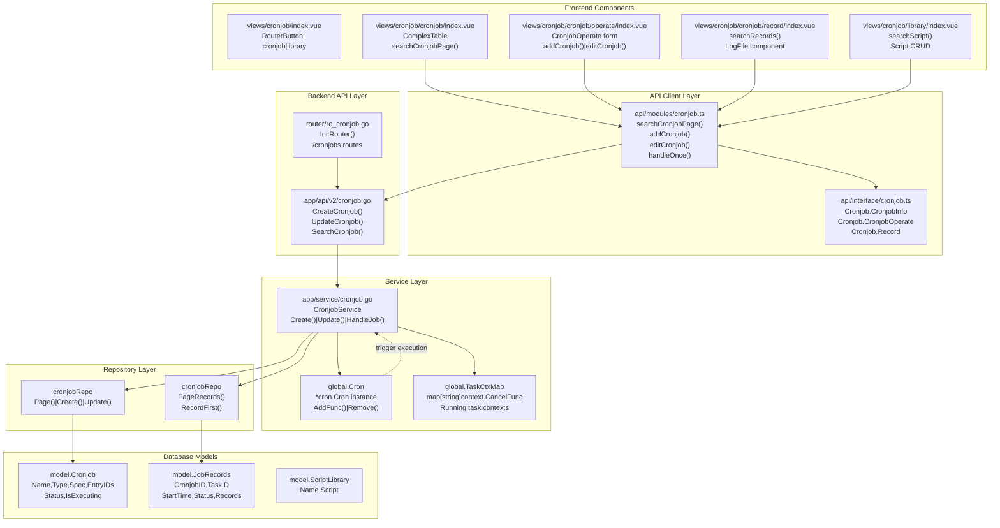
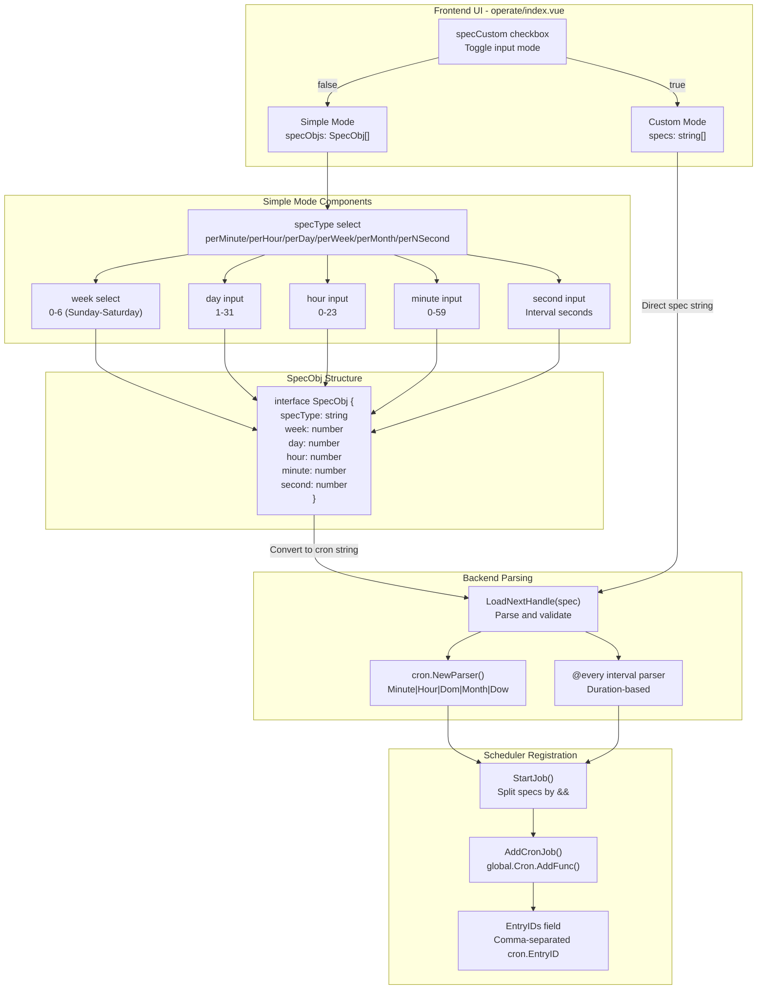
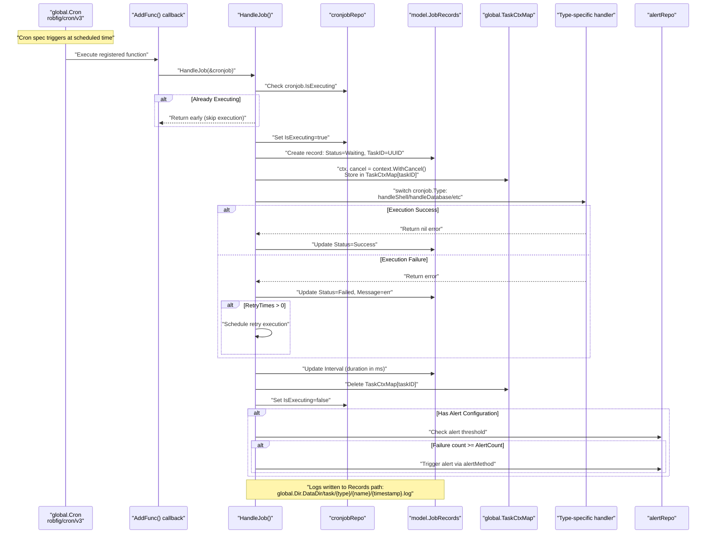
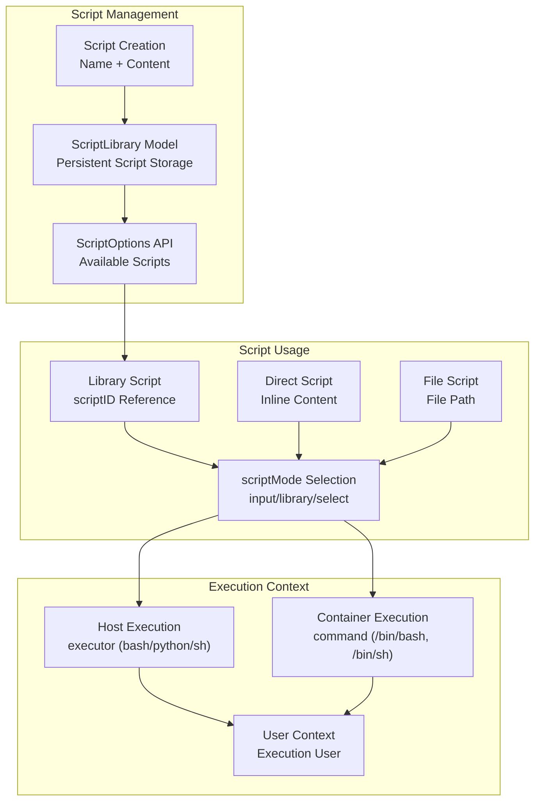
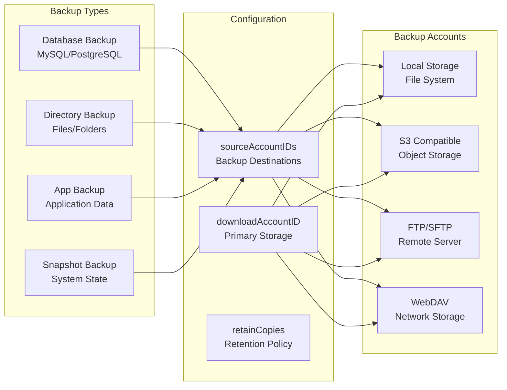

<!-- source: DeepWiki mcp.deepwiki.com · repo 1Panel-dev/1Panel · page 10.2 Scheduled Tasks and Cronjobs · fetched 2026-10-29 -->

# Scheduled Tasks and Cronjobs

<details>
<summary>Relevant source files</summary>

The following files were used as context for generating this wiki page:

- [agent/app/api/v2/cronjob.go](agent/app/api/v2/cronjob.go)
- [agent/app/dto/cronjob.go](agent/app/dto/cronjob.go)
- [agent/app/model/cronjob.go](agent/app/model/cronjob.go)
- [agent/app/service/cronjob.go](agent/app/service/cronjob.go)
- [agent/router/ro_cronjob.go](agent/router/ro_cronjob.go)
- [frontend/src/api/interface/cronjob.ts](frontend/src/api/interface/cronjob.ts)
- [frontend/src/api/modules/cronjob.ts](frontend/src/api/modules/cronjob.ts)
- [frontend/src/views/cronjob/cronjob/index.vue](frontend/src/views/cronjob/cronjob/index.vue)
- [frontend/src/views/cronjob/cronjob/operate/index.vue](frontend/src/views/cronjob/cronjob/operate/index.vue)
- [frontend/src/views/cronjob/cronjob/record/index.vue](frontend/src/views/cronjob/cronjob/record/index.vue)
- [frontend/src/views/cronjob/index.vue](frontend/src/views/cronjob/index.vue)
- [frontend/src/views/setting/snapshot/index.vue](frontend/src/views/setting/snapshot/index.vue)

</details>


This document covers 1Panel's scheduled task and cronjob management system, which provides automated execution of various system operations including shell scripts, backups, database operations, and maintenance tasks. The system uses cron-based scheduling (via `robfig/cron/v3`) with a comprehensive management interface for creating, monitoring, and maintaining automated tasks.

The cronjob system supports 10+ task types, custom cron scheduling, script library integration, execution logging with real-time streaming, import/export functionality, and group-based organization.

For backup and snapshot operations that can be scheduled through cronjobs, see page 10.3. For general system settings that affect cronjob behavior, see page 5.

## System Architecture

The cronjob system is built around a service-oriented architecture with frontend UI components, backend services, and cron scheduler integration using `robfig/cron/v3`.

**Cronjob System Architecture**



**Sources:** [frontend/src/views/cronjob/index.vue:1-24](), [frontend/src/api/modules/cronjob.ts:1-87](), [frontend/src/api/interface/cronjob.ts:1-232](), [agent/app/service/cronjob.go:1-803](), [agent/app/api/v2/cronjob.go:1-360](), [agent/router/ro_cronjob.go:1-32](), [agent/app/model/cronjob.go:1-70]()

## Task Types and Configuration

1Panel supports 10 primary cronjob task types, each with specific configuration options and execution behaviors. Each type is handled by a dedicated handler method in `CronjobService`.

### Job Type Overview

| Type | Handler Method | Primary Purpose | Key Configuration Fields |
|------|----------------|-----------------|-------------------------|
| `shell` | `handleShell()` | Execute shell scripts | `Executor`, `Script`, `ScriptMode`, `Command`, `ContainerName`, `User` |
| `app` | `handleApp()` | Application backup | `AppID`, `SourceAccountIDs`, `RetainCopies` |
| `website` | `handleWebsite()` | Website backup | `Website`, `SourceAccountIDs`, `ExclusionRules` |
| `database` | `handleDatabase()` | Database backup | `DBType`, `DBName`, `Args`, `SourceAccountIDs` |
| `directory` | `handleDirectory()` | File/folder backup | `SourceDir`, `IsDir`, `ExclusionRules` |
| `cleanLog` | `handleCleanLog()` | System log cleanup | `Config` (CleanLogConfig.Scopes array) |
| `curl` | `handleCurl()` | HTTP request execution | `URL` (string or array) |
| `cutWebsiteLog` | `handleCutWebsiteLog()` | Rotate website logs | `Website`, `SourceAccountIDs` |
| `ntp` | `handleNtp()` | Time synchronization | No additional config required |
| `snapshot` | `handleSnapshot()` | System snapshot creation | `SnapshotRule.WithImage`, `SnapshotRule.IgnoreAppIDs` |

### Job Type Architecture

```mermaid
graph TB
    subgraph "Handler Dispatch - handleJob()"
        JobSwitch["switch cronjob.Type"]
    end
    
    subgraph "Script Execution Handlers"
        HandleShell["handleShell()<br/>Executor: bash/sh/python<br/>InContainer: bool"]
        HandleCurl["handleCurl()<br/>URL execution"]
    end
    
    subgraph "Backup Handlers"
        HandleApp["handleApp()<br/>AppID selection<br/>RetainCopies enforcement"]
        HandleWebsite["handleWebsite()<br/>Website ID selection<br/>File compression"]
        HandleDatabase["handleDatabase()<br/>DBType: mysql/postgresql<br/>Args: mysqldump options"]
        HandleDirectory["handleDirectory()<br/>IsDir + SourceDir<br/>ExclusionRules filtering"]
        HandleSnapshot["handleSnapshot()<br/>SnapshotRule.WithImage<br/>IgnoreAppIDs filtering"]
    end
    
    subgraph "Maintenance Handlers"
        HandleCleanLog["handleCleanLog()<br/>Scopes: system/ssh/website"]
        HandleCutWebsiteLog["handleCutWebsiteLog()<br/>Log rotation per site"]
        HandleNtp["handleNtp()<br/>Time sync execution"]
        HandleClean["handleClean()<br/>Generic cleanup"]
        HandleLog["handleLog()<br/>Log processing"]
    end
    
    subgraph "Storage Integration"
        BackupClientMap["BackupClientMap<br/>SourceAccountIDs parsing"]
        RemoveExpired["removeExpiredBackup()<br/>RetainCopies enforcement"]
    end
    
    JobSwitch --> HandleShell
    JobSwitch --> HandleCurl
    JobSwitch --> HandleApp
    JobSwitch --> HandleWebsite
    JobSwitch --> HandleDatabase
    JobSwitch --> HandleDirectory
    JobSwitch --> HandleSnapshot
    JobSwitch --> HandleCleanLog
    JobSwitch --> HandleCutWebsiteLog
    JobSwitch --> HandleNtp
    JobSwitch --> HandleClean
    JobSwitch --> HandleLog
    
    HandleApp --> BackupClientMap
    HandleWebsite --> BackupClientMap
    HandleDatabase --> BackupClientMap
    HandleDirectory --> BackupClientMap
    HandleSnapshot --> BackupClientMap
    
    BackupClientMap --> RemoveExpired
```



**Sources:** [agent/app/service/cronjob.go:143-196](), [agent/app/service/cronjob_helper.go:1-50](), [agent/app/dto/cronjob.go:19-59](), [agent/app/model/cronjob.go:7-49]()

## Core Components

### CronjobService

The `CronjobService` struct implements the `ICronjobService` interface and provides the main business logic for cronjob management:

| Method | Purpose | Key Operations | Return Values |
|--------|---------|----------------|---------------|
| `Create(dto.CronjobOperate)` | Create new cronjob | 1. Validate name uniqueness<br/>2. Marshal SnapshotRule if type=snapshot<br/>3. Call `StartJob()` to register with cron<br/>4. Create AlertInfo if configured | `error` |
| `Update(uint, dto.CronjobOperate)` | Update existing cronjob | 1. Load existing via `cronjobRepo.Get()`<br/>2. Remove old EntryIDs from global.Cron<br/>3. Call `StartJob()` with new config<br/>4. Update via `cronjobRepo.Update()` | `error` |
| `StartJob(*model.Cronjob, bool)` | Start/restart cron job | 1. Parse multiple specs from Spec field (split by "&&")<br/>2. Call `AddCronJob()` for each spec<br/>3. Return comma-separated EntryIDs | `string, error` |
| `AddCronJob(*model.Cronjob)` | Register single cron entry | 1. Create `addFunc` closure calling `HandleJob()`<br/>2. Register via `global.Cron.AddFunc(spec, addFunc)`<br/>3. Store returned cron.EntryID | `int, error` |
| `HandleOnce(uint)` | Execute job immediately | 1. Load cronjob by ID<br/>2. Check `IsExecuting` flag<br/>3. Call `HandleJob()` directly | `error` |
| `HandleStop(uint)` | Stop running job | 1. Load JobRecords by ID<br/>2. Retrieve cancel function from `global.TaskCtxMap[taskID]`<br/>3. Invoke cancel() to stop context | `error` |
| `SearchWithPage(dto.PageCronjob)` | List cronjobs | 1. Query via `cronjobRepo.Page()`<br/>2. Load last record status via `cronjobRepo.RecordFirst()`<br/>3. Resolve backup account names<br/>4. Check alert configuration | `int64, []dto.CronjobInfo, error` |
| `SearchRecords(dto.SearchRecord)` | List execution records | Query via `cronjobRepo.PageRecords()` with filters | `int64, []dto.Record, error` |
| `UpdateStatus(uint, string)` | Enable/disable cronjob | If enabling: call `StartJob()`<br/>If disabling: remove EntryIDs from global.Cron | `error` |
| `CleanRecord(dto.CronjobClean)` | Clean execution history | 1. Optionally clean backup files via `removeExpiredBackup()`<br/>2. Unlink records via `backupRepo.UpdateRecord()`<br/>3. Delete records via `cronjobRepo.DeleteRecord()` | `error` |
| `Delete(dto.CronjobBatchDelete)` | Delete cronjobs | 1. Remove EntryIDs from global.Cron<br/>2. Call `CleanRecord()`<br/>3. Delete via `cronjobRepo.Delete()`<br/>4. Delete alerts via `alertRepo.Delete()` | `error` |
| `Export(dto.OperateByIDs)` | Export cronjobs | Serialize selected cronjobs to JSON with resolved names | `string, error` |
| `Import([]dto.CronjobTrans)` | Import cronjobs | Resolve names to IDs, create with Status=Pending if unresolved | `error` |
| `LoadNextHandle(string)` | Preview schedule | Parse spec, calculate next 5 execution times using `robfig/cron` parser | `[]string, error` |
| `LoadRecordLog(dto.OperateByID)` | Get execution log | Read log file from JobRecords.Records path | `string` |

**Sources:** [agent/app/service/cronjob.go:25-51](), [agent/app/service/cronjob.go:552-607](), [agent/app/service/cronjob.go:609-628](), [agent/app/service/cronjob.go:672-754](), [agent/app/service/cronjob.go:757-781]()

### Frontend Components

The frontend is organized into several Vue.js components handling different aspects of cronjob management:

| Component | File | Key Features |
|-----------|------|-------------|
| Navigation Root | `frontend/src/views/cronjob/index.vue` | `RouterButton` with two tabs: cronjobs and library |
| Main Cronjob List | `frontend/src/views/cronjob/cronjob/index.vue` | `ComplexTable`, batch operations, status management, export/import |
| Create/Edit Form | `frontend/src/views/cronjob/cronjob/operate/index.vue` | Comprehensive form with task type selection, cron spec builder, script editor |
| Execution Records | `frontend/src/views/cronjob/cronjob/record/index.vue` | Two-pane view with record list and `LogFile` component for real-time logs |
| Script Library | `frontend/src/views/cronjob/library/index.vue` | Reusable script management and storage |

The main list component uses `ComplexTable` for pagination and sorting, with operations including:
- Batch enable/disable via `onBatchChangeStatus()`
- Individual job execution via `handleOnce()`
- Record viewing via `loadDetail()`
- Group management via `editCronjobGroup()`

**Sources:** [frontend/src/views/cronjob/index.vue:13-22](), [frontend/src/views/cronjob/cronjob/index.vue:492-521](), [frontend/src/views/cronjob/cronjob/operate/index.vue:1-40](), [frontend/src/views/cronjob/cronjob/record/index.vue:261-290]()

## Scheduling System

### Cron Specification Management

The system supports both simplified scheduling interfaces and custom cron expressions, with the ability to define multiple schedules per job.

#### Specification Input Flow



#### Specification Types

**Simple Mode - `SpecObj` Conversion:**

The frontend converts `SpecObj` structures to standard cron specifications:

| `specType` | Cron Pattern | Example |
|-----------|--------------|---------|
| `perNSecond` | `@every Ns` | `@every 30s` (every 30 seconds) |
| `perMinute` | `M * * * *` | `5 * * * *` (every hour at 5 minutes) |
| `perHour` | `M H * * *` | `30 14 * * *` (daily at 14:30) |
| `perDay` | `M H * * *` | `0 2 * * *` (daily at 02:00) |
| `perWeek` | `M H * * W` | `0 3 * * 1` (Mondays at 03:00) |
| `perMonth` | `M H D * *` | `0 4 15 * *` (15th of month at 04:00) |

**Custom Mode - Direct Specification:**

Supports both standard 5-field cron format and `@every` interval syntax:
- Standard: `"0 2 * * *"` (daily at 02:00)
- Interval: `"@every 1h"` (every hour)
- Interval: `"@every 30m"` (every 30 minutes)

**Multiple Schedules:**

Jobs can have multiple schedules by concatenating specs with `"&&"`:
- Frontend: Array of specs stored in `form.specs[]` or `form.specObjs[]`
- Backend: Combined into single string: `"0 2 * * *&&0 14 * * *"` (02:00 and 14:00 daily)
- Execution: `StartJob()` splits by `"&&"` and registers separate cron entries

#### Preview and Validation

The `loadNext()` function provides schedule preview:

```typescript
// frontend/src/views/cronjob/cronjob/operate/index.vue
const loadNext = async (spec) => {
    const res = await loadNextHandle(spec); // Calls LoadNextHandle() API
    nextTimes.value = res.data; // Array of next 5 execution times
};
```

Backend calculation in `LoadNextHandle()`:

```go
// agent/app/service/cronjob.go:449-481
func (u *CronjobService) LoadNextHandle(specStr string) ([]string, error) {
    spec := cron.NewParser(cron.Minute | cron.Hour | cron.Dom | cron.Month | cron.Dow)
    
    if strings.HasPrefix(specStr, "@every ") {
        // Handle @every interval format
        duration := time.Minute // or time.Second based on suffix
        interval := parseInterval(specStr)
        // Calculate next 5 times based on interval
    } else {
        // Parse standard cron spec
        sched, err := spec.Parse(specStr)
        for i := 0; i < 5; i++ {
            nextTime := sched.Next(now)
            next[i] = nextTime.Format(constant.DateTimeLayout)
            now = nextTime
        }
    }
    return next[:], nil
}
```

**Sources:** [frontend/src/views/cronjob/cronjob/operate/index.vue:98-232](), [frontend/src/api/interface/cronjob.ts:170-177](), [agent/app/service/cronjob.go:449-482](), [agent/app/service/cronjob.go:609-628]()

### Job Execution Flow



**Sources:** [agent/app/service/cronjob.go:791-802](), [agent/app/service/cronjob_helper.go:30-150](), [agent/app/model/cronjob.go:51-63](), [agent/constant/app.go:150-170]()

## Data Models

### Cronjob Model Structure

The `Cronjob` model stores comprehensive task configuration:

| Field Group | Fields | Purpose |
|-------------|--------|---------|
| Basic Info | `Name`, `Type`, `GroupID`, `Status` | Task identification and organization |
| Schedule | `SpecCustom`, `Spec`, `EntryIDs` | Cron scheduling configuration |
| Script Config | `Executor`, `Command`, `ScriptMode`, `Script`, `User` | Shell execution parameters |
| Target Config | `AppID`, `Website`, `DBType`, `DBName`, `URL` | Task target specifications |
| Container Config | `ContainerName`, `InContainer` | Docker execution context |
| Backup Config | `SourceAccountIDs`, `DownloadAccountID`, `RetainCopies` | Storage and retention settings |
| Error Handling | `RetryTimes`, `Timeout`, `IgnoreErr` | Execution behavior configuration |
| Special Rules | `SnapshotRule`, `ExclusionRules` | Type-specific configurations |

**Sources:** [agent/app/model/cronjob.go:7-46]()

### JobRecords Model

The `JobRecords` model tracks execution history:

| Field | Type | Purpose |
|-------|------|---------|
| `CronjobID` | `uint` | Reference to parent cronjob |
| `TaskID` | `string` | Unique execution identifier |
| `StartTime` | `time.Time` | Execution start timestamp |
| `Interval` | `float64` | Execution duration in milliseconds |
| `Records` | `string` | Path to execution log file |
| `Status` | `string` | Success, Failed, or Waiting |
| `Message` | `string` | Error message for failed executions |
| `File` | `string` | Associated file path for file operations |

**Sources:** [agent/app/model/cronjob.go:48-60]()

## API Endpoints

The REST API provides comprehensive cronjob management capabilities:

| Endpoint | Method | Handler Function | Key Parameters |
|----------|--------|-----------------|----------------|
| `/cronjobs` | POST | `CreateCronjob` | `dto.CronjobOperate` structure |
| `/cronjobs/search` | POST | `SearchCronjob` | `dto.PageCronjob` with filtering |
| `/cronjobs/update` | POST | `UpdateCronjob` | `dto.CronjobOperate` with ID |
| `/cronjobs/status` | POST | `UpdateCronjobStatus` | `dto.CronjobUpdateStatus` |
| `/cronjobs/handle` | POST | `HandleOnce` | `dto.OperateByID` |
| `/cronjobs/del` | POST | `DeleteCronjob` | `dto.CronjobBatchDelete` |
| `/cronjobs/search/records` | POST | `SearchJobRecords` | `dto.SearchRecord` |
| `/cronjobs/records/clean` | POST | `CleanRecord` | `dto.CronjobClean` |
| `/cronjobs/next` | POST | `LoadNextHandle` | `dto.CronjobSpec` |
| `/cronjobs/export` | POST | `ExportCronjob` | `dto.OperateByIDs` |
| `/cronjobs/import` | POST | `ImportCronjob` | `dto.CronjobImport` |
| `/cronjobs/load/info` | POST | `LoadCronjobInfo` | `dto.OperateByID` |
| `/cronjobs/records/log` | POST | `LoadRecordLog` | `dto.OperateByID` |
| `/cronjobs/script/options` | GET | `LoadScriptOptions` | No parameters |
| `/cronjobs/group/update` | POST | `UpdateCronjobGroup` | `dto.ChangeGroup` |

**Sources:** [frontend/src/api/modules/cronjob.ts:6-80](), [agent/router/ro_cronjob.go:10-30](), [agent/app/api/v2/cronjob.go:23-337]()

## Script Library System

The system includes a script library for reusable shell scripts:



The script system supports three modes:
- `input`: Direct script content entry
- `library`: Reference to stored script by `scriptID`  
- `select`: File system path to script file

**Sources:** [frontend/src/views/cronjob/cronjob/operate/index.vue:443-484](), [agent/app/service/cronjob.go:399-422](), [agent/app/model/cronjob.go:62-66]()

## Backup Integration

Cronjobs that perform backup operations integrate with 1Panel's backup account system:



Backup-enabled cronjobs automatically clean expired backups based on `retainCopies` settings and can distribute backups across multiple storage accounts.

**Sources:** [agent/app/service/cronjob.go:562-568](), [agent/app/service/cronjob.go:493-532]()

## Monitoring and Alerting

The cronjob system integrates with 1Panel's alert system for execution monitoring:

| Alert Trigger | Configuration | Notification Methods |
|---------------|---------------|---------------------|
| Job Failure | `AlertCount` - failure threshold | Email, Webhook, Slack, etc. |
| Consecutive Failures | Configurable retry count | Escalation based on method |
| Execution Timeout | `Timeout` setting per job | Alert on timeout events |

Alert configuration includes:
- `alertCount`: Number of failures before alerting
- `alertTitle`: Custom alert message title
- `alertMethod`: Notification delivery method

The alert system creates `AlertInfo` records linked to cronjobs by type and project ID, enabling centralized monitoring of automation failures.

**Sources:** [agent/app/service/cronjob.go:72-81](), [agent/app/service/cronjob.go:582-595](), [frontend/src/views/cronjob/cronjob/operate/index.vue:582-595]()

---

