<!-- source: DeepWiki mcp.deepwiki.com · repo 1Panel-dev/1Panel · page 10.3 Backup and Snapshot System · fetched 2026-10-29 -->

# Backup and Snapshot System

<details>
<summary>Relevant source files</summary>

The following files were used as context for generating this wiki page:

- [agent/app/api/v2/cronjob.go](agent/app/api/v2/cronjob.go)
- [agent/app/dto/cronjob.go](agent/app/dto/cronjob.go)
- [agent/app/model/cronjob.go](agent/app/model/cronjob.go)
- [agent/app/service/cronjob.go](agent/app/service/cronjob.go)
- [agent/router/ro_cronjob.go](agent/router/ro_cronjob.go)
- [frontend/src/api/interface/cronjob.ts](frontend/src/api/interface/cronjob.ts)
- [frontend/src/api/interface/setting.ts](frontend/src/api/interface/setting.ts)
- [frontend/src/api/modules/cronjob.ts](frontend/src/api/modules/cronjob.ts)
- [frontend/src/api/modules/setting.ts](frontend/src/api/modules/setting.ts)
- [frontend/src/views/cronjob/cronjob/index.vue](frontend/src/views/cronjob/cronjob/index.vue)
- [frontend/src/views/cronjob/cronjob/operate/index.vue](frontend/src/views/cronjob/cronjob/operate/index.vue)
- [frontend/src/views/cronjob/cronjob/record/index.vue](frontend/src/views/cronjob/cronjob/record/index.vue)
- [frontend/src/views/cronjob/index.vue](frontend/src/views/cronjob/index.vue)
- [frontend/src/views/setting/snapshot/index.vue](frontend/src/views/setting/snapshot/index.vue)

</details>


The Backup and Snapshot System provides complete system state capture and disaster recovery for 1Panel installations. Unlike component-level backups (databases, applications), snapshots capture the entire system state including panel configuration, installed applications, websites, backups, and optional monitoring data.

The system implements a three-tier architecture: Vue.js frontend components for user interaction ([frontend/src/views/setting/snapshot/]() directory), TypeScript API layer with typed interfaces ([frontend/src/api/modules/setting.ts]()), and backend Go services for snapshot operations. Snapshots support selective data inclusion, encryption, remote storage via backup accounts, and full rollback capabilities for failed recovery attempts.

For scheduled snapshot creation, see [8.2 Scheduled Tasks and Cronjobs](#8.2). For application-specific backups, see [6 Application Management System](#6).

## Snapshot Data Model

The snapshot system uses a hierarchical data structure to represent system components and their associated data.

### Core TypeScript Interfaces

```mermaid
graph TB
    subgraph "Snapshot Interfaces"
        SnapshotCreate["SnapshotCreate<br/>Creation request"]
        SnapshotInfo["SnapshotInfo<br/>Snapshot metadata"]
        SnapshotData["SnapshotData<br/>Available data"]
        DataTree["DataTree<br/>Hierarchical structure"]
    end
    
    subgraph "SnapshotCreate Fields"
        SC_ID["id: number"]
        SC_SOURCE["sourceAccountIDs: string"]
        SC_DOWNLOAD["downloadAccountID: string"]
        SC_DESC["description: string"]
        SC_SECRET["secret: string"]
        SC_APPDATA["appData: Array<DataTree>"]
        SC_PANELDATA["panelData: Array<DataTree>"]
        SC_BACKUPDATA["backupData: Array<DataTree>"]
        SC_MONITOR["withMonitorData: boolean"]
        SC_LOGIN["withLoginLog: boolean"]
        SC_OPERATION["withOperationLog: boolean"]
    end
    
    subgraph "DataTree Structure"
        DT_ID["id: string"]
        DT_LABEL["label: string"]
        DT_KEY["key: string"]
        DT_NAME["name: string"]
        DT_SIZE["size: number"]
        DT_PATH["path: string"]
        DT_CHILDREN["Children: Array<DataTree>"]
        DT_ISSHOW["isShow: boolean"]
        DT_ISDISABLE["isDisable: boolean"]
    end
    
    subgraph "SnapshotInfo Fields"
        SI_STATUS["status: string"]
        SI_TASKID["taskID: string"]
        SI_RECOVERID["taskRecoverID: string"]
        SI_ROLLBACKID["taskRollbackID: string"]
        SI_RECOVERSTATUS["recoverStatus: string"]
        SI_ROLLBACKSTATUS["rollbackStatus: string"]
        SI_INTERRUPT["interruptStep: string"]
    end
    
    SnapshotCreate --> SC_ID
    SnapshotCreate --> SC_SOURCE
    SnapshotCreate --> SC_DOWNLOAD
    SnapshotCreate --> SC_APPDATA
    SnapshotCreate --> SC_PANELDATA
    SnapshotCreate --> SC_BACKUPDATA
    SnapshotCreate --> SC_MONITOR
    
    SC_APPDATA --> DataTree
    SC_PANELDATA --> DataTree
    SC_BACKUPDATA --> DataTree
    
    DataTree --> DT_ID
    DataTree --> DT_CHILDREN
    DataTree --> DT_SIZE
    DataTree --> DT_PATH
    
    SnapshotInfo --> SI_STATUS
    SnapshotInfo --> SI_TASKID
    SnapshotInfo --> SI_RECOVERSTATUS
    SnapshotInfo --> SI_ROLLBACKSTATUS
```

**Sources:** [frontend/src/api/interface/setting.ts:139-211]()

### Snapshot Data Categories

The `SnapshotCreate` interface defines three primary data categories, each represented as a tree structure:

| Category | Field | Description | Stored in DataTree |
|----------|-------|-------------|-------------------|
| Application Data | `appData` | Installed applications, Docker containers, volumes | Yes |
| Panel Data | `panelData` | Panel database, system configuration, SSL certificates | Yes |
| Backup Data | `backupData` | Existing backup files, backup configurations | Yes |
| Monitor Data | `withMonitorData` | System monitoring metrics and history | Boolean flag |
| Login Logs | `withLoginLog` | User authentication logs | Boolean flag |
| Operation Logs | `withOperationLog` | Audit trail of panel operations | Boolean flag |

The `DataTree` interface provides hierarchical representation with:
- `id`, `key`, `name`: Identification fields
- `label`: Display name for UI
- `size`: Data size in bytes
- `path`: File system path
- `Children`: Nested DataTree nodes
- `isShow`, `isDisable`: UI control flags

**Sources:** [frontend/src/api/interface/setting.ts:139-211]()

## Snapshot API Layer

The snapshot API provides operations for complete lifecycle management through the settings module.

### API Function Mapping

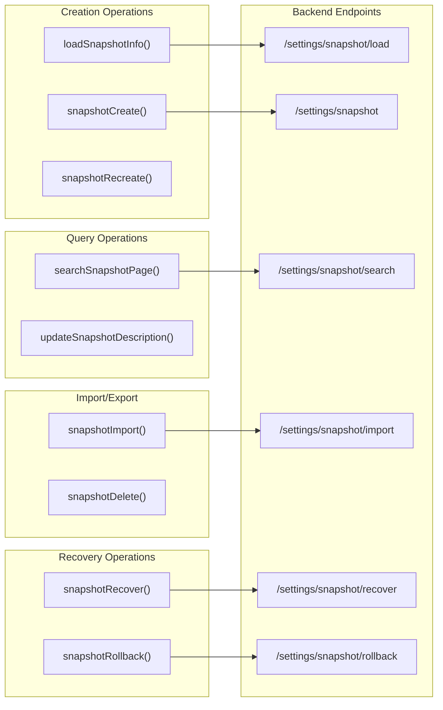

**Sources:** [frontend/src/api/modules/setting.ts:153-180]()

### Snapshot API Functions

| Function | Endpoint | Request Type | Response Type | Purpose |
|----------|----------|--------------|---------------|---------|
| `loadSnapshotInfo` | `/settings/snapshot/load` | GET | `Setting.SnapshotData` | Load available data for snapshot creation |
| `snapshotCreate` | `/settings/snapshot` | POST | - | Create new snapshot |
| `snapshotRecreate` | `/settings/snapshot/recreate` | POST | - | Recreate snapshot by ID |
| `snapshotImport` | `/settings/snapshot/import` | POST | - | Import snapshot from backup account |
| `searchSnapshotPage` | `/settings/snapshot/search` | POST | `ResPage<Setting.SnapshotInfo>` | Search snapshots with pagination |
| `snapshotDelete` | `/settings/snapshot/del` | POST | - | Delete snapshots with optional file removal |
| `snapshotRecover` | `/settings/snapshot/recover` | POST | - | Restore system from snapshot |
| `snapshotRollback` | `/settings/snapshot/rollback` | POST | - | Rollback failed recovery operation |
| `updateSnapshotDescription` | `/settings/snapshot/description/update` | POST | - | Update snapshot description |

**Notable API characteristics:**
- `loadSnapshotInfo` uses `TimeoutEnum.T_60S` for 60-second timeout due to file system scanning
- `snapshotDelete` accepts `deleteWithFile: boolean` to control physical file removal
- Recovery operations use `Setting.SnapshotRecover` interface with `taskID`, `isNew`, `reDownload`, `secret` parameters

**Sources:** [frontend/src/api/modules/setting.ts:153-180]()

## Snapshot Creation Flow

The snapshot creation process begins with loading available data using `loadSnapshotInfo()`, then allows selective inclusion of components through tree selection.

### Data Selection and Creation

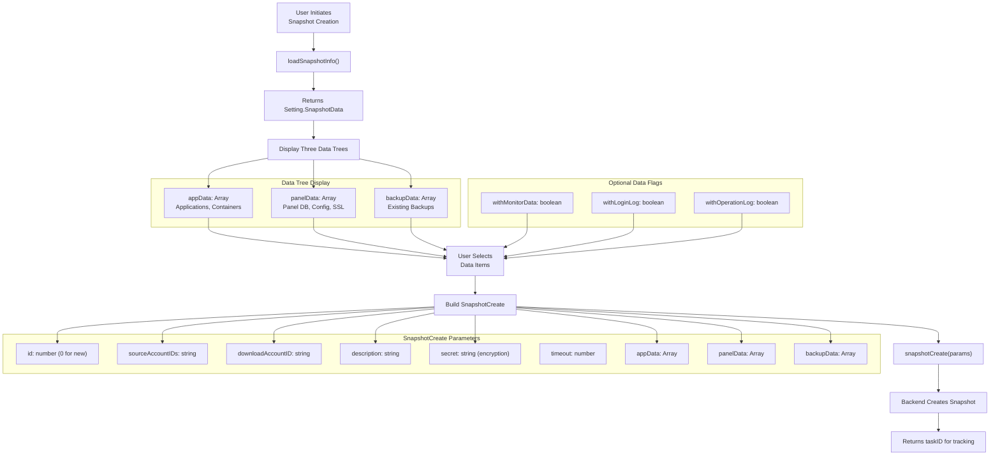

**Sources:** [frontend/src/api/interface/setting.ts:139-154](), [frontend/src/api/modules/setting.ts:154-159]()

### Backup Account Integration

The `SnapshotCreate` interface includes two backup account fields:

- `sourceAccountIDs`: String of account IDs (comma-separated) for uploading snapshot to remote storage
- `downloadAccountID`: String of single account ID for downloading snapshot during recovery

This enables snapshots to be:
1. Created locally
2. Automatically uploaded to multiple remote backup accounts (S3, SFTP, OSS)
3. Downloaded from a specific account during recovery (even on a different server)

**Sources:** [frontend/src/api/interface/setting.ts:139-154]()

## Snapshot Import System

The import functionality allows snapshots to be imported from remote backup accounts, enabling cross-server migration and disaster recovery.

### Import Operation Flow

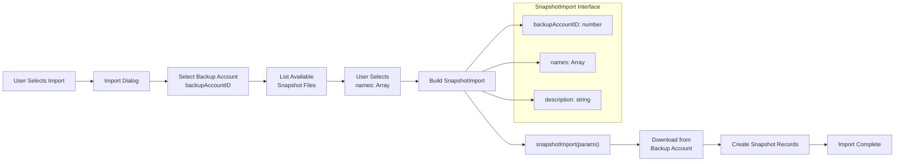

**Sources:** [frontend/src/api/interface/setting.ts:155-159](), [frontend/src/api/modules/setting.ts:163-165]()

The `snapshotImport` function accepts:
- `backupAccountID`: Remote storage account to download from
- `names`: Array of snapshot file names to import
- `description`: Optional description for imported snapshots

This enables scenarios like:
- Importing snapshots from another server
- Restoring from offsite backup storage
- Migrating between hosting providers

**Sources:** [frontend/src/api/modules/setting.ts:163-165]()

## Snapshot Recovery System

The recovery system restores complete system state from a snapshot with pre-validation checks and rollback capability.

### Recovery Status State Machine

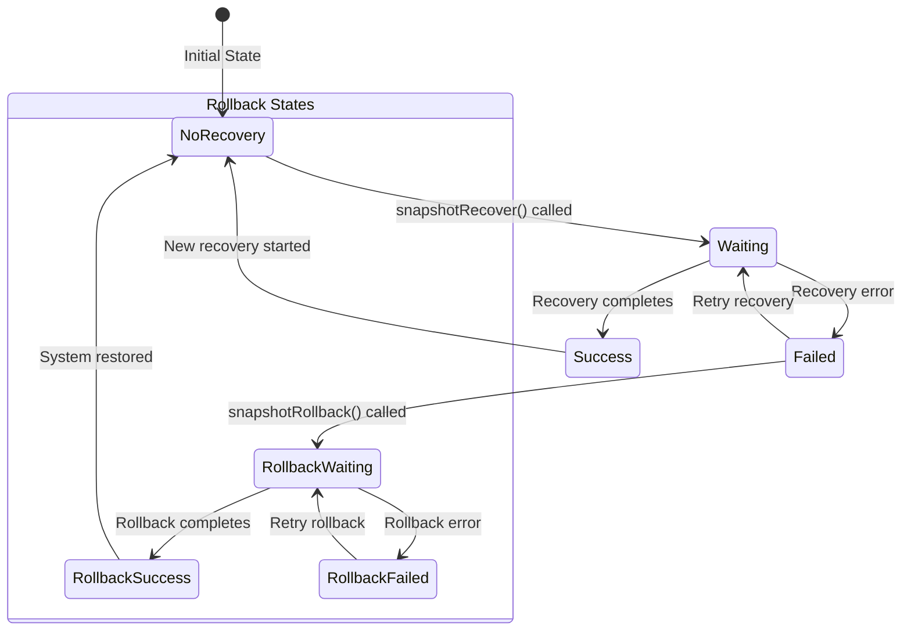

**Sources:** [frontend/src/api/interface/setting.ts:167-189]()

### SnapshotInfo Status Fields

The `SnapshotInfo` interface tracks recovery state through multiple fields:

| Field | Type | Purpose |
|-------|------|---------|
| `status` | string | Snapshot creation status |
| `taskID` | string | Creation task identifier |
| `taskRecoverID` | string | Recovery task identifier |
| `taskRollbackID` | string | Rollback task identifier |
| `recoverStatus` | string | Current recovery status (null, "Waiting", "Success", "Failed") |
| `recoverMessage` | string | Recovery error or status message |
| `rollbackStatus` | string | Current rollback status (null, "Waiting", "Success", "Failed") |
| `rollbackMessage` | string | Rollback error or status message |
| `interruptStep` | string | Step where recovery was interrupted |

**Sources:** [frontend/src/api/interface/setting.ts:167-189]()

## Recovery Operations and Validation

The recovery system performs pre-flight validation before initiating snapshot restoration to prevent failures.

### Pre-Recovery Validation Flow

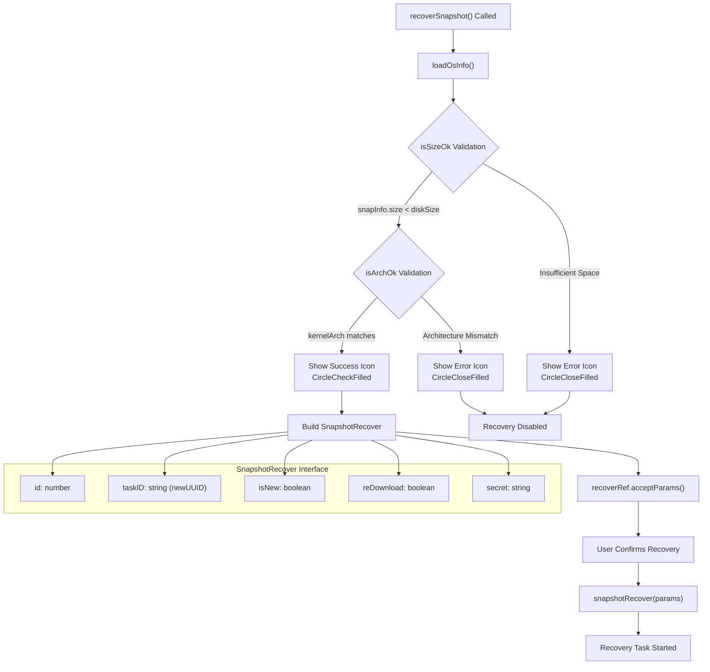

**Sources:** [frontend/src/api/interface/setting.ts:160-166](), [frontend/src/api/modules/setting.ts:172-174]()

### Recovery Parameter Construction

The `SnapshotRecover` interface defines the recovery request:

```typescript
export interface SnapshotRecover {
    id: number;           // Snapshot ID to recover
    taskID: string;       // UUID for task tracking
    isNew: boolean;       // Whether this is a new recovery attempt
    reDownload: boolean;  // Force re-download from backup account
    secret: string;       // Decryption secret if snapshot is encrypted
}
```

**Validation checks performed:**
1. **Disk Space**: Compare `snapInfo.size` with `os.data.diskSize` to ensure sufficient space
2. **Architecture**: Verify `os.data.kernelArch` matches snapshot architecture to prevent binary incompatibility

**Sources:** [frontend/src/api/interface/setting.ts:160-166]()

## Snapshot Rollback System

The rollback functionality restores the system to its pre-recovery state when a snapshot recovery fails or produces undesired results.

### Rollback Operation Flow

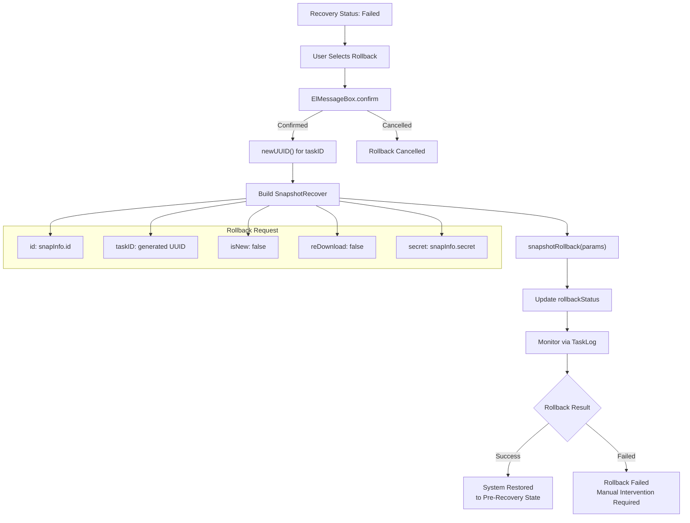

**Sources:** [frontend/src/api/modules/setting.ts:175-177]()

### Rollback Behavior

The `snapshotRollback()` function uses the same `SnapshotRecover` interface as recovery but with different semantics:

- **Recovery**: Restores system from snapshot
- **Rollback**: Restores system from pre-recovery backup (automatically created before recovery)

The backend automatically creates a backup before any recovery operation, allowing rollback to the pre-recovery state if the recovery fails or produces undesired results.

**Key difference:**
- `isNew: false` during rollback indicates this is reverting a previous operation, not a fresh recovery

**Sources:** [frontend/src/api/interface/setting.ts:160-166](), [frontend/src/api/modules/setting.ts:175-177]()

## Task Integration and Monitoring

All snapshot operations integrate with the task management system for async execution tracking.

### Task Lifecycle Integration

```mermaid
graph LR
    Operation["Snapshot Operation"] --> GenerateTaskID["newUUID()"]
    GenerateTaskID --> CallAPI["API Call with taskID"]
    CallAPI --> BackendTask["Backend Creates Task"]
    BackendTask --> TaskLogComponent["TaskLog Component"]
    
    subgraph "Task Monitoring"
        OpenTaskLog["taskLogRef.openWithTaskID()"]
        StreamLogs["Stream Real-time Logs"]
        TrackStatus["Track Task Status"]
        ShowProgress["Display Progress"]
    end
    
    TaskLogComponent --> OpenTaskLog
    OpenTaskLog --> StreamLogs
    StreamLogs --> TrackStatus
    TrackStatus --> ShowProgress
    
    ShowProgress --> CheckResult{"Task Result"}
    CheckResult -->|Success| EmitSearch["emit('search')"]
    CheckResult -->|Failed| ShowError["Display Error"]
    EmitSearch --> RefreshList["Refresh Snapshot List"]
    ShowError --> AllowRetry["Allow Retry/Rollback"]
```

**Sources:** [frontend/src/api/modules/setting.ts:172-177]()

### Operations with Task Integration

| Operation | API Function | Task Type | Monitoring |
|-----------|-------------|-----------|------------|
| Snapshot Creation | `snapshotCreate()` | Async | `taskID` returned in response |
| Snapshot Recovery | `snapshotRecover()` | Async | `taskRecoverID` in `SnapshotInfo` |
| Snapshot Rollback | `snapshotRollback()` | Async | `taskRollbackID` in `SnapshotInfo` |
| Snapshot Import | `snapshotImport()` | Async | Task tracking via backend |

Each operation:
1. Generates UUID via `newUUID()` before API call
2. Passes `taskID` in request parameters
3. Backend creates task record
4. Frontend opens TaskLog component with `taskID`
5. TaskLog streams real-time logs and progress
6. Upon completion, emits 'search' event to refresh list

**Sources:** [frontend/src/api/modules/setting.ts:157-177]()

## Backend Recovery Process

The backend recovery process executes a multi-step restoration sequence with progress tracking and automatic rollback capability.

### Recovery Step Sequence

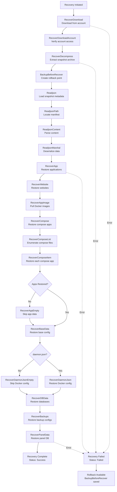

**Sources:** Backend recovery steps are referenced in [agent/i18n/lang/en.yaml:392-415]()

### Recovery Steps Explanation

| Step | Key | Purpose |
|------|-----|---------|
| RecoverDownload | Download snapshot | Retrieve snapshot file from local or remote storage |
| RecoverDownloadAccount | Verify account | Validate backup account credentials and access |
| RecoverDecompress | Extract | Decompress snapshot archive to temporary location |
| BackupBeforeRecover | Rollback preparation | Create backup of current state for rollback |
| Readjson* | Manifest parsing | Load and parse snapshot manifest with metadata |
| RecoverApp | Application restore | Restore installed applications from snapshot |
| RecoverWebsite | Website restore | Restore Nginx websites and configurations |
| RecoverAppImage | Image pull | Pull required Docker images for applications |
| RecoverCompose | Compose restore | Restore Docker Compose applications |
| RecoverBaseData | Base config | Restore panel base configuration files |
| RecoverDaemonJson | Docker config | Restore Docker daemon configuration |
| RecoverDBData | Database restore | Restore database instances and data |
| RecoverBackups | Backup restore | Restore backup account configurations |
| RecoverPanelData | Panel database | Restore panel's internal database |

The `interruptStep` field in `SnapshotInfo` records which step failed during recovery, enabling targeted troubleshooting and retry logic.

**Sources:** [agent/i18n/lang/en.yaml:392-415](), [frontend/src/api/interface/setting.ts:184]()

## Component-Level Backup Integration

The system integrates backup management with component deletion workflows, providing options to clean up associated backup data when removing system components.

### Database Backup Cleanup

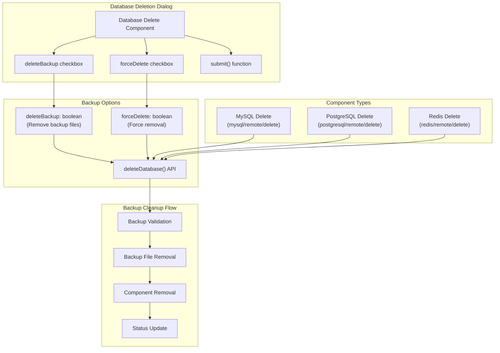

### Component Backup Integration Summary

| Component | Delete Component Path | Backup Cleanup | Force Delete |
|-----------|----------------------|----------------|--------------|
| MySQL | `mysql/remote/delete/index.vue` | `deleteBackup` checkbox | `forceDelete` checkbox |
| PostgreSQL | `postgresql/remote/delete/index.vue` | `deleteBackup` checkbox | `forceDelete` checkbox |
| Redis | `redis/remote/delete/index.vue` | `deleteBackup` checkbox | `forceDelete` checkbox |

Each deletion component follows the same pattern:
1. Present `deleteBackup` and `forceDelete` options via checkboxes
2. Call `deleteDatabase()` API with selected options
3. Backend handles backup cleanup if `deleteBackup` is enabled
4. Emit search event to refresh component list
5. Display success message via `MsgSuccess`

Sources: [frontend/src/views/database/mysql/remote/delete/index.vue:10-15](), [frontend/src/views/database/postgresql/remote/delete/index.vue:10-15](), [frontend/src/views/database/redis/remote/delete/index.vue:10-15]()

## Integration with Scheduled Tasks

The backup system integrates with the 1Panel task scheduling system to provide automated backup operations with comprehensive error handling and monitoring.

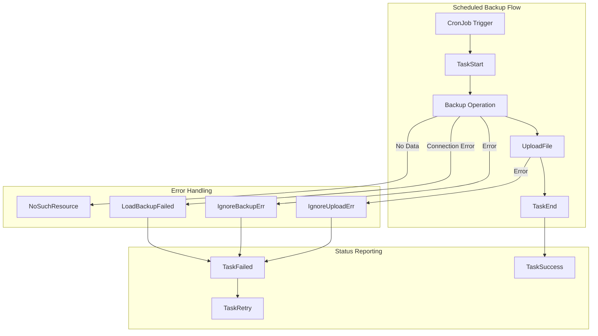

Sources: [agent/i18n/lang/en.yaml:232-238](), [agent/i18n/lang/en.yaml:301-306]()

---

