<!-- source: DeepWiki mcp.deepwiki.com · repo 1Panel-dev/1Panel · page 11 Frontend System Details · fetched 2026-10-29 -->

# Frontend System Details

<details>
<summary>Relevant source files</summary>

The following files were used as context for generating this wiki page:

- [Makefile](Makefile)
- [agent/utils/common/sqlite.go](agent/utils/common/sqlite.go)
- [core/middleware/operation.go](core/middleware/operation.go)
- [core/utils/common/sqlite.go](core/utils/common/sqlite.go)
- [frontend/src/api/interface/app.ts](frontend/src/api/interface/app.ts)
- [frontend/src/api/modules/app.ts](frontend/src/api/modules/app.ts)
- [frontend/src/components/app-status/index.vue](frontend/src/components/app-status/index.vue)
- [frontend/src/global/form-rules.ts](frontend/src/global/form-rules.ts)
- [frontend/src/lang/modules/en.ts](frontend/src/lang/modules/en.ts)
- [frontend/src/lang/modules/es-es.ts](frontend/src/lang/modules/es-es.ts)
- [frontend/src/lang/modules/ja.ts](frontend/src/lang/modules/ja.ts)
- [frontend/src/lang/modules/ko.ts](frontend/src/lang/modules/ko.ts)
- [frontend/src/lang/modules/ms.ts](frontend/src/lang/modules/ms.ts)
- [frontend/src/lang/modules/pt-br.ts](frontend/src/lang/modules/pt-br.ts)
- [frontend/src/lang/modules/ru.ts](frontend/src/lang/modules/ru.ts)
- [frontend/src/lang/modules/tr.ts](frontend/src/lang/modules/tr.ts)
- [frontend/src/lang/modules/zh-Hant.ts](frontend/src/lang/modules/zh-Hant.ts)
- [frontend/src/lang/modules/zh.ts](frontend/src/lang/modules/zh.ts)
- [frontend/src/styles/common.scss](frontend/src/styles/common.scss)
- [frontend/src/views/app-store/apps/index.vue](frontend/src/views/app-store/apps/index.vue)
- [frontend/src/views/app-store/detail/index.vue](frontend/src/views/app-store/detail/index.vue)
- [frontend/src/views/app-store/detail/install/index.vue](frontend/src/views/app-store/detail/install/index.vue)
- [frontend/src/views/app-store/detail/params/index.vue](frontend/src/views/app-store/detail/params/index.vue)
- [frontend/src/views/app-store/installed/detail/index.vue](frontend/src/views/app-store/installed/detail/index.vue)
- [frontend/src/views/app-store/installed/index.vue](frontend/src/views/app-store/installed/index.vue)
- [frontend/src/views/app-store/installed/upgrade/index.vue](frontend/src/views/app-store/installed/upgrade/index.vue)
- [frontend/src/views/website/website/create/index.vue](frontend/src/views/website/website/create/index.vue)
- [frontend/src/views/website/website/index.vue](frontend/src/views/website/website/index.vue)

</details>


## Purpose and Scope

This document provides an in-depth overview of the 1Panel frontend architecture, covering the technology stack, project organization, state management, internationalization, and core patterns. The frontend is a Vue 3 single-page application built with TypeScript and Vite, offering a responsive web interface for managing Linux servers.

For detailed information on reusable component patterns and shared components, see [Component Architecture and Patterns](#11.1). For API client implementation and TypeScript type definitions, see [API Client Layer and Type System](#11.2). For form validation rules and utility functions, see [Form Validation and Utilities](#11.3).

---

## Technology Stack Overview

The 1Panel frontend leverages modern web technologies optimized for performance and developer experience.

### Core Framework Diagram

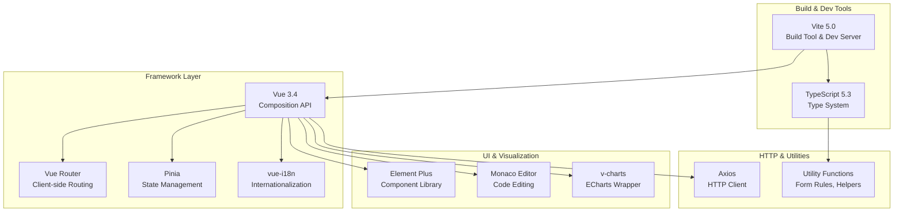

**Key Dependencies:**

| Package | Version | Purpose |
|---------|---------|---------|
| Vue | 3.4.x | Reactive UI framework with Composition API |
| TypeScript | 5.3.x | Static typing and enhanced IDE support |
| Vite | 5.0.x | Fast build tool with hot module replacement |
| Element Plus | Latest | Comprehensive Vue 3 component library |
| Monaco Editor | Latest | VS Code's editor for in-browser code editing |
| Vue Router | Latest | Official routing solution |
| Pinia | Latest | Official state management (Vuex replacement) |
| vue-i18n | Latest | Internationalization framework |
| Axios | Latest | Promise-based HTTP client |

Sources: [Diagram 4 from high-level architecture](#), [frontend/package.json]() (implied)

---

## Project Structure and Build System

### Directory Organization

The frontend follows a feature-based organization with clear separation of concerns:

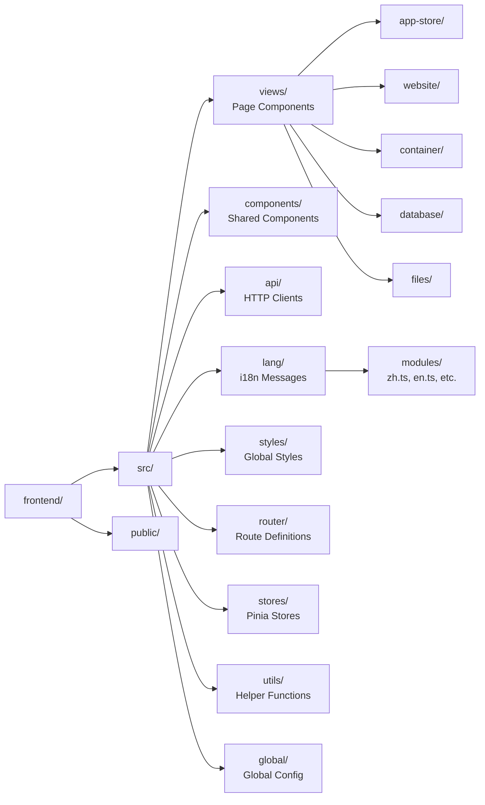

**Key Directories:**

- **`src/views/`**: Page-level components organized by feature (app-store, website, container, database, etc.)
- **`src/components/`**: Reusable components like `AppStatus`, `ComplexTable`, `LayoutContent`
- **`src/api/`**: API client layer with typed interfaces and HTTP methods
- **`src/lang/modules/`**: Translation files for 10 supported languages
- **`src/global/`**: Global configuration including form validation rules
- **`src/styles/`**: SCSS stylesheets including `common.scss` for shared styles

Sources: [frontend/src/views/app-store/installed/index.vue:1-7](), [frontend/src/views/website/website/index.vue:1-11](), [frontend/src/components/app-status/index.vue:1-9]()

### Build System

The project uses **Vite** for development and production builds, configured via the Makefile:

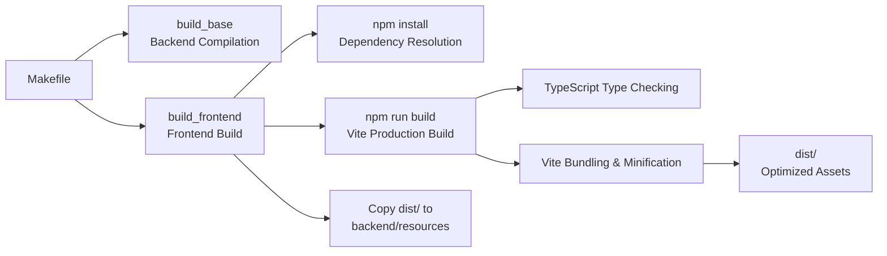

The Makefile defines build targets that handle cross-platform compilation and frontend asset generation. The `build_frontend` target runs `npm install` and `npm run build`, then copies the compiled assets to the backend's resource directory for embedding.

Sources: [Makefile:1-20]()

---

## Internationalization (i18n) System

1Panel supports **10 languages** with a comprehensive translation system managed through vue-i18n.

### Supported Languages

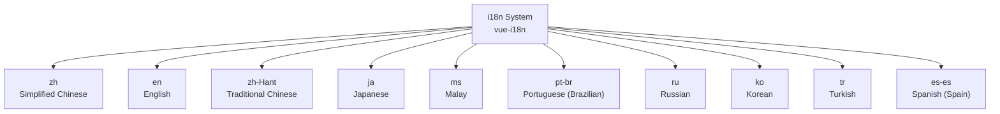

### Message Structure

Translation files follow a hierarchical structure organized by functional domain:

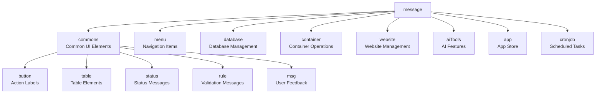

### Translation Key Examples

The i18n system uses nested keys accessed via dot notation:

| Key Path | English | Chinese | Usage |
|----------|---------|---------|-------|
| `commons.button.create` | "Create" | "创建" | Primary action buttons |
| `commons.status.running` | "Running" | "已启动" | Status indicators |
| `database.create` | "Create database" | "创建数据库" | Page headers |
| `app.installSuccess` | "Install successful" | "安装成功" | Success messages |
| `website.defaultServer` | "Default Server" | "默认服务器" | Configuration labels |

### Usage in Components

Components access translations using the `$t()` function:

```vue
<!-- In template -->
<el-button @click="sync" type="primary" plain>
    {{ $t('commons.button.refresh') }}
</el-button>

<!-- With parameters -->
<span>{{ $t('commons.table.total', [count]) }}</span>

<!-- In script -->
import { useI18n } from 'vue-i18n';
const { t } = useI18n();
const message = t('database.formatHelper', [charset]);
```

Sources: [frontend/src/lang/modules/zh.ts:1-100](), [frontend/src/lang/modules/en.ts:1-100](), [frontend/src/views/app-store/installed/index.vue:8-11](), [frontend/src/views/website/website/index.vue:23-28]()

---

## Component Architecture Patterns

### Page Component Structure

Page-level components follow a consistent pattern using `LayoutContent` wrapper:

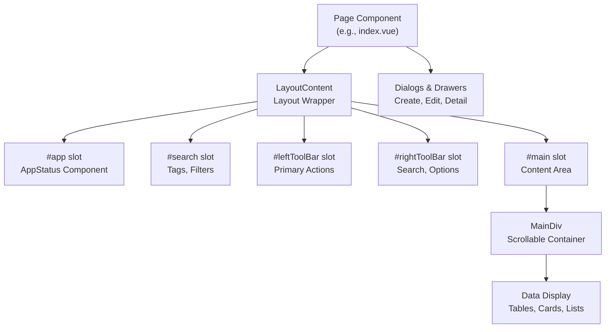

**Example Pattern:**

```vue
<template>
    <LayoutContent v-loading="loading" :title="$t('menu.website')">
        <template #app>
            <AppStatus :app-key="'openresty'" @setting="setting" />
        </template>
        <template #leftToolBar>
            <el-button type="primary" @click="openCreate">
                {{ $t('website.create') }}
            </el-button>
        </template>
        <template #rightToolBar>
            <TableSearch @search="search()" v-model:searchName="req.name" />
        </template>
        <template #main>
            <MainDiv :heightDiff="300">
                <!-- Content -->
            </MainDiv>
        </template>
    </LayoutContent>
</template>
```

Sources: [frontend/src/views/app-store/installed/index.vue:2-17](), [frontend/src/views/website/website/index.vue:11-56]()

### Common Component Patterns

#### AppStatus Component

The `AppStatus` component displays the status of installed applications and provides quick actions:

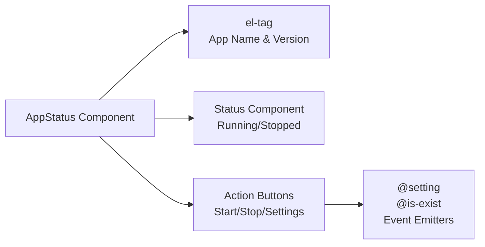

The component manages application lifecycle visibility and provides standardized status display across different pages.

Sources: [frontend/src/components/app-status/index.vue:1-9](), [frontend/src/views/website/website/index.vue:14-21]()

#### Drawer and Dialog Patterns

Modal interactions use `DrawerPro` component with consistent structure:

```vue
<DrawerPro v-model="open" :header="title" size="large" @close="handleClose">
    <template #buttons>
        <el-button type="primary" @click="submit">
            {{ $t('commons.button.save') }}
        </el-button>
    </template>
    <el-form ref="formRef" :model="form" :rules="rules">
        <!-- Form content -->
    </el-form>
    <template #footer>
        <!-- Footer actions -->
    </template>
</DrawerPro>
```

Sources: [frontend/src/views/app-store/installed/detail/index.vue:1-10](), [frontend/src/views/website/website/create/index.vue:1-12]()

---

## State Management and Routing

### Pinia Store Pattern

The application uses Pinia for global state management. While specific store files aren't shown, the pattern follows Pinia's composition-style stores:

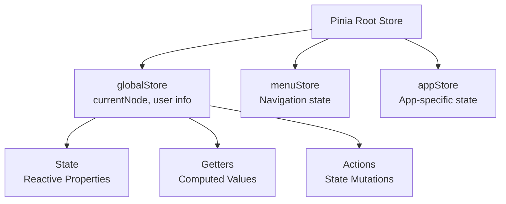

**Typical Usage:**
- `currentNode`: Tracks the active server node in multi-node deployments
- User session data: Authentication and permission information
- UI state: Active tabs, filters, search terms

### Vue Router Structure

Routes are organized by feature modules with lazy-loaded components:

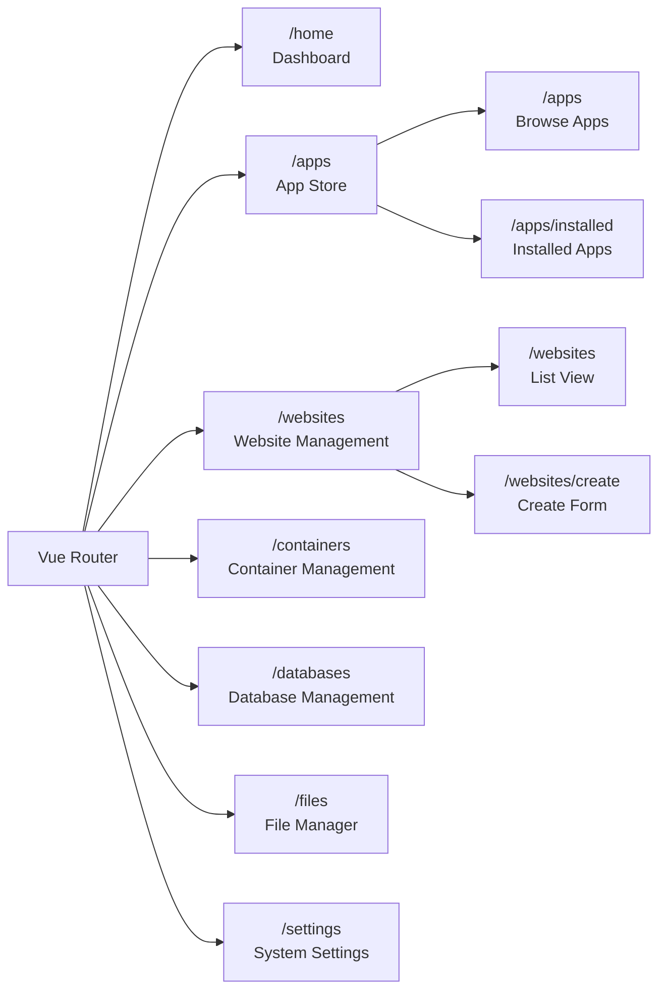

Routes support navigation guards for authentication and permission checks, ensuring users only access authorized resources.

Sources: [frontend/src/views/website/website/index.vue:1-10]() (RouterButton usage), [frontend/src/views/app-store/apps/index.vue:1-4]()

---

## Form Handling and Validation

### Centralized Validation Rules

Form validation rules are centralized in `global/form-rules.ts`, providing reusable validators:

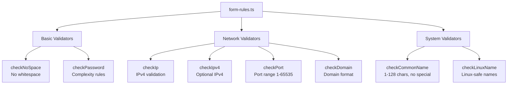

**Example Validators:**

| Validator | Purpose | Error Message Key |
|-----------|---------|-------------------|
| `checkIp` | Validates IPv4 addresses | `commons.rule.ip` |
| `checkPort` | Validates port numbers (1-65535) | `commons.rule.port` |
| `checkNoSpace` | Ensures no whitespace characters | `setting.noSpace` |
| `checkCommonName` | Validates resource names (1-128 chars) | `commons.rule.commonName` |

### Form Binding Pattern

Forms use Element Plus `el-form` with reactive data binding:

```vue
<el-form
    ref="websiteForm"
    label-position="top"
    :model="website"
    :rules="rules"
    :validate-on-rule-change="false"
>
    <el-form-item :label="$t('website.primaryDomain')" prop="primaryDomain">
        <el-input v-model="website.primaryDomain" />
    </el-form-item>
    
    <el-form-item :label="$t('website.type')" prop="type">
        <el-radio-group v-model="website.type" @change="changeType">
            <el-radio-button value="static">Static</el-radio-button>
            <el-radio-button value="proxy">Proxy</el-radio-button>
        </el-radio-group>
    </el-form-item>
</el-form>
```

Sources: [frontend/src/global/form-rules.ts:1-50](), [frontend/src/views/website/website/create/index.vue:4-19]()

---

## API Communication Layer

### Request Structure

API calls use Axios with typed interfaces defined in `api/interface/`:

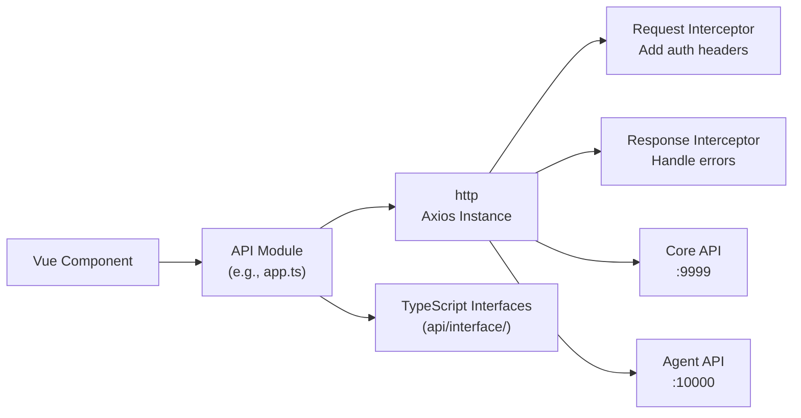

### API Interface Example

TypeScript interfaces ensure type safety across API calls:

```typescript
// api/interface/app.ts
export namespace App {
    export interface App extends CommonModel {
        name: string;
        key: string;
        tags: Tag[];
        shortDescZh: string;
        shortDescEn: string;
        type: string;
        status: string;
    }
    
    export interface AppDTO extends App {
        versions: string[];
        installed: boolean;
        architectures: string;
    }
}

// api/modules/app.ts
export const syncApp = (req: App.AppStoreSync) => {
    return http.post<any>(`/apps/sync`, req, TimeoutEnum.T_40S);
};

export const searchApp = (req: App.AppReq) => {
    return http.post<App.AppResPage>(`/apps/search`, req);
};
```

API functions return strongly-typed promises, enabling IDE autocomplete and compile-time error detection.

Sources: [frontend/src/api/interface/app.ts:1-67](), [frontend/src/api/modules/app.ts:1-20]()

---

## Styling System

### Global Styles

The application uses SCSS for styling with a centralized approach:

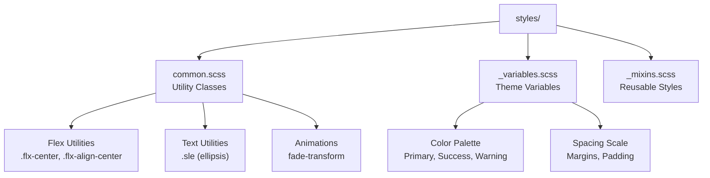

**Common Utility Classes:**

| Class | Purpose | CSS |
|-------|---------|-----|
| `.flx-center` | Flex center alignment | `display: flex; align-items: center; justify-content: center;` |
| `.flx-align-center` | Flex vertical center | `display: flex; align-items: center;` |
| `.sle` | Single-line ellipsis | `overflow: hidden; text-overflow: ellipsis; white-space: nowrap;` |

### Element Plus Customization

The UI framework is customized through CSS variables and component props. Element Plus provides consistent theming across all components.

Sources: [frontend/src/styles/common.scss:1-50]()

---

## Key Feature Examples

### App Store Interface

The app store demonstrates complex state management and interaction patterns:

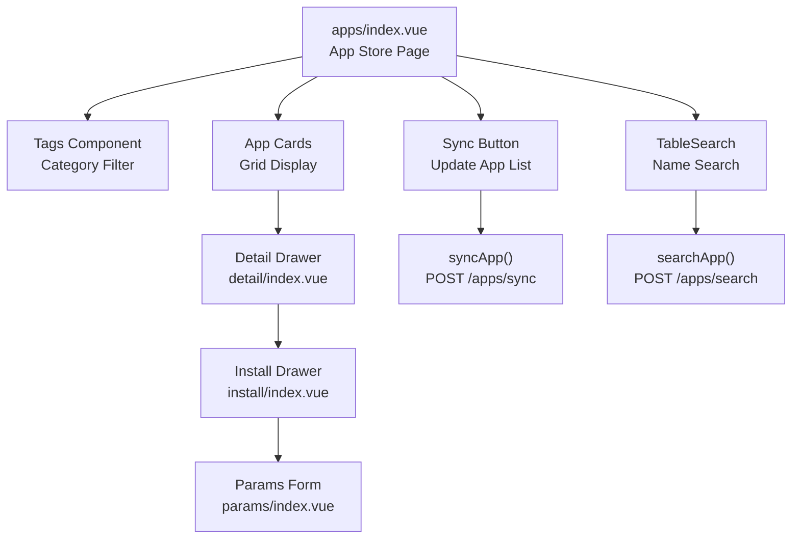

The app store page coordinates multiple child components, managing loading states, filters, and modal interactions.

Sources: [frontend/src/views/app-store/apps/index.vue:1-42](), [frontend/src/views/app-store/detail/index.vue:1-7](), [frontend/src/views/app-store/detail/install/index.vue:1-10]()

### Installed Apps Management

The installed apps page provides lifecycle management for deployed applications:

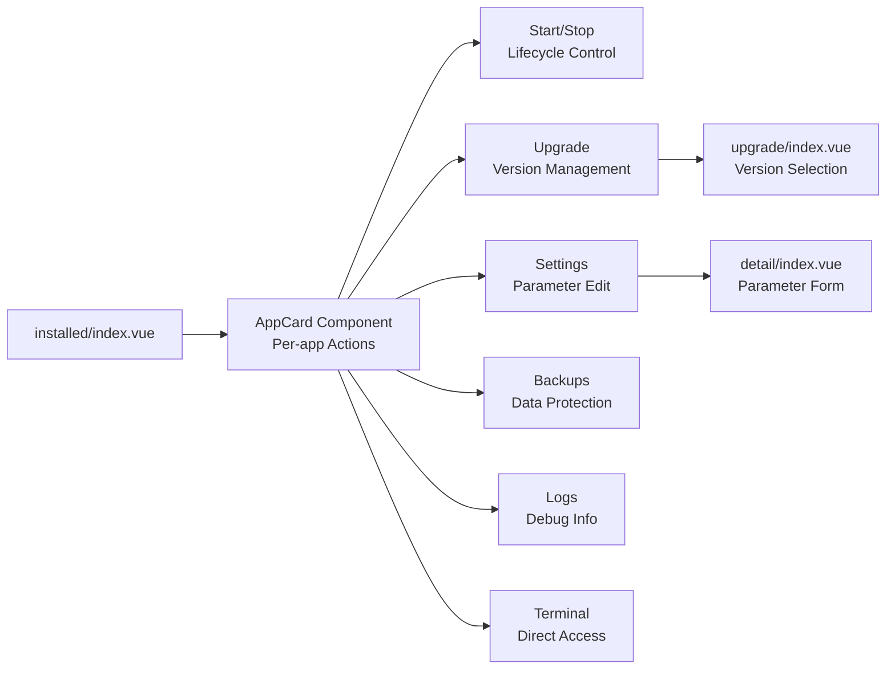

Each installed app card provides contextual actions based on app status and type.

Sources: [frontend/src/views/app-store/installed/index.vue:42-67](), [frontend/src/views/app-store/installed/detail/index.vue:1-20](), [frontend/src/views/app-store/installed/upgrade/index.vue:1-5]()

---

## Development Workflow

### Build Process

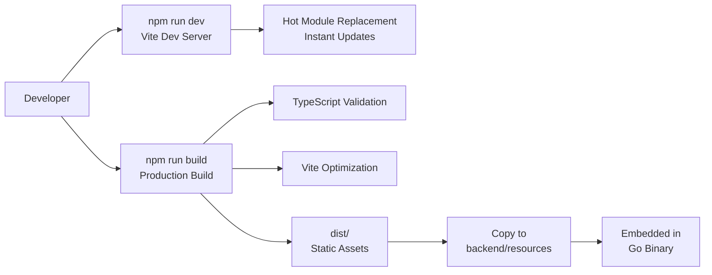

**Development Commands:**
- `npm run dev`: Start Vite development server with hot reload
- `npm run build`: Create production-optimized bundle
- `npm run type-check`: Validate TypeScript without building

### Component Development Pattern

When creating new components or pages:

1. **Create Vue file** in appropriate directory (`views/` or `components/`)
2. **Define TypeScript interfaces** in `api/interface/` for API data
3. **Add API functions** in `api/modules/` for backend communication
4. **Add translations** to all language files in `lang/modules/`
5. **Use form-rules.ts** validators for input validation
6. **Follow LayoutContent pattern** for page structure
7. **Test with multiple languages** to ensure i18n compatibility

Sources: [Makefile:1-20]() (build process), [frontend/src/views/]() (component examples)

---

## Summary

The 1Panel frontend is a modern Vue 3 application with:

- **Type-safe API layer** using TypeScript interfaces
- **Comprehensive i18n support** for 10 languages
- **Reusable component patterns** via LayoutContent and shared components
- **Centralized validation** through form-rules.ts
- **Efficient build system** using Vite with hot module replacement
- **Consistent UI/UX** powered by Element Plus
- **Code editing capabilities** via integrated Monaco Editor

The architecture emphasizes maintainability through clear separation of concerns, type safety, and extensive code reuse across features.

---

