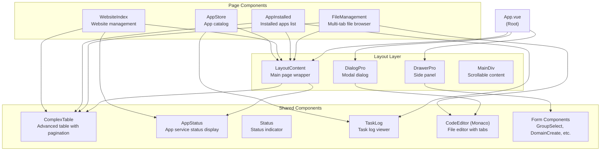
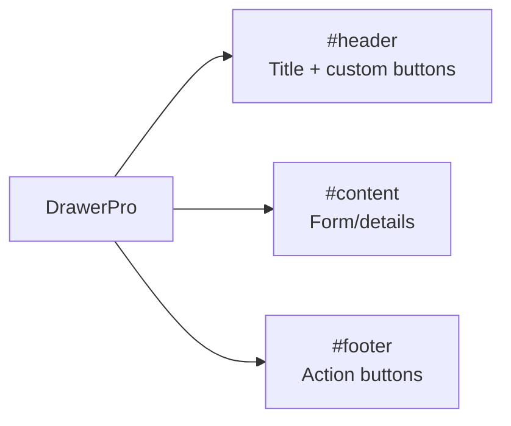
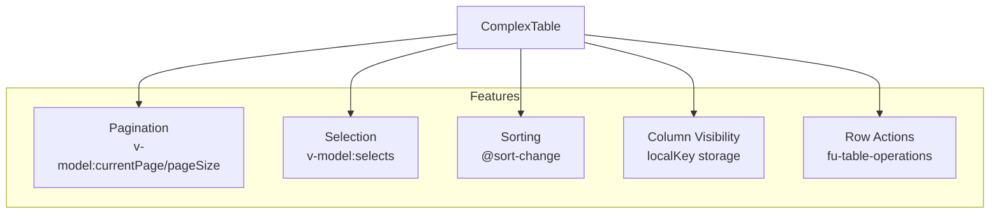
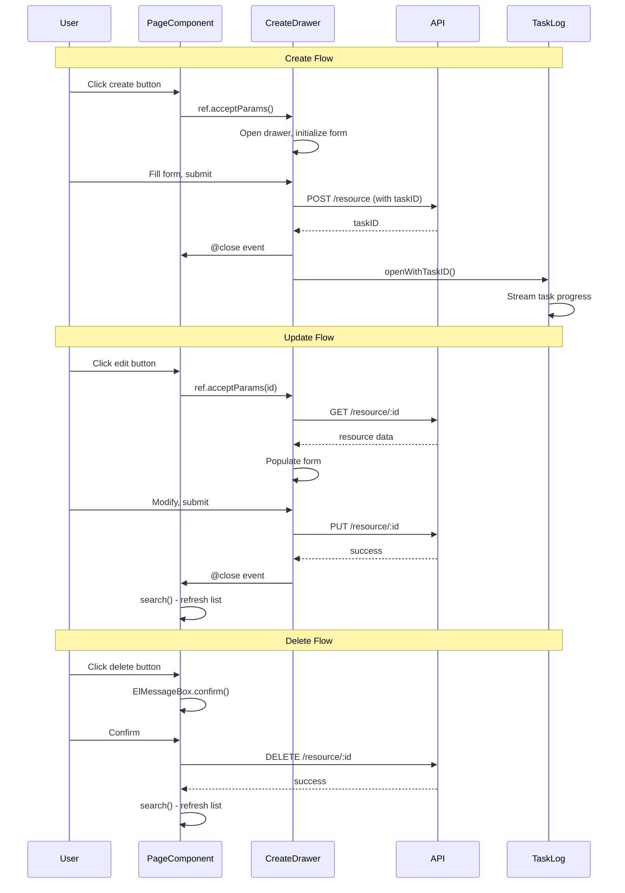
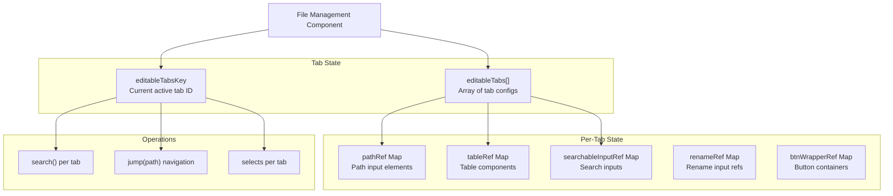

<!-- source: DeepWiki mcp.deepwiki.com · repo 1Panel-dev/1Panel · page 11.1 Component Architecture and Patterns · fetched 2026-10-29 -->

# Component Architecture and Patterns

<details>
<summary>Relevant source files</summary>

The following files were used as context for generating this wiki page:

- [frontend/src/api/interface/app.ts](frontend/src/api/interface/app.ts)
- [frontend/src/api/interface/file.ts](frontend/src/api/interface/file.ts)
- [frontend/src/api/modules/app.ts](frontend/src/api/modules/app.ts)
- [frontend/src/api/modules/files.ts](frontend/src/api/modules/files.ts)
- [frontend/src/components/app-status/index.vue](frontend/src/components/app-status/index.vue)
- [frontend/src/global/form-rules.ts](frontend/src/global/form-rules.ts)
- [frontend/src/styles/common.scss](frontend/src/styles/common.scss)
- [frontend/src/views/app-store/apps/index.vue](frontend/src/views/app-store/apps/index.vue)
- [frontend/src/views/app-store/detail/index.vue](frontend/src/views/app-store/detail/index.vue)
- [frontend/src/views/app-store/detail/install/index.vue](frontend/src/views/app-store/detail/install/index.vue)
- [frontend/src/views/app-store/detail/params/index.vue](frontend/src/views/app-store/detail/params/index.vue)
- [frontend/src/views/app-store/installed/detail/index.vue](frontend/src/views/app-store/installed/detail/index.vue)
- [frontend/src/views/app-store/installed/index.vue](frontend/src/views/app-store/installed/index.vue)
- [frontend/src/views/app-store/installed/upgrade/index.vue](frontend/src/views/app-store/installed/upgrade/index.vue)
- [frontend/src/views/host/file-management/code-editor/index.vue](frontend/src/views/host/file-management/code-editor/index.vue)
- [frontend/src/views/host/file-management/index.vue](frontend/src/views/host/file-management/index.vue)
- [frontend/src/views/website/website/create/index.vue](frontend/src/views/website/website/create/index.vue)
- [frontend/src/views/website/website/index.vue](frontend/src/views/website/website/index.vue)

</details>


This document describes the Vue 3 component architecture used throughout the 1Panel frontend, including reusable components, common patterns, and communication strategies. It focuses on the structural patterns, component hierarchies, and coding conventions that ensure consistency across the application.

For API client architecture and TypeScript interfaces, see [API Client Layer and Type System](#11.2). For form validation utilities, see [Form Validation and Utilities](#11.3).

---

## Component Hierarchy Overview

The frontend implements a three-tier component structure: layout components for structural organization, shared components for common functionality, and page components for feature-specific UI.



**Sources:** [frontend/src/views/host/file-management/index.vue:1-625](), [frontend/src/views/app-store/installed/index.vue:1-469](), [frontend/src/views/website/website/index.vue:1-689](), [frontend/src/components/app-status/index.vue:1-196]()

---

## Layout Components

### LayoutContent Component

The `LayoutContent` component provides the standard page structure with header, toolbar sections, and main content area. It's used consistently across all major feature pages.

**Usage Pattern:**
```vue
<LayoutContent v-loading="loading" :title="$t('menu.website')">
    <template #app>
        <!-- App status banner -->
    </template>
    <template #leftToolBar>
        <!-- Create/action buttons -->
    </template>
    <template #rightToolBar>
        <!-- Search/filter controls -->
    </template>
    <template #main>
        <!-- Main content area -->
    </template>
</LayoutContent>
```

**Common Slots:**
- `#app` - Application status indicator (typically `AppStatus` component)
- `#prompt` - Alert/information banner
- `#search` - Search/tag filters
- `#leftToolBar` - Primary action buttons
- `#rightToolBar` - Secondary controls and filters
- `#main` - Primary content area
- `#footer` - Footer content

**Sources:** [frontend/src/views/website/website/index.vue:11-281](), [frontend/src/views/app-store/installed/index.vue:2-103](), [frontend/src/views/app-store/apps/index.vue:4-63]()

### DrawerPro Component

`DrawerPro` is the standard side panel component for forms and detail views. It implements a consistent header with custom buttons and footer for actions.

**Component Structure:**


**Key Props:**
- `v-model` - Controls open/close state
- `header` - Drawer title (i18n key)
- `size` - Width: "small", "normal", "large", "w-70"
- `@close` - Close event handler

**Common Pattern:**
```vue
<DrawerPro v-model="open" :header="$t('app.param')" @close="handleClose" size="normal">
    <template #buttons>
        <el-button type="primary" @click="editParam">
            {{ $t('commons.button.edit') }}
        </el-button>
    </template>
    <!-- Content -->
    <template #footer>
        <el-button @click="handleClose">{{ $t('commons.button.cancel') }}</el-button>
        <el-button type="primary" @click="submit">{{ $t('commons.button.confirm') }}</el-button>
    </template>
</DrawerPro>
```

**Sources:** [frontend/src/views/app-store/installed/detail/index.vue:1-179](), [frontend/src/views/website/website/create/index.vue:1-411](), [frontend/src/views/app-store/installed/upgrade/index.vue:1-271]()

### DialogPro Component

Similar to `DrawerPro`, but for modal dialogs. Used primarily for the code editor and other full-screen interactions.

**Sources:** [frontend/src/views/host/file-management/code-editor/index.vue:2-9]()

---

## Shared UI Components

### ComplexTable Component

`ComplexTable` is a feature-rich table wrapper around Element Plus's `el-table` with built-in pagination, sorting, selection, and dynamic column visibility.



**Key Props:**
- `:data` - Table data array
- `:pagination-config` - Pagination configuration object
- `v-model:selects` - Selected rows (for batch operations)
- `:columns` - Column definitions for dynamic visibility
- `@sort-change` - Sort event handler
- `:heightDiff` - Dynamic height calculation
- `localKey` - LocalStorage key for column preferences

**Usage Example:**
```vue
<ComplexTable
    :pagination-config="paginationConfig"
    v-model:selects="selects"
    :data="data"
    @search="search"
    @sort-change="changeSort"
    :heightDiff="310"
    :columns="columns"
    localKey="websiteColumn"
>
    <el-table-column type="selection" width="30" />
    <el-table-column :label="$t('commons.table.name')" prop="primaryDomain" sortable />
    <!-- More columns -->
    <fu-table-operations :buttons="buttons" />
</ComplexTable>
```

**Sources:** [frontend/src/views/website/website/index.vue:70-265](), [frontend/src/views/host/file-management/index.vue:448-603](), [frontend/src/views/app-store/installed/index.vue:19-91]()

### AppStatus Component

Displays application service status with start/stop/restart controls. Automatically checks and updates service status.

**Component Interface:**
```typescript
interface Props {
    appKey: string;        // 'openresty', 'mysql', etc.
    appName?: string;      // Optional specific install name
    hideSetting?: boolean; // Hide settings button
}

interface Emits {
    'setting': void;
    'isExist': CheckInstalled;
    'update:loading': boolean;
    'update:maskShow': boolean;
    'update:appInstallID': number;
}

interface Exposed {
    onCheck: (key: string, name: string) => void;
    getHttpPort: () => number;
    getHttpsPort: () => number;
}
```

**Visual Structure:**
- Service name badge (e.g., "OpenResty")
- Status indicator (Running/Stopped/Installing)
- Version tag
- Action buttons: Start, Stop, Restart, Reload (for OpenResty), Settings

**Sources:** [frontend/src/components/app-status/index.vue:1-196](), [frontend/src/views/website/website/index.vue:12-20]()

### Status Component

Simple status indicator component displaying colored status text. Used throughout the application for consistent status display.

**Common Statuses:**
- `Running` - Green
- `Stopped` - Gray
- `Error` - Red
- `Installing` - Blue

**Sources:** [frontend/src/components/app-status/index.vue:7](), [frontend/src/views/website/website/index.vue:146-158]()

---

## Component Communication Patterns

The application uses four primary communication strategies depending on the relationship between components.

```mermaid
graph TB
    subgraph "Parent-Child"
        Parent["Parent Component"]
        Child["Child Component"]
        Parent -->|":props"| Child
        Child -->|"@emits"| Parent
    end
    
    subgraph "Template Refs"
        ParentRef["Parent with ref"]
        ChildRef["Child with defineExpose"]
        ParentRef -->|"ref.method()"| ChildRef
    end
    
    subgraph "Event Bus"
        CompA["Component A"]
        Bus["Global Event Bus<br/>bus.emit()"]
        CompB["Component B"]
        CompA -->|"emit"| Bus
        Bus -->|"on"| CompB
    end
    
    subgraph "Global Store"
        CompX["Any Component"]
        Store["Pinia Store<br/>useGlobalStore()"]
        CompY["Any Component"]
        CompX -->|"read/write"| Store
        Store -->|"reactive"| CompY
    end
```



**Sources:** [frontend/src/views/app-store/installed/index.vue:118-146](), [frontend/src/components/app-status/index.vue:117-128]()

### Props and Emits Pattern

Standard Vue 3 props/emits for parent-child communication with TypeScript type safety.

**Example from AppStatus:**
```typescript
// Props definition
const props = defineProps({
    appKey: { type: String, default: 'openresty' },
    appName: { type: String, default: '' },
    hideSetting: { type: Boolean, default: false },
});

// Emits definition
const em = defineEmits([
    'setting',
    'isExist',
    'update:loading',
    'update:maskShow',
]);

// Usage
em('isExist', res.data);
em('update:maskShow', res.data.status !== 'Running');
```

**Sources:** [frontend/src/components/app-status/index.vue:82-125]()

### Template Refs and defineExpose Pattern

The most common pattern for calling child component methods is the `acceptParams` pattern with template refs.

**Child Component (Drawer/Dialog):**
```typescript
const open = ref(false);

const acceptParams = (props: SomeProps) => {
    // Initialize component state
    data.value = props.data;
    open.value = true;
};

defineExpose({
    acceptParams,
});
```

**Parent Component:**
```typescript
const childRef = ref();

const openChild = (data: any) => {
    childRef.value.acceptParams({ data });
};
```

**Usage in Template:**
```vue
<ChildComponent ref="childRef" @close="handleClose" />
```

**Sources:** [frontend/src/views/app-store/installed/index.vue:189-192](), [frontend/src/views/app-store/detail/index.vue:97-102](), [frontend/src/views/app-store/installed/detail/index.vue:286-296]()

### Event Bus Pattern

Used for cross-component communication, especially for refresh/update events.

**Setup (global/bus.ts):**
```typescript
import mitt from 'mitt';
const bus = mitt();
export default bus;
```

**Emitting Events:**
```typescript
import bus from '@/global/bus';

// Trigger refresh in other components
bus.emit('upgrade', true);
bus.emit('refreshApp');
```

**Listening for Events:**
```typescript
onMounted(() => {
    bus.on('refreshApp', () => {
        search(req);
    });
});

onUnmounted(() => {
    bus.off('refreshApp');
});
```

**Sources:** [frontend/src/views/app-store/apps/index.vue:80-81](), [frontend/src/views/app-store/apps/index.vue:230-232](), [frontend/src/views/app-store/installed/upgrade/index.vue:94]()

### Global Store Pattern

Pinia store used for application-wide state like current node, authentication, and theme.

**Store Access:**
```typescript
import { useGlobalStore } from '@/composables/useGlobalStore';
const { currentNode, isMaster, isProductPro, globalStore } = useGlobalStore();

// Access reactive values
const nodeAddress = currentNode.value;
const isMobile = computed(() => globalStore.isMobile());
```

**Common Global State:**
- `currentNode` - Active server node identifier
- `currentNodeAddr` - Node IP address
- `isMaster` - Is this the master node
- `isProductPro` - Pro edition flag
- `isOffLine` - Offline mode flag

**Sources:** [frontend/src/views/app-store/installed/index.vue:146](), [frontend/src/views/app-store/apps/index.vue:88](), [frontend/src/composables/useGlobalStore]()

---

## Common Component Patterns

### The acceptParams Pattern

A standardized method for initializing drawer and dialog components. This pattern is used consistently across all modal interfaces.

**Pattern Structure:**
```typescript
interface ComponentParams {
    id: number;
    // other props
}

const open = ref(false);
const loading = ref(false);
const data = ref<DataType>();

const acceptParams = async (params: ComponentParams) => {
    // 1. Reset state
    data.value = null;
    loading.value = false;
    
    // 2. Store params
    componentId.value = params.id;
    
    // 3. Fetch data if needed
    await loadData(params.id);
    
    // 4. Open component
    open.value = true;
};

const handleClose = () => {
    open.value = false;
    emit('close');
};

defineExpose({
    acceptParams,
});
```

**Real Examples:**

| Component | Params | Purpose |
|-----------|--------|---------|
| AppParams Detail | `{ id: number }` | View/edit app parameters |
| Website Create | `nginxVersion: string` | Create new website |
| App Install | `{ app: App.App }` | Install application |
| App Upgrade | `AppInstallDto, operation` | Upgrade/ignore app |
| TaskLog | `taskID: string` | View task execution log |

**Sources:** [frontend/src/views/app-store/installed/detail/index.vue:286-296](), [frontend/src/views/website/website/create/index.vue:583-599](), [frontend/src/views/app-store/detail/install/index.vue:127-134](), [frontend/src/views/app-store/installed/upgrade/index.vue:169-189]()

### Form Validation Pattern

Consistent form handling with Element Plus forms and centralized validation rules.

**Form Setup:**
```typescript
import { Rules, checkNumberRange } from '@/global/form-rules';

const formRef = ref<FormInstance>();

const form = reactive({
    name: '',
    port: 3306,
    password: '',
});

const rules = reactive({
    name: [Rules.requiredInput, Rules.name],
    port: [Rules.requiredInput, Rules.port],
    password: [Rules.requiredInput, Rules.paramComplexity],
    cpuQuota: [checkNumberRange(0, 999)],
});

const submit = async (formEl: FormInstance | undefined) => {
    if (!formEl) return;
    await formEl.validate((valid) => {
        if (valid) {
            // Submit form
        }
    });
};
```

**Common Rules from Rules Object:**
- `Rules.requiredInput` - Required text field
- `Rules.requiredSelect` - Required select dropdown
- `Rules.port` - Port number validation (1-65535)
- `Rules.ip` - IP address validation
- `Rules.domain` - Domain name validation
- `Rules.paramComplexity` - Password complexity
- `checkNumberRange(min, max)` - Number range validator

**Sources:** [frontend/src/global/form-rules.ts:1-488](), [frontend/src/views/app-store/installed/detail/index.vue:214-223](), [frontend/src/views/website/website/create/index.vue:519-548]()

### Multi-Tab Interface Pattern

Used extensively in file management and code editor for managing multiple contexts simultaneously.

**Tab State Management:**
```typescript
interface TabItem {
    id: string;
    name: string;
    path: string;
    // other properties
}

const editableTabs = ref<TabItem[]>([
    { id: '1', name: '', path: '/' }
]);
const editableTabsKey = ref('1');

const addTab = () => {
    const newTabId = Date.now().toString();
    editableTabs.value.push({
        id: newTabId,
        name: '',
        path: '/'
    });
    editableTabsKey.value = newTabId;
};

const removeTab = (targetId: string) => {
    const tabs = editableTabs.value;
    let activeName = editableTabsKey.value;
    
    if (activeName === targetId) {
        tabs.forEach((tab, index) => {
            if (tab.id === targetId) {
                const nextTab = tabs[index + 1] || tabs[index - 1];
                if (nextTab) {
                    activeName = nextTab.id;
                }
            }
        });
    }
    
    editableTabsKey.value = activeName;
    editableTabs.value = tabs.filter(tab => tab.id !== targetId);
};

const changeTab = (targetId: string) => {
    // Switch context to selected tab
    const tab = editableTabs.value.find(t => t.id === targetId);
    if (tab) {
        // Load tab-specific data
    }
};
```

**Usage in Template:**
```vue
<el-tabs
    type="card"
    v-model="editableTabsKey"
    @tab-change="changeTab"
    @tab-remove="removeTab"
>
    <el-tab-pane
        closable
        v-for="item in editableTabs"
        :key="item.id"
        :label="item.name"
        :name="item.id"
    >
        <!-- Tab content -->
    </el-tab-pane>
    <el-tab-pane :name="editableTabsKey" :closable="false" :disabled="editableTabs.length > 6">
        <template #label>
            <el-icon @click="addTab()"><Plus /></el-icon>
        </template>
    </el-tab-pane>
</el-tabs>
```

**File Management Implementation:**
The file manager uses tabs to allow browsing multiple directories simultaneously, with each tab maintaining its own:
- Current path
- File list
- Search state
- Selection state

**Code Editor Implementation:**
The code editor supports up to 10 file tabs, each with:
- File path and content
- Monaco editor instance
- Unsaved changes tracking
- Language mode

**Sources:** [frontend/src/views/host/file-management/index.vue:3-612](), [frontend/src/views/host/file-management/code-editor/index.vue:1-680]()

### Loading and Async State Pattern

Consistent handling of loading states and async operations.

**Basic Loading Pattern:**
```typescript
const loading = ref(false);
const data = ref([]);

const search = async () => {
    loading.value = true;
    try {
        const res = await searchAPI(params);
        data.value = res.data.items;
    } finally {
        loading.value = false;
    }
};
```

**With v-loading Directive:**
```vue
<LayoutContent v-loading="loading">
    <!-- Content -->
</LayoutContent>
```

**Task-based Async Operations:**
For long-running operations, the application uses a task ID pattern with task log streaming:

```typescript
import { newUUID } from '@/utils/util';

const taskLogRef = ref();

const performOperation = async () => {
    const taskID = newUUID();
    
    await apiCall({
        // operation params
        taskID: taskID
    });
    
    // Open task log viewer
    taskLogRef.value.openWithTaskID(taskID);
};
```

**Sources:** [frontend/src/views/app-store/installed/index.vue:202-211](), [frontend/src/views/app-store/apps/index.vue:175-198](), [frontend/src/views/website/website/index.vue:443-457]()

### Pagination Configuration Pattern

Standardized pagination setup with localStorage persistence.

```typescript
const paginationConfig = reactive({
    cacheSizeKey: 'website-page-size',
    currentPage: 1,
    pageSize: Number(localStorage.getItem('website-page-size')) || 20,
    total: 0,
});

const search = async () => {
    req.page = paginationConfig.currentPage;
    req.pageSize = paginationConfig.pageSize;
    
    // Save to localStorage
    localStorage.setItem('website-page-size', String(req.pageSize));
    
    const res = await searchAPI(req);
    data.value = res.data.items;
    paginationConfig.total = res.data.total;
};
```

**Sources:** [frontend/src/views/website/website/index.vue:377-391](), [frontend/src/views/app-store/installed/index.vue:152-157](), [frontend/src/views/app-store/apps/index.vue:94-99]()

---

## Page Component Patterns

### CRUD Operation Flow

Standard pattern for Create, Read, Update, Delete operations across resource management pages.



**Sources:** [frontend/src/views/website/website/index.vue:597-607](), [frontend/src/views/app-store/installed/index.vue:229-246]()

### List Page Pattern

Standard structure for resource list pages with search, filter, and batch operations.

**Component Structure:**
```
ListPage/
├── Search/Filter Bar (leftToolBar/rightToolBar)
├── ComplexTable
│   ├── Selection Column
│   ├── Data Columns
│   └── Operations Column
└── Batch Operation Bar (footerLeft)
```

**Key Features:**
- **Search**: Name/keyword search
- **Filters**: Type, group, status dropdowns
- **Sorting**: Click column headers
- **Selection**: Checkbox for batch operations
- **Actions**: Per-row operations (edit, delete, etc.)
- **Batch Operations**: Apply operation to selected rows

**Batch Operations Implementation:**
```typescript
const selects = ref([]);
const batchReq = reactive({
    operate: '',
    ids: [] as number[],
});

const batchOp = () => {
    batchReq.ids = selects.value.map(item => item.id);
    
    ElMessageBox.confirm(
        i18n.global.t('website.batchOpreateHelper', [batchReq.operate]),
        i18n.global.t('website.batchOpreate'),
        { /* ... */ }
    ).then(() => {
        batchOperateAPI(batchReq).then(() => {
            MsgSuccess(i18n.global.t('commons.msg.operationSuccess'));
            selects.value = [];
            search();
        });
    });
};
```

**Sources:** [frontend/src/views/website/website/index.vue:232-263](), [frontend/src/views/app-store/installed/index.vue:18-101]()

### Detail/Edit Drawer Pattern

Drawers that switch between read-only and edit modes.

**Mode Toggle:**
```typescript
const edit = ref(false);
const params = ref<EditForm[]>([]);

const editParam = () => {
    if (!edit.value) {
        // Switch to edit mode
        params.value.forEach(param => {
            paramModel.params[param.key] = param.value;
        });
    }
    edit.value = !edit.value;
};
```

**Conditional Rendering:**
```vue
<template #buttons>
    <el-button @click="editParam" :icon="edit ? '' : 'Edit'">
        {{ edit ? $t('app.detail') : $t('commons.button.edit') }}
    </el-button>
</template>

<div v-if="!edit">
    <!-- Read-only view with el-descriptions -->
    <el-descriptions border>
        <el-descriptions-item :label="getLabel(param)">
            {{ param.value }}
        </el-descriptions-item>
    </el-descriptions>
</div>

<div v-else>
    <!-- Edit mode with el-form -->
    <el-form :model="paramModel" :rules="rules">
        <el-form-item :prop="'params.' + p.key">
            <el-input v-model="paramModel.params[p.key]" />
        </el-form-item>
    </el-form>
</div>
```

**Sources:** [frontend/src/views/app-store/installed/detail/index.vue:1-434]()

---

## Form Component Patterns

### Dynamic Form Fields

Form fields generated from API metadata, commonly used in app installation and configuration.

**Metadata-Driven Forms:**
```typescript
interface FromField {
    type: string;           // 'text', 'number', 'password', 'select', 'service'
    labelZh: string;
    labelEn: string;
    required: boolean;
    default: any;
    envKey: string;
    values?: ServiceParam[];
}

// Generate form from metadata
const handleParams = () => {
    if (params.value?.formFields) {
        for (const p of params.value.formFields) {
            form[p.envKey] = p.default;
            
            if (p.required) {
                if (p.type === 'service') {
                    rules[p.envKey] = [Rules.requiredSelect];
                } else {
                    rules[p.envKey] = [Rules.requiredInput];
                }
            }
            
            if (p.type === 'service') {
                getServices(p.envKey, p.key);
            }
        }
    }
};
```

**Template Rendering:**
```vue
<div v-for="(p, index) in paramObjs" :key="index">
    <el-form-item :label="getLabel(p)" :prop="p.prop">
        <el-input v-if="p.type == 'text'" v-model="form[p.envKey]" />
        <el-input v-if="p.type == 'number'" v-model.number="form[p.envKey]" />
        <el-input v-if="p.type == 'password'" v-model="form[p.envKey]" show-password />
        <el-select v-if="p.type == 'select'" v-model="form[p.envKey]">
            <el-option v-for="opt in p.values" :key="opt.value" :label="opt.label" :value="opt.value" />
        </el-select>
    </el-form-item>
</div>
```

**Sources:** [frontend/src/views/app-store/detail/params/index.vue:1-306](), [frontend/src/views/website/website/create/index.vue:1-878]()

### Nested Form Components

Complex forms decomposed into reusable sub-components.

**Component Hierarchy:**
```
WebsiteCreate/
├── SSLAlert (validation warnings)
├── GroupSelect (website group selector)
├── DomainCreate (domain configuration)
├── AppInstallForm (app installation params)
├── LoadBalanceForm (load balancer config)
└── WebsiteSSL (SSL certificate display)
```

**Sub-component Integration:**
```vue
<GroupSelect
    v-model="website.webSiteGroupId"
    :prop="'webSiteGroupId'"
    :groupType="'website'"
/>

<AppInstallForm 
    ref="installFormRef" 
    v-model="website.appinstall" 
    :loading="loading" 
/>

<DomainCreate 
    v-model:form="website" 
    @gengerate="websiteForm.clearValidate()"
/>
```

**v-model Pattern for Sub-components:**
```typescript
// Child component
const props = defineProps({
    modelValue: Object
});

const emit = defineEmits(['update:modelValue']);

const updateValue = () => {
    emit('update:modelValue', localForm.value);
};

// Parent usage
<SubComponent v-model="parentForm" />
```

**Sources:** [frontend/src/views/website/website/create/index.vue:19-411]()

### Conditional Form Sections

Forms with sections that appear/disappear based on selections.

**Example - Website Type Conditional Rendering:**
```vue
<el-form-item>
    <el-radio-group v-model="website.type" @change="changeType">
        <el-radio-button value="deployment">{{ $t('website.deployment') }}</el-radio-button>
        <el-radio-button value="runtime">{{ $t('website.runtime') }}</el-radio-button>
        <el-radio-button value="proxy">{{ $t('website.proxy') }}</el-radio-button>
    </el-radio-group>
</el-form-item>

<!-- Deployment-specific fields -->
<div v-if="website.type === 'deployment'">
    <el-form-item prop="appInstallId">
        <el-select v-model="website.appInstallId">
            <!-- options -->
        </el-select>
    </el-form-item>
</div>

<!-- Runtime-specific fields -->
<div v-if="website.type === 'runtime'">
    <el-form-item prop="runtimeType">
        <el-select v-model="website.runtimeType" @change="changeRuntimeType()">
            <el-option label="PHP" value="php" />
            <el-option label="Node.js" value="node" />
        </el-select>
    </el-form-item>
</div>

<!-- Proxy-specific fields -->
<el-row v-if="website.type === 'proxy'">
    <el-form-item prop="proxyAddress">
        <el-input v-model="website.proxyAddress" />
    </el-form-item>
</el-row>
```

**Sources:** [frontend/src/views/website/website/create/index.vue:14-318]()

---

## Advanced Patterns

### File Manager Tab System

The file manager implements a sophisticated multi-tab system where each tab maintains independent state.



**Ref Map Implementation:**
```typescript
const pathRefs = new Map();
const tableRefs = new Map();
const searchableInputRefs = new Map();

const setPathRef = (tabId: string, el: any) => {
    if (el) {
        pathRefs.set(tabId, el);
    }
};

const setTableRef = (tabId: string, el: any) => {
    if (el) {
        tableRefs.set(tabId, el);
    }
};

// In template
<div :ref="(el) => setPathRef(item.id, el)">
    <!-- Path display -->
</div>

<ComplexTable :ref="(el) => setTableRef(item.id, el)" />
```

**Tab-Specific Data Management:**
```typescript
const editableTabs = ref([
    { id: '1', name: '', req: { path: '/', page: 1, pageSize: 100 } }
]);

const getCurrentTab = () => {
    return editableTabs.value.find(t => t.id === editableTabsKey.value);
};

const search = () => {
    const currentTab = getCurrentTab();
    if (!currentTab) return;
    
    // Use tab-specific request params
    getFilesList(currentTab.req).then(res => {
        data.value = res.data.items;
    });
};
```

**Sources:** [frontend/src/views/host/file-management/index.vue:1-674]()

### Code Editor Multi-File Management

The code editor manages up to 10 open files simultaneously with Monaco editor instances.

**File Tab State:**
```typescript
interface FileTab {
    id: string;
    name: string;
    path: string;
    content: string;
    language: string;
    extension: string;
    isModified: boolean;
}

const fileTabs = ref<FileTab[]>([]);
const selectTab = ref<FileTab | null>(null);
const maxTabs = 10;

const addTab = (path: string, extension: string) => {
    if (fileTabs.value.length >= maxTabs) {
        MsgError(i18n.global.t('file.maxTabsReached', [maxTabs]));
        return;
    }
    
    const existingTab = fileTabs.value.find(t => t.path === path);
    if (existingTab) {
        selectTab.value = existingTab;
        return;
    }
    
    const newTab: FileTab = {
        id: Date.now().toString(),
        name: path.split('/').pop() || '',
        path: path,
        content: '',
        language: getLanguageFromExtension(extension),
        extension: extension,
        isModified: false
    };
    
    fileTabs.value.push(newTab);
    selectTab.value = newTab;
};
```

**Content Loading and Caching:**
```typescript
const getContent = async (path: string, extension: string) => {
    const existingTab = fileTabs.value.find(t => t.path === path);
    
    if (existingTab) {
        // Tab already open, switch to it
        selectTab.value = existingTab;
        return;
    }
    
    // Load content from server
    loading.value = true;
    try {
        const res = await getFileContent({ path: path });
        addTab(path, extension);
        
        const tab = fileTabs.value.find(t => t.path === path);
        if (tab) {
            tab.content = res.data.content;
        }
    } finally {
        loading.value = false;
    }
};
```

**Unsaved Changes Tracking:**
```typescript
const saveContent = async () => {
    if (!selectTab.value) return;
    
    loading.value = true;
    try {
        await saveFileContent({
            path: selectTab.value.path,
            content: selectTab.value.content
        });
        
        selectTab.value.isModified = false;
        MsgSuccess(i18n.global.t('commons.msg.saveSuccess'));
    } finally {
        loading.value = false;
    }
};

const handleReset = () => {
    if (selectTab.value) {
        // Reload from server
        getContent(selectTab.value.path, selectTab.value.extension);
    }
};
```

**Sources:** [frontend/src/views/host/file-management/code-editor/index.vue:1-680]()

### Responsive Button Overflow Management

Dynamic button visibility based on available space, common in toolbar areas.

**Pattern Implementation:**
```typescript
const visibleButtons = ref([]);
const moreButtons = ref([]);

const buttons = [
    { label: 'commons.button.compress', action: () => compress() },
    { label: 'commons.button.decompress', action: () => decompress() },
    { label: 'commons.button.copy', action: () => copy() },
    { label: 'commons.button.move', action: () => move() },
    { label: 'commons.button.download', action: () => download() },
    { label: 'commons.button.delete', action: () => deleteFiles() },
];

const calculateVisibleButtons = () => {
    const containerWidth = toolbarRef.value?.offsetWidth || 0;
    const buttonWidth = 100; // Approximate
    const maxVisible = Math.floor(containerWidth / buttonWidth);
    
    visibleButtons.value = buttons.slice(0, maxVisible);
    moreButtons.value = buttons.slice(maxVisible);
};

onMounted(() => {
    calculateVisibleButtons();
    window.addEventListener('resize', calculateVisibleButtons);
});
```

**Template Structure:**
```vue
<template v-if="visibleButtons.length > 0">
    <el-button-group>
        <el-button 
            v-for="btn in visibleButtons" 
            :key="btn.label"
            @click="btn.action"
            :disabled="selects.length === 0"
        >
            {{ $t(btn.label) }}
        </el-button>
        
        <el-dropdown v-if="moreButtons.length">
            <el-button>
                {{ $t('tabs.more') }}
                <el-icon><arrow-down /></el-icon>
            </el-button>
            <template #dropdown>
                <el-dropdown-menu>
                    <el-dropdown-item 
                        v-for="btn in moreButtons"
                        @click="btn.action"
                    >
                        {{ $t(btn.label) }}
                    </el-dropdown-item>
                </el-dropdown-menu>
            </template>
        </el-dropdown>
    </el-button-group>
</template>
```

**Sources:** [frontend/src/views/host/file-management/index.vue:356-406]()

---

## Styling and Theme Patterns

### Dark Mode Support

Components use CSS variables for theme-aware styling.

**CSS Variable Usage:**
```scss
.code-header {
    background: var(--panel-main-bg-color-9);
    color: var(--el-text-color-primary);
}

.monaco-editor-background {
    background: var(--panel-main-bg-color-10);
}

.table-link {
    color: $primary-color;
    cursor: pointer;
    
    &:hover {
        opacity: 0.6;
    }
}
```

**Monaco Editor Theme Sync:**
```typescript
const config = reactive({
    theme: 'vs-dark', // or 'vs'
});

const changeTheme = (theme: string) => {
    config.theme = theme;
    monaco.editor.setTheme(theme);
    localStorage.setItem('code-theme', theme);
};
```

**Sources:** [frontend/src/styles/common.scss:1-392](), [frontend/src/views/host/file-management/code-editor/index.vue:32-99]()

### Responsive Design Patterns

Mobile-specific adjustments using computed properties.

```typescript
import { GlobalStore } from '@/store';
const globalStore = GlobalStore();

const mobile = computed(() => {
    return globalStore.isMobile();
});

// Conditional rendering
<div :class="mobile ? 'mobile-layout' : 'desktop-layout'">
    <!-- Content -->
</div>

// Conditional props
<ComplexTable 
    :ellipsis="mobile ? 0 : 2"
    :fixed="mobile ? false : 'right'"
/>

// Conditional column widths
<el-col 
    :xs="24" 
    :sm="12" 
    :md="8" 
    :lg="6"
>
    <!-- Responsive card -->
</el-col>
```

**Sources:** [frontend/src/views/website/website/index.vue:392-394](), [frontend/src/views/app-store/apps/index.vue:90-92]()

---

## Summary

The 1Panel frontend component architecture follows these key principles:

1. **Consistent Patterns**: `acceptParams` for modals, `ComplexTable` for lists, `LayoutContent` for pages
2. **Clear Communication**: Props/emits for parent-child, template refs for method calls, event bus for cross-component events, Pinia store for global state
3. **Separation of Concerns**: Reusable components, page-specific logic, shared utilities
4. **Type Safety**: TypeScript interfaces for all component props and emits
5. **Responsive Design**: Mobile-aware rendering and layout adjustments
6. **Theme Support**: CSS variables for dark/light mode compatibility
7. **Form Validation**: Centralized validation rules and consistent error handling
8. **Async Operations**: Task-based long-running operations with progress tracking

This architecture enables maintainability, reusability, and consistency across the entire application.

---

