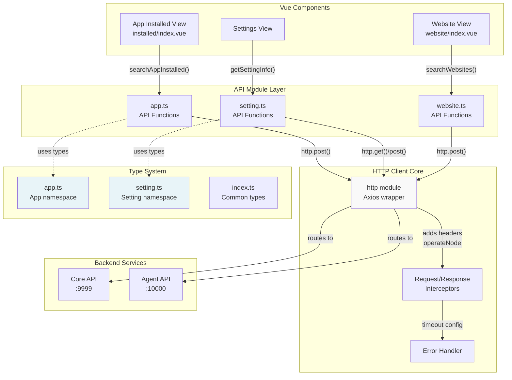
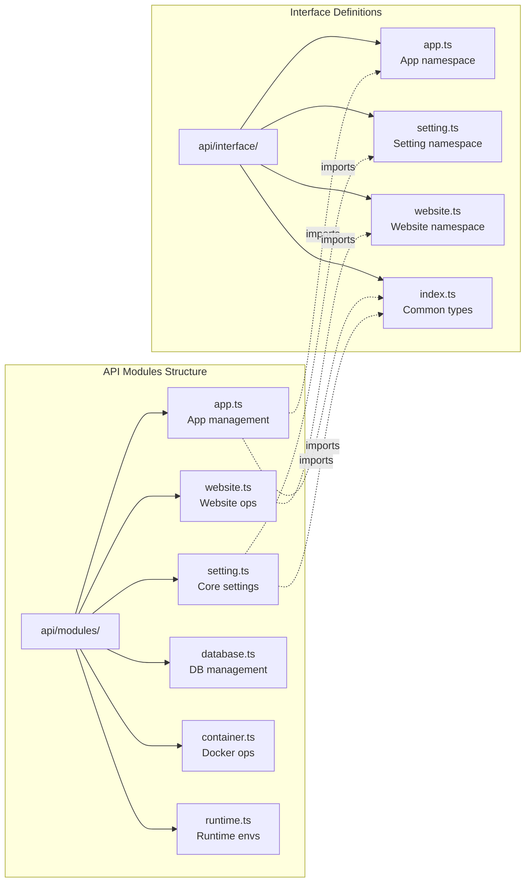
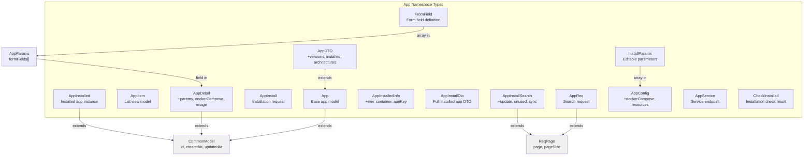
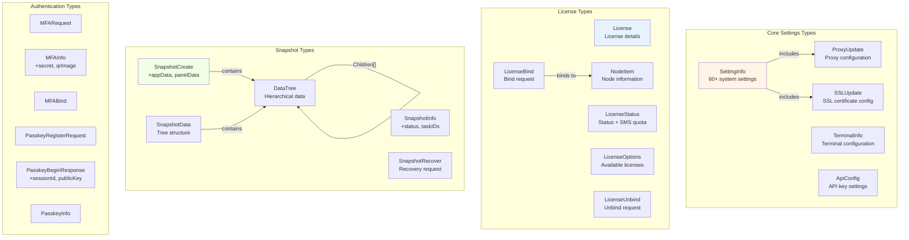
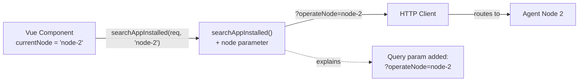
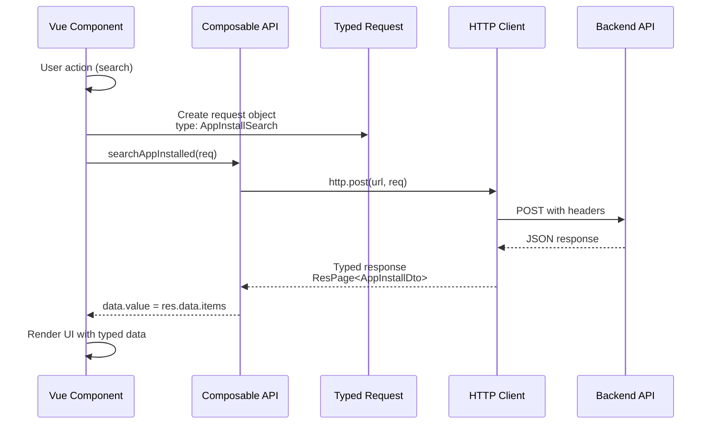
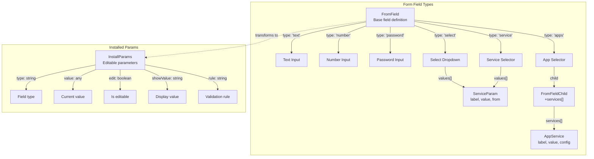
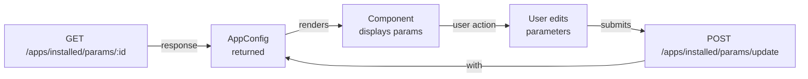

<!-- source: DeepWiki mcp.deepwiki.com · repo 1Panel-dev/1Panel · page 11.2 API Client Layer and Type System · fetched 2026-10-29 -->

# API Client Layer and Type System

<details>
<summary>Relevant source files</summary>

The following files were used as context for generating this wiki page:

- [frontend/src/api/interface/app.ts](frontend/src/api/interface/app.ts)
- [frontend/src/api/interface/setting.ts](frontend/src/api/interface/setting.ts)
- [frontend/src/api/modules/app.ts](frontend/src/api/modules/app.ts)
- [frontend/src/api/modules/setting.ts](frontend/src/api/modules/setting.ts)
- [frontend/src/components/app-status/index.vue](frontend/src/components/app-status/index.vue)
- [frontend/src/global/form-rules.ts](frontend/src/global/form-rules.ts)
- [frontend/src/styles/common.scss](frontend/src/styles/common.scss)
- [frontend/src/views/app-store/apps/index.vue](frontend/src/views/app-store/apps/index.vue)
- [frontend/src/views/app-store/detail/index.vue](frontend/src/views/app-store/detail/index.vue)
- [frontend/src/views/app-store/detail/install/index.vue](frontend/src/views/app-store/detail/install/index.vue)
- [frontend/src/views/app-store/detail/params/index.vue](frontend/src/views/app-store/detail/params/index.vue)
- [frontend/src/views/app-store/installed/detail/index.vue](frontend/src/views/app-store/installed/detail/index.vue)
- [frontend/src/views/app-store/installed/index.vue](frontend/src/views/app-store/installed/index.vue)
- [frontend/src/views/app-store/installed/upgrade/index.vue](frontend/src/views/app-store/installed/upgrade/index.vue)
- [frontend/src/views/website/website/create/index.vue](frontend/src/views/website/website/create/index.vue)
- [frontend/src/views/website/website/index.vue](frontend/src/views/website/website/index.vue)

</details>


## Purpose and Scope

This document describes the frontend API client layer architecture and TypeScript type system in 1Panel. It covers the organization of API modules, type definitions, request/response patterns, and how components interact with backend services. For information about backend service architecture, see [2.3](#2.3). For frontend form validation, see [11.3](#11.3).

The API client layer provides:
- Type-safe HTTP communication with Core and Agent servers
- Centralized request/response handling
- Strongly-typed interfaces for all data models
- Multi-node routing support
- Timeout management for long-running operations
- Security patterns for sensitive data transmission

---

## API Client Architecture Overview



**Sources**: [frontend/src/api/modules/app.ts:1-143](), [frontend/src/api/modules/setting.ts:1-223](), [frontend/src/api/interface/app.ts:1-365](), [frontend/src/api/interface/setting.ts:1-313]()

---

## API Module Organization

API functions are organized by domain into separate modules under `frontend/src/api/modules/`. Each module exports functions that wrap HTTP calls and use typed interfaces.



**Sources**: [frontend/src/api/modules/app.ts:1-5](), [frontend/src/api/modules/setting.ts:1-8](), [frontend/src/api/interface/app.ts:1-365](), [frontend/src/api/interface/setting.ts:1-313]()

---

## TypeScript Namespace Organization

All API-related types are organized into namespaces that correspond to their domain. This provides clean separation and prevents naming conflicts.

### Common Types

```typescript
// Defined in api/interface/index.ts
interface ReqPage {
    page: number;
    pageSize: number;
}

interface ResPage<T> {
    items: T[];
    total: number;
}

interface CommonModel {
    id: number;
    createdAt: string;
    updatedAt: string;
}
```

### Domain-Specific Namespaces

| Namespace | File | Purpose |
|-----------|------|---------|
| `App` | `api/interface/app.ts` | App store, installations, parameters |
| `Setting` | `api/interface/setting.ts` | System settings, licenses, snapshots |
| `Website` | `api/interface/website.ts` | Websites, domains, SSL certificates |
| `Container` | `api/interface/container.ts` | Docker containers, images, networks |
| `Database` | `api/interface/database.ts` | MySQL, PostgreSQL, Redis management |
| `Runtime` | `api/interface/runtime.ts` | PHP, Node.js, Python environments |

**Sources**: [frontend/src/api/interface/app.ts:1-4](), [frontend/src/api/interface/setting.ts:1-2]()

---

## App Namespace Type Hierarchy



**Sources**: [frontend/src/api/interface/app.ts:3-365]()

---

## API Function Patterns

### Basic GET Request

```typescript
// Simple GET with path parameter
export const getAppByKey = (key: string, node?: string) => {
    const params = node ? `?operateNode=${node}` : '';
    return http.get<App.AppDTO>('apps/' + key + `${params}`);
};
```

**Sources**: [frontend/src/api/modules/app.ts:18-21]()

### POST with Request Body

```typescript
// POST with typed request and response
export const searchApp = (req: App.AppReq) => {
    return http.post<App.AppResPage>('apps/search', req);
};

// POST with pagination
export const searchAppInstalled = (search: App.AppInstallSearch, node?: string) => {
    const params = node ? `?operateNode=${node}` : '';
    return http.post<ResPage<App.AppInstallDto>>(`apps/installed/search${params}`, search);
};
```

**Sources**: [frontend/src/api/modules/app.ts:14-16](), [frontend/src/api/modules/app.ts:44-47]()

### Operations with Timeout

```typescript
// Long-running operation with custom timeout
export const installedOp = (op: App.AppInstalledOp, node?: string) => {
    const params = node ? `?operateNode=${node}` : '';
    return http.post<any>(`apps/installed/op${params}`, op, TimeoutEnum.T_40S);
};
```

**Sources**: [frontend/src/api/modules/app.ts:79-82]()

### Multi-Parameter Queries

```typescript
// Complex query with multiple path parameters
export const getAppDetail = (appID: number, version: string, type: string, node?: string) => {
    const params = node ? `?operateNode=${node}` : '';
    return http.get<App.AppDetail>(`apps/detail/${appID}/${version}/${type}${params}`);
};
```

**Sources**: [frontend/src/api/modules/app.ts:27-30]()

---

## Request/Response Type Patterns

### Search Request Pattern

All paginated search operations follow a consistent pattern:

```typescript
// Request extends ReqPage
interface AppInstallSearch extends ReqPage {
    name?: string;
    tags?: string[];
    update?: boolean;
    unused?: boolean;
    sync?: boolean;
}

// Response wraps items in ResPage
interface AppResPage {
    total: number;
    items: AppItem[];
}
```

**Sources**: [frontend/src/api/interface/app.ts:140-146](), [frontend/src/api/interface/app.ts:62-65]()

### Operation Request Pattern

```typescript
interface AppInstalledOp {
    installId: number;
    operate: string;
    backupId?: number;
    detailId?: number;
    forceDelete?: boolean;
    deleteBackup?: boolean;
    deleteImage?: boolean;
    taskID?: string;
}
```

**Sources**: [frontend/src/api/interface/app.ts:250-260]()

### Nested Form Field Pattern

```typescript
interface FromField {
    type: string;
    labelZh: string;
    labelEn: string;
    required: boolean;
    default: any;
    envKey: string;
    key?: string;
    values?: ServiceParam[];
    child?: FromFieldChild;
    params?: FromParam[];
    multiple?: boolean;
    allowCreate?: boolean;
    label: Locale;
    description: Locale;
}

interface FromFieldChild extends FromField {
    services: App.AppService[];
}
```

**Sources**: [frontend/src/api/interface/app.ts:99-118]()

---

## Setting Namespace Type System



**Sources**: [frontend/src/api/interface/setting.ts:3-312]()

---

## Multi-Node Routing Pattern

API functions support routing requests to specific agent nodes using the `operateNode` query parameter. This enables centralized management of distributed nodes.



### Implementation Pattern

```typescript
// API function accepts optional node parameter
export const searchAppInstalled = (search: App.AppInstallSearch, node?: string) => {
    const params = node ? `?operateNode=${node}` : '';
    return http.post<ResPage<App.AppInstallDto>>(`apps/installed/search${params}`, search);
};

// Component passes currentNode
const { currentNode } = useGlobalStore();
const search = async () => {
    const res = await searchAppInstalled(searchReq, currentNode.value);
    // ...
};
```

**Sources**: [frontend/src/api/modules/app.ts:44-47](), [frontend/src/views/app-store/installed/index.vue:146]()

---

## Timeout Management

The API client uses `TimeoutEnum` for operations that require extended timeout periods:

| Timeout Value | Duration | Use Case |
|---------------|----------|----------|
| `T_40S` | 40 seconds | App operations (start/stop/restart) |
| `T_60S` | 60 seconds | License binding, app store sync |
| Default | - | Standard CRUD operations |

### Usage in API Functions

```typescript
// Standard timeout (default)
export const searchApp = (req: App.AppReq) => {
    return http.post<App.AppResPage>('apps/search', req);
};

// Extended timeout for long operations
export const installedOp = (op: App.AppInstalledOp, node?: string) => {
    const params = node ? `?operateNode=${node}` : '';
    return http.post<any>(`apps/installed/op${params}`, op, TimeoutEnum.T_40S);
};

// 60-second timeout for license operations
export const bindLicense = (params: Setting.LicenseBind) => {
    return http.post(`/core/licenses/bind`, params, TimeoutEnum.T_60S);
};
```

**Sources**: [frontend/src/api/modules/app.ts:79-82](), [frontend/src/api/modules/setting.ts:31-33](), [frontend/src/api/modules/app.ts:4](), [frontend/src/api/modules/setting.ts:6]()

---

## Security Patterns in API Layer

### Base64 Encoding for Sensitive Data

Proxy passwords are Base64-encoded before transmission:

```typescript
export const updateProxy = (params: Setting.ProxyUpdate) => {
    let request = deepCopy(params) as Setting.ProxyUpdate;
    if (request.proxyPasswd) {
        request.proxyPasswd = Base64.encode(request.proxyPasswd);
    }
    request.proxyType = request.proxyType === 'close' ? '' : request.proxyType;
    return http.post(`/core/settings/proxy/update`, request);
};
```

**Sources**: [frontend/src/api/modules/setting.ts:107-114]()

### File Upload with FormData

```typescript
export const uploadLicense = (oldLicense: string, params: FormData) => {
    if (oldLicense === '') {
        return http.upload('/core/licenses/upload', params);
    }
    return http.upload('/core/licenses/update', params);
};
```

**Sources**: [frontend/src/api/modules/setting.ts:10-15]()

### Custom Headers for Authentication

```typescript
export const passkeyRegisterFinish = (param: Record<string, any>, sessionId: string) => {
    return http.post(`/core/settings/passkey/register/finish`, param, undefined, { 'Passkey-Session': sessionId });
};
```

**Sources**: [frontend/src/api/modules/setting.ts:148-150]()

---

## Component-to-API Integration Pattern



### Example: Installed Apps Search

```typescript
// 1. Define reactive request (in component)
const searchReq = reactive<App.AppInstallSearch>({
    page: 1,
    pageSize: 20,
    name: '',
    tags: [],
    update: false,
    sync: false,
});

// 2. Call typed API function
const search = async () => {
    searchReq.page = paginationConfig.currentPage;
    searchReq.pageSize = paginationConfig.pageSize;
    
    const res = await searchAppInstalled(searchReq);
    data.value = res.data.items;  // Typed as AppInstallDto[]
    paginationConfig.total = res.data.total;
};

// 3. TypeScript ensures type safety
data.value.forEach((app: App.AppInstallDto) => {
    console.log(app.name);      // Valid
    console.log(app.version);   // Valid
    console.log(app.unknown);   // TypeScript error
});
```

**Sources**: [frontend/src/views/app-store/installed/index.vue:175-182](), [frontend/src/views/app-store/installed/index.vue:202-211]()

---

## Icon URL Generation Pattern

Some resources require special URL generation for assets:

```typescript
export function getAppIconUrl(appKey: string, node?: string): string {
    const baseURL = import.meta.env.VITE_API_URL as string;
    const params = node ? `?operateNode=${node}` : '';
    return `${baseURL}/apps/icon/${appKey}${params}`;
}

// Usage in component

```

**Sources**: [frontend/src/api/modules/app.ts:134-138](), [frontend/src/views/app-store/detail/index.vue:8]()

---

## Form Parameter Type System

Form parameters use a flexible type system to handle dynamic app configurations:



**Sources**: [frontend/src/api/interface/app.ts:99-131](), [frontend/src/api/interface/app.ts:280-294]()

---

## Validation Rule Integration

The type system integrates with form validation rules defined in `frontend/src/global/form-rules.ts`:

```typescript
// In InstallParams interface
interface InstallParams {
    labelZh: string;
    labelEn: string;
    value: any;
    edit: boolean;
    key: string;
    rule: string;  // References rule name from form-rules.ts
    type: string;
    values?: any;
    showValue?: string;
    required?: boolean;
    multiple?: boolean;
    label: Locale;
    showPassword: boolean;
}

// Usage in component
if (param.required) {
    rules.params[param.key] = [Rules.requiredInput];
    if (param.rule && param.rule != '') {
        rules.params[param.key].push(Rules[param.rule]);  // e.g., Rules.dbName
    }
}
```

**Sources**: [frontend/src/api/interface/app.ts:280-294](), [frontend/src/views/app-store/installed/detail/index.vue:344-351]()

---

## AppConfig Type for Parameter Management

The `AppConfig` type represents the complete configuration of an installed app:

```typescript
interface AppConfig {
    params: InstallParams[];       // User-editable parameters
    rawCompose?: string;           // Original docker-compose.yml
    cpuQuota: number;              // CPU limit in cores
    memoryLimit: number;           // Memory limit
    memoryUnit: string;            // 'MB' or 'GB'
    containerName: string;         // Custom container name
    allowPort: boolean;            // Expose ports to host
    dockerCompose: string;         // Current docker-compose.yml
    hostMode?: boolean;            // Host network mode
    type: string;                  // App type
    webUI: string;                 // Web UI access URL
    specifyIP: string;             // IP binding
    restartPolicy: string;         // Container restart policy
}
```

### Usage Flow



**Sources**: [frontend/src/api/interface/app.ts:296-310](), [frontend/src/api/modules/app.ts:102-108]()

---

## Pagination Configuration Pattern

All paginated views use consistent pagination configuration:

```typescript
const paginationConfig = reactive({
    cacheSizeKey: 'app-installed-page-size',
    currentPage: 1,
    pageSize: Number(localStorage.getItem('app-installed-page-size')) || 20,
    total: 0,
});

// Request includes pagination
const req = reactive<App.AppReq>({
    name: '',
    tags: [],
    page: 1,
    pageSize: 60,
    resource: 'all',
    showCurrentArch: false,
});

// API call
req.page = paginationConfig.currentPage;
req.pageSize = paginationConfig.pageSize;
const res = await searchApp(req);
paginationConfig.total = res.data.total;
```

**Sources**: [frontend/src/views/app-store/installed/index.vue:152-157](), [frontend/src/views/app-store/apps/index.vue:101-109]()

---

## Type Safety in Component Operations

Components leverage TypeScript types to ensure safe operations:

```typescript
// Operation request with typed parameters
const operateReq = reactive<App.AppInstalledOp>({
    installId: 0,
    operate: '',
    detailId: 0,
    favorite: false,
});

// Type-safe operation calls
const openOperate = (row: App.AppInstalled, op: string) => {
    operateReq.installId = row.id;
    operateReq.operate = op;
    if (op == 'upgrade') {
        upgradeRef.value.acceptParams(row, op);
    } else if (op == 'delete') {
        appInstalledDeleteCheck(row.id).then(async (res) => {
            // TypeScript knows res.data is AppInstallResource[]
            const items = res.data;
            if (res.data && res.data.length > 0) {
                checkRef.value.acceptParams({ 
                    items: items, 
                    key: row.appKey, 
                    installID: row.id 
                });
            }
        });
    }
};
```

**Sources**: [frontend/src/views/app-store/installed/index.vue:159-164](), [frontend/src/views/app-store/installed/index.vue:229-246]()

---

## Summary

The 1Panel frontend API client layer provides:

1. **Modular Organization**: Domain-specific API modules (`app.ts`, `setting.ts`, etc.) with corresponding type namespaces
2. **Strong Type Safety**: TypeScript interfaces for all requests, responses, and data models
3. **Consistent Patterns**: Standardized pagination, search, and operation patterns across all modules
4. **Multi-Node Support**: Built-in routing to different agent nodes via `operateNode` parameter
5. **Timeout Management**: Configurable timeouts for long-running operations via `TimeoutEnum`
6. **Security**: Base64 encoding, custom headers, and FormData for sensitive operations
7. **Integration**: Seamless connection between Vue components and backend APIs with full type inference

This architecture ensures maintainability, type safety, and consistent behavior across the entire frontend codebase.

---

