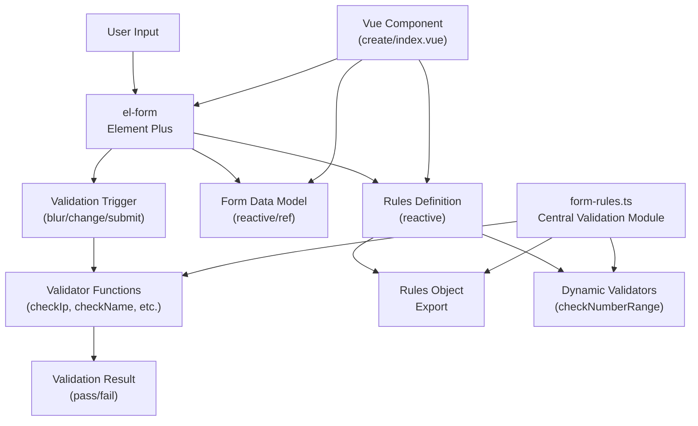
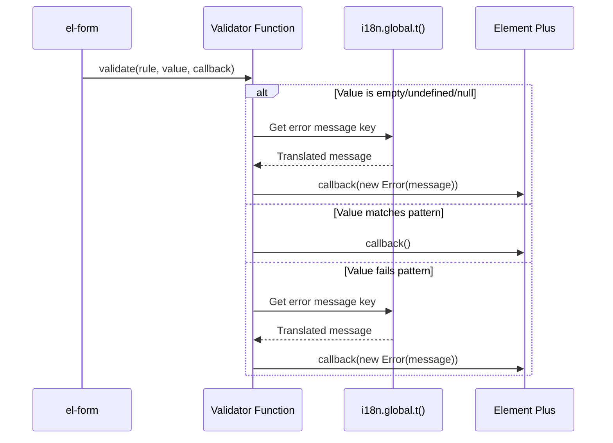
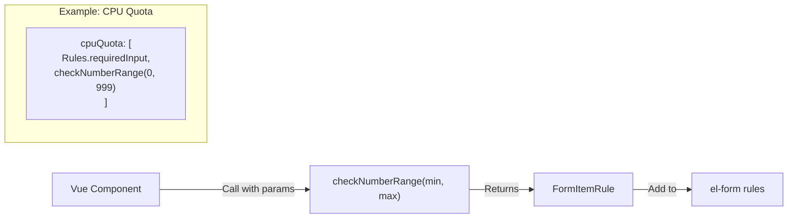
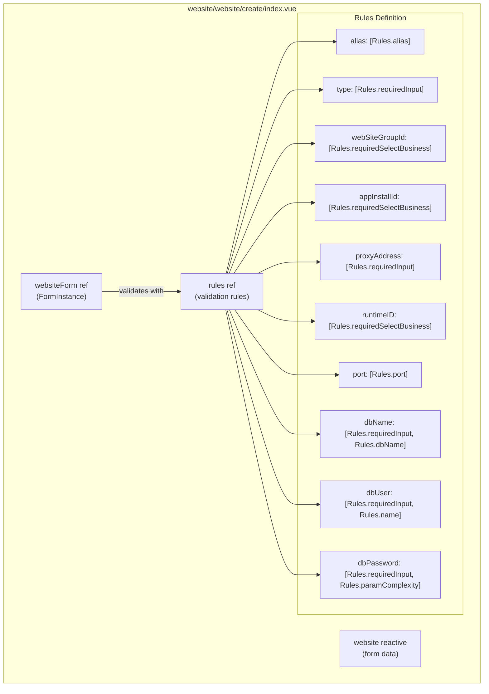
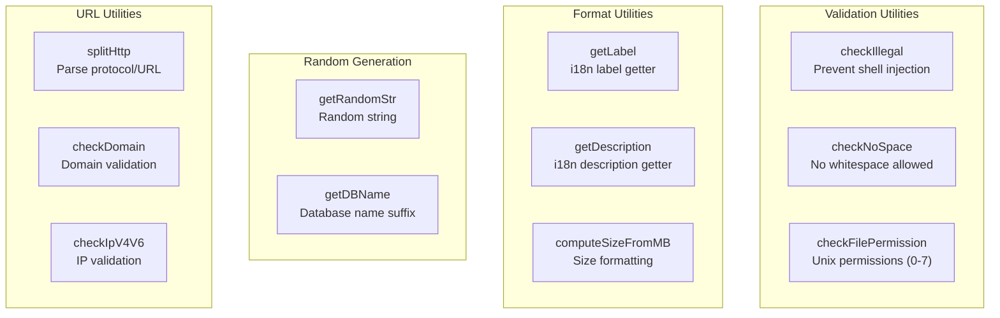

<!-- source: DeepWiki mcp.deepwiki.com · repo 1Panel-dev/1Panel · page 11.3 Form Validation and Utilities · fetched 2026-10-29 -->

# Form Validation and Utilities

<details>
<summary>Relevant source files</summary>

The following files were used as context for generating this wiki page:

- [agent/go.mod](agent/go.mod)
- [agent/go.sum](agent/go.sum)
- [agent/utils/ssl/dns_provider.go](agent/utils/ssl/dns_provider.go)
- [core/go.mod](core/go.mod)
- [core/go.sum](core/go.sum)
- [frontend/src/api/interface/app.ts](frontend/src/api/interface/app.ts)
- [frontend/src/api/modules/app.ts](frontend/src/api/modules/app.ts)
- [frontend/src/components/app-status/index.vue](frontend/src/components/app-status/index.vue)
- [frontend/src/global/form-rules.ts](frontend/src/global/form-rules.ts)
- [frontend/src/global/mimetype.ts](frontend/src/global/mimetype.ts)
- [frontend/src/styles/common.scss](frontend/src/styles/common.scss)
- [frontend/src/views/app-store/apps/index.vue](frontend/src/views/app-store/apps/index.vue)
- [frontend/src/views/app-store/detail/index.vue](frontend/src/views/app-store/detail/index.vue)
- [frontend/src/views/app-store/detail/install/index.vue](frontend/src/views/app-store/detail/install/index.vue)
- [frontend/src/views/app-store/detail/params/index.vue](frontend/src/views/app-store/detail/params/index.vue)
- [frontend/src/views/app-store/installed/detail/index.vue](frontend/src/views/app-store/installed/detail/index.vue)
- [frontend/src/views/app-store/installed/index.vue](frontend/src/views/app-store/installed/index.vue)
- [frontend/src/views/app-store/installed/upgrade/index.vue](frontend/src/views/app-store/installed/upgrade/index.vue)
- [frontend/src/views/website/ssl/dns-account/create/index.vue](frontend/src/views/website/ssl/dns-account/create/index.vue)
- [frontend/src/views/website/website/create/index.vue](frontend/src/views/website/website/create/index.vue)
- [frontend/src/views/website/website/index.vue](frontend/src/views/website/website/index.vue)

</details>


This page documents the centralized form validation system and utility functions used throughout the 1Panel frontend. The system provides reusable validators, custom rules, and helper utilities that ensure consistent data validation across all forms in the application.

For information about API client type validation, see [API Client Layer and Type System](#11.2). For component-level patterns, see [Component Architecture and Patterns](#11.1).

---

## Purpose and Architecture

The form validation system centralizes all validation logic in a single module (`frontend/src/global/form-rules.ts`) that exports:

1. **Validator Functions**: Asynchronous callbacks conforming to Element Plus validation API
2. **Rules Object**: Pre-configured FormItemRule instances ready for use in forms
3. **Dynamic Validators**: Factory functions that generate rules with parameters
4. **Utility Functions**: Common helpers for validation and data manipulation

This architecture ensures consistent validation behavior, reduces code duplication, and provides a single source of truth for all validation rules.

**Validation Flow Overview**



Sources: [frontend/src/global/form-rules.ts:1-800](), [frontend/src/views/website/website/create/index.vue:519-548]()

---

## Core Validation Rules Module

The `form-rules.ts` module serves as the foundation of the validation system. It exports a centralized `Rules` object containing all standard validation rules.

**Rules Object Structure**

```mermaid
graph LR
    subgraph "form-rules.ts Export"
        RulesObj["Rules Object"]
        
        subgraph "Common Validators"
            RequiredInput["requiredInput"]
            RequiredSelect["requiredSelect"]
            RequiredSelectBusiness["requiredSelectBusiness"]
        end
        
        subgraph "String Pattern Validators"
            Name["name"]
            SimpleName["simpleName"]
            SimplePassword["simplePassword"]
            ParamComplexity["paramComplexity"]
            Alias["alias"]
        end
        
        subgraph "Network Validators"
            IP["ip"]
            IPV4["ipV4"]
            IPV6["ipV6"]
            Domain["domain"]
            DomainWithPort["domainWithPort"]
            Port["port"]
        end
        
        subgraph "Special Format Validators"
            DBName["dbName"]
            AppName["appName"]
            ContainerName["containerName"]
            ImageName["imageName"]
            VolumeName["volumeName"]
        end
        
        RulesObj --> RequiredInput
        RulesObj --> RequiredSelect
        RulesObj --> RequiredSelectBusiness
        RulesObj --> Name
        RulesObj --> SimpleName
        RulesObj --> SimplePassword
        RulesObj --> ParamComplexity
        RulesObj --> Alias
        RulesObj --> IP
        RulesObj --> IPV4
        RulesObj --> IPV6
        RulesObj --> Domain
        RulesObj --> DomainWithPort
        RulesObj --> Port
        RulesObj --> DBName
        RulesObj --> AppName
        RulesObj --> ContainerName
        RulesObj --> ImageName
        RulesObj --> VolumeName
    end
```



Sources: [frontend/src/global/form-rules.ts:576-650]()

### Rules Object Definition

The `Rules` object at [frontend/src/global/form-rules.ts:576-650]() contains pre-configured FormItemRule instances:

| Rule Name | Purpose | Validator Function | Trigger |
|-----------|---------|-------------------|---------|
| `requiredInput` | Required text input | None (uses Element Plus required) | blur |
| `requiredSelect` | Required dropdown selection | None | change |
| `requiredSelectBusiness` | Required business selection | None | change |
| `name` | Common name pattern | `checkName` | blur |
| `userName` | Username pattern | `checkUserName` | blur |
| `simpleName` | Simple alphanumeric name | `checkSimpleName` | blur |
| `simplePassword` | Simple password pattern | `checkSimplePassword` | blur |
| `authBasicPassword` | HTTP basic auth password | `checkAuthBasicPassword` | blur |
| `ip` | IPv4 address (required) | `checkIp` | blur |
| `ipV4` | IPv4 address (optional) | `checkIpv4` | blur |
| `ipV6` | IPv6 address | `checkIpV6` | blur |
| `domain` | Domain name | `checkDomain` | blur |
| `domainWithPort` | Domain with optional port | `checkDomainWithPort` | blur |
| `port` | Port number (1-65535) | `checkPort` | blur |
| `dbName` | Database name | `checkDBName` | blur |
| `appName` | Application name | `checkAppName` | blur |
| `containerName` | Docker container name | `checkContainerName` | blur |
| `imageName` | Docker image name | `checkImageName` | blur |
| `volumeName` | Docker volume name | `checkVolumeName` | blur |
| `alias` | File/resource alias | `checkAlias` | blur |
| `paramComplexity` | Complex parameter | `checkParamComplexity` | blur |

Sources: [frontend/src/global/form-rules.ts:576-650]()

---

## Validator Functions

Each validator function follows the Element Plus validation callback pattern: `(rule: any, value: any, callback: any) => void`.

**Validation Function Pattern**



Sources: [frontend/src/global/form-rules.ts:4-575]()

### Common Validator Patterns

#### Empty Value Check

Most validators start by checking for empty, undefined, or null values:

```typescript
if (value === '' || typeof value === 'undefined' || value == null) {
    callback(new Error(i18n.global.t('commons.rule.requiredInput')));
}
```

Sources: [frontend/src/global/form-rules.ts:11-13]()

#### Pattern Matching

Validators use regex patterns to validate format:

```typescript
const reg = /^[a-zA-Z0-9]{1}[a-zA-Z0-9_]{2,29}$/;
if (!reg.test(value) && value !== '') {
    callback(new Error(i18n.global.t('commons.rule.simpleName')));
} else {
    callback();
}
```

Sources: [frontend/src/global/form-rules.ts:193-196]()

### Key Validator Functions

**IP Address Validators**

| Validator | Pattern | Example Valid Input |
|-----------|---------|-------------------|
| `checkIp` | IPv4 with required | `192.168.1.1` |
| `checkIpv4` | IPv4 optional | `10.0.0.1` or empty |
| `checkIpV6` | IPv6 | `2001:db8::1` |
| `checkIpV4V6OrDomain` | IPv4/IPv6/domain | `example.com`, `192.168.1.1`, `::1` |
| `checkDomainOrIP` | Domain or IP | `example.com`, `192.168.1.1` |

Sources: [frontend/src/global/form-rules.ts:11-110]()

**Name Pattern Validators**

| Validator | Pattern | Allowed Characters | Max Length |
|-----------|---------|-------------------|-----------|
| `checkName` | Common name | `a-zA-Z0-9_.-` + Chinese | 128 |
| `checkUserName` | Username | `a-zA-Z0-9_` + Chinese | 30 |
| `checkSimpleName` | Simple name | `a-zA-Z0-9_` | 30 |
| `checkDBName` | Database name | `a-zA-Z0-9_.-` + Chinese | 64 |
| `checkAppName` | App name | `a-zA-Z0-9_-` (no start/end with `-_`) | 30 |
| `checkAlias` | Alias | `A-Za-z0-9._-` (no start/end with `-_`) | 128 |
| `checkLinuxName` | Linux filename | Any except `/\:*?"'()<>\|` | 128 |

Sources: [frontend/src/global/form-rules.ts:163-343]()

**Password and Security Validators**

| Validator | Purpose | Pattern |
|-----------|---------|---------|
| `checkSimplePassword` | Basic password | `a-zA-Z0-9_`, 1-30 chars |
| `checkAuthBasicPassword` | HTTP Basic Auth | `a-zA-Z0-9_\-\.@$!%*?&`, 1-72 chars |
| `complexityPassword` | Complex password | Must have 2+ char types, 8-30 chars |
| `checkParamComplexity` | Parameter password | `a-zA-Z0-9.%@!~_-`, 6-128 chars |

Sources: [frontend/src/global/form-rules.ts:150-436]()

**Container/Docker Validators**

| Validator | Purpose | Pattern |
|-----------|---------|---------|
| `checkContainerName` | Container name | `a-zA-Z0-9_.-`, 2-128 chars |
| `checkComposeName` | Compose project | `a-z0-9_-`, 1-256 chars |
| `checkImageName` | Image name | `a-zA-Z0-9:@_/.-`, 1-256 chars |
| `checkVolumeName` | Volume name | `a-zA-Z0-9_.-`, 2-31 chars |

Sources: [frontend/src/global/form-rules.ts:241-278]()

---

## Dynamic Validators

Dynamic validators are factory functions that generate validation rules with custom parameters.

**Dynamic Validator Usage**



Sources: [frontend/src/global/form-rules.ts:478-507](), [frontend/src/views/app-store/installed/detail/index.vue:219-220]()

### checkNumberRange

Validates numeric input within a range:

```typescript
export function checkNumberRange(min: number, max: number): FormItemRule {
    return {
        required: false,
        trigger: 'blur',
        min: min,
        max: max,
        type: 'number',
        message: i18n.global.t('commons.rule.numberRange', [min, max]),
    };
}
```

**Usage Examples:**

| Context | Rule | Range |
|---------|------|-------|
| CPU Quota | `checkNumberRange(0, 999)` | 0-999 cores |
| Memory Limit | `checkNumberRange(0, 9999999999)` | 0-9999999999 MB |
| Port (internal) | `checkNumberRange(1, 65535)` | Valid port range |

Sources: [frontend/src/global/form-rules.ts:478-487](), [frontend/src/views/app-store/installed/detail/index.vue:219-220]()

### checkFloatNumberRange

Validates float numbers within a range:

```typescript
export function checkFloatNumberRange(min: number, max: number): FormItemRule {
    let validatorFunc = function (rule: any, value: any, callback: any) {
        if (value === '' || typeof value === 'undefined' || value == null) {
            callback(new Error(i18n.global.t('commons.rule.disableFunction')));
        } else {
            if ((Number(value) < min || Number(value) > max) && value !== '') {
                callback(new Error(i18n.global.t('commons.rule.disableFunction')));
            } else {
                callback();
            }
        }
    };
    return {
        required: false,
        trigger: 'blur',
        validator: validatorFunc,
        message: i18n.global.t('commons.rule.numberRange', [min, max]),
    };
}
```

Sources: [frontend/src/global/form-rules.ts:489-507]()

---

## Form Validation in Practice

This section demonstrates how validation rules are applied in real Vue components.

**Website Creation Form Example**



Sources: [frontend/src/views/website/website/create/index.vue:519-548]()

### Validation Rule Composition

Forms typically compose multiple rules for a single field:

```typescript
// Single rule
alias: [Rules.alias],

// Multiple rules for one field
dbName: [Rules.requiredInput, Rules.dbName],
dbUser: [Rules.requiredInput, Rules.name],
dbPassword: [Rules.requiredInput, Rules.paramComplexity],

// Dynamic rule with static rule
cpuQuota: [Rules.requiredInput, checkNumberRange(0, 999)],
memoryLimit: [Rules.requiredInput, checkNumberRange(0, 9999999999)],
```

Sources: [frontend/src/views/website/website/create/index.vue:520-548](), [frontend/src/views/app-store/installed/detail/index.vue:217-221]()

### Nested Form Validation

For complex forms with nested objects (like app installation), rules can be nested:

```typescript
rules = {
    alias: [Rules.alias],
    type: [Rules.requiredInput],
    appinstall: {
        name: [Rules.appName],
        appId: [Rules.requiredSelectBusiness],
        params: {},
        cpuQuota: [Rules.requiredInput, checkNumberRange(0, 99999)],
        memoryLimit: [Rules.requiredInput, checkNumberRange(0, 9999999999)],
        containerName: [Rules.containerName],
    },
}
```

Sources: [frontend/src/views/website/website/create/index.vue:527-534]()

### Conditional Validation

Rules can be dynamically added/removed based on conditions:

```typescript
// Add rules conditionally
if (p.required) {
    if (p.type === 'service' || p.type === 'apps') {
        rules[p.envKey] = [Rules.requiredSelect];
        if (p.child) {
            p.childProp = propStart.value + p.child.envKey;
            if (p.child.type === 'service') {
                rules[p.child.envKey] = [Rules.requiredSelect];
            }
        }
    } else {
        rules[p.envKey] = [Rules.requiredInput];
    }
    if (p.rule && p.rule != '') {
        rules[p.envKey].push(Rules[p.rule]);
    }
} else {
    delete rules[p.envKey];
}
```

Sources: [frontend/src/views/app-store/detail/params/index.vue:227-244]()

---

## Utility Functions and Helpers

Beyond validation, the form system includes utility functions used across components.

**Utility Function Categories**



Sources: [frontend/src/global/form-rules.ts:127-572](), [frontend/src/utils/util.ts]()

### Security and Input Sanitization

**checkIllegal Validator**

Prevents shell injection by blocking dangerous characters:

```typescript
const checkIllegal = (rule: any, value: any, callback: any) => {
    if (value === '' || typeof value === 'undefined' || value == null) {
        callback(new Error(i18n.global.t('commons.rule.requiredInput')));
        return;
    }
    if (
        value.indexOf('&') !== -1 ||
        value.indexOf('|') !== -1 ||
        value.indexOf(';') !== -1 ||
        value.indexOf('$') !== -1 ||
        value.indexOf("'") !== -1 ||
        value.indexOf('`') !== -1 ||
        value.indexOf('(') !== -1 ||
        value.indexOf(')') !== -1 ||
        value.indexOf('>') !== -1 ||
        value.indexOf('<') !== -1
    ) {
        callback(new Error(i18n.global.t('commons.rule.illegalInput')));
    } else {
        callback();
    }
};
```

Blocked characters: `& | ; $ ' \` ( ) > <`

Sources: [frontend/src/global/form-rules.ts:127-148]()

### Form Helper Styling

The form system provides CSS classes for consistent styling:

| CSS Class | Purpose | Usage |
|-----------|---------|-------|
| `.input-help` | Help text below inputs | `<span class="input-help">...</span>` |
| `.input-error` | Error messages | `<span class="input-error">...</span>` |
| `.common-prompt` | Alert prompts in forms | `<el-alert class="common-prompt">` |
| `.form-button` | Right-aligned buttons | `<div class="form-button">` |

Sources: [frontend/src/styles/common.scss:79-98]()

**Help Text Styling:**

```scss
.input-help {
    font-size: 12px;
    word-break: keep-all;
    color: #adb0bc;
    width: 100%;
    display: inline-block;
    white-space: pre-line;
}
```

Sources: [frontend/src/styles/common.scss:79-86]()

---

## Common Validation Patterns

This section documents common patterns for implementing validation in different scenarios.

### Pattern 1: Simple Form with Basic Rules

**Structure:**
1. Import `Rules` from `@/global/form-rules`
2. Define reactive form model
3. Define reactive rules object
4. Bind to `el-form` with `ref` and `:rules`

**Example from App Installation:**

```typescript
import { Rules } from '@/global/form-rules';

const formData = ref({
    name: '',
    version: '',
    // ... other fields
});

const rules = reactive({
    name: [Rules.appName],
    version: [Rules.requiredSelect],
});
```

Sources: [frontend/src/views/app-store/detail/install/index.vue:42-62]()

### Pattern 2: Dynamic Rules Based on Form State

**Structure:**
1. Start with base rules
2. Conditionally add/modify rules in watchers or computed properties
3. Use `delete` to remove rules when not applicable

**Example from Website Creation:**

```typescript
const rules = ref<any>({
    alias: [Rules.alias],
    type: [Rules.requiredInput],
    // Base rules...
});

// Conditionally add nested rules
if (website.value.appType == 'new') {
    rules.value.appinstall = {
        name: [Rules.appName],
        appId: [Rules.requiredSelectBusiness],
        cpuQuota: [Rules.requiredInput, checkNumberRange(0, 99999)],
        memoryLimit: [Rules.requiredInput, checkNumberRange(0, 9999999999)],
    };
}
```

Sources: [frontend/src/views/website/website/create/index.vue:519-548]()

### Pattern 3: Nested Object Validation

For forms with nested data structures, use nested rule definitions:

```typescript
rules = {
    params: {
        [key1]: [Rules.requiredInput],
        [key2]: [Rules.port],
    },
    advanced: [],
    cpuQuota: [Rules.requiredInput, checkNumberRange(0, 999)],
    containerName: [Rules.containerName],
}
```

The `el-form-item` `prop` attribute should use dot notation: `prop="params.key1"`

Sources: [frontend/src/views/app-store/installed/detail/index.vue:217-223]()

### Pattern 4: Manual Validation Trigger

For programmatic validation (e.g., before API calls):

```typescript
const formRef = ref<FormInstance>();

const submit = async () => {
    if (!formRef.value) return;
    
    await formRef.value.validate((valid) => {
        if (!valid) {
            return;
        }
        // Proceed with submission
    });
};
```

Sources: [frontend/src/views/app-store/installed/detail/index.vue:380-416]()

### Pattern 5: Clear Validation on Dynamic Changes

When form fields change dynamically, clear previous validation errors:

```typescript
const changeType = (type: string) => {
    // Clear validation when switching types
    websiteForm.value?.clearValidate();
    
    // Update form state
    website.value.type = type;
};
```

Sources: [frontend/src/views/website/website/create/index.vue:616-639]()

---

## Validation Error Handling

### Error Message Internationalization

All validation error messages use the i18n system:

```typescript
callback(new Error(i18n.global.t('commons.rule.simpleName')));
callback(new Error(i18n.global.t('commons.rule.port')));
callback(new Error(i18n.global.t('commons.rule.ip')));
```

**Common Error Message Keys:**

| Key | Message Purpose |
|-----|-----------------|
| `commons.rule.requiredInput` | Field is required |
| `commons.rule.requiredSelect` | Selection is required |
| `commons.rule.simpleName` | Invalid name format |
| `commons.rule.port` | Invalid port number |
| `commons.rule.ip` | Invalid IP address |
| `commons.rule.domain` | Invalid domain name |
| `commons.rule.numberRange` | Number out of range |
| `commons.rule.illegalInput` | Contains illegal characters |

Sources: [frontend/src/global/form-rules.ts:1-800]()

### Displaying Validation Errors

Element Plus automatically displays validation errors below form fields when validation fails. Custom error display can be added:

```vue
<el-form-item :label="$t('app.name')" prop="name">
    <el-input v-model="form.name"></el-input>
    <span class="input-help">{{ $t('app.nameHelper') }}</span>
</el-form-item>
```

Sources: [frontend/src/views/website/website/create/index.vue:200-207]()

---

## Summary

**Key Takeaways:**

1. **Centralized Validation**: All validation logic resides in `frontend/src/global/form-rules.ts`
2. **Reusable Rules**: The `Rules` object provides 40+ pre-configured validators
3. **Type Safety**: Validators use TypeScript and Element Plus FormItemRule interface
4. **i18n Support**: All error messages are internationalized
5. **Composable**: Rules can be combined, nested, and generated dynamically
6. **Consistent Patterns**: Common validation scenarios follow established patterns

**File Reference Map:**

| Component | Purpose | Key Exports |
|-----------|---------|-------------|
| `form-rules.ts` | Core validation module | `Rules`, `checkNumberRange`, validator functions |
| `util.ts` | Utility functions | `getLabel`, `getDescription`, `getRandomStr` |
| `common.scss` | Form styling | `.input-help`, `.input-error`, `.form-button` |

Sources: [frontend/src/global/form-rules.ts:1-800](), [frontend/src/styles/common.scss:75-310]()