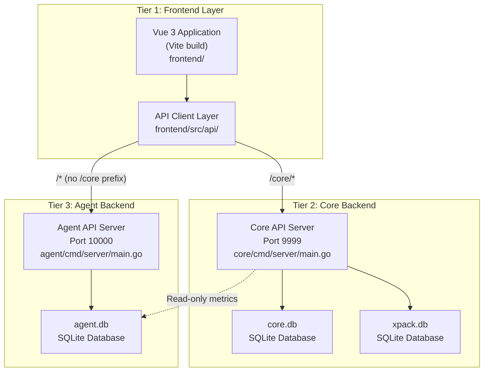
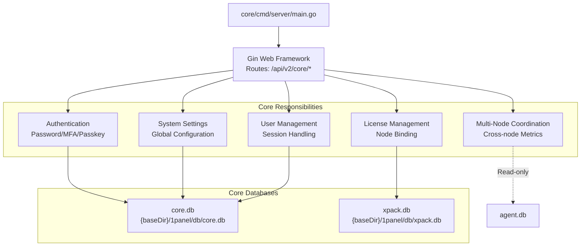
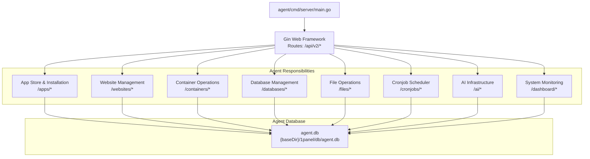
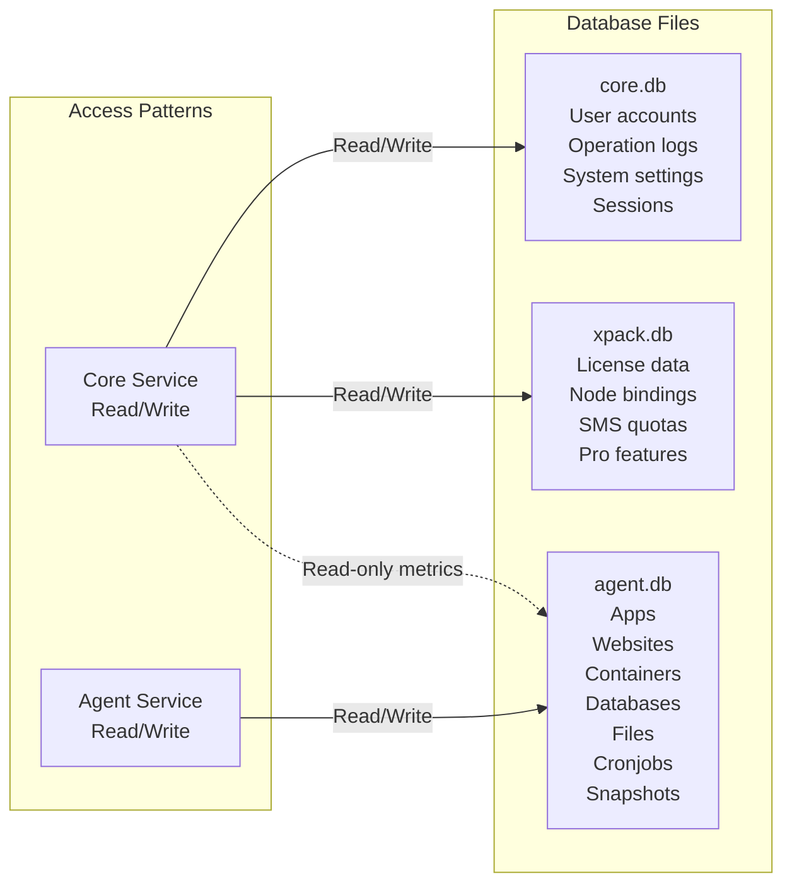
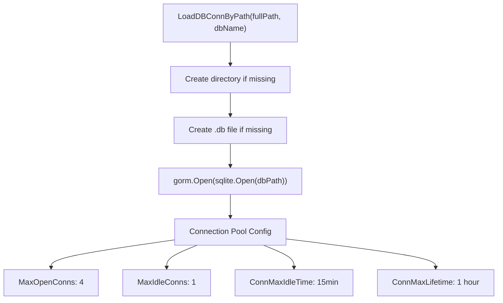
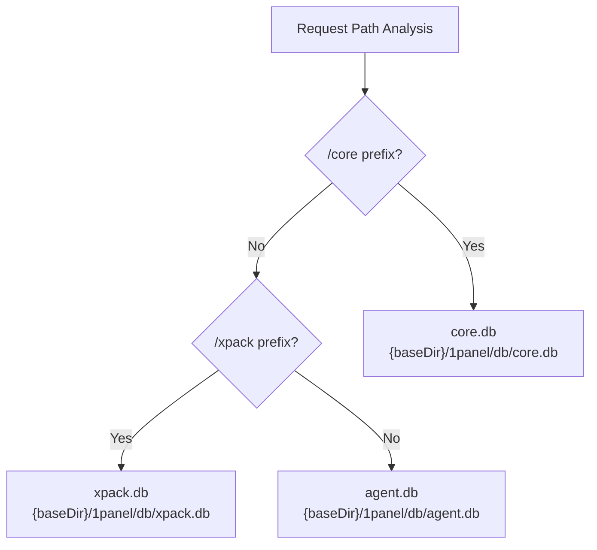
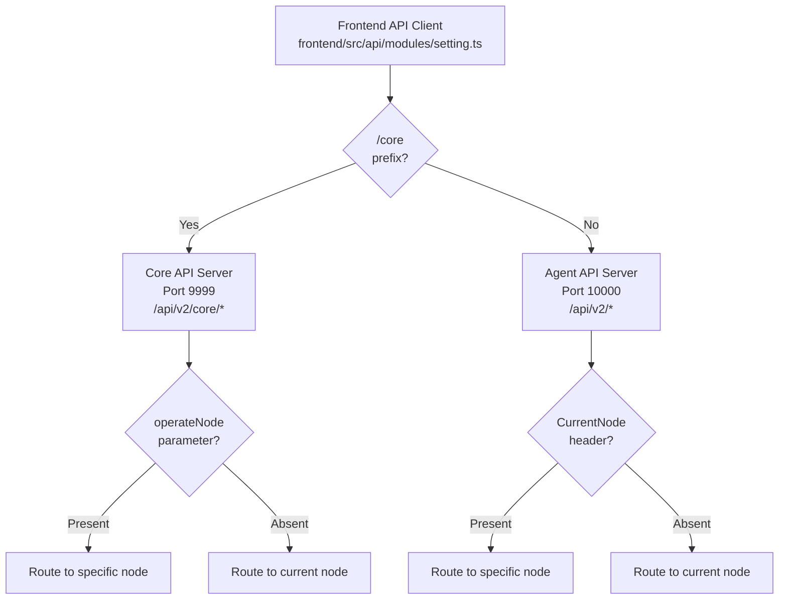
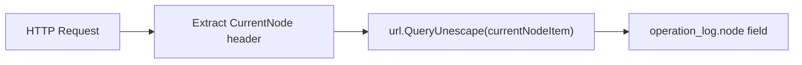
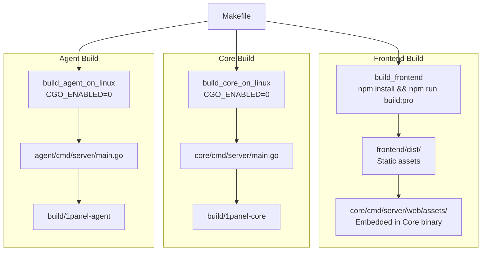
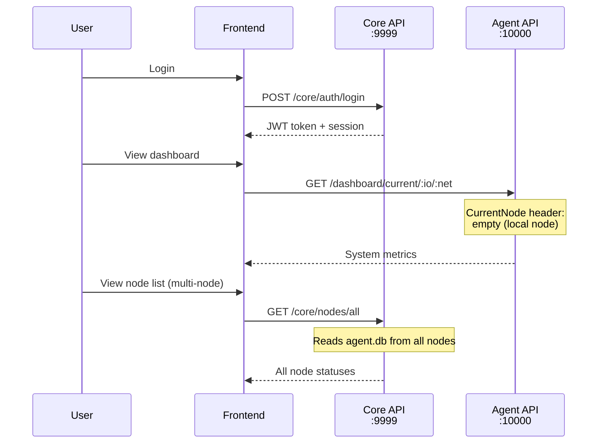

<!-- source: DeepWiki mcp.deepwiki.com · repo 1Panel-dev/1Panel · page 2.1 System Architecture Overview · fetched 2026-10-29 -->

# System Architecture Overview

<details>
<summary>Relevant source files</summary>

The following files were used as context for generating this wiki page:

- [Makefile](Makefile)
- [agent/utils/common/sqlite.go](agent/utils/common/sqlite.go)
- [core/middleware/operation.go](core/middleware/operation.go)
- [core/utils/common/sqlite.go](core/utils/common/sqlite.go)
- [frontend/src/api/interface/setting.ts](frontend/src/api/interface/setting.ts)
- [frontend/src/api/modules/setting.ts](frontend/src/api/modules/setting.ts)

</details>


## Purpose and Scope

This document describes the high-level architecture of 1Panel, focusing on the three-tier design pattern and the separation of concerns between the Core and Agent backend services. It explains how the frontend communicates with backend services, the database architecture, and request routing mechanisms.

For detailed information about multi-node distributed deployments, see [Multi-Node Architecture](#2.2). For authentication and security mechanisms, see [Authentication and Security](#3). For frontend-specific architecture patterns, see [Frontend Architecture](#2.4).

## Three-Tier Architecture

1Panel implements a classic three-tier architecture with clear separation between presentation, business logic, and infrastructure operations:



**Sources:** [Makefile:12-18](), [frontend/src/api/modules/setting.ts:10-45]()

### Layer Responsibilities

| Layer | Port | Main Entry Point | Responsibilities |
|-------|------|-----------------|------------------|
| **Frontend** | N/A (served by Core) | `frontend/src/main.ts` | UI rendering, user interaction, state management, API orchestration |
| **Core Backend** | 9999 | `core/cmd/server/main.go` | Authentication, authorization, licensing, system settings, user management, cross-node coordination |
| **Agent Backend** | 10000 | `agent/cmd/server/main.go` | Infrastructure operations: containers, websites, databases, files, cronjobs, AI services, monitoring |

**Sources:** [Makefile:12-18](), [frontend/src/api/modules/setting.ts:64-77]()

## Backend Service Split: Core vs Agent

The backend is intentionally split into two independent Go services with distinct responsibilities:

### Core Service Architecture



**Core API Endpoint Examples:**
- `/core/auth/login` - User authentication
- `/core/licenses/bind` - License binding to nodes
- `/core/settings/update` - System settings management
- `/core/settings/mfa` - Multi-factor authentication setup
- `/core/settings/passkey/register/begin` - WebAuthn passkey registration

**Sources:** [frontend/src/api/modules/setting.ts:10-46](), [core/middleware/operation.go:218-227]()

### Agent Service Architecture



**Agent API Endpoint Examples:**
- `/settings/basedir` - Base directory configuration
- `/settings/search` - Agent settings retrieval
- `/settings/snapshot/create` - System snapshot creation
- `/dashboard/current/:io/:net` - Real-time system metrics

**Sources:** [frontend/src/api/modules/setting.ts:63-80](), [agent/utils/common/sqlite.go:16-33]()

### Why Two Separate Services?

The Core/Agent split provides several architectural benefits:

1. **Separation of Concerns**: Core handles authentication and authorization (stateful, security-critical), while Agent handles infrastructure operations (resource-intensive, potentially long-running).

2. **Independent Scaling**: In multi-node deployments, one Core can manage many Agent instances across different servers.

3. **Security Isolation**: Core controls access and licensing, preventing direct infrastructure manipulation without proper authentication.

4. **Database Isolation**: Separate SQLite databases prevent infrastructure operations from locking authentication/licensing database operations.

5. **Service Recovery**: If Agent crashes during a resource-intensive operation (e.g., Docker operations), Core remains available for authentication and monitoring.

**Sources:** [Makefile:31-37](), [core/middleware/operation.go:218-241]()

## Database Architecture

1Panel uses three separate SQLite databases, each with specific responsibilities:

### Database Overview



**Database File Locations:**
- `{baseDir}/1panel/db/core.db` - Core database
- `{baseDir}/1panel/db/xpack.db` - Extended pack database
- `{baseDir}/1panel/db/agent.db` - Agent database

**Sources:** [core/middleware/operation.go:218-227]()

### Database Connection Management

Both services use identical connection patterns with GORM ORM:



**Connection Pool Settings:**
| Setting | Value | Purpose |
|---------|-------|---------|
| `MaxOpenConns` | 4 | Maximum concurrent database connections |
| `MaxIdleConns` | 1 | Keep one idle connection warm |
| `ConnMaxIdleTime` | 15 minutes | Idle connection timeout |
| `ConnMaxLifetime` | 1 hour | Maximum connection age |

**Sources:** [agent/utils/common/sqlite.go:62-79](), [core/utils/common/sqlite.go:42-56]()

### Database Selection Logic in Middleware

The operation logging middleware demonstrates how the system routes to different databases based on URL path:



**Sources:** [core/middleware/operation.go:218-227]()

## Request Routing and Multi-Node Headers

The frontend API client uses specific patterns to route requests between Core and Agent services, and to specify target nodes in multi-node deployments:

### API Route Patterns



**Core API Pattern Examples:**
- `http.post('/core/licenses/bind', params)` → Core Server
- `http.get('/core/settings/search/available')` → Core Server
- `http.post('/core/settings/password/update', param)` → Core Server

**Agent API Pattern Examples:**
- `http.get('/settings/basedir')` → Agent Server
- `http.post('/settings/update', param)` → Agent Server
- `http.get('/settings/snapshot/load', {}, {timeout: 60s})` → Agent Server

**Sources:** [frontend/src/api/modules/setting.ts:10-96]()

### Multi-Node Request Headers

For multi-node operations, the frontend includes routing metadata:

**Query Parameter Method:**
```typescript
// Example from setting.ts
export const getAppStoreConfig = (node?: string) => {
    const params = node ? `?operateNode=${node}` : '';
    return http.get<App.AppStoreConfig>(`/core/settings/apps/store/config${params}`);
};
```

**Header-Based Method:**
The `CurrentNode` header is extracted from requests and logged:



**Sources:** [frontend/src/api/modules/setting.ts:157-163](), [core/middleware/operation.go:38-46]()

## Port Configuration and Network Binding

The two backend services listen on distinct ports for network separation:

| Service | Default Port | Configuration | Purpose |
|---------|-------------|---------------|---------|
| **Core** | 9999 | Configurable via settings | System management, authentication, licensing |
| **Agent** | 10000 | Configurable via settings | Infrastructure operations |

### Port Update API

The Core service provides an endpoint to dynamically update its listening port:

```typescript
export const updatePort = (param: Setting.PortUpdate) => {
    return http.post(`/core/settings/port/update`, param);
};
```

This requires the service to restart to bind to the new port.

**Sources:** [frontend/src/api/modules/setting.ts:124-126](), [frontend/src/api/interface/setting.ts:119-121]()

### Interface Binding

The system supports binding to specific network interfaces and IPv6:

```typescript
export const loadInterfaceAddr = () => {
    return http.get(`/core/settings/interface`);
};

export const updateBindInfo = (ipv6: string, bindAddress: string) => {
    return http.post(`/core/settings/bind/update`, {
        ipv6: ipv6,
        bindAddress: bindAddress
    });
};
```

**Configuration Options:**
- `ipv6`: Enable/disable IPv6 support (`"enable"` / `"disable"`)
- `bindAddress`: Specific IP address to bind to (e.g., `"0.0.0.0"`, `"127.0.0.1"`, specific interface IP)

**Sources:** [frontend/src/api/modules/setting.ts:118-123](), [frontend/src/api/interface/setting.ts:30-31]()

## Build System and Service Compilation

The Makefile defines separate build targets for Core and Agent services:

### Build Architecture



**Build Targets:**

| Target | Command | Output | Description |
|--------|---------|--------|-------------|
| `build_frontend` | `cd frontend && npm install && npm run build:pro` | `frontend/dist/` | Vite production build |
| `build_core_on_linux` | `CGO_ENABLED=0 GOOS=$(GOOS) GOARCH=$(GOARCH) go build` | `build/1panel-core` | Core service binary |
| `build_agent_on_linux` | `CGO_ENABLED=0 GOOS=$(GOOS) GOARCH=$(GOARCH) go build` | `build/1panel-agent` | Agent service binary |
| `build_all` | Sequential: frontend → core → agent | Both binaries | Complete system build |

**Key Build Flags:**
- `CGO_ENABLED=0`: Pure Go builds, no C dependencies required
- `-trimpath`: Remove file system paths from binary for reproducible builds
- `-ldflags '-s -w'`: Strip debug information for smaller binaries

**Sources:** [Makefile:28-47]()

### Cross-Platform Compilation

The Makefile supports Darwin (macOS) development with cross-compilation to Linux:

```makefile
build_core_on_darwin:
    cd $(CORE_PATH) \
    && CGO_ENABLED=0 GOOS=linux GOARCH=amd64 $(GOBUILD) \
       -trimpath -ldflags '-s -w' \
       -o $(BUILD_PATH)/$(CORE_NAME) $(CORE_MAIN)
```

This allows developers on macOS to build Linux binaries that run on the target deployment servers.

**Sources:** [Makefile:39-45]()

## Service Communication Pattern

While Core and Agent are separate processes, they can communicate through direct HTTP requests in single-node deployments:



In this pattern:
1. Authentication flows exclusively through Core
2. Infrastructure operations route to Agent
3. Core can read Agent's database for metrics aggregation
4. Both services operate independently but coordinate through database access

**Sources:** [frontend/src/api/modules/setting.ts:47-77](), [core/middleware/operation.go:38-46]()

---

