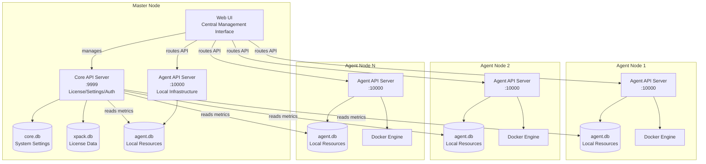
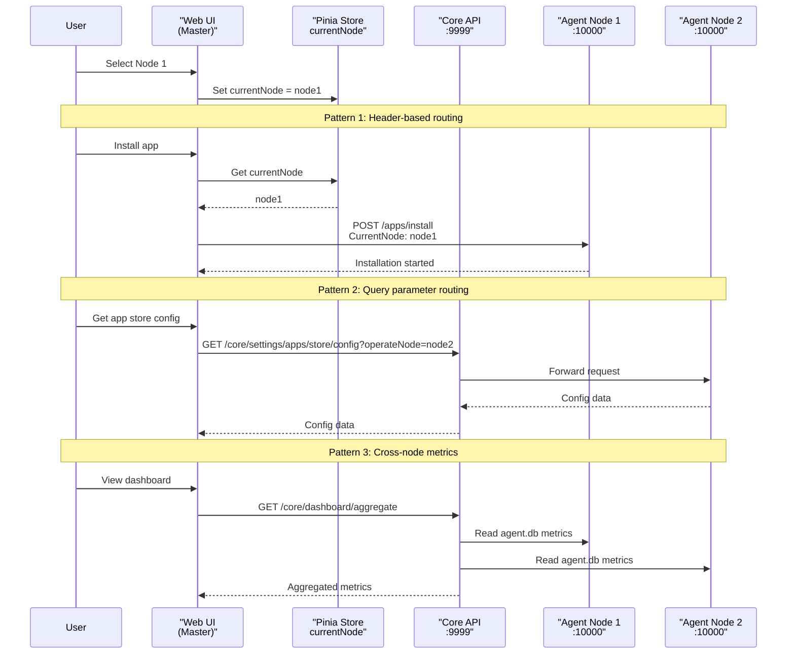
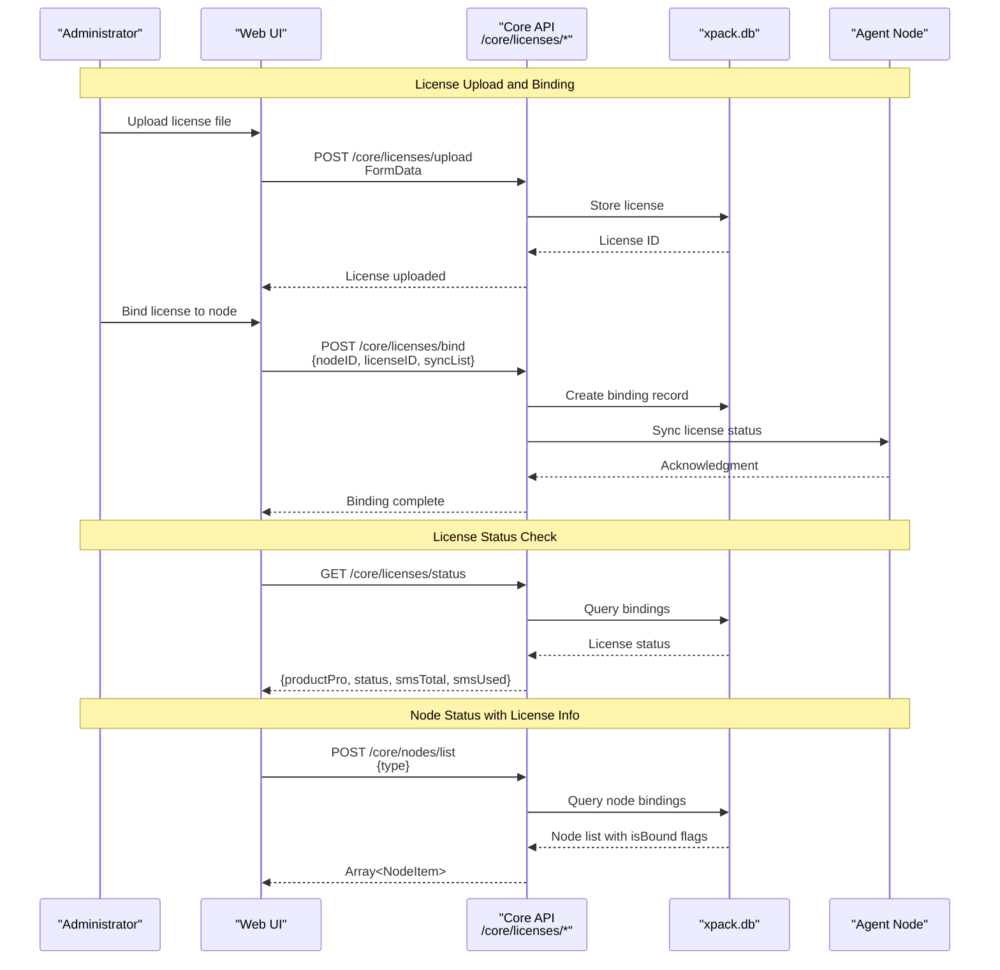
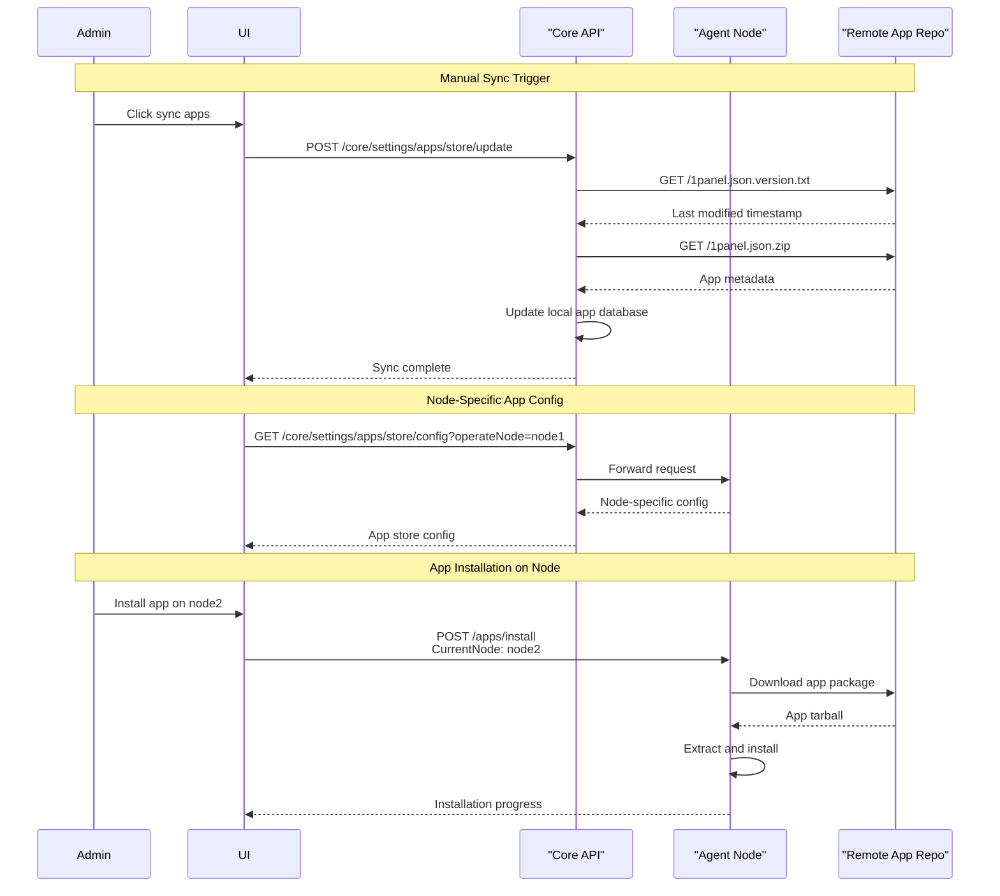
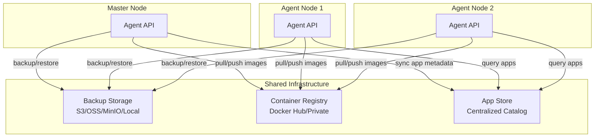
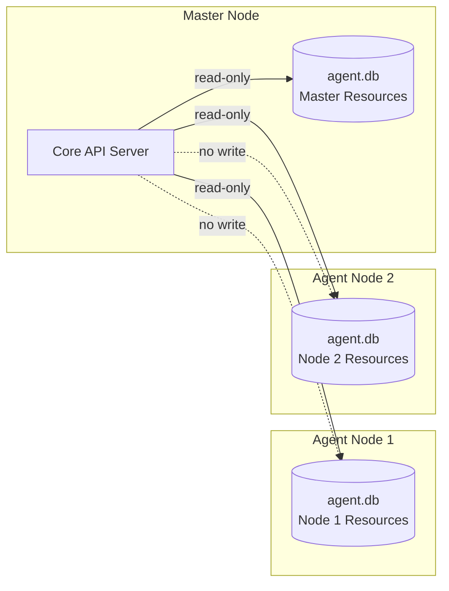

<!-- source: DeepWiki mcp.deepwiki.com · repo 1Panel-dev/1Panel · page 2.2 Multi-Node Architecture · fetched 2026-10-29 -->

# Multi-Node Architecture

<details>
<summary>Relevant source files</summary>

The following files were used as context for generating this wiki page:

- [agent/app/api/v2/app.go](agent/app/api/v2/app.go)
- [agent/app/dto/file.go](agent/app/dto/file.go)
- [agent/app/dto/request/app.go](agent/app/dto/request/app.go)
- [agent/app/dto/response/app.go](agent/app/dto/response/app.go)
- [agent/app/repo/app.go](agent/app/repo/app.go)
- [agent/app/service/app.go](agent/app/service/app.go)
- [agent/app/service/app_install.go](agent/app/service/app_install.go)
- [agent/app/service/app_sync_task.go](agent/app/service/app_sync_task.go)
- [agent/app/service/app_utils.go](agent/app/service/app_utils.go)
- [agent/global/config.go](agent/global/config.go)
- [agent/init/business/business.go](agent/init/business/business.go)
- [agent/init/dir/dir.go](agent/init/dir/dir.go)
- [agent/router/ro_app.go](agent/router/ro_app.go)
- [agent/utils/appicon/appicon.go](agent/utils/appicon/appicon.go)
- [agent/utils/files/utils.go](agent/utils/files/utils.go)
- [agent/utils/req_helper/request.go](agent/utils/req_helper/request.go)
- [core/init/cron/cron.go](core/init/cron/cron.go)
- [frontend/src/api/interface/setting.ts](frontend/src/api/interface/setting.ts)
- [frontend/src/api/modules/setting.ts](frontend/src/api/modules/setting.ts)

</details>


## Purpose and Scope

This document describes 1Panel's multi-node architecture, which enables distributed deployments where a Master node provides centralized management while multiple Agent nodes handle infrastructure operations independently. This architecture allows infrastructure teams to manage hundreds of servers from a single web interface while maintaining operational isolation between nodes.

For information about the single-node architecture components, see [System Architecture Overview](#2.1). For details on authentication and security across nodes, see [Authentication and Security](#3).

---

## Architecture Overview

1Panel implements a hub-and-spoke topology where one Master node coordinates multiple Agent nodes. Each node runs its own Agent API server to manage local infrastructure, while the Master additionally runs a Core API server for system-wide configuration, licensing, and node orchestration.

### Multi-Node Topology



**Sources:** Diagram 6 from high-level architecture diagrams, [frontend/src/api/modules/setting.ts:43-52]()

### Node Components

| Component | Master Node | Agent Node | Purpose |
|-----------|------------|------------|---------|
| **Core API Server** | ✓ | ✗ | System-wide settings, authentication, licensing, node management |
| **Agent API Server** | ✓ | ✓ | Infrastructure operations (containers, websites, databases, files) |
| **Web UI** | ✓ | ✗ | Central management interface |
| **core.db** | ✓ | ✗ | System settings, user accounts, global configuration |
| **xpack.db** | ✓ | ✗ | License data, node bindings |
| **agent.db** | ✓ | ✓ | Local resource metadata (apps, containers, websites, databases) |
| **Docker Engine** | ✓ | ✓ | Container runtime |

**Sources:** [frontend/src/api/interface/setting.ts:260-268](), Diagram 6 from high-level architecture diagrams

---

## Request Routing

The Web UI routes API requests to the appropriate node using one of two mechanisms:

### Routing Mechanisms

#### 1. CurrentNode Header
The frontend maintains a `CurrentNode` context in its global store. When a user selects a node, this value is set and included as a header in subsequent API requests.

#### 2. operateNode Query Parameter
Specific operations can target a node using the `?operateNode=X` query parameter in the URL. This is commonly used for operations that need explicit node targeting.



**Sources:** [frontend/src/api/modules/setting.ts:157-163](), Diagram 6 from high-level architecture diagrams

### Node Selection API

The frontend provides APIs to list and select nodes:

```typescript
// List all nodes with full information
listAllNodes() -> Array<NodeItem>

// List simplified nodes with basic metrics
listAllSimpleNodes() -> Array<SimpleNodeItem>

// List nodes by type (e.g., "xpack" or "free")
listNodeOptions(type: string) -> Array<NodeItem>
```

**Sources:** [frontend/src/api/modules/setting.ts:47-52](), [frontend/src/api/interface/setting.ts:260-280]()

---

## License Binding and Node Management

License binding is the mechanism that associates licenses with specific nodes to enable features. Each node can be bound to a license, and the binding determines which features are available on that node.

### License Binding Flow



**Sources:** [frontend/src/api/modules/setting.ts:10-45](), [frontend/src/api/interface/setting.ts:236-300]()

### License Management APIs

| API Endpoint | Purpose |
|--------------|---------|
| `POST /core/licenses/upload` | Upload new license file |
| `POST /core/licenses/update` | Update existing license |
| `POST /core/licenses/search` | Search licenses with pagination |
| `POST /core/licenses/bind` | Bind license to node(s) |
| `POST /core/licenses/unbind` | Unbind license from node |
| `POST /core/licenses/bind/free` | Change license binding to different nodes |
| `GET /core/licenses/status` | Get current license status |
| `GET /core/licenses/master/status` | Get master node license status |
| `POST /core/licenses/sync` | Sync license data |
| `GET /core/licenses/options` | List available license options |

**Sources:** [frontend/src/api/modules/setting.ts:10-45]()

### License Binding Structure

```typescript
interface LicenseBind {
    nodeID: number;           // Target node ID
    licenseID: number;        // License to bind
    syncList: string;         // Comma-separated list of items to sync
    withDockerRestart: boolean; // Whether to restart Docker
}

interface LicenseUnbind {
    id: number;               // Binding ID
    force: boolean;           // Force unbind even if in use
    withDockerRestart: boolean; // Whether to restart Docker
}

interface NodeItem {
    id: number;
    addr: string;             // Node address
    status: string;           // online/offline
    version: string;          // 1Panel version
    isXpack: boolean;         // Whether node has xpack features
    isBound: boolean;         // Whether license is bound
    name: string;             // Node name
}
```

**Sources:** [frontend/src/api/interface/setting.ts:260-300]()

---

## App Store Synchronization

The App Store synchronization system handles distributing app metadata across nodes. The Master node fetches app data from the remote repository, and nodes can query app information as needed.

### App Store Sync with Node Context



**Sources:** [frontend/src/api/modules/setting.ts:157-163](), [agent/app/service/app.go:950-1044](), [agent/app/service/app_utils.go:990-1044]()

### App Download and Resource Management

Each node maintains its own app resource directories. When an app is installed, the agent downloads the app package from the remote repository and extracts it to the local resource directory:

```
{baseDir}/1panel/resource/apps/
  ├── remote/          # Remote apps from app store
  │   ├── mysql/
  │   │   ├── 8.0.31/
  │   │   └── 8.0.32/
  │   └── redis/
  ├── local/           # Local custom apps
  ├── custom/          # User-added apps
  └── offline/         # Offline app packages
```

**Sources:** [agent/app/service/app_utils.go:990-1044](), [agent/global/config.go:36-44](), [agent/init/dir/dir.go:22-31]()

### App Store Configuration per Node

The app store configuration can be queried per node using the `operateNode` parameter:

```typescript
// Get app store config for specific node
getAppStoreConfig(node?: string) {
    const params = node ? `?operateNode=${node}` : '';
    return http.get<App.AppStoreConfig>(`/core/settings/apps/store/config${params}`);
}
```

This allows each node to have different app store URLs or configurations, useful for environments with network segmentation or different compliance requirements.

**Sources:** [frontend/src/api/modules/setting.ts:157-163]()

---

## Node Status and Monitoring

The Master node aggregates metrics from all Agent nodes to provide a unified monitoring dashboard.

### Simplified Node Monitoring

```typescript
interface SimpleNodeItem {
    id: number;
    name: string;
    addr: string;              // Node address
    description: string;
    systemVersion: string;     // 1Panel version
    securityEntrance: string;  // Safe entrance path
    cpuUsedPercent: number;    // CPU usage percentage
    cpuTotal: number;          // Total CPU cores
    memoryTotal: number;       // Total memory in bytes
    memoryUsedPercent: number; // Memory usage percentage
}
```

The `listAllSimpleNodes()` API returns a lightweight summary of all nodes, which is suitable for dashboard display showing node health at a glance.

**Sources:** [frontend/src/api/interface/setting.ts:269-280](), [frontend/src/api/modules/setting.ts:50-52]()

### Node App Update Tracking

```typescript
interface NodeAppItem {
    name: string;        // Node name
    updateCount: number; // Number of apps with available updates
}
```

The `listAppNodes()` API returns which nodes have apps with available updates, allowing administrators to prioritize update operations:

```typescript
listAppNodes() {
    return http.get<Array<Setting.NodeAppItem>>(
        `/core/xpack/nodes/apps/update`, 
        {}, 
        { timeout: TimeoutEnum.T_60S }
    );
}
```

**Sources:** [frontend/src/api/interface/setting.ts:308-311](), [frontend/src/api/modules/setting.ts:58-60]()

---

## Shared Infrastructure

While nodes operate independently, they share certain infrastructure components to enable coordinated operations.

### Shared Components Architecture



**Sources:** Diagram 6 from high-level architecture diagrams

### Backup Storage

All nodes can be configured to use the same backup storage backend, enabling:
- Centralized backup management
- Cross-node backup restoration
- Disaster recovery across the fleet

Supported backup storage types:
- **S3**: AWS S3 or S3-compatible storage
- **OSS**: Alibaba Cloud Object Storage Service
- **MinIO**: Self-hosted S3-compatible storage
- **Local**: Local filesystem (node-specific)

**Sources:** Diagram 6 from high-level architecture diagrams

### Container Registry

Nodes share container registry configuration, allowing:
- Consistent image sources across the fleet
- Private registry support for air-gapped environments
- Image caching and distribution strategies

**Sources:** Diagram 6 from high-level architecture diagrams, [agent/app/service/app_utils.go:990-1044]()

### App Store Catalog

The centralized app store catalog is synchronized from the remote repository and made available to all nodes. This ensures:
- Consistent app versions across the fleet
- Centralized app metadata management
- Efficient distribution of app updates

The synchronization process checks for updates periodically and downloads the `1panel.json` file containing app metadata.

**Sources:** [agent/app/service/app.go:950-1044](), [agent/app/service/app_sync_task.go:38-128]()

---

## Data Isolation and Access Patterns

Each node maintains its own `agent.db` SQLite database for local resource metadata. The databases are not replicated, but the Master Core server can read from any Agent's database for monitoring purposes.

### Database Access Pattern



**Key Principles:**
- Each Agent API server has **exclusive write access** to its own `agent.db`
- The Master Core server has **read-only access** to all `agent.db` files for metrics aggregation
- No database replication occurs between nodes
- Resource operations (create/update/delete) must be sent to the appropriate Agent API server

**Sources:** Diagram 6 from high-level architecture diagrams

---

## License Quota Management

Licenses include quota tracking for certain features. The most common quota is SMS (Short Message Service) usage for notification services.

### SMS Quota Tracking

```typescript
interface SmsInfo {
    licenseName: string;
    smsUsed: number;     // SMS messages consumed
    smsTotal: number;    // Total SMS quota
}

interface LicenseStatus {
    productPro: string;   // Product edition (Pro/Community)
    status: string;       // License status
    smsTotal: number;     // Total SMS quota
    smsUsed: number;      // SMS consumed
}
```

The SMS quota is tracked at the license level and shared across all nodes bound to that license. When a node sends an SMS notification, the usage is recorded and synchronized.

**Sources:** [frontend/src/api/interface/setting.ts:302-312](), [frontend/src/api/modules/setting.ts:54-56]()

---

## Node Initialization and Bootstrapping

When a new Agent node joins the deployment, it must be registered with the Master and optionally bound to a license.

### Node Registration Process

1. **Agent Installation**: Install 1Panel agent on the new server
2. **Network Configuration**: Ensure the Master can reach the Agent API server (default port 10000)
3. **Node Registration**: Add the node through the Master UI or API
4. **License Binding**: Optionally bind a license to enable xpack features
5. **Verification**: The Master queries the node status to confirm connectivity

The exact registration API endpoints are part of the xpack functionality and handle node discovery and authentication.

**Sources:** [frontend/src/api/modules/setting.ts:43-45]()

---

## Cross-Node Operations

Certain operations may span multiple nodes, requiring coordination through the Master:

### Batch App Installation

When installing the same app across multiple nodes (batch installation support), the Master coordinates the installation:

1. User selects multiple nodes and an app
2. Master sends installation requests to each selected Agent
3. Each Agent independently installs the app
4. Master aggregates installation status from all nodes

**Sources:** [agent/app/dto/request/app.go:29-36]()

### Configuration Synchronization

When binding a license, the `syncList` parameter specifies which configuration items should be synchronized to the node:

```typescript
interface LicenseBind {
    nodeID: number;
    licenseID: number;
    syncList: string;          // e.g., "apps,settings,backups"
    withDockerRestart: boolean;
}
```

This allows selectively pushing configuration from Master to Agent nodes during binding operations.

**Sources:** [frontend/src/api/interface/setting.ts:290-295]()

---

## Implementation References

### Core API Routes (Master Only)
- `/core/licenses/*` - License management endpoints
- `/core/nodes/*` - Node registration and listing
- `/core/settings/apps/store/config` - App store configuration (with node targeting)
- `/core/xpack/nodes/apps/update` - Cross-node app update tracking

### Agent API Routes (All Nodes)
- `/apps/*` - Application management
- `/containers/*` - Container operations
- `/websites/*` - Website management
- `/databases/*` - Database operations
- `/files/*` - File management
- `/settings/*` - Local node settings

### TypeScript Interfaces
- `NodeItem` - Full node information
- `SimpleNodeItem` - Lightweight node metrics
- `LicenseBind` / `LicenseUnbind` - License binding operations
- `LicenseStatus` - License and quota status
- `SmsInfo` - SMS quota information
- `NodeAppItem` - App update tracking per node

**Sources:** [frontend/src/api/modules/setting.ts:1-223](), [frontend/src/api/interface/setting.ts:1-313](), [agent/router/ro_app.go:1-50]()

---

