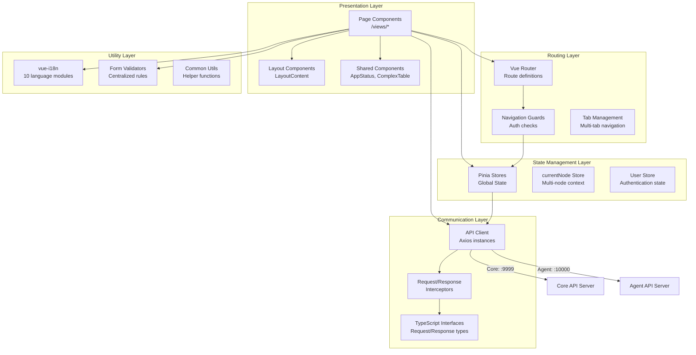
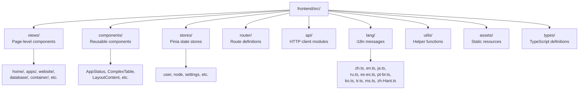
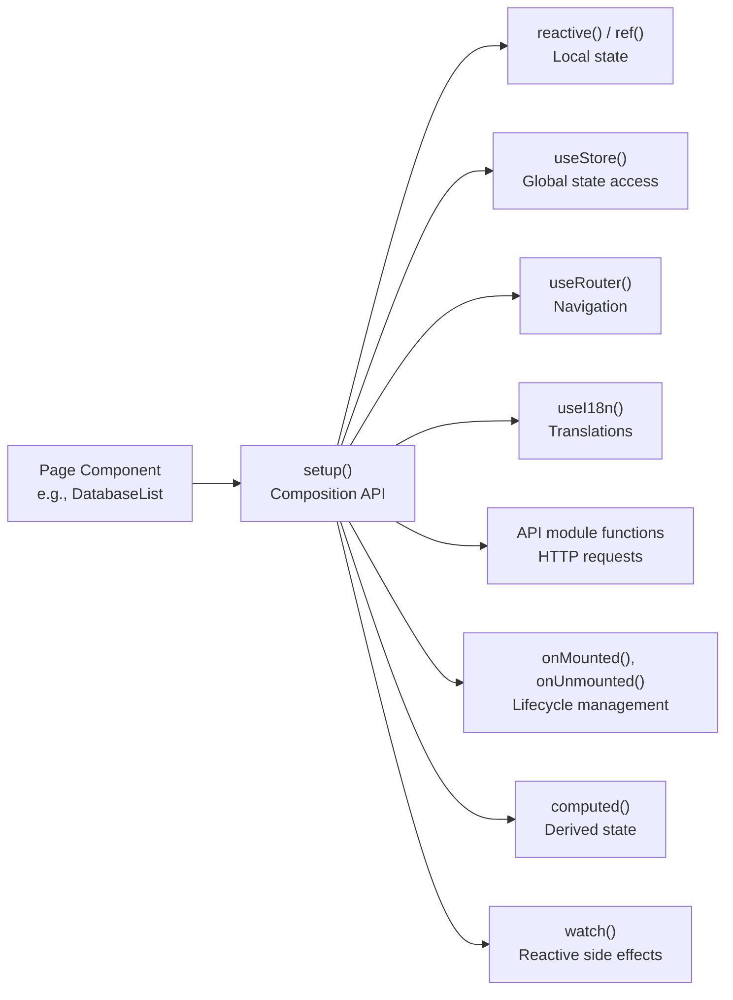
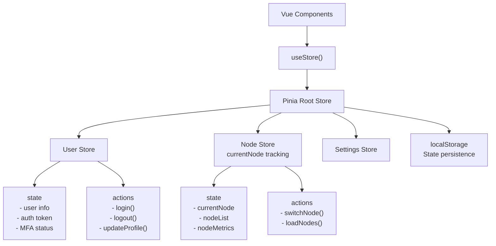
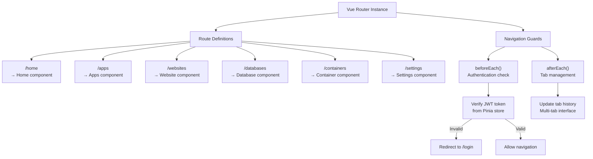
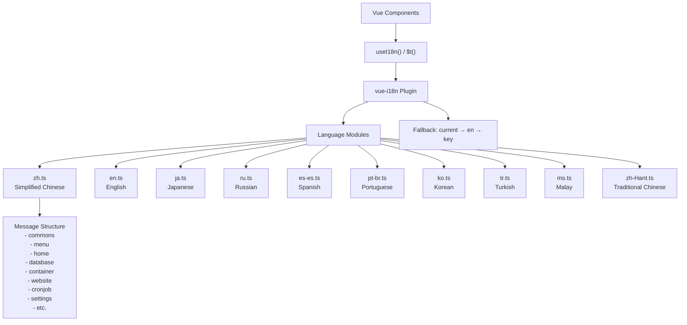
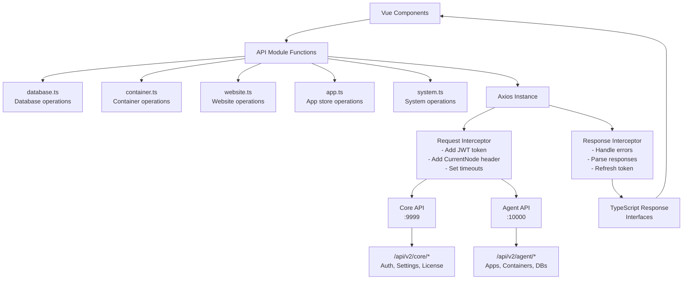
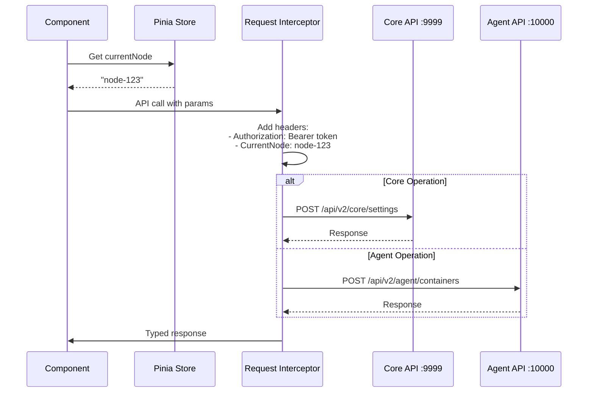
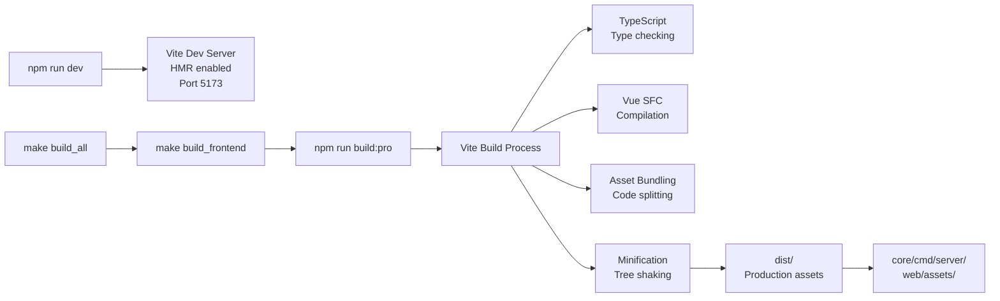
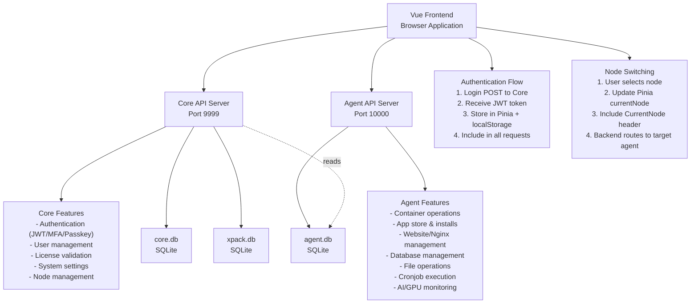

<!-- source: DeepWiki mcp.deepwiki.com · repo 1Panel-dev/1Panel · page 2.4 Frontend Architecture · fetched 2026-10-29 -->

# Frontend Architecture

Relevant source files

The following files were used as context for generating this wiki page:

- [Makefile](Makefile)
- [agent/utils/common/sqlite.go](agent/utils/common/sqlite.go)
- [core/middleware/operation.go](core/middleware/operation.go)
- [core/utils/common/sqlite.go](core/utils/common/sqlite.go)
- [frontend/src/lang/modules/en.ts](frontend/src/lang/modules/en.ts)
- [frontend/src/lang/modules/es-es.ts](frontend/src/lang/modules/es-es.ts)
- [frontend/src/lang/modules/ja.ts](frontend/src/lang/modules/ja.ts)
- [frontend/src/lang/modules/ko.ts](frontend/src/lang/modules/ko.ts)
- [frontend/src/lang/modules/ms.ts](frontend/src/lang/modules/ms.ts)
- [frontend/src/lang/modules/pt-br.ts](frontend/src/lang/modules/pt-br.ts)
- [frontend/src/lang/modules/ru.ts](frontend/src/lang/modules/ru.ts)
- [frontend/src/lang/modules/tr.ts](frontend/src/lang/modules/tr.ts)
- [frontend/src/lang/modules/zh-Hant.ts](frontend/src/lang/modules/zh-Hant.ts)
- [frontend/src/lang/modules/zh.ts](frontend/src/lang/modules/zh.ts)

## Purpose and Scope

This document describes the high-level architecture of the 1Panel frontend application, including its technology stack, project structure, core architectural layers, and integration patterns with the backend services. For detailed component patterns and shared components, see [Component Architecture and Patterns](#11.1). For API client implementation details, see [API Client Layer and Type System](#11.2). For internationalization specifics, see [Internationalization and Localization](#4).

## Technology Stack

The 1Panel frontend is built using modern web technologies optimized for developer experience and runtime performance:

| Technology | Version | Purpose |
|------------|---------|---------|
| Vue 3 | 3.4+ | Progressive framework using Composition API |
| TypeScript | 5.3+ | Type-safe JavaScript development |
| Vite | 5.0+ | Build tool with fast HMR and optimized bundling |
| Element Plus | Latest | Comprehensive UI component library |
| Pinia | Latest | Vue 3 official state management |
| Vue Router | Latest | Client-side routing |
| Axios | Latest | HTTP client with interceptors |
| vue-i18n | Latest | Internationalization supporting 10 languages |
| Monaco Editor | Latest | Code editor with syntax highlighting |
| v-charts/ECharts | Latest | Data visualization and charting |

**Sources:** Diagram 1 and Diagram 4 from high-level architecture

## Application Architecture

### Layered Architecture Overview

**Sources:** 
- [Makefile:9]() - WEB_PATH definition
- Diagram 1, Diagram 4 from high-level architecture
- Section 2.4 description from table of contents

### Directory Structure

The frontend codebase follows a modular organization pattern:

**Sources:**
- [frontend/src/lang/modules/zh.ts:1-3]()
- [frontend/src/lang/modules/en.ts:1-3]()
- Table of contents sections 11.1, 11.2, 11.3

## Core Architectural Patterns

### Component Composition Pattern

The application uses Vue 3's Composition API throughout:

**Sources:** Diagram 1 from high-level architecture, Vue 3 Composition API mentioned

### State Management with Pinia

Global application state is managed through Pinia stores:

**Sources:** 
- Diagram 1 mentions Pinia Global Store
- Diagram 6 references currentNode tracking across multi-node architecture
- High-level architecture mentions CurrentNode header

### Routing and Navigation

Vue Router manages client-side navigation with route-based code splitting:

**Sources:**
- [frontend/src/lang/modules/zh.ts:362-392]() - Menu structure with all routes
- [frontend/src/lang/modules/en.ts:375-406]() - Menu translations
- Diagram 1 mentions Vue Router

## Internationalization System

The i18n system supports 10 languages through hierarchical message structures:

**Sources:**
- [frontend/src/lang/modules/zh.ts:1-400]()
- [frontend/src/lang/modules/en.ts:1-410]()
- All other language module files
- Diagram 1 mentions "10-Language Support"

### Message Key Structure

Translation keys follow a hierarchical dot notation pattern:

| Key Pattern | Example | Usage |
|-------------|---------|-------|
| `commons.button.*` | `commons.button.create` | Common UI actions |
| `commons.msg.*` | `commons.msg.deleteSuccess` | System messages |
| `menu.*` | `menu.database` | Navigation menu items |
| `database.*` | `database.create` | Domain-specific terms |
| `status.*` | `commons.status.running` | Status indicators |

**Sources:**
- [frontend/src/lang/modules/zh.ts:3-360]() - commons section
- [frontend/src/lang/modules/zh.ts:362-392]() - menu section
- [frontend/src/lang/modules/zh.ts:475-653]() - database section

## API Client Architecture

The frontend communicates with backend services through a typed API client layer:

**Sources:**
- Diagram 1 and Diagram 3 from high-level architecture
- Diagram 6 mentions CurrentNode header for multi-node routing
- Section 11.2 API Client Layer mentioned in table of contents

### Request Flow with Node Context

The frontend supports multi-node deployments by routing API calls to appropriate nodes:

**Sources:**
- Diagram 3 and Diagram 6 from high-level architecture
- [core/middleware/operation.go:38-39]() - CurrentNode header handling

## Build and Development Workflow

### Build Process

The frontend build is managed through npm scripts and integrated into the main Makefile:

**Sources:**
- [Makefile:8-9]() - WEB_PATH and ASSERT_PATH definitions
- [Makefile:28-29]() - build_frontend target
- [Makefile:47]() - build_all target
- Diagram 4 mentions Vite 5.0 as build tool

### Development vs Production Configuration

| Aspect | Development | Production |
|--------|------------|------------|
| Build Command | `npm run dev` | `npm run build:pro` |
| Server | Vite dev server (HMR) | Static files served by Go backend |
| Source Maps | Full source maps | None or minimal |
| Bundle Size | Unoptimized | Minified and tree-shaken |
| API Proxy | Vite proxy to :9999/:10000 | Direct backend connection |
| Hot Module Replacement | Enabled | N/A |

**Sources:**
- [Makefile:28-29]()
- [Makefile:10]() - ASSERT_PATH where production assets are placed

## Integration with Backend Services

The frontend integrates with two backend services (Core and Agent) through REST APIs:

**Sources:**
- Diagram 1, Diagram 2, Diagram 6 from high-level architecture
- Diagram 3 authentication flow
- [core/middleware/operation.go:38-40]() - Node header handling

### API Communication Patterns

The frontend follows standardized patterns for API communication:

1. **Synchronous Operations**: Direct API calls with loading states
2. **Asynchronous Operations**: Task-based execution with SSE streaming for progress
3. **Polling**: Dashboard metrics refreshed every 3 seconds
4. **Error Handling**: Centralized error interceptor with user-friendly messages

**Sources:**
- Diagram 3 shows task-based async operations with SSE
- Diagram 3 mentions 3-second polling for dashboard

## Security Considerations

The frontend implements multiple security layers:

| Security Feature | Implementation |
|-----------------|----------------|
| Authentication | JWT tokens stored in Pinia with localStorage persistence |
| MFA Support | TOTP 6-digit codes validated through Core API |
| Passkey Support | WebAuthn integration for biometric/hardware key auth |
| CSRF Protection | Token-based validation on state-changing operations |
| XSS Prevention | Vue's template escaping + Content-Security-Policy headers |
| Sensitive Data | Masked display with show/hide toggles |
| Session Management | Token refresh mechanism with expiration handling |

**Sources:**
- Diagram 5 from high-level architecture (Authentication Mechanisms)
- [frontend/src/lang/modules/zh.ts:192-220]() - Login page with MFA and passkey support
- [frontend/src/lang/modules/en.ts:185-223]() - English login translations

## Performance Optimizations

The frontend implements several performance optimizations:

1. **Code Splitting**: Route-based lazy loading for reduced initial bundle size
2. **Tree Shaking**: Vite eliminates unused code during production builds
3. **Asset Optimization**: Images and static assets are minified and cached
4. **API Response Caching**: Dashboard metrics cached with 3-second refresh intervals
5. **Virtual Scrolling**: Large lists use ComplexTable with pagination
6. **Debounced Search**: Form inputs debounced to reduce API calls

**Sources:**
- Diagram 4 mentions Vite for optimized builds
- Diagram 3 mentions caching strategy for dashboard with 3-second intervals
- Section 11.1 mentions ComplexTable component

---

