<!-- source: DeepWiki mcp.deepwiki.com · repo 1Panel-dev/1Panel · page 2.5 Data Flow and Integration Patterns · fetched 2026-10-29 -->

# Data Flow and Integration Patterns

<details>
<summary>Relevant source files</summary>

The following files were used as context for generating this wiki page:

- [agent/app/api/v2/container.go](agent/app/api/v2/container.go)
- [agent/app/dto/container.go](agent/app/dto/container.go)
- [agent/app/service/container.go](agent/app/service/container.go)
- [agent/router/ro_container.go](agent/router/ro_container.go)
- [frontend/src/api/interface/container.ts](frontend/src/api/interface/container.ts)
- [frontend/src/api/interface/setting.ts](frontend/src/api/interface/setting.ts)
- [frontend/src/api/modules/container.ts](frontend/src/api/modules/container.ts)
- [frontend/src/api/modules/setting.ts](frontend/src/api/modules/setting.ts)
- [frontend/src/views/container/container/operate/index.vue](frontend/src/views/container/container/operate/index.vue)

</details>


## Purpose and Scope

This document describes the fundamental data flow patterns and integration mechanisms used throughout the 1Panel system. It covers:

- Communication patterns between frontend and backend (synchronous, asynchronous, streaming)
- The async task execution system for long-running operations
- Multi-node request routing and data aggregation
- Type system integration between TypeScript frontend and Go backend
- Error handling and validation flows

For details on specific subsystem architectures, see [Backend Service Layer](#2.3) and [Frontend Architecture](#2.4). For authentication specifics, see [Authentication and Security](#3).

---

## Core Integration Patterns

### Pattern 1: Synchronous Request-Response

The simplest pattern used for quick operations that complete in under a few seconds. The client sends a request and waits for a complete response.

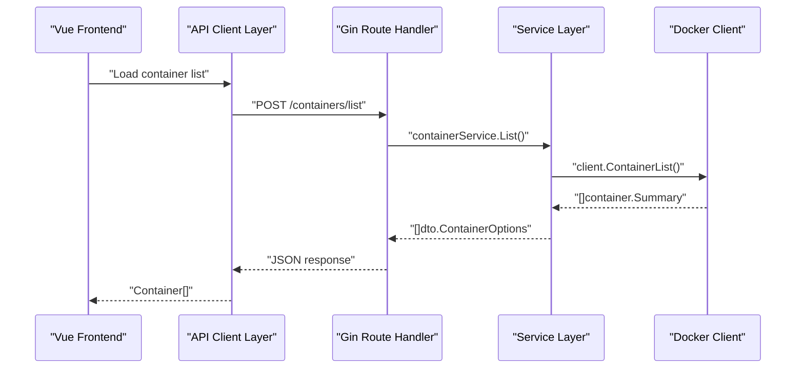

**Key Characteristics:**
- Immediate response with complete data
- No intermediate status tracking
- Typically completes in < 5 seconds
- Used for reads, simple updates, and fast operations

**Examples:**

| Operation | Frontend API | Backend Handler | Service Method |
|-----------|-------------|-----------------|----------------|
| List containers | `listContainer()` | `ListContainer` | `containerService.List()` |
| Load container info | `loadContainerInfo(name)` | `ContainerInfo` | `containerService.ContainerInfo()` |
| Container stats | `containerStats(id)` | `ContainerStats` | `containerService.ContainerStats()` |
| Load resource limits | `loadResourceLimit()` | `LoadResourceLimit` | `containerService.LoadResourceLimit()` |

**Sources:** [frontend/src/api/modules/container.ts:9-23](), [agent/app/api/v2/container.go:64-100](), [agent/app/service/container.go:145-167]()

---

### Pattern 2: Async Task Execution with Task Logs

For long-running operations (container creation, image pulls, upgrades), the system uses an asynchronous task pattern. Operations return immediately with a `taskID`, and clients stream progress via Server-Sent Events.

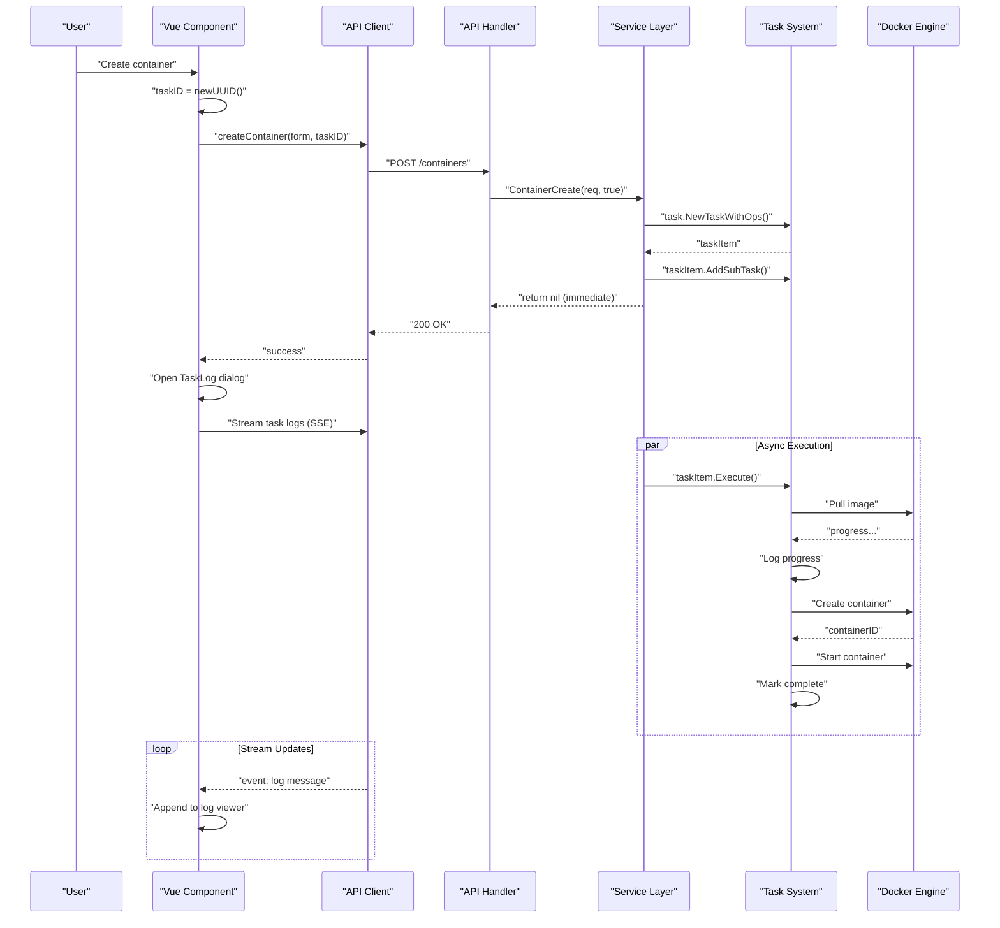

**Task Structure:**

Each task consists of:
- **Task ID**: UUID for tracking
- **Task Type**: Create, Update, Upgrade, Clean, etc.
- **Scope**: Container, Image, Compose, etc.
- **Subtasks**: Individual steps with names and functions
- **Log Buffer**: Real-time progress messages

**Sources:** [agent/app/service/container.go:509-583](), [frontend/src/views/container/container/operate/index.vue:549-562]()

#### Task Creation and Execution Flow

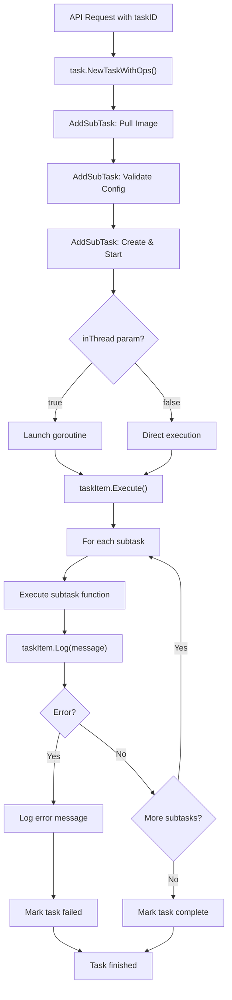

**Key Code Paths:**

- Task creation: [agent/app/service/container.go:521-525]()
- Adding subtasks: [agent/app/service/container.go:527-536]()
- Async execution: [agent/app/service/container.go:574-579]()
- Container create example: [agent/app/service/container.go:509-583]()

**Sources:** [agent/app/service/container.go:305-339](), [agent/app/service/container.go:509-583]()

#### Frontend Task Log Integration

The frontend uses a `TaskLog` component to display real-time progress:

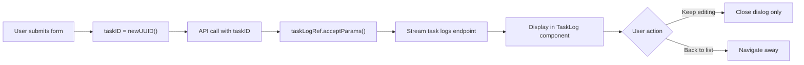

**Sources:** [frontend/src/views/container/container/operate/index.vue:327-332](), [frontend/src/views/container/container/operate/index.vue:549-551]()

---

### Pattern 3: Real-time Streaming (Server-Sent Events)

For continuous data streams like container logs, the system uses SSE (Server-Sent Events) to push updates to the client.

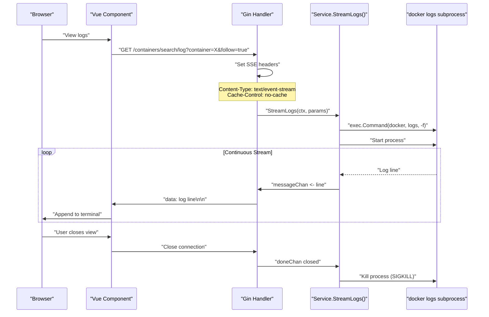

**SSE Message Format:**

```
data: 2024-01-15 10:30:45 Container started\n\n
data: 2024-01-15 10:30:46 Listening on port 8080\n\n
event: error\ndata: Connection lost\n\n
```

**Key Implementation Details:**

1. **SSE Headers**: Set by Gin handler at [agent/app/api/v2/container.go:766-769]()
2. **Streaming Function**: `collectLogs()` goroutine at [agent/app/service/container.go:951-1056]()
3. **Process Management**: Uses `syscall.Setpgid` and `SIGKILL` for cleanup at [agent/app/service/container.go:992]()
4. **Graceful Shutdown**: `doneChan` signals termination at [agent/app/service/container.go:924-929]()

**Sources:** [agent/app/service/container.go:921-1056](), [agent/app/api/v2/container.go:765-792]()

---

### Pattern 4: Multi-Node Request Routing

In multi-node deployments, the Core server routes requests to appropriate Agent nodes based on the `CurrentNode` header or `?operateNode=X` query parameter.

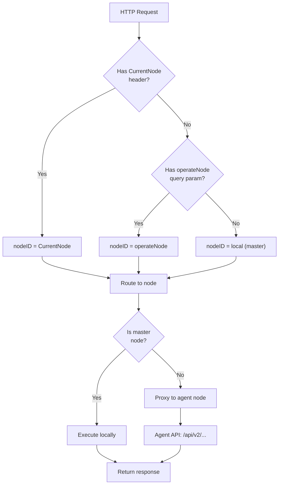

**Node Selection Examples:**

| Scenario | Header/Query | Target |
|----------|-------------|--------|
| Dashboard view for Node 1 | `CurrentNode: 1` | Agent Node 1 |
| Container operation with explicit node | `?operateNode=2` | Agent Node 2 |
| Default master operation | None | Master node (local) |
| Settings API (always master) | Ignored | Master node |

**API Examples:**

```typescript
// Frontend: Explicit node routing
const params = operateNode ? `?operateNode=${operateNode}` : '';
return http.post(`/containers/compose/clean/log${params}`, {...});
```

```typescript
// Frontend: Load app store config for specific node
export const getAppStoreConfig = (node?: string) => {
    const params = node ? `?operateNode=${node}` : '';
    return http.get<App.AppStoreConfig>(`/core/settings/apps/store/config${params}`);
};
```

**Core Server Data Aggregation:**

The Core server can read metrics from all agent databases for unified monitoring:

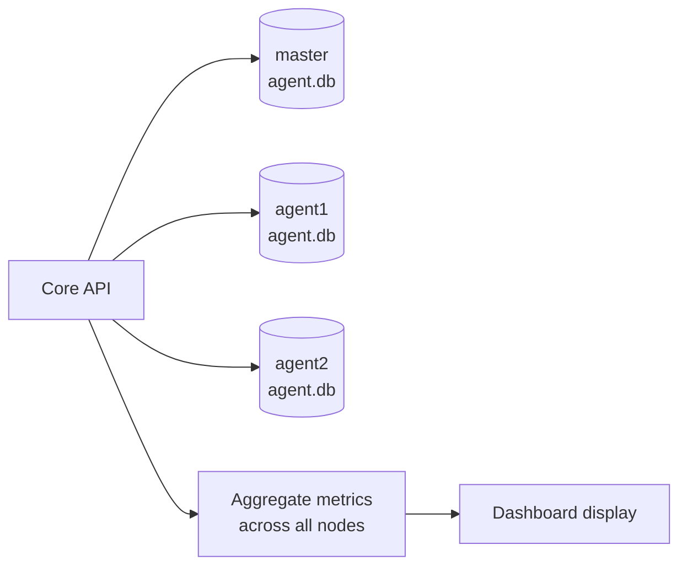

**Sources:** [frontend/src/api/modules/container.ts:42-48](), [frontend/src/api/modules/setting.ts:157-163]()

---

## Detailed Data Flow Examples

### Container Lifecycle Flow

This diagram shows the complete flow from user interaction to Docker container creation, including all layers and state transitions.

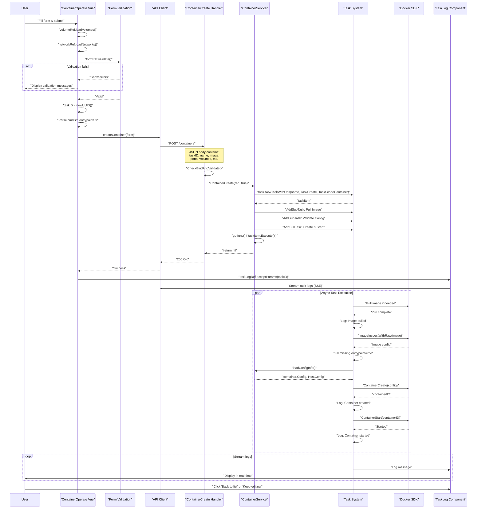

**Key Decision Points:**

1. **Form Validation** [frontend/src/views/container/container/operate/index.vue:520-548]()
   - Volume/network completeness check
   - Port configuration validation
   - CPU/Memory limits validation

2. **Task Execution Mode** [agent/app/service/container.go:574-582]()
   - `inThread=true`: Launch goroutine, return immediately
   - `inThread=false`: Execute synchronously (used for app installations)

3. **Image Pull Strategy** [agent/app/service/container.go:527-536]()
   - If `forcePull=true`: Always pull
   - If image missing: Pull
   - Otherwise: Use cached image

**Sources:** [agent/app/service/container.go:509-583](), [frontend/src/views/container/container/operate/index.vue:520-562]()

---

### Container Update vs Upgrade Flow

Understanding the difference between update and upgrade operations:

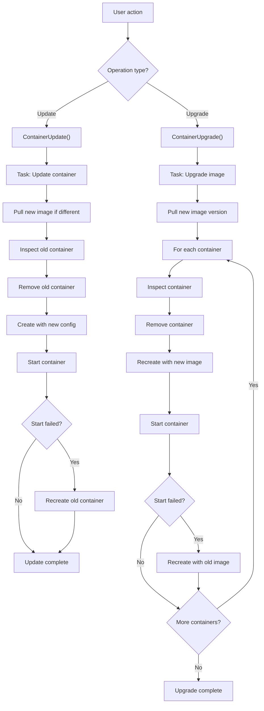

**Update Operation** (`ContainerUpdate`):
- Modifies configuration of a single container
- Can change: ports, volumes, env vars, resource limits, networks
- Image can be changed
- Old container config preserved for rollback

**Upgrade Operation** (`ContainerUpgrade`):
- Updates image version for multiple containers
- Preserves all container configuration
- Only changes the image tag/version
- Batch operation across multiple containers

**Sources:** [agent/app/service/container.go:652-717](), [agent/app/service/container.go:719-793]()

---

### Authentication and Session Flow

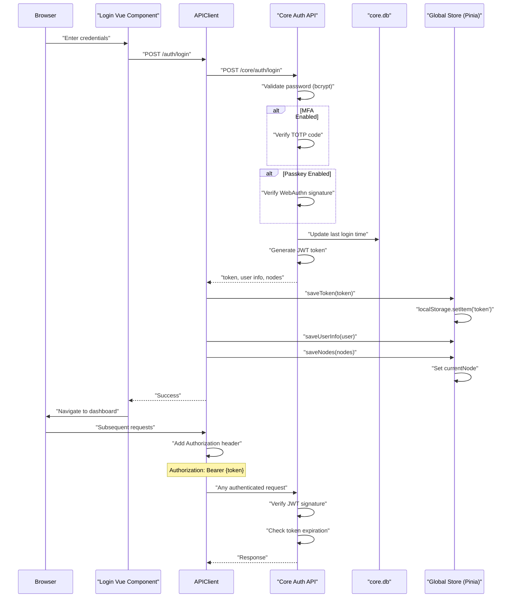

**JWT Token Structure:**

The JWT contains:
- User ID
- Username
- Node information
- Expiration time
- Issued at time

**Token Usage:**

All authenticated requests include the token in the `Authorization` header. The backend middleware validates:
1. Token signature
2. Token expiration
3. User session validity

**Sources:** [frontend/src/api/modules/setting.ts:83-100]()

---

### Dashboard Monitoring Data Flow

The dashboard uses a polling mechanism to fetch real-time metrics every 3 seconds.

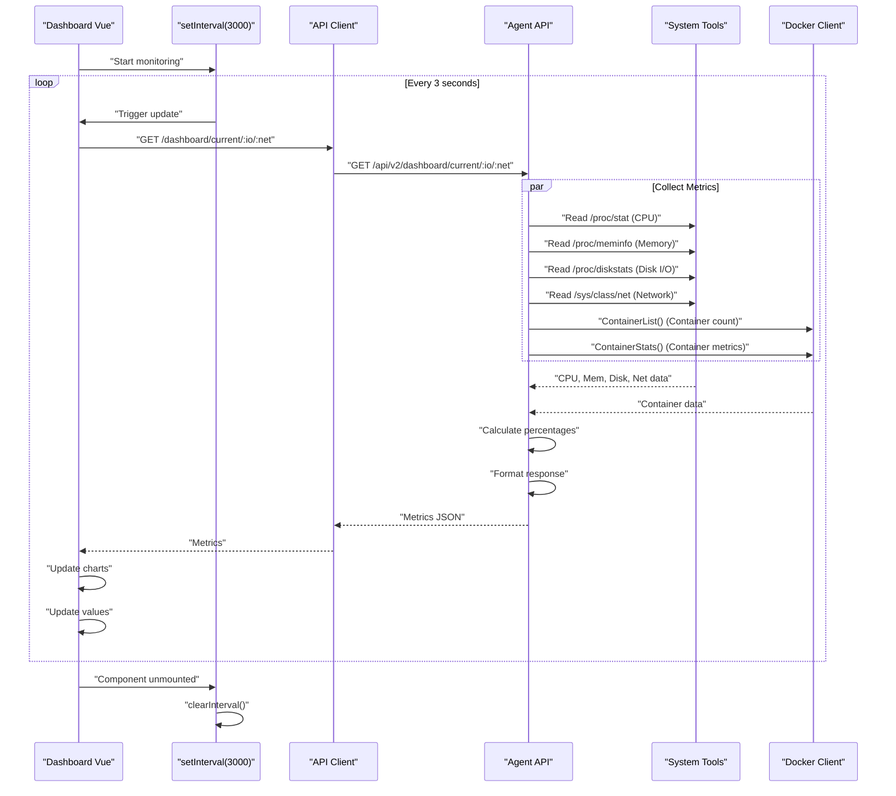

**Metrics Collected:**

| Category | Metrics | Source |
|----------|---------|--------|
| CPU | Usage %, per-core usage | `/proc/stat` |
| Memory | Used, Available, Total, % | `/proc/meminfo` |
| Disk I/O | Read/Write rates | `/proc/diskstats` |
| Network | RX/TX rates | `/sys/class/net` |
| Containers | Count by state, CPU/Mem per container | Docker SDK |
| GPU | Usage, temp, memory (if present) | `nvidia-smi`, `xpu-smi` |

**Response Caching Strategy:**

The dashboard endpoint uses query parameters to control data freshness:
- `io` parameter: Disk I/O sampling interval
- `net` parameter: Network sampling interval

**Sources:** References from overview diagram, typical monitoring implementation patterns

---

## Type System Integration

The system maintains type safety across the TypeScript-Go boundary through parallel interface definitions.

### TypeScript to Go DTO Mapping

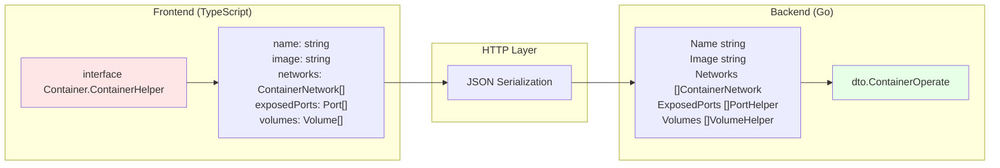

**Example Type Correspondence:**

| TypeScript Interface | Go DTO | Purpose |
|---------------------|--------|---------|
| `Container.ContainerHelper` | `dto.ContainerOperate` | Container creation/update |
| `Container.ContainerSearch` | `dto.PageContainer` | Container pagination query |
| `Container.ContainerStatus` | `dto.ContainerStatus` | Container statistics |
| `Container.ComposeCreate` | `dto.ComposeCreate` | Compose file deployment |
| `Container.NetworkCreate` | `dto.NetworkCreate` | Docker network creation |
| `Container.VolumeCreate` | `dto.VolumeCreate` | Docker volume creation |

**Sources:** [frontend/src/api/interface/container.ts:4-406](), [agent/app/dto/container.go:1-323]()

### Nested Type Structures

Both languages handle complex nested structures:

**TypeScript:**
```typescript
export interface ContainerHelper {
    name: string;
    networks: Array<ContainerNetwork>;  // Nested array
    exposedPorts: Array<Port>;          // Nested array
}

export interface ContainerNetwork {
    network: string;
    ipv4: string;
    ipv6: string;
    macAddr: string;
}
```

**Go:**
```go
type ContainerOperate struct {
    Name         string             `json:"name"`
    Networks     []ContainerNetwork `json:"networks"`  // Nested slice
    ExposedPorts []PortHelper       `json:"exposedPorts"` // Nested slice
}

type ContainerNetwork struct {
    Network string `json:"network"`
    Ipv4    string `json:"ipv4"`
    Ipv6    string `json:"ipv6"`
    MacAddr string `json:"macAddr"`
}
```

**JSON Tags for Serialization:**

Go struct tags specify JSON field names to match TypeScript camelCase conventions:
- `json:"name"` → TypeScript `name`
- `json:"exposedPorts"` → TypeScript `exposedPorts`
- `json:"cpuShares"` → TypeScript `cpuShares`

**Sources:** [frontend/src/api/interface/container.ts:63-93](), [agent/app/dto/container.go:73-101]()

---

## Error Handling and Validation Patterns

### Frontend Validation Flow

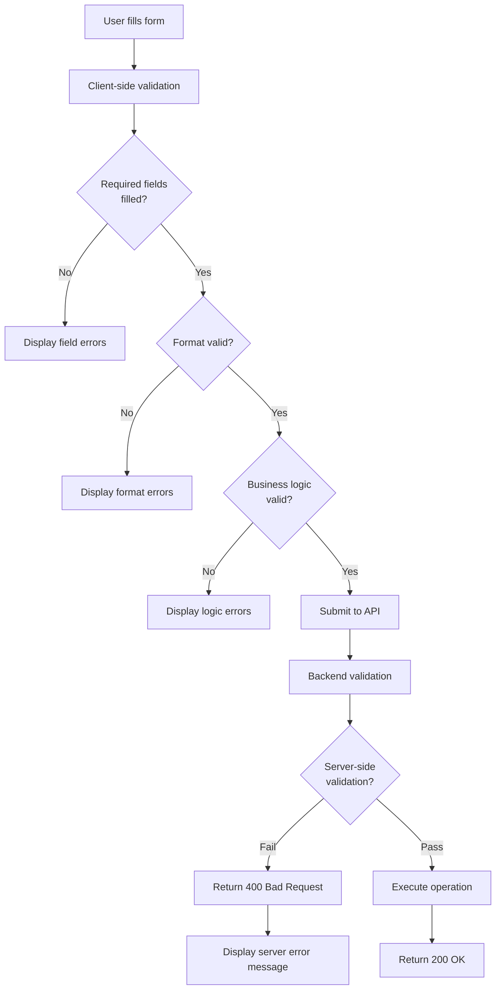

**Frontend Validation Rules:**

```typescript
// Form validation rules
const rules = reactive({
    name: [Rules.requiredInput, Rules.containerName],
    image: [Rules.imageName],
    cpuShares: [Rules.integerNumberWith0, checkNumberRange(0, 262144)],
    nanoCPUs: [Rules.floatNumber],
    memory: [Rules.floatNumber],
});
```

Common validation rules include:
- `Rules.requiredInput`: Field must not be empty
- `Rules.containerName`: Valid Docker container name format
- `Rules.imageName`: Valid Docker image name format
- `checkNumberRange(min, max)`: Numeric range validation
- `checkFloatNumberRange(min, max)`: Float range validation

**Sources:** [frontend/src/views/container/container/operate/index.vue:469-475]()

### Backend Validation with Struct Tags

Go uses struct tags for automatic validation:

```go
type ContainerOperate struct {
    Name   string `json:"name" validate:"required"`
    Image  string `json:"image" validate:"required"`
    // ...
}

type ContainerOperation struct {
    Names     []string `json:"names" validate:"required"`
    Operation string   `json:"operation" validate:"required,oneof=up start stop restart kill pause unpause remove"`
}
```

**Validation Tag Examples:**

| Tag | Meaning | Example |
|-----|---------|---------|
| `required` | Field must be present | `validate:"required"` |
| `oneof` | Must be one of specified values | `validate:"oneof=up down start stop"` |
| `min`, `max` | Numeric range | `validate:"min=0,max=100"` |
| `ip` | Must be valid IP address | `validate:"ip"` |

**Sources:** [agent/app/dto/container.go:73-101](), [agent/app/dto/container.go:174-178]()

### Error Response Format

When validation fails or errors occur, the backend returns structured error responses:

```json
{
  "code": 400,
  "message": "validation failed: name is required",
  "data": null
}
```

**Error Handling in API Client:**

The frontend API client intercepts error responses and displays localized messages:

```typescript
// API client error interceptor
http.interceptors.response.use(
    (response) => response,
    (error) => {
        if (error.response?.status === 400) {
            MsgError(i18n.global.t('commons.msg.validationError'));
        }
        // ... other error handling
    }
);
```

**Sources:** [frontend/src/views/container/container/operate/index.vue:354]()

---

## API Route to Service Method Mapping

This table shows how HTTP routes map to service methods for container operations:

| HTTP Method | Route | Handler Method | Service Method | Description |
|-------------|-------|----------------|----------------|-------------|
| POST | `/containers/search` | `SearchContainer` | `containerService.Page()` | Paginate containers |
| POST | `/containers/list` | `ListContainer` | `containerService.List()` | List all containers |
| GET | `/containers/status` | `LoadContainerStatus` | `containerService.LoadStatus()` | Container counts by state |
| GET | `/containers/limit` | `LoadResourceLimit` | `containerService.LoadResourceLimit()` | CPU/Memory limits |
| POST | `/containers` | `ContainerCreate` | `containerService.ContainerCreate()` | Create container (async) |
| POST | `/containers/update` | `ContainerUpdate` | `containerService.ContainerUpdate()` | Update container (async) |
| POST | `/containers/upgrade` | `ContainerUpgrade` | `containerService.ContainerUpgrade()` | Upgrade image (async) |
| POST | `/containers/info` | `ContainerInfo` | `containerService.ContainerInfo()` | Get container config |
| POST | `/containers/operate` | `ContainerOperation` | `containerService.ContainerOperation()` | Start/stop/restart |
| POST | `/containers/commit` | `ContainerCommit` | `containerService.ContainerCommit()` | Commit to image |
| POST | `/containers/rename` | `ContainerRename` | `containerService.ContainerRename()` | Rename container |
| POST | `/containers/prune` | `ContainerPrune` | `containerService.Prune()` | Clean unused resources |
| GET | `/containers/search/log` | `ContainerStreamLogs` | `containerService.StreamLogs()` | Stream logs (SSE) |
| POST | `/containers/clean/log` | `CleanContainerLog` | `containerService.ContainerLogClean()` | Truncate log files |
| GET | `/containers/stats/:id` | `ContainerStats` | `containerService.ContainerStats()` | Real-time stats |

**Route Registration:**

Routes are registered in the router initialization:

```go
baRouter.POST("/search", baseApi.SearchContainer)
baRouter.POST("", baseApi.ContainerCreate)
baRouter.POST("/update", baseApi.ContainerUpdate)
// ... more routes
```

**Sources:** [agent/router/ro_container.go:10-91](), [agent/app/api/v2/container.go:21-793]()

---

## Integration Pattern Summary

| Pattern | Use Cases | Response Type | Typical Duration |
|---------|-----------|---------------|------------------|
| **Synchronous Request-Response** | List operations, Get info, Simple updates | Complete JSON | < 5 seconds |
| **Async Task Execution** | Container create/update, Image pull, Compose deployment | Task ID + SSE logs | 10s - 10m |
| **Real-time Streaming (SSE)** | Container logs, Task logs, Live monitoring | Event stream | Continuous |
| **Multi-Node Routing** | Distributed operations, Cross-node queries | Varies | Varies |

**Pattern Selection Guidelines:**

1. **Use Synchronous** when:
   - Operation completes in < 5 seconds
   - User needs immediate result
   - No progress tracking needed
   
2. **Use Async Task** when:
   - Operation may take > 5 seconds
   - Multiple steps to track
   - User needs to see progress
   - Operation can be backgrounded

3. **Use SSE Streaming** when:
   - Continuous data updates
   - Real-time feedback required
   - Logs or metrics display

4. **Use Multi-Node Routing** when:
   - Multi-node deployment
   - Node-specific operations
   - Cross-node aggregation

**Sources:** Overall architecture understanding from [agent/app/service/container.go](), [agent/app/api/v2/container.go](), [frontend/src/api/modules/container.ts]()

---

