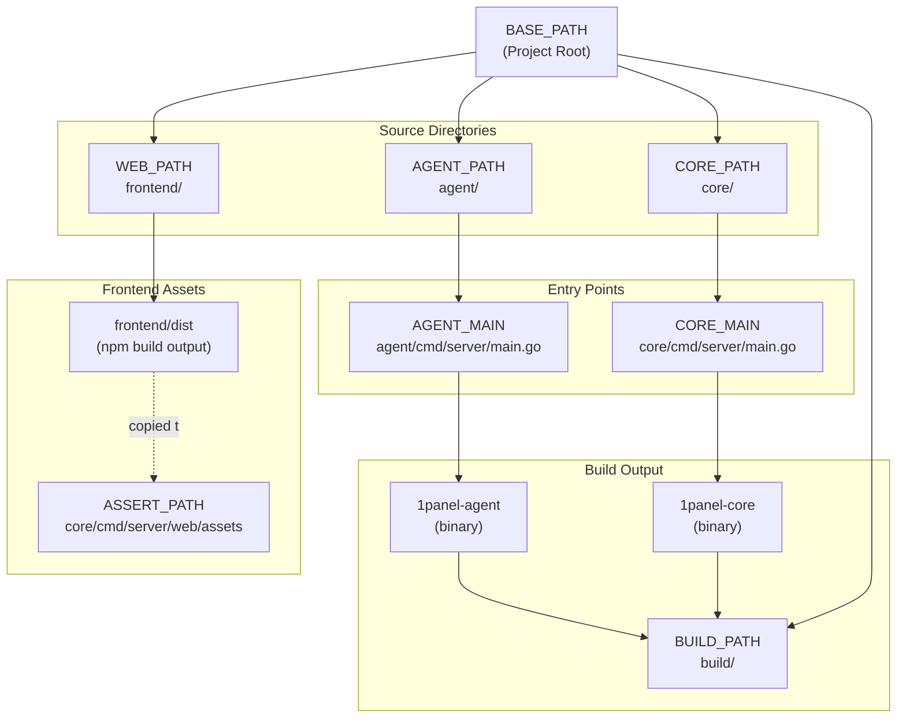
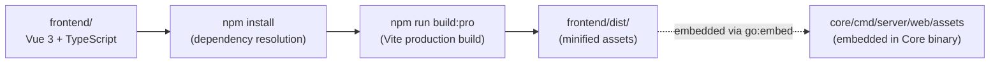
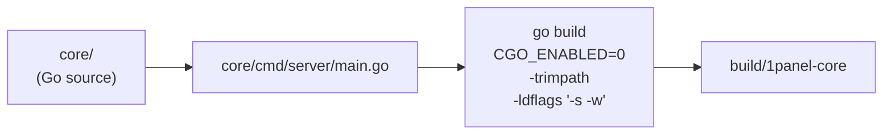
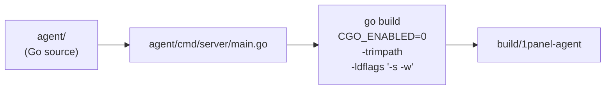
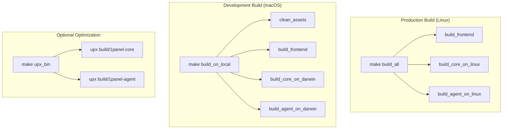
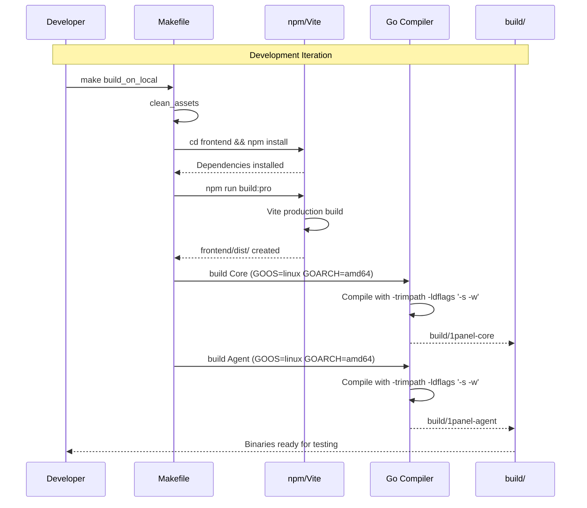
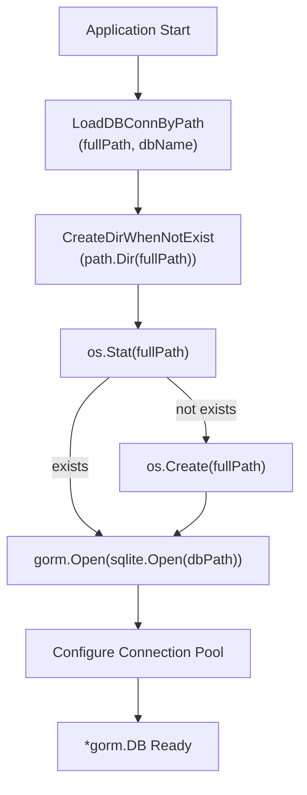
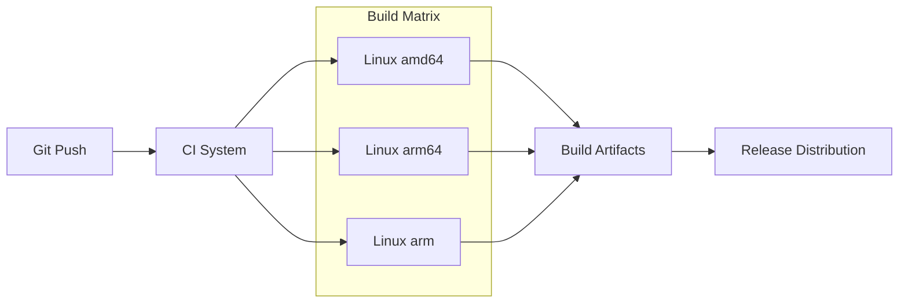

<!-- source: DeepWiki mcp.deepwiki.com · repo 1Panel-dev/1Panel · page 2.6 Build System and Development · fetched 2026-10-29 -->

# Build System and Development

<details>
<summary>Relevant source files</summary>

The following files were used as context for generating this wiki page:

- [Makefile](Makefile)
- [agent/utils/common/sqlite.go](agent/utils/common/sqlite.go)
- [core/middleware/operation.go](core/middleware/operation.go)
- [core/utils/common/sqlite.go](core/utils/common/sqlite.go)

</details>


This document explains the 1Panel build system, development workflow, compilation process, and build optimization strategies. It covers the Makefile-based build orchestration, frontend and backend compilation pipelines, cross-compilation support, and database initialization patterns used during development.

For information about the runtime architecture and service initialization, see [Backend Service Layer](#2.3). For frontend build artifacts and routing, see [Frontend Architecture](#2.4).

## Build System Overview

1Panel uses a Makefile-based build system that orchestrates the compilation of three distinct components: the Vue.js frontend, the Go-based Core API server, and the Go-based Agent API server. The build process produces statically-linked binaries suitable for Linux deployment, with optional support for cross-compilation from macOS development environments.

**Sources:** [Makefile:1-50]()

## Build Directory Structure

The build system operates on a well-defined directory structure that separates source code, build artifacts, and frontend assets:



**Sources:** [Makefile:7-18]()

| Variable | Path | Purpose |
|----------|------|---------|
| `BASE_PATH` | Project root | Base directory for all paths |
| `BUILD_PATH` | `build/` | Output directory for compiled binaries |
| `WEB_PATH` | `frontend/` | Vue.js application source |
| `ASSERT_PATH` | `core/cmd/server/web/assets` | Embedded frontend assets for Core server |
| `CORE_PATH` | `core/` | Core API server source |
| `AGENT_PATH` | `agent/` | Agent API server source |
| `CORE_MAIN` | `core/cmd/server/main.go` | Core binary entry point |
| `AGENT_MAIN` | `agent/cmd/server/main.go` | Agent binary entry point |

**Sources:** [Makefile:7-18]()

## Frontend Build Pipeline

The frontend build process compiles the Vue 3 TypeScript application into optimized production assets using Vite:



The `build_frontend` target executes the frontend build:

```makefile
build_frontend:
    cd $(WEB_PATH) && npm install && npm run build:pro
```

This target:
1. Changes to the `frontend/` directory
2. Installs npm dependencies from `package.json`
3. Runs the Vite production build script (`build:pro`)
4. Outputs minified assets to `frontend/dist/`

The compiled frontend assets are then embedded into the Core server binary at compile time using Go's `embed` directive, making the Core server a self-contained executable that serves both the API and the web interface.

**Sources:** [Makefile:28-29]()

## Backend Build Pipeline

The backend build process compiles two independent Go binaries with static linking and optimization flags:

### Build Flags and Optimization

All backend builds use the following compiler configuration:

| Flag | Purpose |
|------|---------|
| `CGO_ENABLED=0` | Disable CGO for fully static binaries (no C dependencies) |
| `GOOS=$(GOOS)` | Target operating system (linux or darwin) |
| `GOARCH=$(GOARCH)` | Target architecture (amd64, arm64, etc.) |
| `-trimpath` | Remove file system paths from compiled binary (reproducible builds) |
| `-ldflags '-s -w'` | Strip debug info (`-s`) and DWARF symbol table (`-w`) for smaller binaries |

**Sources:** [Makefile:32-37]()

### Core API Build



Build targets:
- `build_core_on_linux`: Native Linux build using system `GOOS`/`GOARCH`
- `build_core_on_darwin`: Cross-compile from macOS to Linux amd64

**Sources:** [Makefile:31-45]()

### Agent API Build



Build targets:
- `build_agent_on_linux`: Native Linux build using system `GOOS`/`GOARCH`
- `build_agent_on_darwin`: Cross-compile from macOS to Linux amd64

**Sources:** [Makefile:35-45]()

## Cross-Compilation Strategy

The build system supports two compilation scenarios:

### Native Linux Build

When building on a Linux system, the Makefile uses the system's native `GOOS` and `GOARCH` environment variables:

```makefile
build_core_on_linux:
    cd $(CORE_PATH) \
    && CGO_ENABLED=0 GOOS=$(GOOS) GOARCH=$(GOARCH) $(GOBUILD) \
       -trimpath -ldflags '-s -w' -o $(BUILD_PATH)/$(CORE_NAME) $(CORE_MAIN)

build_agent_on_linux:
    cd $(AGENT_PATH) \
    && CGO_ENABLED=0 GOOS=$(GOOS) GOARCH=$(GOARCH) $(GOBUILD) \
       -trimpath -ldflags '-s -w' -o $(BUILD_PATH)/$(AGENT_NAME) $(AGENT_MAIN)
```

This approach supports building for multiple Linux architectures (amd64, arm64, etc.) by setting environment variables before running `make`.

**Sources:** [Makefile:31-37]()

### macOS to Linux Cross-Compilation

When building on macOS (Darwin), the Makefile explicitly sets `GOOS=linux` and `GOARCH=amd64` to produce Linux binaries:

```makefile
build_core_on_darwin:
    cd $(CORE_PATH) \
    && CGO_ENABLED=0 GOOS=linux GOARCH=amd64 $(GOBUILD) \
       -trimpath -ldflags '-s -w' -o $(BUILD_PATH)/$(CORE_NAME) $(CORE_MAIN)

build_agent_on_darwin:
    cd $(AGENT_PATH) \
    && CGO_ENABLED=0 GOOS=linux GOARCH=amd64 $(GOBUILD) \
       -trimpath -ldflags '-s -w' -o $(BUILD_PATH)/$(AGENT_NAME) $(AGENT_MAIN)
```

This enables developers to build deployment-ready Linux binaries on macOS workstations without requiring a Linux VM or container.

**Sources:** [Makefile:39-45]()

## Build Targets and Workflow

The Makefile provides several composite targets for common build workflows:



### Target Descriptions

| Target | Purpose | Dependencies |
|--------|---------|--------------|
| `clean_assets` | Remove embedded frontend assets | None |
| `build_frontend` | Compile Vue.js application | npm, Node.js |
| `build_core_on_linux` | Compile Core binary (native Linux) | Go 1.22+ |
| `build_agent_on_linux` | Compile Agent binary (native Linux) | Go 1.22+ |
| `build_core_on_darwin` | Cross-compile Core binary (macOS → Linux) | Go 1.22+ |
| `build_agent_on_darwin` | Cross-compile Agent binary (macOS → Linux) | Go 1.22+ |
| `build_all` | Full production build (Linux) | All Linux targets |
| `build_on_local` | Full development build (macOS) | All Darwin targets |
| `upx_bin` | Compress binaries with UPX | UPX utility |

**Sources:** [Makefile:21-49]()

### Typical Development Workflow



**Sources:** [Makefile:47-49]()

## Development Environment Setup

### Prerequisites

| Tool | Version | Purpose |
|------|---------|---------|
| Go | 1.22+ | Backend compilation |
| Node.js | 16+ | Frontend build tooling |
| npm | 8+ | JavaScript package management |
| Make | 3.81+ | Build orchestration |
| UPX | 3.96+ (optional) | Binary compression |

### Local Build Commands

For developers working on macOS:
```bash
# Full build with frontend and cross-compiled binaries
make build_on_local

# Individual component builds
make clean_assets        # Clean embedded frontend assets
make build_frontend      # Build only Vue.js frontend
make build_core_on_darwin   # Build only Core binary
make build_agent_on_darwin  # Build only Agent binary
```

For developers working on Linux:
```bash
# Full build
make build_all

# Individual component builds
make build_frontend         # Build Vue.js frontend
make build_core_on_linux    # Build Core binary
make build_agent_on_linux   # Build Agent binary
```

For production releases with maximum compression:
```bash
make build_all
make upx_bin  # Compress binaries with UPX
```

**Sources:** [Makefile:21-49]()

## Database Initialization Patterns

The system initializes three SQLite databases during startup: `core.db`, `xpack.db`, and `agent.db`. The database initialization logic follows a consistent pattern across both Core and Agent services.

### Database Connection Initialization



### Core Service Database Initialization

The Core service initializes databases using the pattern defined in [core/utils/common/sqlite.go:15-32]():

```
LoadDBConnByPath(fullPath, dbName) flow:
1. Create directory structure if missing
2. Create empty .db file if missing
3. Open connection with gorm.Open(sqlite.Open(dbPath))
4. Configure connection pool settings
5. Return *gorm.DB instance
```

The database paths are determined by the middleware layer when routing requests. The operation logging middleware dynamically opens connections based on request paths:

| Request Path Prefix | Database File |
|---------------------|---------------|
| `/core` | `{InstallDir}/1panel/db/core.db` |
| `/xpack` | `{InstallDir}/1panel/db/xpack.db` |
| (other) | `{InstallDir}/1panel/db/agent.db` |

**Sources:** [core/utils/common/sqlite.go:15-68](), [core/middleware/operation.go:218-241]()

### Agent Service Database Initialization

The Agent service uses an identical initialization pattern implemented in [agent/utils/common/sqlite.go:16-33]():

```
LoadDBConnByPath(fullPath, dbName) flow:
1. createDirWhenNotExist(isDir=true, path.Dir(fullPath))
2. os.Stat(fullPath) check
3. os.Create(fullPath) if not exists
4. GetDBWithPath(fullPath)
5. Configure connection pool
```

**Sources:** [agent/utils/common/sqlite.go:16-79]()

### Connection Pool Configuration

Both Core and Agent services apply identical SQLite connection pool settings:

| Setting | Value | Rationale |
|---------|-------|-----------|
| `MaxOpenConns` | 4 | SQLite performs best with limited concurrency |
| `MaxIdleConns` | 1 | Minimize idle connections for lightweight SQLite |
| `ConnMaxIdleTime` | 15 minutes | Close idle connections to free resources |
| `ConnMaxLifetime` | 1 hour | Prevent connection staleness |

These settings are optimized for SQLite's single-writer model and the application's read-heavy workload patterns.

**Sources:** [agent/utils/common/sqlite.go:74-77](), [core/utils/common/sqlite.go:51-54](), [core/middleware/operation.go:236-239]()

### GORM Configuration

The database initialization uses GORM with the following configuration:

```go
gorm.Config{
    DisableForeignKeyConstraintWhenMigrating: true,
    Logger: logger.Silent,  // Production: silent logging
    IgnoreRecordNotFoundError: true,
    Colorful: false,
}
```

- **Foreign key constraints disabled**: Allows flexible schema evolution during migrations
- **Silent logging**: Reduces log verbosity in production
- **Ignore record not found**: Simplifies error handling for optional lookups
- **No color output**: Clean logs for log aggregation systems

**Sources:** [agent/utils/common/sqlite.go:63-66](), [core/utils/common/sqlite.go:43-46](), [agent/utils/common/sqlite.go:82-90](), [core/utils/common/sqlite.go:58-67]()

## Build Optimization Strategies

### Binary Size Reduction

The build system employs multiple strategies to minimize binary size:

1. **CGO Disabled (`CGO_ENABLED=0`)**: Produces fully static binaries without C library dependencies, reducing size and improving portability
2. **Strip Flags (`-ldflags '-s -w'`)**: 
   - `-s`: Omit symbol table and debug information
   - `-w`: Omit DWARF debugging information
   - Combined reduction: typically 20-30% smaller binaries
3. **Path Trimming (`-trimpath`)**: Removes file system paths from compiled code, enabling reproducible builds and slight size reduction
4. **Optional UPX Compression**: The `upx_bin` target can compress binaries by 50-70% using UPX, though at the cost of slower startup times

**Sources:** [Makefile:24-26](), [Makefile:32-37]()

### Static Linking Benefits

`CGO_ENABLED=0` ensures that Go produces fully static binaries with no external dependencies. This provides:

- **Deployment simplicity**: Single binary with no shared library requirements
- **Container optimization**: Minimal container images (can use `scratch` base)
- **Version consistency**: No runtime library version conflicts
- **Security**: Reduced attack surface from fewer dependencies

**Sources:** [Makefile:32-37]()

### Frontend Asset Embedding

The frontend assets are embedded directly into the Core binary using Go's `embed` directive, eliminating the need to distribute separate static file directories. This approach:

- Simplifies deployment (single binary distribution)
- Ensures version consistency between frontend and backend
- Enables atomic updates (one file to replace)
- Eliminates file permission issues on deployed systems

**Sources:** [Makefile:10]()

## Continuous Integration Considerations

The build system is designed for automated CI/CD pipelines:



The build system supports architecture-specific builds by setting `GOARCH` environment variables:

```bash
# AMD64 build
GOARCH=amd64 make build_all

# ARM64 build
GOARCH=arm64 make build_all

# ARM v7 build
GOARCH=arm GOARM=7 make build_all
```

This enables building release artifacts for multiple architectures from a single build script.

**Sources:** [Makefile:4-5](), [Makefile:31-37]()

---

