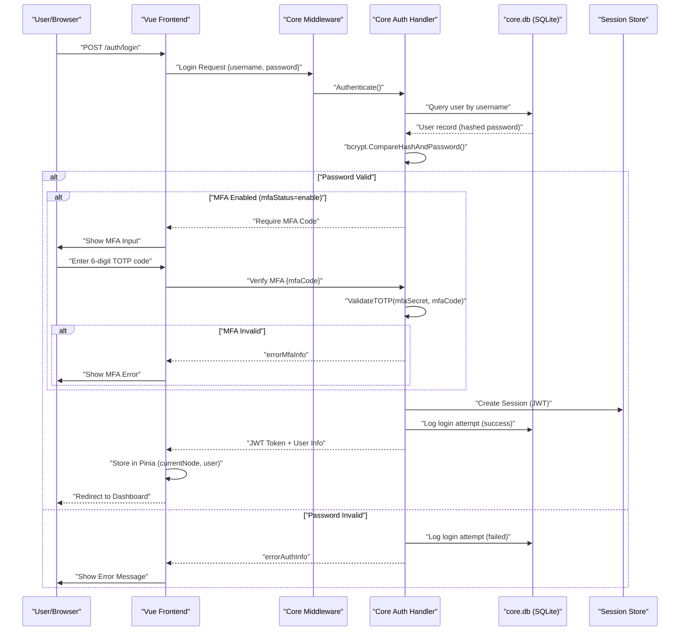
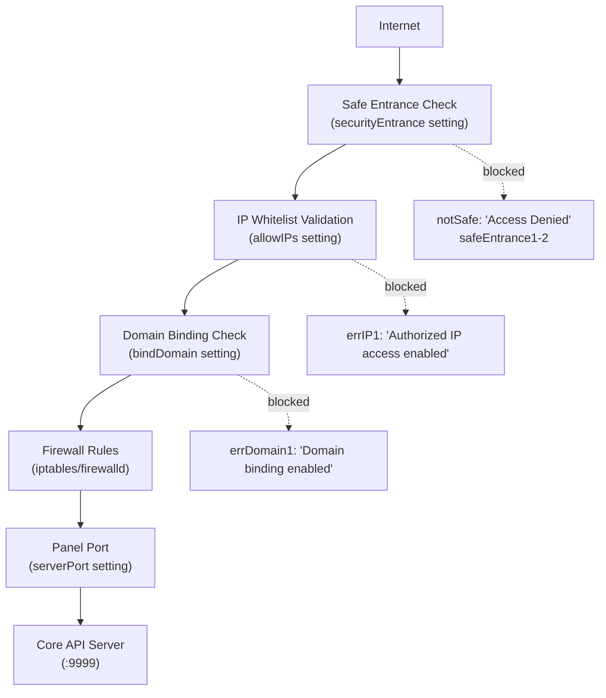
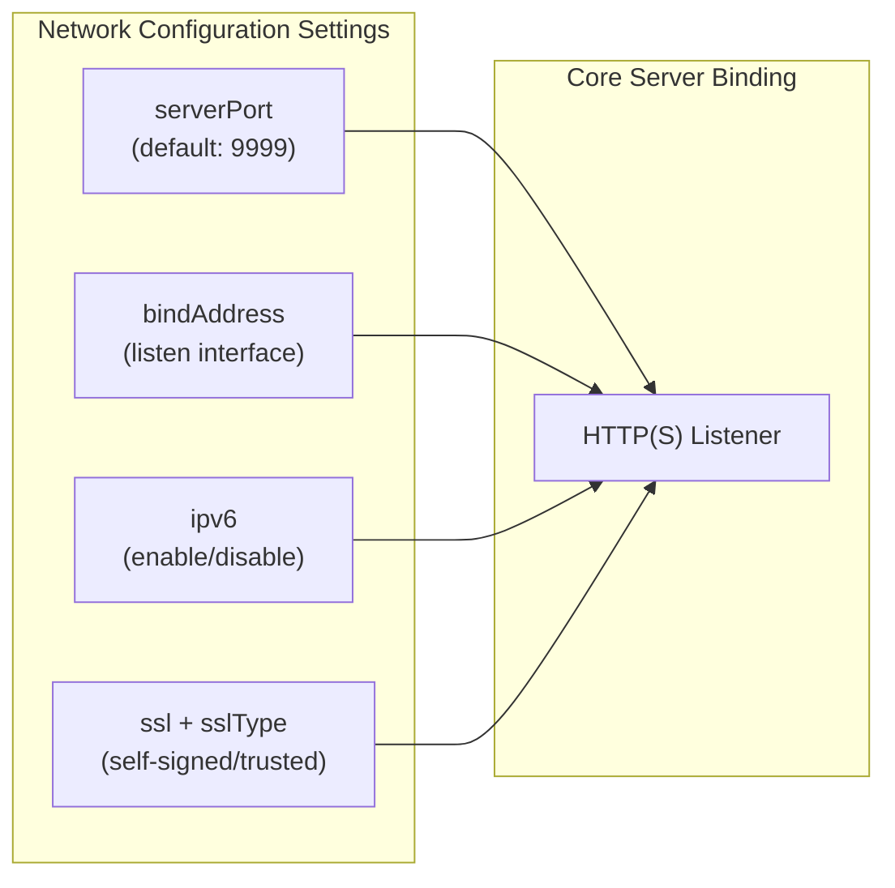
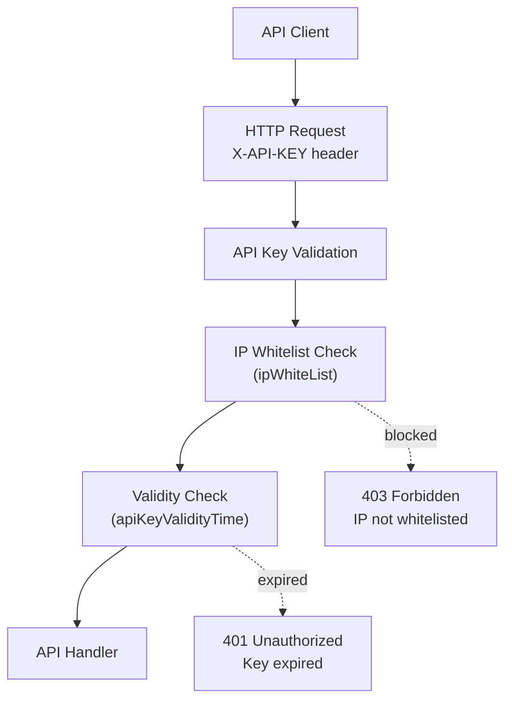
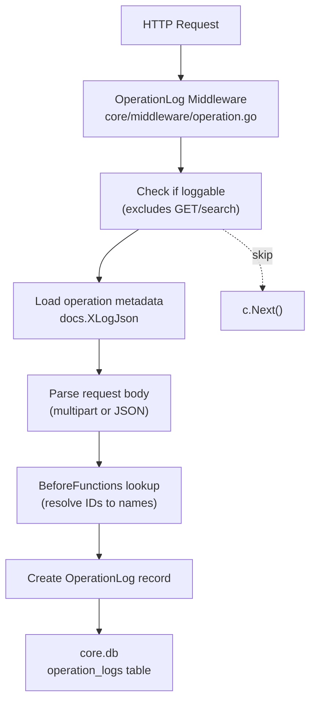
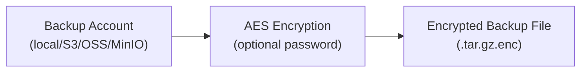
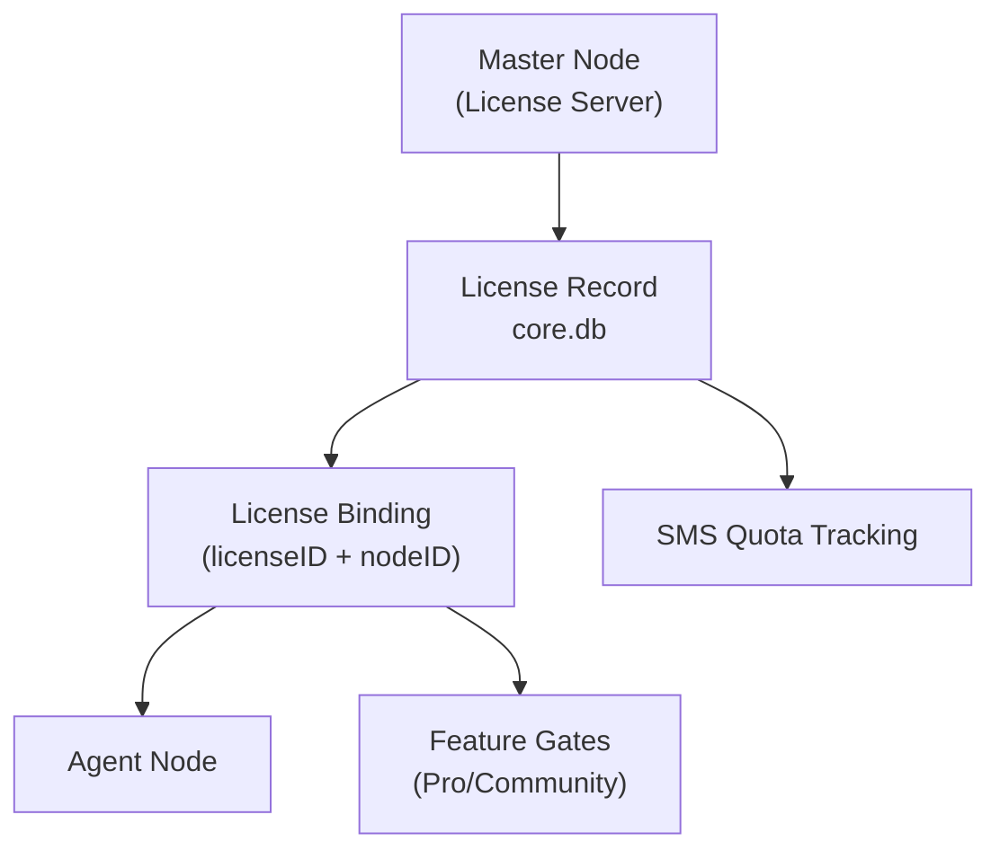

<!-- source: DeepWiki mcp.deepwiki.com · repo 1Panel-dev/1Panel · page 3 Authentication and Security · fetched 2026-10-29 -->

# Authentication and Security

<details>
<summary>Relevant source files</summary>

The following files were used as context for generating this wiki page:

- [Makefile](Makefile)
- [agent/utils/common/sqlite.go](agent/utils/common/sqlite.go)
- [core/middleware/operation.go](core/middleware/operation.go)
- [core/utils/common/sqlite.go](core/utils/common/sqlite.go)
- [frontend/src/api/interface/setting.ts](frontend/src/api/interface/setting.ts)
- [frontend/src/api/modules/setting.ts](frontend/src/api/modules/setting.ts)
- [frontend/src/lang/modules/en.ts](frontend/src/lang/modules/en.ts)
- [frontend/src/lang/modules/es-es.ts](frontend/src/lang/modules/es-es.ts)
- [frontend/src/lang/modules/ja.ts](frontend/src/lang/modules/ja.ts)
- [frontend/src/lang/modules/ko.ts](frontend/src/lang/modules/ko.ts)
- [frontend/src/lang/modules/ms.ts](frontend/src/lang/modules/ms.ts)
- [frontend/src/lang/modules/pt-br.ts](frontend/src/lang/modules/pt-br.ts)
- [frontend/src/lang/modules/ru.ts](frontend/src/lang/modules/ru.ts)
- [frontend/src/lang/modules/tr.ts](frontend/src/lang/modules/tr.ts)
- [frontend/src/lang/modules/zh-Hant.ts](frontend/src/lang/modules/zh-Hant.ts)
- [frontend/src/lang/modules/zh.ts](frontend/src/lang/modules/zh.ts)

</details>


## Purpose and Scope

This document describes 1Panel's multi-layered security architecture, covering authentication mechanisms, network access controls, API security, and audit logging. The system implements defense-in-depth with six primary security layers: authentication (password/MFA/passkey), network security (safe entrance, IP whitelisting, domain binding), application security (captcha, API keys), data security (encrypted backups, SSL), audit logging, and license enforcement.

For information about general system settings configuration, see [Settings and Configuration Management](#5). For user management and access control within specific subsystems, see the relevant functional domain pages.

---

## Authentication Mechanisms

1Panel supports three authentication methods that can be used independently or combined for enhanced security: traditional password-based authentication with bcrypt hashing, time-based one-time password (TOTP) multi-factor authentication, and WebAuthn passkey authentication for passwordless biometric/hardware key login.

### Authentication Flow



**Sources:**
- [frontend/src/lang/modules/en.ts:185-224]()
- [frontend/src/lang/modules/zh.ts:192-220]()
- [frontend/src/api/modules/setting.ts:83-96]()

### Password Authentication

The system uses bcrypt for password hashing with configurable complexity requirements. Password policies are enforced through the `complexityVerification` setting stored in the `settings` table.

| Setting Key | Type | Purpose |
|-------------|------|---------|
| `complexityVerification` | `enable`/`disable` | Enforce 8-30 char passwords with letters, numbers, and at least 2 special chars |
| `expirationDays` | integer | Password expiration period |
| `expirationTime` | timestamp | Actual expiration timestamp |

Password validation rules are defined in the frontend validation system:

- **Common Password**: Minimum 6 characters ([frontend/src/lang/modules/en.ts:249]())
- **Complex Password**: 8-30 characters with letters, numbers, and at least 2 special characters ([frontend/src/lang/modules/en.ts:247-248]())

**Sources:**
- [frontend/src/api/interface/setting.ts:41-42]()
- [frontend/src/lang/modules/en.ts:247-249]()

### Multi-Factor Authentication (MFA)

MFA implements TOTP (Time-based One-Time Password) authentication compatible with standard authenticator apps like Google Authenticator or Authy. The system stores the MFA secret in the `settings` table.

| MFA Setting | Purpose |
|-------------|---------|
| `mfaStatus` | Enable/disable MFA (`enable`/`disable`) |
| `mfaSecret` | Base32-encoded shared secret for TOTP generation |
| `mfaInterval` | Time step interval for TOTP (typically 30s) |

**MFA Workflow:**

1. Admin enables MFA in panel settings
2. System generates `mfaSecret` and displays QR code
3. User scans QR with authenticator app
4. On subsequent logins, system prompts for 6-digit TOTP code
5. System validates code against `mfaSecret` with time tolerance

**Sources:**
- [frontend/src/api/interface/setting.ts:42-44]()
- [frontend/src/lang/modules/en.ts:210-212]()
- [frontend/src/lang/modules/zh.ts:206-209]()

### Passkey Authentication (WebAuthn)

Passkey authentication uses the WebAuthn standard for passwordless login with biometric authentication or hardware security keys. This requires HTTPS and domain binding to be configured.

**Key Messages:**

- `passkeyNotSupported`: "Current browser or environment does not support passkeys, please confirm you have bound the domain name and enabled the panel SSL, and used a trusted certificate when accessing" ([frontend/src/lang/modules/en.ts:221-222]())
- `passkeyFailed`: Handles failed passkey authentication attempts ([frontend/src/lang/modules/en.ts:220]())

**Requirements:**
1. Panel must be accessed via HTTPS
2. Domain name must be bound (`bindDomain` setting)
3. Valid SSL certificate must be configured
4. Browser must support WebAuthn API

**Sources:**
- [frontend/src/lang/modules/en.ts:198-223]()
- [frontend/src/lang/modules/zh.ts:209-212]()

---

## Network Security Layers



**Sources:**
- [frontend/src/lang/modules/en.ts:204-209]()
- [frontend/src/api/interface/setting.ts:30-36]()

### Safe Entrance

The Safe Entrance feature requires users to execute a specific SSH command to retrieve panel login credentials before accessing the web interface. This prevents unauthorized access even if the panel port is exposed.

| Setting | Type | Description |
|---------|------|-------------|
| `securityEntrance` | string | Random URL path segment (e.g., `/abc123def`) |

When Safe Entrance is enabled:
1. Direct panel access returns "Access Denied" message
2. User must SSH into server and run: `1pctl user-info`
3. Command outputs the current entrance URL
4. User navigates to: `https://server-ip:port/<securityEntrance>`

**Error Messages:**
- `notSafe`: "Access Denied" ([frontend/src/lang/modules/en.ts:204]())
- `safeEntrance1`: "The secure login has been enabled in the current environment" ([frontend/src/lang/modules/en.ts:205]())
- `safeEntrance2`: "Enter the following command on the SSH terminal to view the panel entry: 1pctl user-info" ([frontend/src/lang/modules/en.ts:206]())

**Reset Command:**
```bash
1pctl user-info  # View current safe entrance
1pctl reset-entrance  # Reset safe entrance (from errHelper)
```

**Sources:**
- [frontend/src/api/interface/setting.ts:36]()
- [frontend/src/lang/modules/en.ts:204-206]()
- [frontend/src/lang/modules/zh.ts:201-203]()

### IP Whitelist

The IP whitelist restricts panel access to specific IP addresses or CIDR ranges. Multiple IPs can be configured, stored in the `allowIPs` setting.

| Setting | Format | Example |
|---------|--------|---------|
| `allowIPs` | Comma-separated IPs/CIDRs | `192.168.1.100,10.0.0.0/8` |

**Validation:**
- Checked before authentication
- Blocks non-whitelisted IPs immediately
- Returns `errIP1` message: "Authorized IP address access is enabled in the current environment" ([frontend/src/lang/modules/en.ts:207]())

**Reset via SSH:**
```bash
1pctl reset-ips  # Clear IP whitelist restrictions
```

**Sources:**
- [frontend/src/api/interface/setting.ts:34]()
- [frontend/src/lang/modules/en.ts:207-209]()

### Domain Binding

Domain binding restricts panel access to specific domain names, preventing IP-based access attacks.

| Setting | Purpose | Example |
|---------|---------|---------|
| `bindDomain` | Allowed domain(s) | `panel.example.com` |

**Behavior:**
- Validates `Host` header in HTTP requests
- Rejects requests with non-matching domains
- Required for passkey authentication to work
- Error message: `errDomain1` ([frontend/src/lang/modules/en.ts:208]())

**Reset Command:**
```bash
1pctl reset-domain  # Remove domain binding
```

**Sources:**
- [frontend/src/api/interface/setting.ts:35]()
- [frontend/src/lang/modules/en.ts:208-209]()

### Port and Binding Configuration



| Setting | Type | Default | Purpose |
|---------|------|---------|---------|
| `serverPort` | integer | 9999 | Core API listen port |
| `bindAddress` | string | `0.0.0.0` | Network interface to bind |
| `ipv6` | `enable`/`disable` | `disable` | Enable IPv6 support |
| `ssl` | `enable`/`disable` | `disable` | Enable HTTPS |
| `sslType` | `self`/`import` | - | Certificate type (self-signed or imported) |

**Sources:**
- [frontend/src/api/interface/setting.ts:29-33]()

---

## API Security

### API Key Authentication

For programmatic access, 1Panel provides API key authentication as an alternative to session-based authentication. API keys can be restricted by IP whitelist and have configurable expiration times.



| API Setting | Type | Purpose |
|-------------|------|---------|
| `apiInterfaceStatus` | `enable`/`disable` | Enable/disable API key authentication |
| `apiKey` | string | The actual API key (Base64 encoded) |
| `ipWhiteList` | string | Comma-separated IPs allowed to use API |
| `apiKeyValidityTime` | integer | Days until key expires |

**API Key Usage:**
```http
GET /api/v2/containers HTTP/1.1
Host: panel.example.com:9999
X-API-KEY: your-api-key-here
```

**Frontend Validation Rules:**
- `authBasicPassword`: "Supports letters, numbers, and common special characters, length 1-72" ([frontend/src/lang/modules/en.ts:279]())

**Sources:**
- [frontend/src/api/interface/setting.ts:65-68]()
- [frontend/src/lang/modules/en.ts:279]()

### Session Management

Sessions are managed with JWT tokens with configurable timeout periods.

| Setting | Type | Default | Purpose |
|---------|------|---------|---------|
| `sessionTimeout` | integer | 86400 | Session timeout in seconds (default: 24h) |

Session tokens are stored in the Pinia global store on the frontend after successful authentication. The token is included in all subsequent API requests via standard HTTP Authorization headers or cookies.

**Sources:**
- [frontend/src/api/interface/setting.ts:14]()

### Captcha Protection

The system includes captcha protection for login attempts to prevent brute-force attacks.

**Captcha Messages:**
- `captchaHelper`: "Captcha" ([frontend/src/lang/modules/en.ts:202]())
- `errorCaptcha`: "Captcha code error!" ([frontend/src/lang/modules/en.ts:203]())

Captcha is displayed after multiple failed login attempts and must be correctly entered before password validation proceeds.

**Sources:**
- [frontend/src/lang/modules/en.ts:202-203]()

---

## Audit and Monitoring

### Operation Logging System



The operation logging middleware captures all mutating API operations (POST, PUT, DELETE) and stores structured logs in the `operation_logs` table.

**Log Record Structure:**

| Field | Type | Source | Purpose |
|-------|------|--------|---------|
| `source` | string | `loadLogInfo(path)` | Operation source (Core/Agent) |
| `node` | string | `CurrentNode` header | Target node for multi-node setups |
| `ip` | string | `c.ClientIP()` | Client IP address |
| `method` | string | HTTP method | Operation type (post/put/delete) |
| `path` | string | URL path | API endpoint |
| `user_agent` | string | User-Agent header | Client information |

**Operation Metadata from Swagger:**

The middleware uses `docs.XLogJson` to map API paths to human-readable operation descriptions:

```go
type operationJson struct {
    FormatZH         map[string]interface{} // Chinese format strings
    FormatEN         map[string]interface{} // English format strings  
    BodyKeys         []string               // Request body keys to log
    BeforeFunctions  []functionInfo         // DB lookups for context
}
```

**Example Flow:**

1. Request: `POST /api/v2/containers` with `{"name": "my-container"}`
2. Middleware extracts `name` from body based on `BodyKeys`
3. If `BeforeFunctions` defined, performs DB lookup to resolve IDs to names
4. Stores formatted log: "Created container: my-container"

**Sources:**
- [core/middleware/operation.go:28-166]()

### Login Attempt Logging

All login attempts (successful and failed) are logged with timestamps, IP addresses, and outcomes. This provides forensic data for security investigations.

**Login Messages:**
- `loginSuccess`: "Logged in successfully" ([frontend/src/lang/modules/en.ts:157]())
- `errorAuthInfo`: "The user name or password you entered is incorrect" ([frontend/src/lang/modules/en.ts:200]())

**Sources:**
- [frontend/src/lang/modules/en.ts:157-200]()

### Task Execution Logging

Async operations (like app installations, container operations) generate detailed task logs stored separately. Each task has multiple subtasks with progress tracking.

**Log Viewing:**
- `notRecords`: "No execution record is generated for the current task" ([frontend/src/lang/modules/en.ts:163]())

**Sources:**
- [frontend/src/lang/modules/en.ts:163]()

### Resource Change Tracking

The operation log system tracks all resource changes (create/update/delete) across:
- Containers, images, networks, volumes
- Websites, SSL certificates, domains
- Databases and database users
- Applications and installations
- System settings
- Firewall rules

Each logged operation includes:
- User who performed the action
- Timestamp
- Resource type and identifier
- Before/after state (where applicable)
- Success/failure status

**Sources:**
- [core/middleware/operation.go:1-234]()

---

## Data Security

### Encrypted Backups

Backup files can be encrypted using AES encryption with user-provided passwords. The encryption settings are configured per backup account.

**Backup Configuration:**


**Sources:**
- [frontend/src/lang/modules/en.ts:181-182]()

### SSL/TLS Configuration

The panel supports SSL/TLS for encrypted communication:

| SSL Setting | Values | Purpose |
|-------------|--------|---------|
| `ssl` | `enable`/`disable` | Enable HTTPS |
| `sslType` | `self`/`import` | Self-signed or imported certificate |

**SSL Certificate Types:**
1. **Self-signed**: Automatically generated by panel
2. **Imported**: User-provided trusted certificate

**Sources:**
- [frontend/src/api/interface/setting.ts:32-33]()

### Secret Management

Sensitive data like passwords and API keys are:
1. Hashed with bcrypt before storage (passwords)
2. Base64 encoded for transmission (secrets)
3. Never logged in operation logs
4. Masked in UI by default with show/hide toggle

**Password Display:**
- `passwordHelper`: "Cannot obtain, click to modify" ([frontend/src/lang/modules/en.ts:542]())

**Sources:**
- [frontend/src/lang/modules/en.ts:542]()

---

## License and Node Security

### License Binding System



**License API Endpoints:**

| Endpoint | Purpose |
|----------|---------|
| `POST /core/licenses/upload` | Upload new license ([frontend/src/api/modules/setting.ts:12]()) |
| `POST /core/licenses/update` | Update existing license ([frontend/src/api/modules/setting.ts:14]()) |
| `POST /core/licenses/bind` | Bind license to nodes ([frontend/src/api/modules/setting.ts:31-32]()) |
| `POST /core/licenses/unbind` | Unbind license from nodes ([frontend/src/api/modules/setting.ts:34-35]()) |
| `GET /core/licenses/status` | Check license status ([frontend/src/api/modules/setting.ts:22-26]()) |

**License Binding:**
```typescript
interface LicenseBind {
    licenseID: number;
    nodeIDs: Array<number>;
}
```

License binding occurs at the node level, enabling per-node feature gating. When a license is bound:
1. Master node validates license with license server
2. Node ID is associated with license record
3. Features are unlocked on that specific node
4. SMS quota is allocated (if applicable)

**SMS Quota:**
- Used for notification services
- Tracked per license
- API: `GET /core/licenses/sms/info` ([frontend/src/api/modules/setting.ts:54-56]())

**Sources:**
- [frontend/src/api/modules/setting.ts:10-56]()
- [frontend/src/api/interface/setting.ts:93-120]()

### Multi-Node Access Control

In multi-node deployments, the `CurrentNode` header determines which node processes the request:

```http
POST /api/v2/containers HTTP/1.1
CurrentNode: node-02
Authorization: Bearer <jwt-token>
```

The operation log middleware extracts this header to track which node performed each operation ([core/middleware/operation.go:38-40]()).

**Sources:**
- [core/middleware/operation.go:38-42]()

---

## Database Security

### SQLite Configuration

Both `core.db` and `agent.db` use SQLite with specific security configurations:

**Connection Settings:**

| Parameter | Value | Purpose |
|-----------|-------|---------|
| `MaxOpenConns` | 4 | Limit concurrent connections |
| `MaxIdleConns` | 1 | Minimize idle connections |
| `ConnMaxIdleTime` | 15 min | Close idle connections quickly |
| `ConnMaxLifetime` | 1 hour | Rotate connections regularly |

These settings minimize the attack surface by limiting database connection persistence and concurrency.

**Database Initialization:**
```go
func LoadDBConnByPath(fullPath, dbName string) *gorm.DB {
    // Creates directory and file if not exist
    // Opens with GORM and SQLite driver
    // Configures connection pool
    // Returns *gorm.DB instance
}
```

**Sources:**
- [agent/utils/common/sqlite.go:16-33]()
- [core/utils/common/sqlite.go:15-32]()
- [agent/utils/common/sqlite.go:62-78]()

### Sensitive Data Handling

The middleware filters sensitive keys from operation logs:

```go
sensitiveKeys := []string{"password", "passwd", "secret", "token", "api_key"}
// These keys are never logged in operation_logs
```

This prevents accidental exposure of credentials in audit trails.

**Sources:**
- [core/middleware/operation.go:64-80]()

---

## Security Best Practices

### Recommended Configuration

For production deployments, the following security settings should be enabled:

| Feature | Setting | Recommendation |
|---------|---------|----------------|
| Safe Entrance | `securityEntrance` | **Enable** - Prevents direct access |
| IP Whitelist | `allowIPs` | **Enable** - Restrict to known IPs |
| Domain Binding | `bindDomain` | **Enable** - Prevent IP-based attacks |
| SSL/TLS | `ssl=enable` | **Enable** - Encrypt all traffic |
| MFA | `mfaStatus=enable` | **Enable** - Add second factor |
| Password Complexity | `complexityVerification=enable` | **Enable** - Enforce strong passwords |
| API Interface | `apiInterfaceStatus` | **Disable** unless needed |
| Session Timeout | `sessionTimeout` | **Reduce** to 3600-7200s for high-security |

### Security Headers

The system should configure appropriate security headers (CSP, HSTS, X-Frame-Options) to protect against common web attacks. These are typically configured in the Gin router middleware.

### Regular Security Audits

Administrators should regularly review:
1. Operation logs for suspicious activity ([core/middleware/operation.go]())
2. Login attempt logs for brute-force patterns
3. License bindings and node status
4. API key usage and IP whitelist entries
5. Firewall rule changes

**Sources:**
- [frontend/src/api/interface/setting.ts:4-68]()
- [core/middleware/operation.go:28-166]()

---

