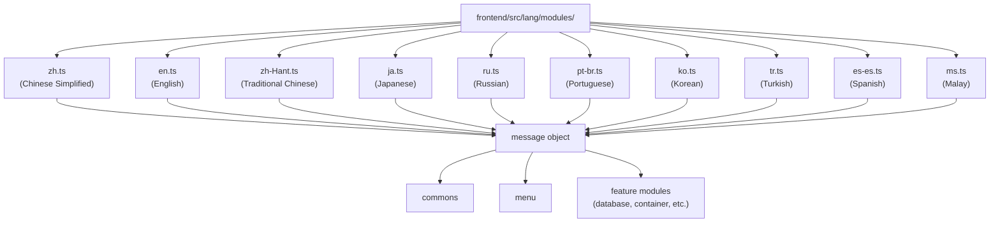
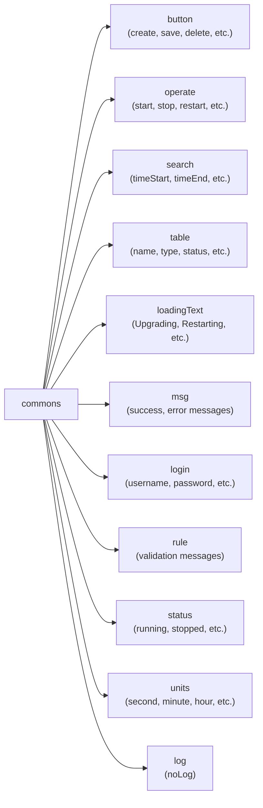
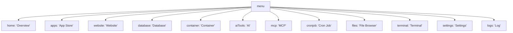
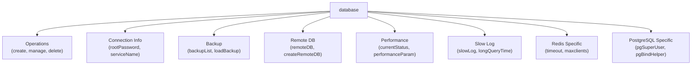
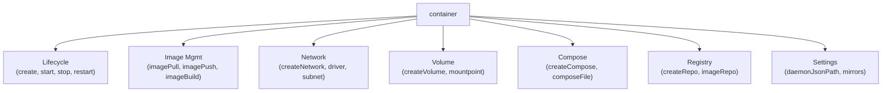
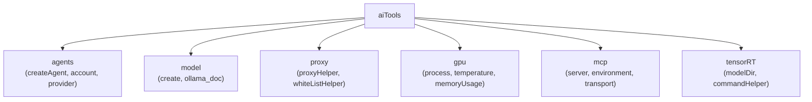
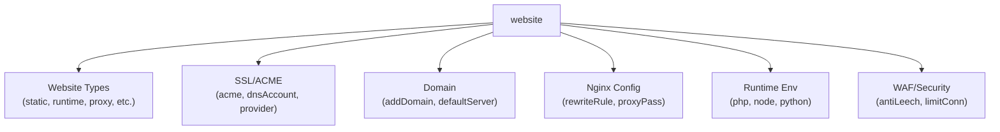
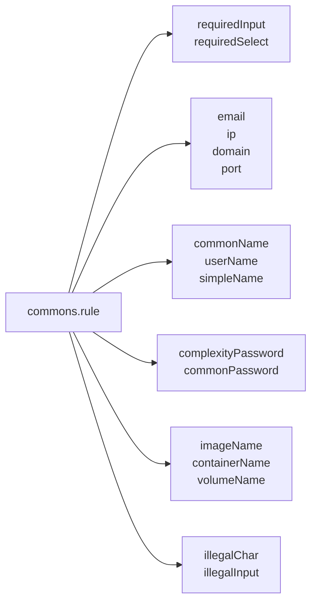
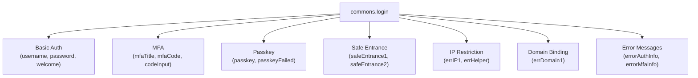
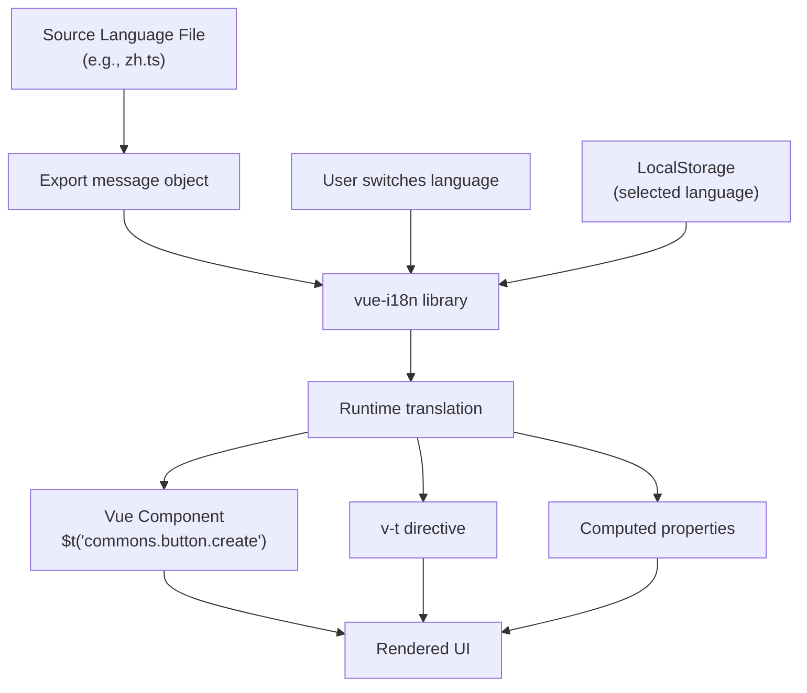

<!-- source: DeepWiki mcp.deepwiki.com · repo 1Panel-dev/1Panel · page 4 Internationalization and Localization · fetched 2026-10-29 -->

# Internationalization and Localization

<details>
<summary>Relevant source files</summary>

The following files were used as context for generating this wiki page:

- [frontend/src/lang/modules/en.ts](frontend/src/lang/modules/en.ts)
- [frontend/src/lang/modules/es-es.ts](frontend/src/lang/modules/es-es.ts)
- [frontend/src/lang/modules/ja.ts](frontend/src/lang/modules/ja.ts)
- [frontend/src/lang/modules/ko.ts](frontend/src/lang/modules/ko.ts)
- [frontend/src/lang/modules/ms.ts](frontend/src/lang/modules/ms.ts)
- [frontend/src/lang/modules/pt-br.ts](frontend/src/lang/modules/pt-br.ts)
- [frontend/src/lang/modules/ru.ts](frontend/src/lang/modules/ru.ts)
- [frontend/src/lang/modules/tr.ts](frontend/src/lang/modules/tr.ts)
- [frontend/src/lang/modules/zh-Hant.ts](frontend/src/lang/modules/zh-Hant.ts)
- [frontend/src/lang/modules/zh.ts](frontend/src/lang/modules/zh.ts)

</details>


**Purpose**: This document describes the internationalization (i18n) and localization (l10n) system in 1Panel, including the supported languages, translation file structure, message organization, and how translations are integrated into the frontend application.

**Scope**: Covers the frontend translation system, message structure, supported languages, and translation key organization. For backend configuration of panel settings including language selection, see [Settings and Configuration Management](#5).

---

## Overview

1Panel provides a comprehensive internationalization system supporting **10 languages** across its Vue.js frontend. The i18n implementation uses `vue-i18n` to provide runtime translation switching and a hierarchical message structure that mirrors the application's feature organization.

The translation system covers all user-facing text including:
- UI components (buttons, tables, forms, status messages)
- Navigation menus and page titles
- Feature-specific terminology (containers, databases, websites, AI tools)
- Validation messages and error text
- Help text and tooltips

**Sources**: [frontend/src/lang/modules/zh.ts:1-10](), [frontend/src/lang/modules/en.ts:1-10]()

---

## Supported Languages

1Panel supports the following 10 languages with complete translation coverage:

| Language | Code | File | Import Source |
|----------|------|------|---------------|
| Chinese (Simplified) | `zh` | `zh.ts` | `fit2cloud-ui-plus/src/locale/lang/zh-cn` |
| English | `en` | `en.ts` | `fit2cloud-ui-plus/src/locale/lang/en` |
| Chinese (Traditional) | `zh-Hant` | `zh-Hant.ts` | `fit2cloud-ui-plus/src/locale/lang/zh-tw` |
| Japanese | `ja` | `ja.ts` | `fit2cloud-ui-plus/src/locale/lang/ja` |
| Russian | `ru` | `ru.ts` | `fit2cloud-ui-plus/src/locale/lang/ru` |
| Portuguese (Brazilian) | `pt-br` | `pt-br.ts` | `fit2cloud-ui-plus/src/locale/lang/pt-br` |
| Korean | `ko` | `ko.ts` | `fit2cloud-ui-plus/src/locale/lang/en` |
| Turkish | `tr` | `tr.ts` | `fit2cloud-ui-plus/src/locale/lang/en` |
| Spanish (Spanish) | `es-es` | `es-es.ts` | `fit2cloud-ui-plus/src/locale/lang/en` |
| Malay | `ms` | `ms.ts` | `fit2cloud-ui-plus/src/locale/lang/ms` |

Each language file is located at `frontend/src/lang/modules/{language}.ts` and exports a `message` object containing all translations for that language. The files also import locale configurations from the `fit2cloud-ui-plus` component library to ensure consistency across UI components.

**Sources**: [frontend/src/lang/modules/zh.ts:1-2](), [frontend/src/lang/modules/en.ts:1-2](), [frontend/src/lang/modules/ja.ts:1-2]()

---

## Translation File Structure

### File Organization



**Sources**: [frontend/src/lang/modules/zh.ts:3-361](), [frontend/src/lang/modules/en.ts:3-374]()

### Message Object Structure

Each language file exports a `message` object with the following structure:

```typescript
const message = {
    commons: {
        button: { /* button labels */ },
        operate: { /* operation verbs */ },
        table: { /* table UI text */ },
        status: { /* status values */ },
        msg: { /* common messages */ },
        // ...
    },
    menu: { /* navigation menu labels */ },
    home: { /* dashboard page */ },
    database: { /* database management */ },
    container: { /* container management */ },
    website: { /* website management */ },
    aiTools: { /* AI tools module */ },
    // ... feature-specific namespaces
}
```

**Sources**: [frontend/src/lang/modules/zh.ts:3-361](), [frontend/src/lang/modules/en.ts:3-374]()

---

## Message Hierarchy

### Commons Namespace

The `commons` namespace contains reusable UI elements shared across the entire application:



**Sources**: [frontend/src/lang/modules/zh.ts:4-361](), [frontend/src/lang/modules/en.ts:4-374]()

#### Button Actions

Common button labels defined in `commons.button`:

| Key | English | Chinese | Usage Context |
|-----|---------|---------|---------------|
| `create` | Create | 创建 | Resource creation |
| `save` | Save | 保存 | Form submission |
| `delete` | Delete | 删除 | Resource deletion |
| `edit` | Edit | 编辑 | Resource modification |
| `enable` | Enable | 启用 | Activation |
| `disable` | Disable | 停用 | Deactivation |
| `backup` | Backup | 备份 | Backup operations |
| `recover` | Recover | 恢复 | Restore operations |
| `upgrade` | Upgrade | 升级 | Version upgrades |
| `install` | Install | 安装 | App installation |

**Sources**: [frontend/src/lang/modules/zh.ts:11-90](), [frontend/src/lang/modules/en.ts:11-90]()

#### Status Values

Status translations in `commons.status`:

| Key | English | Chinese | Context |
|-----|---------|---------|---------|
| `running` | Running | 已启动 | Active state |
| `stopped` | Stopped | 已停止 | Inactive state |
| `installing` | Installing | 安装中 | Installation in progress |
| `upgrading` | Upgrading | 升级中 | Upgrade in progress |
| `failed` | Failed | 失败 | Error state |
| `success` | Success | 成功 | Successful completion |
| `healthy` | Normal | 正常 | Health check passed |
| `unhealthy` | Unhealthy | 异常 | Health check failed |

**Sources**: [frontend/src/lang/modules/zh.ts:281-340](), [frontend/src/lang/modules/en.ts:294-352]()

### Menu Namespace

The `menu` namespace defines all navigation menu labels:



**Sources**: [frontend/src/lang/modules/en.ts:375-407](), [frontend/src/lang/modules/zh.ts:362-393]()

---

## Feature-Specific Namespaces

### Database Module

The `database` namespace contains all database management translations:



**Sources**: [frontend/src/lang/modules/en.ts:491-653](), [frontend/src/lang/modules/zh.ts:477-653]()

### Container Module

The `container` namespace provides Docker container management translations:



**Sources**: [frontend/src/lang/modules/en.ts:802-1095](), [frontend/src/lang/modules/zh.ts:801-1094]()

### AI Tools Module

The `aiTools` namespace covers AI infrastructure management:



**Sources**: [frontend/src/lang/modules/en.ts:654-800](), [frontend/src/lang/modules/zh.ts:654-800]()

### Website Module

The `website` namespace contains web server and SSL management:



**Sources**: [frontend/src/lang/modules/en.ts:1096-1800](), [frontend/src/lang/modules/zh.ts:1095-1800]()

---

## Translation Key Patterns

### Validation Rules

The `commons.rule` namespace defines validation error messages with consistent patterns:



**Pattern Structure**:
- **Input validation**: `requiredInput`, `requiredSelect`
- **Format validation**: `{type}` (e.g., `email`, `ip`, `domain`)
- **Length validation**: `{scope}Name` (e.g., `commonName`, `userName`)
- **Pattern validation**: `{resource}Name` (e.g., `imageName`, `containerName`)

**Sources**: [frontend/src/lang/modules/en.ts:225-283](), [frontend/src/lang/modules/zh.ts:221-270]()

### Helper Text Pattern

Helper text keys follow the pattern `{feature}Helper` or `{action}Helper`:

| Key Pattern | Example | Usage |
|-------------|---------|-------|
| `{feature}Helper` | `localhostHelper` | Explains feature behavior |
| `{action}Helper` | `backupHelper` | Confirms action before execution |
| `{setting}Helper` | `portHelper` | Describes configuration option |

**Sources**: [frontend/src/lang/modules/en.ts:494-653](), [frontend/src/lang/modules/zh.ts:477-653]()

### Operation Confirmation Messages

Confirmation messages in `commons.msg`:

```typescript
// Pattern: {action} + 'Helper'
backupHelper: 'The current operation will back up {0}. Do you want to proceed?'
recoverHelper: 'Restoring from {0} file. This operation is irreversible.'
operatorHelper: 'The operation "{1}" will be performed on "{0}"...'
```

Uses placeholder `{0}`, `{1}` for dynamic values.

**Sources**: [frontend/src/lang/modules/en.ts:151-194](), [frontend/src/lang/modules/zh.ts:148-191]()

---

## Pluralization and Formatting

### Time Units with Pluralization

The `commons.units` namespace supports pluralization for time units:

```typescript
// English format: 'singular | singular | plural'
second: ' second | second | seconds'
minute: 'minute | minute | minutes'
hour: 'hour | hour | hours'
day: 'day | day | days'
```

This format allows `vue-i18n` to automatically select the correct form based on count.

**Sources**: [frontend/src/lang/modules/en.ts:355-370](), [frontend/src/lang/modules/zh.ts:341-357]()

### Dynamic Message Formatting

Messages use numbered placeholders for dynamic content:

```typescript
// Table total count
total: 'Total {0}'

// Number range validation
numberRange: 'This field must be a number between {0} and {1}.'

// Operation confirmation
operatorHelper: 'The operation "{1}" will be performed on "{0}"...'
```

**Sources**: [frontend/src/lang/modules/en.ts:112](), [frontend/src/lang/modules/zh.ts:112]()

---

## Special Characters and Formatting

### Colon Character

Each language defines its colon character to match local conventions:

| Language | Colon | Example Usage |
|----------|-------|---------------|
| Chinese | `'：'` (full-width) | Used after labels |
| English | `': '` (with space) | Used after labels |
| Japanese | `':'` | Used after labels |

**Sources**: [frontend/src/lang/modules/zh.ts:10](), [frontend/src/lang/modules/en.ts:7](), [frontend/src/lang/modules/ja.ts:7]()

### Semicolon in Units

Used for separating multiple values:

```typescript
units: {
    semicolon: '；'  // Chinese uses full-width semicolon
}
```

**Sources**: [frontend/src/lang/modules/zh.ts:356](), [frontend/src/lang/modules/en.ts:369]()

---

## Authentication and Security

### Login Page Translations

The `commons.login` namespace includes authentication-specific text:



**Key Features**:
- **Passkey support**: `passkey`, `passkeyFailed`, `passkeyNotSupported`, `passkeyToPassword`
- **MFA authentication**: `mfaTitle`, `mfaCode`, `codeInput`
- **Safe entrance**: `safeEntrance1`, `safeEntrance2` (explains SSH command requirement)
- **IP/Domain restrictions**: `errIP1`, `errDomain1`, `errHelper`

**Sources**: [frontend/src/lang/modules/en.ts:195-224](), [frontend/src/lang/modules/zh.ts:192-220]()

---

## Context-Specific Translations

### Loading States

The `commons.loadingText` namespace provides system operation status messages:

```typescript
loadingText: {
    Upgrading: 'System upgrade, please wait...',
    Restarting: 'System restart, please wait...',
    Recovering: 'Recovering from snapshot, please wait...',
    Rollbacking: 'Rollbacking from snapshot, please wait...'
}
```

These are displayed during long-running system operations.

**Sources**: [frontend/src/lang/modules/en.ts:145-150](), [frontend/src/lang/modules/zh.ts:142-147]()

### Service-Specific Messages

Each major feature module includes specialized terminology:

**Container Module Example**:
```typescript
container: {
    privileged: 'Privileged mode',
    privilegedHelper: 'Allows container to perform privileged operations...',
    autoRemove: 'Auto-remove container on exit',
    cpuShare: 'CPU weight',
    cpuShareHelper: 'Container default share is 1024 CPU...'
}
```

**Database Module Example**:
```typescript
database: {
    pgSuperUser: 'Super User',
    pgBindHelper: 'This operation is used to create a new user...',
    localhostHelper: 'Configuring database permissions as "localhost"...'
}
```

**Sources**: [frontend/src/lang/modules/en.ts:893-896](), [frontend/src/lang/modules/en.ts:538-540]()

---

## Translation Workflow Diagram



**Sources**: [frontend/src/lang/modules/zh.ts:1-10](), [frontend/src/lang/modules/en.ts:1-10]()

---

## Translation Coverage by Module

### Complete Module List

The following table shows the primary namespaces and their translation key counts (approximate, based on English file):

| Namespace | Key Count | Primary Features |
|-----------|-----------|------------------|
| `commons` | ~500 | Buttons, tables, status, validation, messages |
| `menu` | ~40 | Navigation menu labels |
| `home` | ~80 | Dashboard, system info, quick actions |
| `database` | ~180 | MySQL, PostgreSQL, Redis management |
| `container` | ~300 | Docker containers, images, networks, volumes |
| `website` | ~700+ | Nginx, SSL, domains, runtime environments |
| `aiTools` | ~150 | AI agents, models, GPU monitoring, MCP |
| `cronjob` | ~100 | Scheduled tasks, backup jobs |
| `app` | ~200 | App store, installation, updates |
| `terminal` | ~60 | Terminal sessions, SSH |
| `firewall` | ~100 | Firewall rules, port forwarding |
| `file` | ~180 | File browser, editor, operations |
| `settings` | ~300+ | Panel settings, security, backup |
| `logs` | ~80 | Audit logs, operation logs |
| `toolbox` | ~120 | Device management, FTP, fail2ban |

**Sources**: [frontend/src/lang/modules/en.ts:1-3000]()

---

## Implementation Details

### Vue-i18n Integration

Each language file imports the corresponding `fit2cloud-ui-plus` locale:

```typescript
// Chinese
import fit2cloudZhLocale from 'fit2cloud-ui-plus/src/locale/lang/zh-cn';

// English
import fit2cloudEnLocale from 'fit2cloud-ui-plus/src/locale/lang/en';
```

This ensures that UI component library elements (Element Plus wrapper) are also translated.

**Sources**: [frontend/src/lang/modules/zh.ts:1](), [frontend/src/lang/modules/en.ts:1]()

### Message Export

Each file exports a `message` constant:

```typescript
const message = {
    commons: { /* ... */ },
    menu: { /* ... */ },
    // ... feature namespaces
};

export default message;
```

This is consumed by the i18n configuration to register translations for each language.

**Sources**: [frontend/src/lang/modules/zh.ts:3-end]()

---

## Best Practices and Conventions

### Key Naming Conventions

1. **camelCase for keys**: All translation keys use camelCase: `createDatabase`, `rootPassword`
2. **Helper suffix**: Explanatory text uses `Helper` suffix: `localhostHelper`, `portHelper`
3. **Verb-first for actions**: Action keys start with verbs: `create`, `delete`, `backup`
4. **Noun-first for resources**: Resource keys start with nouns: `containerName`, `imageName`

### Organizational Patterns

1. **Hierarchical grouping**: Related translations are nested under common parents
2. **Feature isolation**: Each major feature has its own top-level namespace
3. **Common reuse**: Frequently used terms (button labels, status values) are centralized in `commons`
4. **Context preservation**: Similar terms in different contexts have different keys

### Translation Consistency

1. **Placeholder syntax**: Use `{0}`, `{1}`, etc. for dynamic values
2. **Punctuation**: Include trailing punctuation in the translation, not in code
3. **Case sensitivity**: Maintain consistent capitalization within each language
4. **Length consideration**: Some languages (German, Russian) may have longer text

**Sources**: [frontend/src/lang/modules/en.ts:1-3000](), [frontend/src/lang/modules/zh.ts:1-3000]()

---

## Summary

The 1Panel internationalization system provides comprehensive translation coverage across 10 languages with over 2,000 translation keys per language. The hierarchical message structure aligns with the application's feature organization, making translations easy to locate and maintain. The use of consistent naming conventions, placeholder syntax, and the `vue-i18n` library ensures a robust and maintainable i18n implementation that supports the system's global user base.

---

