<!-- source: DeepWiki mcp.deepwiki.com · repo 1Panel-dev/1Panel · page 5 Settings and Configuration Management · fetched 2026-10-29 -->

# Settings and Configuration Management

<details>
<summary>Relevant source files</summary>

The following files were used as context for generating this wiki page:

- [frontend/src/api/interface/setting.ts](frontend/src/api/interface/setting.ts)
- [frontend/src/api/modules/setting.ts](frontend/src/api/modules/setting.ts)

</details>


## Purpose and Scope

This document covers the settings and configuration management system in 1Panel, which controls system-wide behavior, security parameters, network configuration, license management, and operational settings. The settings system operates at multiple levels: Core server settings (authentication, SSL, proxy, licenses) and Agent server settings (terminal configuration, snapshot behavior, monitoring parameters).

For authentication mechanisms themselves (password validation, MFA verification, session management), see [Authentication and Security](#3). For internationalization settings and language configuration, see [Internationalization and Localization](#4). For multi-node architecture and node management, see [Multi-Node Architecture](#2.2).

---

## Settings Architecture Overview

The settings system follows a two-tier architecture where the Core API server manages global configuration and the Agent API server manages operational parameters. Settings are persisted in SQLite databases (`core.db` for Core settings, `agent.db` for Agent settings) and exposed via REST endpoints.

```mermaid
graph TB
    subgraph "Frontend Layer"
        SettingsUI["Settings UI Components"]
        SettingsStore["Global Store<br/>(currentNode, user)"]
        SettingsAPI["Settings API Client<br/>frontend/src/api/modules/setting.ts"]
    end
    
    subgraph "Core API Server :9999"
        CoreSettingsHandler["Settings Handlers"]
        CoreDB[("core.db<br/>settings table")]
        LicenseTable[("xpack.db<br/>licenses table")]
        
        subgraph "Core Settings Domains"
            GeneralSettings["General Settings<br/>SettingInfo (69 fields)"]
            TerminalSettings["Terminal Config<br/>TerminalInfo"]
            ProxySettings["Proxy Config<br/>ProxyUpdate"]
            SSLSettings["SSL Config<br/>SSLUpdate, SSLInfo"]
            AuthSettings["Auth Settings<br/>MFA, Passkey"]
            APISettings["API Key Config<br/>ApiConfig"]
            LicenseSettings["License Management<br/>License, LicenseBind"]
            UpgradeSettings["Upgrade Config<br/>UpgradeInfo"]
        end
    end
    
    subgraph "Agent API Server :10000"
        AgentSettingsHandler["Settings Handlers"]
        AgentDB[("agent.db<br/>settings table")]
        
        subgraph "Agent Settings Domains"
            BaseConfig["Base Configuration<br/>basedir, daemonjson"]
            SnapshotConfig["Snapshot Config<br/>SnapshotCreate, SnapshotInfo"]
            MonitorConfig["Monitor Settings<br/>interval, retention"]
        end
    end
    
    SettingsUI --> SettingsStore
    SettingsUI --> SettingsAPI
    
    SettingsAPI -->|"/core/settings/*"| CoreSettingsHandler
    SettingsAPI -->|"/settings/*"| AgentSettingsHandler
    
    CoreSettingsHandler --> CoreDB
    CoreSettingsHandler --> LicenseTable
    CoreSettingsHandler --> GeneralSettings
    CoreSettingsHandler --> TerminalSettings
    CoreSettingsHandler --> ProxySettings
    CoreSettingsHandler --> SSLSettings
    CoreSettingsHandler --> AuthSettings
    CoreSettingsHandler --> APISettings
    CoreSettingsHandler --> LicenseSettings
    CoreSettingsHandler --> UpgradeSettings
    
    AgentSettingsHandler --> AgentDB
    AgentSettingsHandler --> BaseConfig
    AgentSettingsHandler --> SnapshotConfig
    AgentSettingsHandler --> MonitorConfig
```

**Sources:** [frontend/src/api/modules/setting.ts:1-223](), [frontend/src/api/interface/setting.ts:1-312]()

---

## Core Settings Structure

The `SettingInfo` interface defines 69 distinct configuration parameters organized into functional categories. All settings are retrieved via `POST /core/settings/search` and updated via `POST /core/settings/update` with key-value pairs.

### SettingInfo Schema

| Category | Fields | Purpose |
|----------|--------|---------|
| **User Credentials** | `userName`, `password`, `email` | Administrator account information |
| **System Identity** | `systemIP`, `systemVersion`, `panelName` | System identification and branding |
| **Time Configuration** | `sessionTimeout`, `localTime`, `timeZone`, `ntpSite` | Time synchronization and session management |
| **UI Preferences** | `theme`, `menuTabs`, `language`, `hideMenu`, `dashboardMemoVisible` | Interface customization |
| **Network Settings** | `serverPort`, `ipv6`, `bindAddress`, `ssl`, `sslType`, `allowIPs`, `bindDomain` | Network binding and access control |
| **Security Parameters** | `securityEntrance`, `expirationDays`, `complexityVerification`, `mfaStatus`, `mfaSecret` | Authentication and access protection |
| **Monitoring** | `monitorStatus`, `monitorInterval`, `monitorStoreDays` | System monitoring configuration |
| **Proxy Configuration** | `proxyUrl`, `proxyType`, `proxyPort`, `proxyUser`, `proxyPasswd` | Outbound proxy settings |
| **API Access** | `apiInterfaceStatus`, `apiKey`, `ipWhiteList`, `apiKeyValidityTime` | Programmatic API access control |
| **Operational** | `dockerSockPath`, `developerMode`, `defaultIO`, `defaultNetwork`, `snapshotIgnore` | Runtime behavior configuration |

**Core API Endpoints:**

```typescript
// Retrieve all settings
POST /core/settings/search
Response: SettingInfo

// Retrieve single setting by key
POST /core/settings/by
Body: { key: string }
Response: string

// Update setting
POST /core/settings/update
Body: { key: string, value: string }

// Check system availability
GET /core/settings/search/available
```

**Sources:** [frontend/src/api/interface/setting.ts:4-69](), [frontend/src/api/modules/setting.ts:83-100]()

---

## Terminal Configuration

The `TerminalInfo` interface controls the web-based terminal appearance and behavior. This configuration applies to all terminal sessions across file management, container shells, and SSH access.

### Terminal Parameters

```typescript
interface TerminalInfo {
    lineHeight: string;        // Line spacing (e.g., "1.2")
    letterSpacing: string;     // Character spacing (e.g., "0.5px")
    fontSize: string;          // Font size (e.g., "14px")
    fontFamily: string;        // Monospace font name
    cursorBlink: string;       // "enable" or "disable"
    cursorStyle: string;       // "bar", "block", or "underline"
    scrollback: string;        // History buffer size (lines)
    scrollSensitivity: string; // Scroll wheel sensitivity
}
```

**Terminal Settings Endpoints:**

```typescript
// Get terminal configuration
POST /core/settings/terminal/search
Response: TerminalInfo

// Update terminal configuration
POST /core/settings/terminal/update
Body: TerminalInfo
```

**Sources:** [frontend/src/api/interface/setting.ts:70-79](), [frontend/src/api/modules/setting.ts:89-94]()

---

## Network and Security Settings

Network configuration controls panel accessibility, domain binding, IP restrictions, and the Safe Entrance feature.

### Access Control Hierarchy

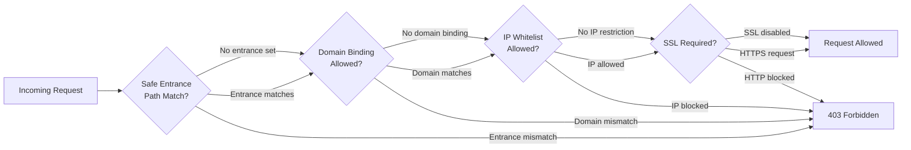

### Network Configuration Endpoints

```typescript
// Load available network interfaces
GET /core/settings/interface
Response: Array<InterfaceInfo>

// Update bind address and IPv6 setting
POST /core/settings/bind/update
Body: { ipv6: string, bindAddress: string }

// Update server port
POST /core/settings/port/update
Body: { serverPort: number }
```

### Safe Entrance Configuration

The `securityEntrance` setting defines a custom URL path (e.g., `/admin-xyz123`) required to access the panel. Without this path, requests receive a 404 response. The entrance is typically displayed via SSH command: `1pctl user-info`.

**Sources:** [frontend/src/api/interface/setting.ts:8-42](), [frontend/src/api/modules/setting.ts:118-126]()

---

## Proxy Configuration

The proxy system enables outbound HTTP/HTTPS requests to route through a forward proxy, essential for air-gapped environments or networks requiring proxy authentication. The `ProxyUpdate` interface supports HTTP, SOCKS5, and disabled states.

### Proxy Configuration Flow

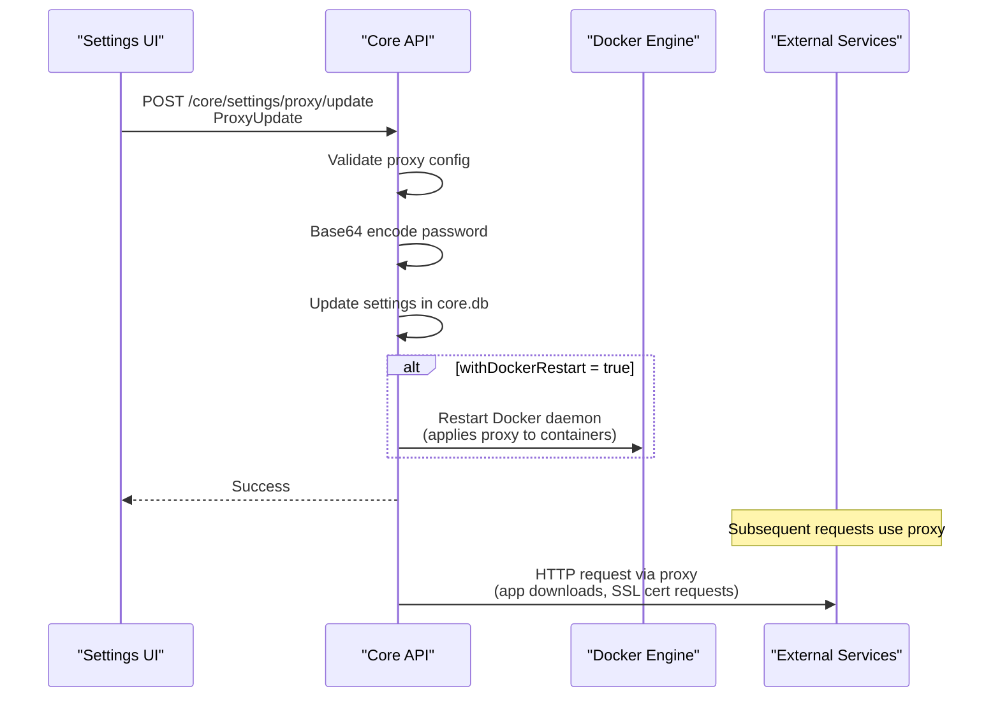

### Proxy Update Parameters

```typescript
interface ProxyUpdate {
    proxyUrl: string;           // Proxy server address
    proxyType: string;          // "http", "socks5", or "close"
    proxyPort: string;          // Proxy port number
    proxyUser: string;          // Optional authentication username
    proxyPasswd: string;        // Optional authentication password
    proxyPasswdKeep: string;    // Keep existing password flag
    withDockerRestart: boolean; // Restart Docker to apply proxy
}
```

**Password Handling:** Passwords are Base64 encoded before transmission: `request.proxyPasswd = Base64.encode(request.proxyPasswd)`. When `proxyType` is set to `"close"`, it's converted to empty string to disable the proxy.

**Endpoint:**
```typescript
POST /core/settings/proxy/update
Body: ProxyUpdate
```

**Sources:** [frontend/src/api/interface/setting.ts:84-92](), [frontend/src/api/modules/setting.ts:107-114]()

---

## SSL/TLS Configuration

SSL configuration enables HTTPS access to the 1Panel web interface. The system supports three SSL sources: self-signed certificates, ACME-issued certificates, and manually uploaded certificates.

### SSL Configuration Structure

```typescript
interface SSLUpdate {
    ssl: string;        // "enable" or "disable"
    domain: string;     // Domain for ACME validation
    sslType: string;    // "self", "import", or "acme"
    cert: string;       // PEM-encoded certificate
    key: string;        // PEM-encoded private key
    sslID: number;      // Reference to SSL certificate ID
}

interface SSLInfo {
    domain: string;     // Current SSL domain
    timeout: string;    // Certificate expiration date
    rootPath: string;   // SSL files storage path
    cert: string;       // Current certificate content
    key: string;        // Current private key content
    sslID: number;      // Current certificate ID
}
```

### SSL Management Endpoints

```typescript
// Get current SSL configuration
GET /core/settings/ssl/info
Response: SSLInfo

// Update SSL configuration
POST /core/settings/ssl/update
Body: SSLUpdate

// Download current SSL certificate
GET /core/settings/ssl/download
Response: Binary file (certificate archive)
```

**SSL Type Behaviors:**
- **self**: Generates self-signed certificate on demand
- **import**: Uses uploaded certificate and key files
- **acme**: References a certificate from the SSL certificate manager (see [SSL Certificate Management](#7.4))

**Sources:** [frontend/src/api/interface/setting.ts:99-114](), [frontend/src/api/modules/setting.ts:127-135]()

---

## Authentication Settings

The settings system manages advanced authentication mechanisms including Multi-Factor Authentication (MFA) via TOTP and WebAuthn Passkey authentication.

### MFA Configuration

MFA uses Time-Based One-Time Password (TOTP) with configurable intervals. The binding process generates a QR code for authenticator apps.

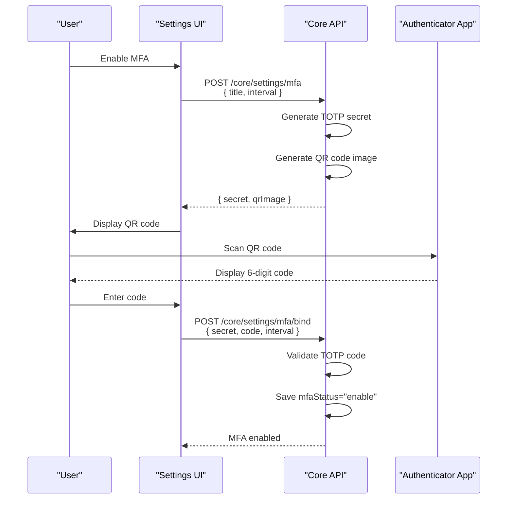

**MFA Endpoints:**
```typescript
// Generate MFA QR code
POST /core/settings/mfa
Body: { title: string, interval: number }
Response: { secret: string, qrImage: string }

// Bind MFA with verification code
POST /core/settings/mfa/bind
Body: { secret: string, code: string, interval: string }
```

### Passkey (WebAuthn) Configuration

Passkey authentication enables biometric and hardware security key authentication using the WebAuthn standard. Multiple passkeys can be registered per user.

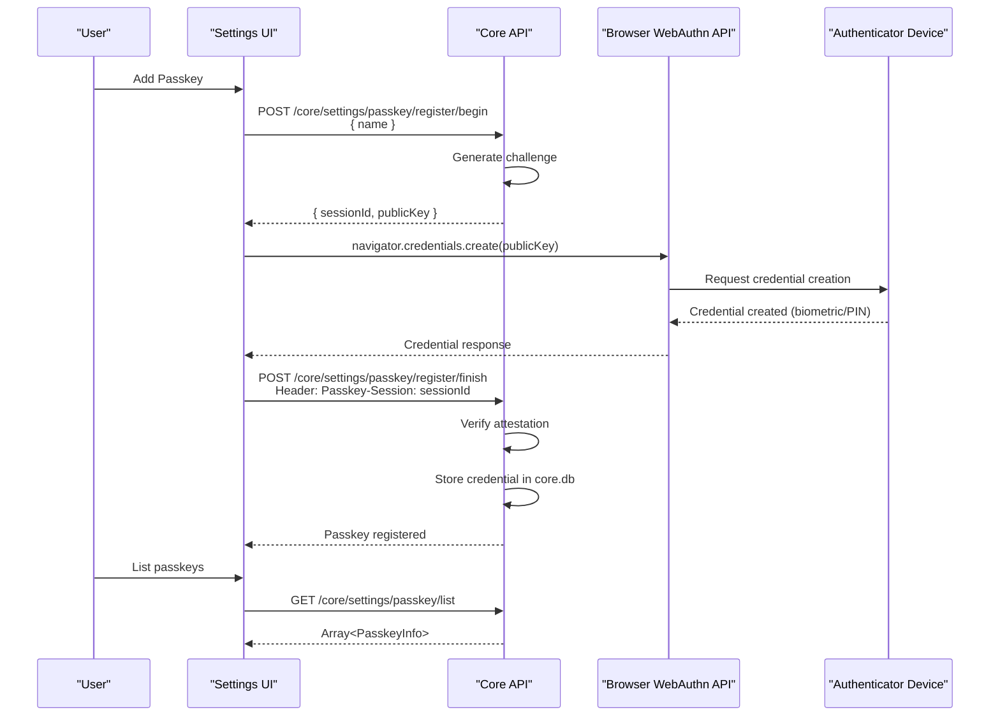

**Passkey Endpoints:**
```typescript
// Begin passkey registration
POST /core/settings/passkey/register/begin
Body: { name: string }
Response: { sessionId: string, publicKey: Record<string, any> }

// Finish passkey registration
POST /core/settings/passkey/register/finish
Headers: { 'Passkey-Session': sessionId }
Body: WebAuthn attestation response

// List registered passkeys
GET /core/settings/passkey/list
Response: Array<PasskeyInfo>

// Delete passkey
DELETE /core/settings/passkey/:id
```

**PasskeyInfo Structure:**
```typescript
interface PasskeyInfo {
    id: string;         // Credential ID
    name: string;       // User-assigned name
    createdAt: string;  // Registration timestamp
    lastUsedAt: string; // Last authentication timestamp
}
```

**Sources:** [frontend/src/api/interface/setting.ts:122-147](), [frontend/src/api/modules/setting.ts:139-156]()

---

## Snapshot Configuration

The snapshot system creates point-in-time backups of the entire 1Panel installation including apps, databases, panel configuration, and operational data. Snapshots support encryption, selective data inclusion, and multi-account distribution.

### Snapshot Data Model

```typescript
interface SnapshotCreate {
    id: number;                      // 0 for new, >0 for recreate
    sourceAccountIDs: string;        // Comma-separated backup account IDs
    downloadAccountID: string;       // Account ID for storage
    description: string;             // Snapshot description
    secret: string;                  // Encryption password (optional)
    timeout: number;                 // Execution timeout in seconds
    
    appData: Array<DataTree>;        // Selected installed apps
    panelData: Array<DataTree>;      // Selected panel configurations
    backupData: Array<DataTree>;     // Selected backup accounts
    
    withMonitorData: boolean;        // Include monitoring history
    withLoginLog: boolean;           // Include login logs
    withOperationLog: boolean;       // Include operation logs
}
```

### Snapshot Lifecycle

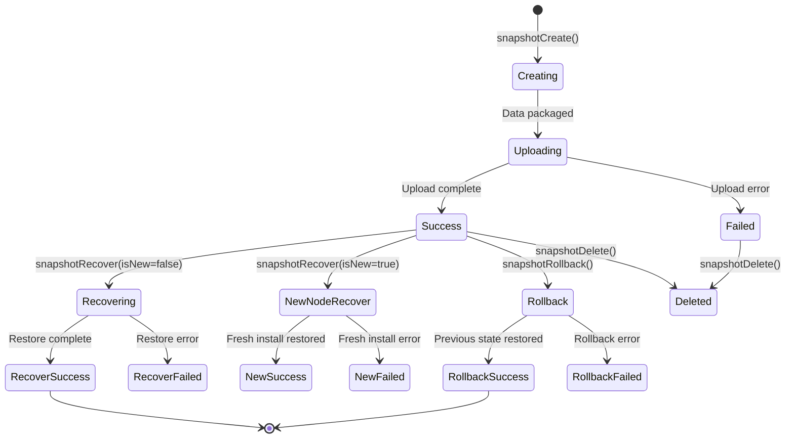

### DataTree Structure

The `DataTree` structure represents hierarchical data selection for snapshots:

```typescript
interface DataTree {
    id: string;           // Unique identifier
    label: string;        // Display name
    key: string;          // Data key (app name, DB name, etc.)
    name: string;         // Resource name
    size: number;         // Data size in bytes
    isShow: boolean;      // Visible in UI
    isDisable: boolean;   // Cannot be selected
    path: string;         // File system path
    Children: Array<DataTree>; // Nested items
}
```

### Snapshot Endpoints

```typescript
// Load available data for snapshot
GET /settings/snapshot/load
Response: { appData, panelData, backupData, withMonitorData, withLoginLog, withOperationLog }

// Create new snapshot
POST /settings/snapshot
Body: SnapshotCreate

// Recreate existing snapshot with updated data
POST /settings/snapshot/recreate
Body: { id: number }

// Import snapshot from backup account
POST /settings/snapshot/import
Body: { backupAccountID: number, names: Array<string>, description: string }

// Recover snapshot to current system
POST /settings/snapshot/recover
Body: { id, taskID, isNew, reDownload, secret }

// Rollback to snapshot state
POST /settings/snapshot/rollback
Body: { id, taskID, isNew, reDownload, secret }

// Search snapshots with pagination
POST /settings/snapshot/search
Body: SearchWithPage
Response: ResPage<SnapshotInfo>

// Delete snapshots
POST /settings/snapshot/del
Body: { ids: number[], deleteWithFile: boolean }
```

**Snapshot Encryption:** When `secret` is provided, the snapshot archive is AES-encrypted. The same secret must be provided during recovery/rollback operations.

**Snapshot Status Fields:**
- `status`: "Success", "Failed", "Uploading", "Creating"
- `recoverStatus`: "Success", "Failed", "Recovering"
- `rollbackStatus`: "Success", "Failed", "RollingBack"
- `interruptStep`: Records which step failed for recovery continuation

**Sources:** [frontend/src/api/interface/setting.ts:156-228](), [frontend/src/api/modules/setting.ts:166-192]()

---

## Upgrade System Configuration

The upgrade system manages 1Panel version updates with release notes, version constraints, and rollback capability through snapshots.

### Upgrade Information Structure

```typescript
interface UpgradeInfo {
    testVersion: string;     // Beta/testing version available
    newVersion: string;      // Stable version available
    latestVersion: string;   // Highest version available
    releaseNote: string;     // Markdown release notes
}

interface ReleasesNotes {
    Version: string;         // Version number (e.g., "v1.10.0")
    CreatedAt: string;       // Release date
    Content: string;         // Full release notes (Markdown)
    NewCount: number;        // Count of new features
    OptimizationCount: number; // Count of optimizations
    FixCount: number;        // Count of bug fixes
}
```

### Upgrade Process Flow

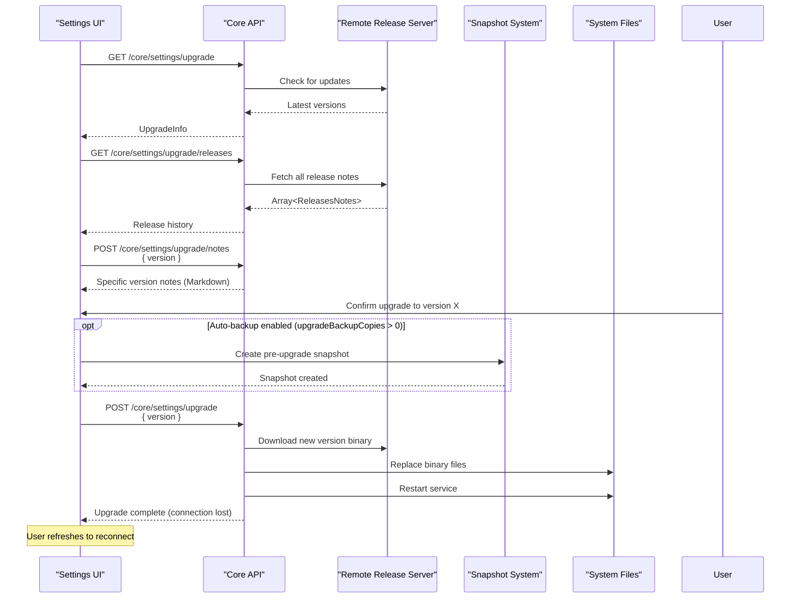

### Upgrade Endpoints

```typescript
// Get available upgrade information
GET /core/settings/upgrade
Response: UpgradeInfo

// List all release notes
GET /core/settings/upgrade/releases
Response: Array<ReleasesNotes>

// Get specific version release notes
POST /core/settings/upgrade/notes
Body: { version: string }
Response: string (Markdown content)

// Execute upgrade
POST /core/settings/upgrade
Body: { version: string }
```

**Automatic Backup:** The `upgradeBackupCopies` setting (in `SettingInfo`) controls how many automatic snapshots are retained during upgrades. Setting this to `"3"` maintains the last 3 pre-upgrade snapshots.

**Version Selection:** Users can upgrade to `newVersion` (stable), `testVersion` (beta), or any previous version for rollback scenarios.

**Sources:** [frontend/src/api/interface/setting.ts:229-288](), [frontend/src/api/modules/setting.ts:195-206]()

---

## License Management

The license system enforces node-level feature gating between Community and Pro editions. Licenses bind to specific nodes and control access to advanced features like multi-node management, enhanced monitoring, and SMS notifications.

### License Data Model

```typescript
interface License {
    licenseName: string;        // License identifier
    assigneeName: string;       // Licensed organization/user
    productPro: string;         // Product tier ("community" or "xpack")
    versionConstraint: string;  // Compatible version range
    trial: boolean;             // Trial license flag
    status: string;             // "Active", "Expired", "Invalid"
    message: string;            // Status message
    smsUsed: number;            // SMS notifications used
    smsTotal: number;           // SMS notifications quota
}

interface LicenseStatus {
    productPro: string;         // Current product tier
    status: string;             // License status
    smsTotal: number;           // Total SMS quota
    smsUsed: number;            // Used SMS quota
}

interface LicenseBind {
    nodeID: number;             // Target node ID
    licenseID: number;          // License to bind
    syncList: string;           // Data to sync ("app,website,database")
    withDockerRestart: boolean; // Restart Docker after binding
}
```

### License Binding Workflow

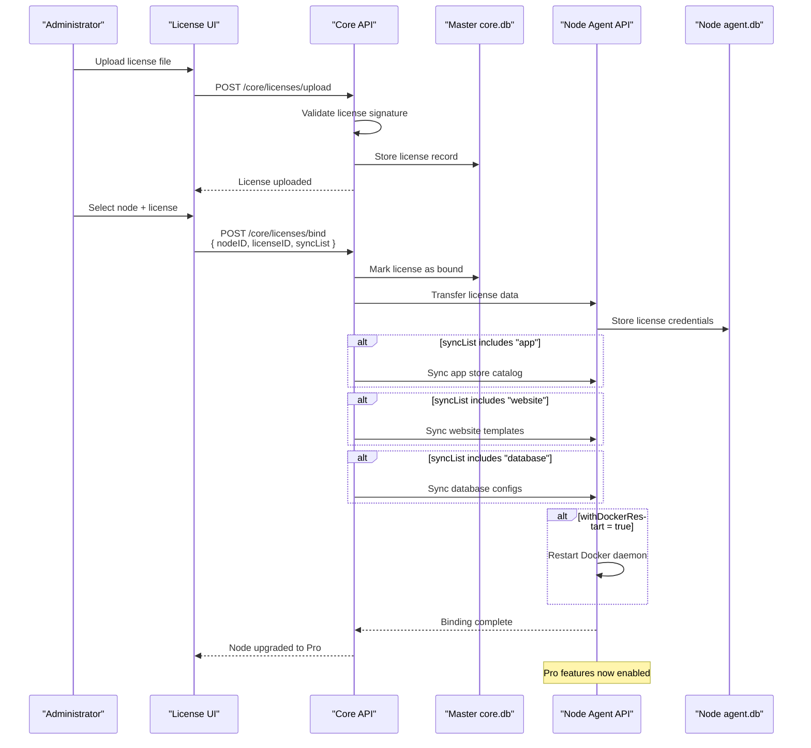

### Node Management

```typescript
interface NodeItem {
    id: number;         // Node database ID
    addr: string;       // Node address (IP:port)
    status: string;     // "Running", "Stopped", "Error"
    version: string;    // 1Panel version
    isXpack: boolean;   // Pro edition enabled
    isBound: boolean;   // License bound to this node
    name: string;       // Node display name
}

interface SimpleNodeItem {
    id: number;
    name: string;
    addr: string;
    description: string;
    systemVersion: string;         // OS version
    securityEntrance: string;      // Safe entrance path
    cpuUsedPercent: number;        // CPU usage
    cpuTotal: number;              // CPU core count
    memoryTotal: number;           // Total RAM in bytes
    memoryUsedPercent: number;     // Memory usage
}
```

### License Endpoints

```typescript
// Upload new license
POST /core/licenses/upload
Body: FormData (license file)

// Update existing license
POST /core/licenses/update
Body: FormData (license file)

// Search licenses with pagination
POST /core/licenses/search
Body: ReqPage
Response: ResPage<License>

// Delete license
POST /core/licenses/del
Body: { ids: number }

// Get license status for current node
GET /core/licenses/status
Response: LicenseStatus

// Get license status for master node
GET /core/licenses/master/status
Response: LicenseStatus

// Sync license data from remote
POST /core/licenses/sync
Body: { id: number }

// Bind license to node
POST /core/licenses/bind
Body: LicenseBind
Timeout: 60 seconds

// Unbind license from node
POST /core/licenses/unbind
Body: { id: number, force: boolean, withDockerRestart: boolean }
Timeout: 60 seconds

// Change license binding between nodes
POST /core/licenses/bind/free
Body: { licenseID: number, nodeIDs: Array<number> }
Timeout: 60 seconds

// Load license options for dropdown
GET /core/licenses/options
Response: Array<LicenseOptions>

// List nodes by type
POST /core/nodes/list
Body: { type: string }
Response: Array<NodeItem>

// List all nodes
GET /core/nodes/all
Response: Array<NodeItem>

// List simple node info for dashboard
GET /core/nodes/simple/all
Response: Array<SimpleNodeItem>

// Get SMS quota information
GET /core/licenses/sms/info
Response: { licenseName, smsUsed, smsTotal }

// List nodes with app updates available
GET /core/xpack/nodes/apps/update
Response: Array<NodeAppItem>
Timeout: 60 seconds
```

**License Binding Constraints:**
- Each license can bind to multiple nodes based on quota
- `availableFreeCount` in `LicenseOptions` shows remaining node slots
- Forced unbinding (`force: true`) removes license even if node is offline
- SMS quota is shared across all nodes bound to a license

**Sources:** [frontend/src/api/interface/setting.ts:236-312](), [frontend/src/api/modules/setting.ts:10-60]()

---

## API Key Management

The API key system enables programmatic access to 1Panel with IP-based access control and key expiration management. This allows CI/CD systems and automation tools to interact with the panel without web UI authentication.

### API Configuration Structure

```typescript
interface ApiConfig {
    apiInterfaceStatus: string;    // "enable" or "disable"
    apiKey: string;                // Generated API key (64-char hex)
    ipWhiteList: string;           // Comma-separated IP addresses
    apiKeyValidityTime: number;    // Expiration time (Unix timestamp)
}
```

### API Key Management Flow

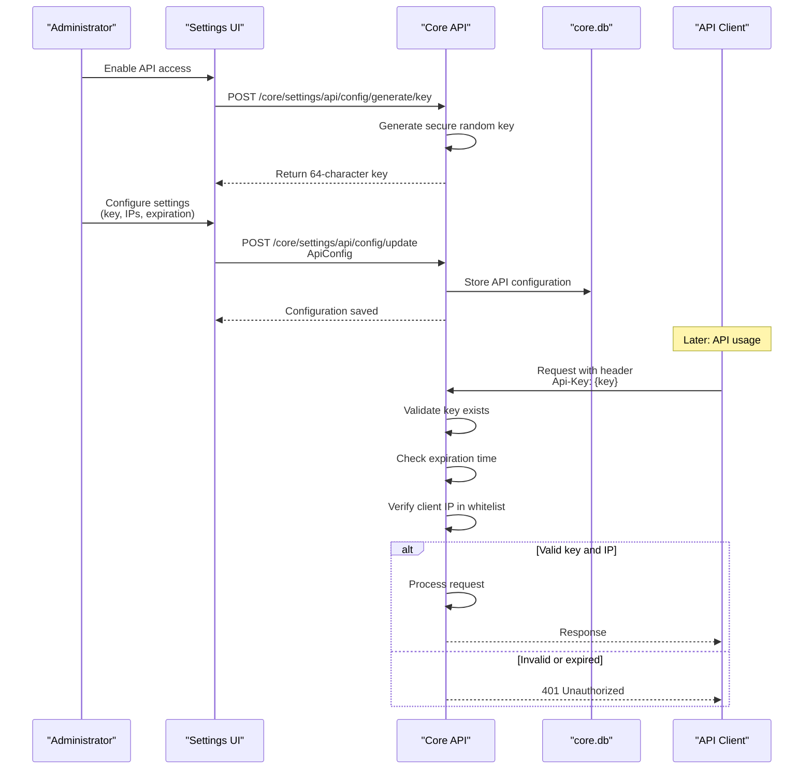

### API Key Endpoints

```typescript
// Generate new API key
POST /core/settings/api/config/generate/key
Response: string (64-character hex key)

// Update API configuration
POST /core/settings/api/config/update
Body: ApiConfig
```

**API Key Properties:**
- Keys are 64-character hexadecimal strings
- Keys are stored in `core.db` settings table with key `"ApiKey"`
- IP whitelist supports CIDR notation (e.g., `"192.168.1.0/24"`)
- `apiKeyValidityTime` of `0` means no expiration
- When `apiInterfaceStatus` is `"disable"`, all API requests are rejected regardless of valid keys

**API Request Authentication:**
Clients include the API key in request headers:
```http
GET /api/v1/containers
Api-Key: a1b2c3d4e5f6...
```

**Sources:** [frontend/src/api/interface/setting.ts:93-98](), [frontend/src/api/modules/setting.ts:209-214]()

---

## App Store Configuration

The App Store configuration controls which remote catalog 1Panel uses to fetch application metadata. This allows organizations to use private app repositories or mirrors.

### App Store Configuration Structure

```typescript
interface AppStoreConfig {
    appStoreUrl: string;          // App catalog base URL
    appStoreLastModified: string; // Last sync timestamp
}

interface AppStoreConfigUpdate {
    appStoreUrl: string;          // New catalog URL
}
```

### App Store Endpoints

```typescript
// Get current app store configuration
GET /core/settings/apps/store/config
Query: ?operateNode={node}  // Optional: target specific node
Response: AppStoreConfig

// Update app store configuration
POST /core/settings/apps/store/update
Body: { appStoreUrl: string }
```

**Default App Store:** The default URL points to the official 1Panel app repository which serves `1panel.json` containing app metadata, icons, docker-compose templates, and installation scripts.

**Multi-Node Support:** The `?operateNode={node}` query parameter allows configuring different app stores per node in multi-node deployments.

**Sources:** [frontend/src/api/modules/setting.ts:157-163]()

---

## Agent Settings Management

The Agent API server maintains its own configuration separate from Core settings, primarily focused on operational parameters like base directories, daemon paths, and snapshot preferences.

### Agent Settings Endpoints

```typescript
// Get base directory path
GET /settings/basedir
Response: string (e.g., "/opt/1panel")

// Get Docker daemon.json path
GET /settings/daemonjson
Response: string (e.g., "/etc/docker/daemon.json")

// Update agent setting
POST /settings/update
Body: { key: string, value: string }

// Get all agent settings
POST /settings/search
Response: SettingInfo (subset of fields used by agent)

// Get single agent setting by key
GET /settings/get/:key
Response: string

// Save description for common resources
POST /settings/description/save
Body: { id, type, detailType, isPinned, description }
```

### Common Description System

The `CommonDescription` interface provides a unified way to attach descriptions and pin status to various resources (containers, websites, databases, etc.):

```typescript
interface CommonDescription {
    id: string;          // Resource ID
    type: string;        // Resource type ("container", "website", "app", etc.)
    detailType: string;  // Sub-type (e.g., "mysql" for database type)
    isPinned: boolean;   // Pin to top of lists
    description: string; // User-defined description
}
```

**Sources:** [frontend/src/api/interface/setting.ts:148-154](), [frontend/src/api/modules/setting.ts:63-80]()

---

## Memo System

The memo system provides a scratchpad for administrators to store notes visible on the dashboard.

### Memo Endpoints

```typescript
// Get current memo content
GET /core/settings/memo
Response: string (memo content)

// Update memo content
POST /core/settings/memo
Body: { content: string }
```

The memo content is displayed on the dashboard when `dashboardMemoVisible` is set to `"enable"` in `SettingInfo`.

**Sources:** [frontend/src/api/modules/setting.ts:217-222]()

---

## Settings Update Patterns

### Single Setting Update Pattern

Most settings follow a key-value update pattern:

```typescript
interface SettingUpdate {
    key: string;    // Setting name (e.g., "SystemIP", "PanelName")
    value: string;  // New value (always string, parsed by backend)
}

// Example: Update panel name
updateSetting({ key: "PanelName", value: "Production Panel" })

// Example: Enable monitoring
updateSetting({ key: "MonitorStatus", value: "enable" })
```

### Specialized Update Endpoints

Some settings require dedicated endpoints due to complex validation or side effects:

| Endpoint | Purpose | Side Effects |
|----------|---------|--------------|
| `/core/settings/password/update` | Change admin password | Invalidates all sessions |
| `/core/settings/port/update` | Change panel port | Requires service restart |
| `/core/settings/ssl/update` | Configure SSL | Regenerates certificate files |
| `/core/settings/proxy/update` | Configure proxy | Optionally restarts Docker |
| `/core/settings/bind/update` | Change bind address | Requires service restart |
| `/core/settings/menu/update` | Update menu visibility | Updates UI state |
| `/core/settings/menu/default` | Reset menu to defaults | Clears custom menu config |

### Menu Configuration

Menu visibility is controlled through a specialized endpoint that accepts the same `SettingUpdate` structure but performs additional validation:

```typescript
POST /core/settings/menu/update
Body: { key: "HideMenu", value: "app,website,database" }

POST /core/settings/menu/default
// Resets menu to show all items
```

**Sources:** [frontend/src/api/interface/setting.ts:80-83](), [frontend/src/api/modules/setting.ts:98-126]()

---

## Settings Storage and Persistence

Settings are stored in SQLite databases with different scoping:

### Core Settings Storage

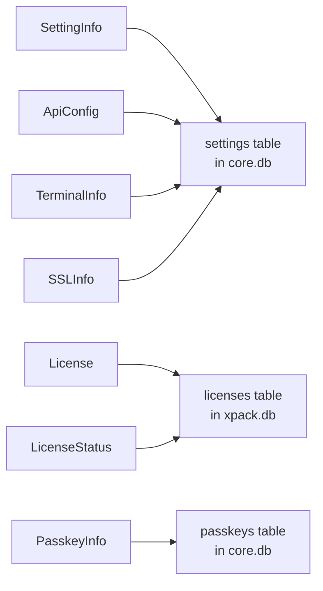

**Settings Table Schema:** Each setting is stored as a key-value pair where:
- `key`: Setting name (e.g., `"SystemIP"`, `"PanelName"`)
- `value`: Setting value as string (even for numbers/booleans)
- Complex settings (MFA, proxy) use JSON serialization in the value field

### Agent Settings Storage

Agent settings reside in `agent.db` on each node, allowing per-node configuration independence:

```
agent.db
├── settings table (base configuration)
├── snapshots table (snapshot records)
└── backup_accounts table (referenced by snapshots)
```

### Multi-Node Settings Synchronization

When the `CurrentNode` header is set in requests, settings operations target specific nodes. The Core server proxies requests to the appropriate Agent API:

```typescript
// Target specific node
const headers = { CurrentNode: "2" };
await getAgentSettingInfo();  // Routed to node 2's agent API

// Without header, uses current node from global store
```

**Sources:** Analysis of [frontend/src/api/modules/setting.ts:63-80]()

---

## Diagram: Complete Settings API Surface

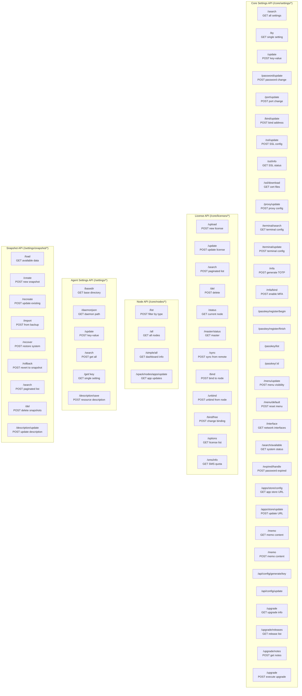

**Sources:** [frontend/src/api/modules/setting.ts:1-223]()

---

