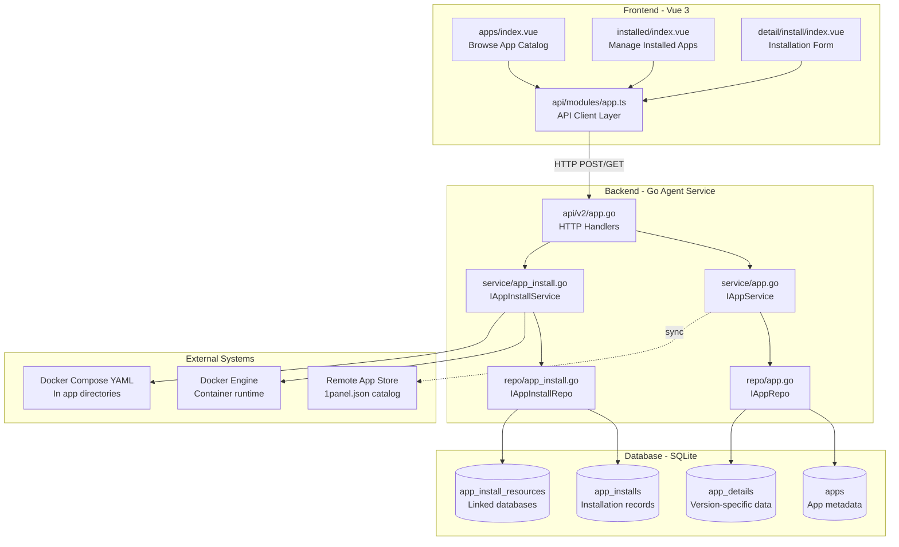
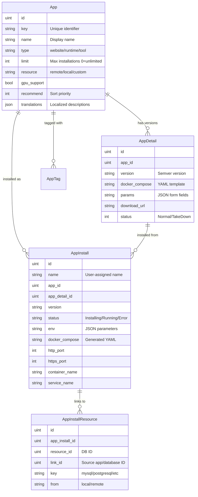
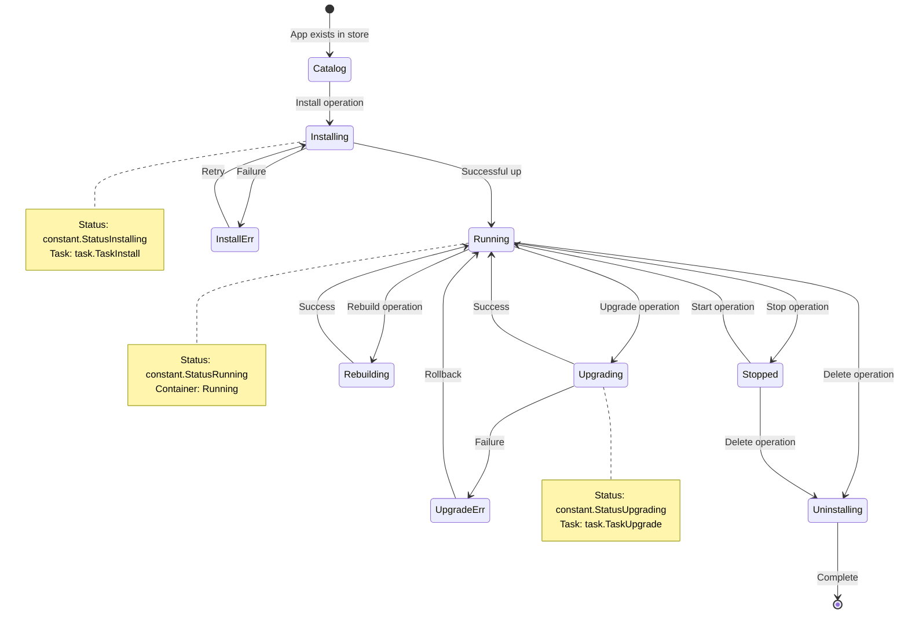
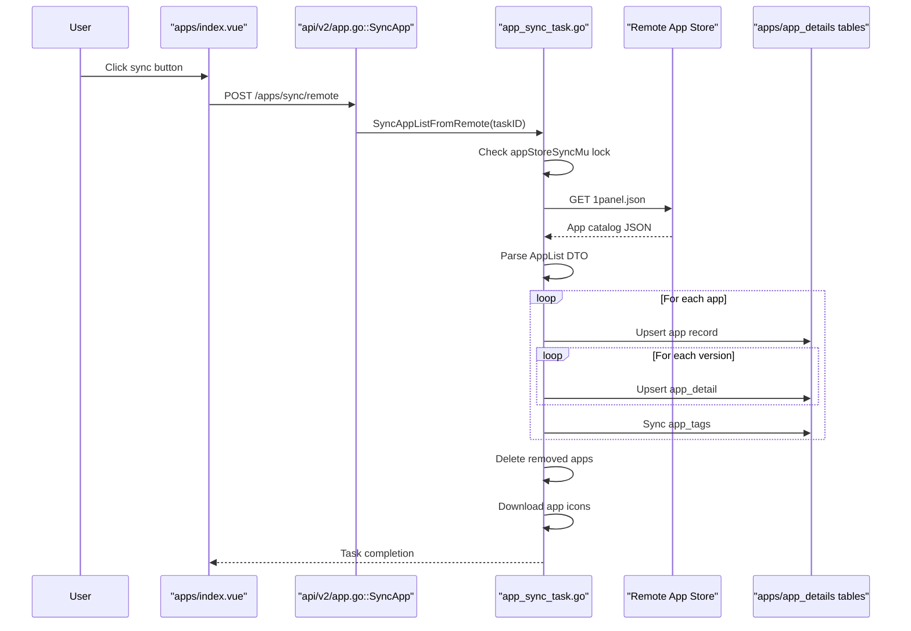
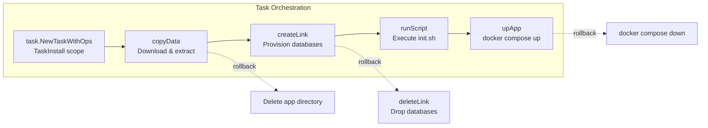
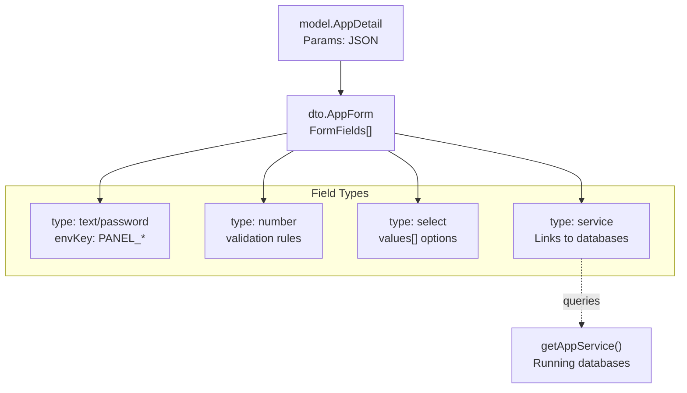
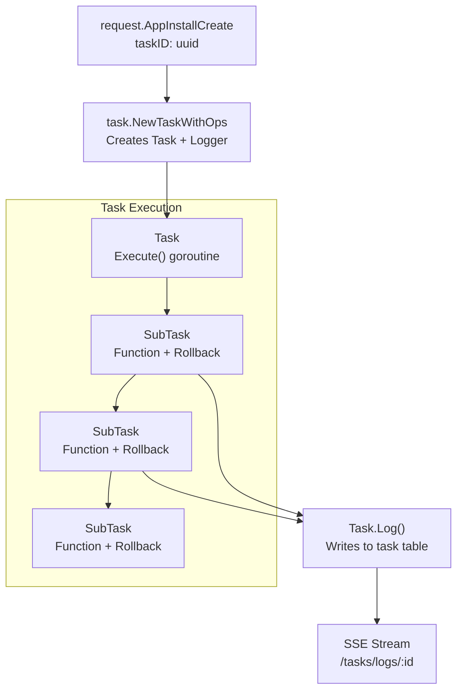

<!-- source: DeepWiki mcp.deepwiki.com · repo 1Panel-dev/1Panel · page 6 Application Management System · fetched 2026-10-29 -->

# Application Management System

Relevant source files

The following files were used as context for generating this wiki page:

- [agent/app/api/v2/app.go](agent/app/api/v2/app.go)
- [agent/app/dto/file.go](agent/app/dto/file.go)
- [agent/app/dto/request/app.go](agent/app/dto/request/app.go)
- [agent/app/dto/response/app.go](agent/app/dto/response/app.go)
- [agent/app/repo/app.go](agent/app/repo/app.go)
- [agent/app/service/app.go](agent/app/service/app.go)
- [agent/app/service/app_install.go](agent/app/service/app_install.go)
- [agent/app/service/app_sync_task.go](agent/app/service/app_sync_task.go)
- [agent/app/service/app_utils.go](agent/app/service/app_utils.go)
- [agent/global/config.go](agent/global/config.go)
- [agent/init/business/business.go](agent/init/business/business.go)
- [agent/init/dir/dir.go](agent/init/dir/dir.go)
- [agent/router/ro_app.go](agent/router/ro_app.go)
- [agent/utils/appicon/appicon.go](agent/utils/appicon/appicon.go)
- [agent/utils/files/utils.go](agent/utils/files/utils.go)
- [agent/utils/req_helper/request.go](agent/utils/req_helper/request.go)
- [core/init/cron/cron.go](core/init/cron/cron.go)
- [frontend/src/api/interface/app.ts](frontend/src/api/interface/app.ts)
- [frontend/src/api/modules/app.ts](frontend/src/api/modules/app.ts)
- [frontend/src/components/app-status/index.vue](frontend/src/components/app-status/index.vue)
- [frontend/src/global/form-rules.ts](frontend/src/global/form-rules.ts)
- [frontend/src/styles/common.scss](frontend/src/styles/common.scss)
- [frontend/src/views/app-store/apps/index.vue](frontend/src/views/app-store/apps/index.vue)
- [frontend/src/views/app-store/detail/index.vue](frontend/src/views/app-store/detail/index.vue)
- [frontend/src/views/app-store/detail/install/index.vue](frontend/src/views/app-store/detail/install/index.vue)
- [frontend/src/views/app-store/detail/params/index.vue](frontend/src/views/app-store/detail/params/index.vue)
- [frontend/src/views/app-store/installed/detail/index.vue](frontend/src/views/app-store/installed/detail/index.vue)
- [frontend/src/views/app-store/installed/index.vue](frontend/src/views/app-store/installed/index.vue)
- [frontend/src/views/app-store/installed/upgrade/index.vue](frontend/src/views/app-store/installed/upgrade/index.vue)
- [frontend/src/views/website/website/create/index.vue](frontend/src/views/website/website/create/index.vue)
- [frontend/src/views/website/website/index.vue](frontend/src/views/website/website/index.vue)

## Purpose and Scope

The Application Management System provides a Docker Compose-based application marketplace and lifecycle management framework within 1Panel. This system enables users to browse a curated app catalog, install applications with configurable parameters, and manage their lifecycle through start/stop/upgrade/uninstall operations. Applications are deployed as Docker containers orchestrated by Docker Compose, with automatic handling of database provisioning, environment configuration, and resource linking.

This document provides an overview of the app management architecture, core data models, and operational workflows. For detailed information on specific subsystems:
- App catalog synchronization and browsing: see [App Store and Catalog](#6.1)
- Installation workflow and parameter handling: see [App Installation and Deployment](#6.2)  
- Post-installation operations and lifecycle management: see [Installed App Operations](#6.3)

---

## System Architecture

The Application Management System operates across three layers: the frontend Vue.js application, the backend Go agent service, and external app store repositories.

### Component Architecture

**Sources:** [frontend/src/views/app-store/apps/index.vue:1-279](), [frontend/src/views/app-store/installed/index.vue:1-469](), [agent/app/service/app.go:1-636](), [agent/app/service/app_install.go:1-848](), [agent/app/api/v2/app.go:1-245]()

---

## Core Data Model

The system uses three primary entities to represent applications, their versions, and installations.

### Entity Relationship Diagram

**Key Structures:**

| Entity | Purpose | Key Fields |
|--------|---------|------------|
| `model.App` | App catalog entry | `Key`, `Type`, `Limit`, `Resource` |
| `model.AppDetail` | Version-specific metadata | `Version`, `DockerCompose`, `Params` |
| `model.AppInstall` | Installation instance | `Name`, `Status`, `Env`, `ContainerName` |
| `model.AppInstallResource` | Linked database resources | `ResourceId`, `LinkId`, `Key` |

**Sources:** [agent/app/dto/response/app.go:1-164](), [frontend/src/api/interface/app.ts:1-365]()

---

## Application States and Lifecycle

Applications transition through distinct states during their lifecycle, from catalog browsing to installation and operational management.

### State Machine

**Status Constants:**

| Constant | Value | Meaning |
|----------|-------|---------|
| `constant.StatusInstalling` | "Installing" | Initial installation in progress |
| `constant.StatusRunning` | "Running" | Container successfully running |
| `constant.StatusInstallErr` | "InstallErr" | Installation failed |
| `constant.StatusUpgrading` | "Upgrading" | Upgrade in progress |
| `constant.StatusUpgradeErr` | "UpgradeErr" | Upgrade failed |
| `constant.StatusUninstalling` | "Uninstalling" | Removal in progress |

**Sources:** [agent/app/service/app.go:342-576](), [agent/app/service/app_utils.go:333-468](), [agent/app/service/app_utils.go:674-898]()

---

## App Store Synchronization

The system maintains a local mirror of remote app catalog metadata through periodic synchronization tasks.

### Sync Process Flow

**Synchronization Components:**

- **Lock Management:** `appStoreSyncMu` mutex prevents concurrent sync operations
- **Version Tracking:** `AppStoreSyncStatus` setting tracks sync state
- **Incremental Updates:** Compares remote `LastModified` timestamp
- **Icon Caching:** Downloads and stores app icons locally in `1panel/data/cache/app_icons`

**Sources:** [agent/app/service/app_sync_task.go:1-320](), [frontend/src/views/app-store/apps/index.vue:175-198]()

---

## Installation Workflow

Application installation follows a multi-phase process orchestrated by task subtasks, with automatic rollback on failure.

### Installation Task Chain

**Key Functions in Installation Pipeline:**

1. **Request Validation** - `app.go::Install` [agent/app/service/app.go:342-576]()
   - Check Docker network exists
   - Validate app name uniqueness
   - Check port availability
   - Verify resource limits

2. **Compose Generation** - `app_utils.go::addDockerComposeCommonParam` [agent/app/service/app_utils.go:1366-1549]()
   - Merge user params with template
   - Configure container name, restart policy
   - Set CPU/memory limits
   - Handle port mappings

3. **Database Provisioning** - `app_utils.go::createLink` [agent/app/service/app_utils.go:207-331]()
   - Create MySQL/PostgreSQL/MongoDB databases
   - Generate credentials
   - Link via `AppInstallResource` records

4. **Container Deployment** - Uses `compose.Up()` wrapper around Docker Compose V2 API

**Sources:** [agent/app/service/app.go:342-576](), [agent/app/service/app_utils.go:207-331](), [agent/app/service/app_utils.go:1366-1549]()

---

## Installed App Operations

Post-installation, the system provides lifecycle management operations through standardized interfaces.

### Operation Routing

| Operation | Handler | Implementation | Docker Command |
|-----------|---------|----------------|----------------|
| `start` | `AppInstallService::Operate` | `compose.Start()` | `docker compose start` |
| `stop` | `AppInstallService::Operate` | `compose.Stop()` | `docker compose stop` |
| `restart` | `AppInstallService::Operate` | `compose.Restart()` | `docker compose restart` |
| `rebuild` | `AppInstallService::Operate` | `compose.Down() + Up()` | Recreate containers |
| `upgrade` | `app_utils.go::upgradeInstall` | Version migration | Multi-step process |
| `delete` | `app_utils.go::deleteAppInstall` | Full cleanup | Remove all resources |

### Frontend Operation Interface

The installed apps view provides a unified control panel for all operations:

**Component:** `installed/index.vue` [frontend/src/views/app-store/installed/index.vue:1-469]()

**Action Buttons:** [frontend/src/views/app-store/installed/index.vue:296-376]()
- Rebuild: Recreates containers from current compose
- Restart: Stops and starts containers
- Start/Stop: Container state control
- Uninstall: Triggers deletion workflow
- Params: Opens parameter editor

**Status Polling:** The view uses `setInterval` to refresh app status every 30 seconds [frontend/src/views/app-store/installed/index.vue:460-462](), ensuring real-time status updates for long-running operations.

**Sources:** [agent/app/service/app_install.go:428-561](), [frontend/src/views/app-store/installed/index.vue:296-376]()

---

## Parameter Management

Applications define customizable parameters through a form schema system that generates UI controls and validates input.

### Parameter Schema Structure

**Frontend Parameter Rendering:** `detail/params/index.vue` [frontend/src/views/app-store/detail/params/index.vue:1-353]()

**Backend Validation:** Parameters are validated during installation and update operations. The system supports:
- **Service Dependencies:** `type: "service"` fields link to running database/tool instances
- **Multi-App Linking:** `type: "apps"` fields with nested child services
- **Dynamic Values:** Some fields populate values by querying system state

**Parameter Updates:** The `updateAppInstallParams` endpoint allows modifying certain parameters post-installation, triggering container rebuild if needed [agent/app/service/app_install.go:678-777]().

**Sources:** [frontend/src/views/app-store/detail/params/index.vue:1-353](), [agent/app/service/app_install.go:678-777]()

---

## Task-Based Execution

Long-running operations (install, upgrade, uninstall) execute asynchronously through a task framework that provides logging, progress tracking, and rollback capabilities.

### Task Architecture

**Task Lifecycle:**

1. **Creation:** `task.NewTaskWithOps(name, taskType, scope, taskID, resourceID)` [agent/app/service/app.go:523-526]()
2. **Subtask Registration:** `AddSubTask(name, fn, rollbackFn)` adds sequential steps
3. **Async Execution:** `go installTask.Execute()` runs in background [agent/app/service/app.go:564-573]()
4. **Progress Streaming:** Frontend opens SSE connection to stream logs [frontend/src/components/log/task/index.vue]()

**Rollback Mechanism:** If any subtask fails, the task executor calls registered rollback functions in reverse order, enabling automatic cleanup [agent/app/service/app_utils.go:871-881]().

**Sources:** [agent/app/service/app.go:523-573](), [agent/app/task/task.go]()

---

## Integration Points

The Application Management System integrates with multiple 1Panel subsystems:

### Cross-System Dependencies

| System | Integration Point | Purpose |
|--------|------------------|---------|
| **Database Management** | `createLink()` | Auto-provision MySQL/PostgreSQL/MongoDB databases for apps |
| **Website System** | App type `website` | Deploy apps as Nginx-backed websites |
| **Runtime Management** | App type `runtime` | PHP/Node/Python runtime environments |
| **Container Platform** | Docker SDK | All apps deploy as Docker containers |
| **Backup System** | `AppBackup()` | Snapshot app state before upgrades |
| **File Manager** | App directory access | Browse app files at `/opt/1panel/apps/[key]/[name]` |
| **Task Logging** | Async task framework | Stream installation/upgrade progress |

**Database Resource Linking:** When an app declares a database dependency, the system:
1. Queries available databases via `databaseRepo.Get()` [agent/app/service/app_utils.go:256-259]()
2. Creates database/user if not exists [agent/app/service/app_utils.go:274-313]()
3. Records link in `app_install_resources` table [agent/app/service/app_utils.go:316-326]()
4. Injects connection params into app's `.env` file

**Sources:** [agent/app/service/app_utils.go:207-331](), [agent/app/service/app_install.go:1-848]()

---

## API Endpoints

The system exposes RESTful endpoints for all app management operations:

### Core Routes

| Method | Path | Handler | Purpose |
|--------|------|---------|---------|
| POST | `/apps/search` | `SearchApp` | Paginated app catalog search |
| GET | `/apps/{key}` | `GetApp` | Fetch app metadata by key |
| GET | `/apps/detail/{id}/{version}/{type}` | `GetAppDetail` | Version-specific detail |
| POST | `/apps/install` | `InstallApp` | Install app instance |
| POST | `/apps/installed/search` | `SearchAppInstalled` | List installed apps |
| POST | `/apps/installed/op` | `OperateInstalled` | Execute lifecycle operation |
| POST | `/apps/installed/delete` | `DeleteAppInstall` | Uninstall app |
| POST | `/apps/sync/remote` | `SyncApp` | Sync app store catalog |
| GET | `/apps/services/{key}` | `GetAppService` | Query available service instances |

**Request/Response DTOs:**
- Requests: [agent/app/dto/request/app.go:1-184]()
- Responses: [agent/app/dto/response/app.go:1-164]()

**Sources:** [agent/app/api/v2/app.go:1-245](), [agent/router/ro_app.go:1-69]()

---

