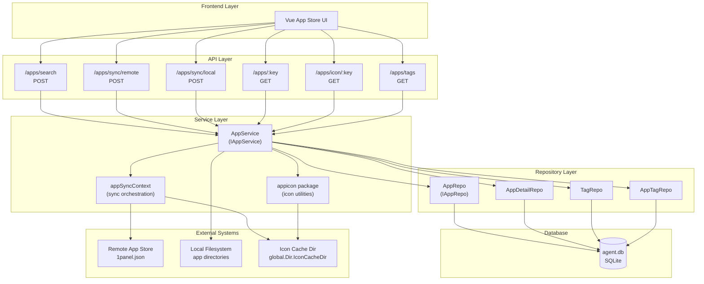
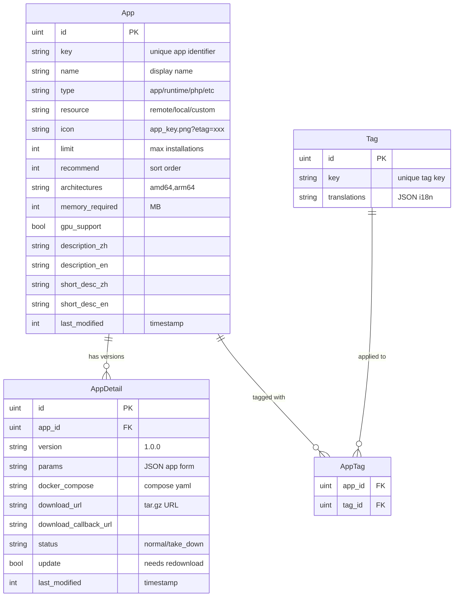
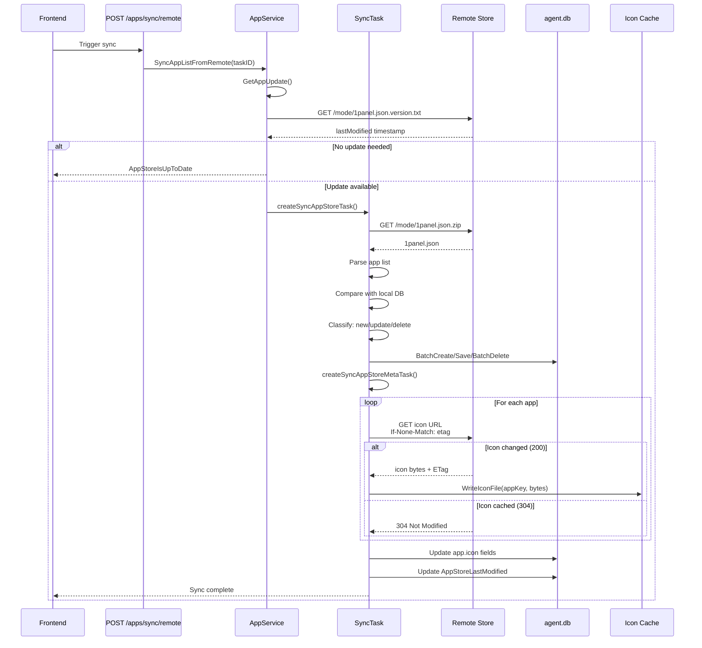
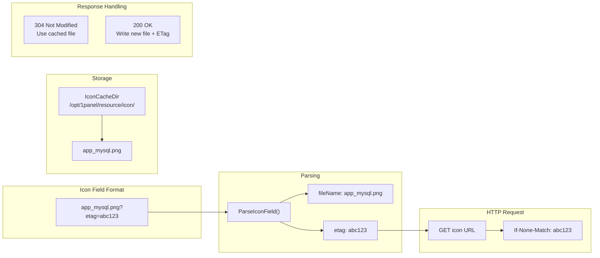
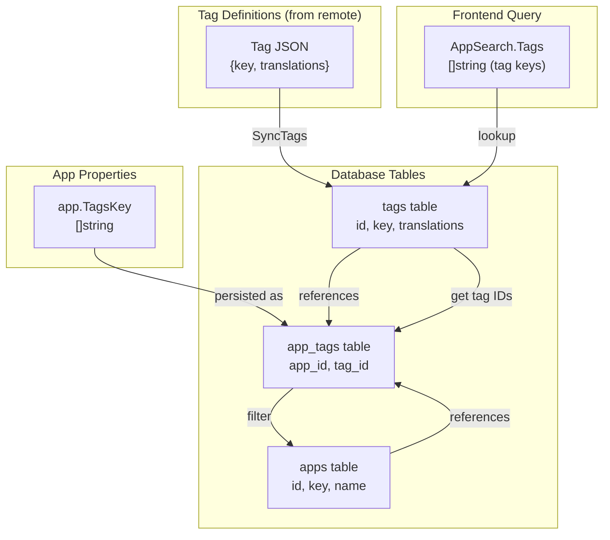
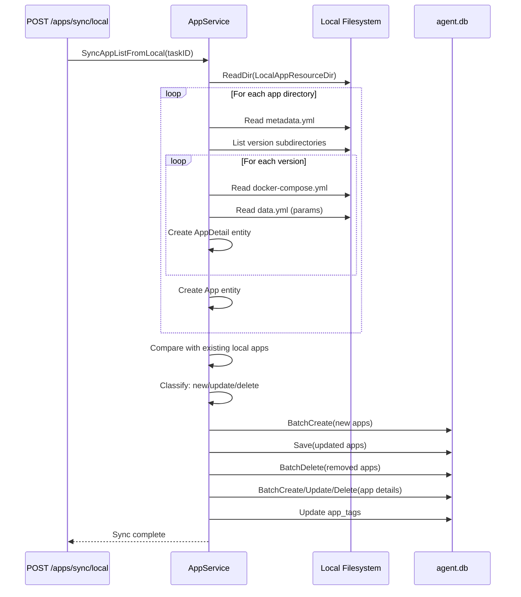
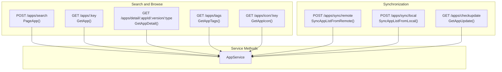

<!-- source: DeepWiki mcp.deepwiki.com · repo 1Panel-dev/1Panel · page 6.1 App Store and Catalog · fetched 2026-10-29 -->

# App Store and Catalog

<details>
<summary>Relevant source files</summary>

The following files were used as context for generating this wiki page:

- [agent/app/api/v2/app.go](agent/app/api/v2/app.go)
- [agent/app/dto/file.go](agent/app/dto/file.go)
- [agent/app/dto/request/app.go](agent/app/dto/request/app.go)
- [agent/app/dto/response/app.go](agent/app/dto/response/app.go)
- [agent/app/repo/app.go](agent/app/repo/app.go)
- [agent/app/service/app.go](agent/app/service/app.go)
- [agent/app/service/app_install.go](agent/app/service/app_install.go)
- [agent/app/service/app_sync_task.go](agent/app/service/app_sync_task.go)
- [agent/app/service/app_utils.go](agent/app/service/app_utils.go)
- [agent/global/config.go](agent/global/config.go)
- [agent/init/business/business.go](agent/init/business/business.go)
- [agent/init/dir/dir.go](agent/init/dir/dir.go)
- [agent/router/ro_app.go](agent/router/ro_app.go)
- [agent/utils/appicon/appicon.go](agent/utils/appicon/appicon.go)
- [agent/utils/files/utils.go](agent/utils/files/utils.go)
- [agent/utils/req_helper/request.go](agent/utils/req_helper/request.go)
- [core/init/cron/cron.go](core/init/cron/cron.go)

</details>


This document describes the App Store and Catalog system, which manages the discovery, synchronization, and metadata of applications available for installation in 1Panel. This includes remote app store synchronization, local app management, icon caching, and tag-based categorization.

For information about app installation and lifecycle management, see [App Installation and Deployment](#6.2). For operations on installed apps, see [Installed App Operations](#6.3).

---

## Overview

The App Store system provides a centralized catalog of applications that users can browse and install. It supports three app sources:

| Source | Description | Storage Location |
|--------|-------------|------------------|
| **Remote** | Official 1Panel app store | `global.Dir.RemoteAppResourceDir` |
| **Local** | User-provided local apps | `global.Dir.LocalAppResourceDir` |
| **Custom** | Custom app definitions | `global.Dir.CustomAppResourceDir` |

The system maintains app metadata in SQLite, downloads and caches app icons with ETag support, and provides search/filtering capabilities through a tag-based categorization system.

**Sources:** [agent/app/service/app.go:1-1000](), [agent/global/config.go:26-52]()

---

## System Architecture



The architecture follows a layered pattern where API endpoints delegate to `AppService`, which orchestrates synchronization tasks, manages icon caching, and persists metadata through repository classes.

**Sources:** [agent/app/api/v2/app.go:1-256](), [agent/app/service/app.go:38-62](), [agent/router/ro_app.go:1-50]()

---

## Data Model

### Core Entities



The `App` entity stores base metadata, while `AppDetail` stores version-specific configuration. Tags enable categorization and filtering. The `icon` field uses the format `app_{key}.png?etag={value}` for cache control.

**Sources:** [agent/app/model/app.go:1-100](), [agent/app/dto/response/app.go:24-50]()

---

## Remote App Store Synchronization

### Synchronization Flow



The synchronization process checks for updates by comparing timestamps, downloads the app list from the remote store, classifies changes, and persists metadata to the database. Icons are downloaded with HTTP ETag caching to minimize bandwidth usage.

**Sources:** [agent/app/service/app.go:950-1027](), [agent/app/service/app_sync_task.go:38-128]()

### Remote App List Structure

The remote app store serves a `1panel.json` file containing all available apps:

```json
{
  "lastModified": 1234567890,
  "apps": [
    {
      "appProperty": {
        "key": "mysql",
        "name": "MySQL",
        "tags": ["database", "popular"],
        "recommend": 100,
        "icon": "https://..."
      },
      "versions": [
        {
          "name": "8.0.32",
          "appForm": {...},
          "lastModified": 1234567890,
          "downloadCallBackUrl": "https://..."
        }
      ],
      "readMe": "...",
      "lastModified": 1234567890
    }
  ],
  "extra": {
    "version": "1.10.0",
    "tags": [...]
  }
}
```

The `getAppList()` function downloads this file from `{AppRepo}/{Mode}/1panel.json.zip` and parses it.

**Sources:** [agent/app/service/app.go:890-906](), [agent/app/service/app.go:872-888]()

### Synchronization State Management

The system uses `AppStoreSyncStatus` setting to prevent concurrent syncs:

| Status | Meaning |
|--------|---------|
| `StatusSyncing` | Sync in progress |
| `StatusSyncSuccess` | Last sync succeeded |
| `StatusError` | Last sync failed |

The `appStoreSyncMu` mutex and `appStoreSyncing` boolean at [agent/app/service/app.go:39-41]() ensure only one sync runs at a time.

**Sources:** [agent/app/service/app.go:950-991](), [agent/app/service/app_sync_task.go:70-73]()

---

## Icon Caching System

### Icon File Management

Icons are cached locally with ETag-based validation to minimize downloads:



Icon file operations are centralized in the `appicon` package:

- `IsIconFile(icon)` - Check if field contains cached icon: [agent/utils/appicon/appicon.go:16-18]()
- `ParseIconField(icon)` - Extract filename and ETag: [agent/utils/appicon/appicon.go:20-33]()
- `BuildIconField(fileName, etag)` - Construct icon field: [agent/utils/appicon/appicon.go:35-40]()
- `WriteIconFile(appKey, data)` - Save icon to disk: [agent/utils/appicon/appicon.go:52-60]()
- `ReadIconFile(fileName)` - Read icon from disk: [agent/utils/appicon/appicon.go:79-82]()
- `IconFileExists(fileName)` - Check if cached: [agent/utils/appicon/appicon.go:84-88]()

**Sources:** [agent/utils/appicon/appicon.go:1-94](), [agent/app/service/app_sync_task.go:222-271]()

### Icon Download with ETag Caching

The `downloadAppIcon()` method implements conditional HTTP requests:

```go
// From app_sync_task.go:222-271
func (c *appSyncContext) downloadAppIcon(iconUrl, appKey, oldIcon string) (status int, iconField string) {
    iconFileName, existingEtag := appicon.ParseIconField(oldIcon)
    
    reqHeaders := make(map[string]string)
    if existingEtag != "" && iconFileName != "" && appicon.IconFileExists(iconFileName) {
        reqHeaders["If-None-Match"] = existingEtag  // Conditional request
    }
    
    resp, err := req_helper.HandleRequestWithHeaders(&c.httpClient, iconUrl, http.MethodGet, constant.TimeOut20s, reqHeaders)
    
    if resp.StatusCode == http.StatusNotModified {
        return http.StatusNotModified, ""  // Use cached
    }
    
    if resp.StatusCode == http.StatusOK {
        fileName, err := appicon.WriteIconFile(appKey, resp.Body)
        newEtag := resp.Header.Get("ETag")
        iconField = appicon.BuildIconField(fileName, newEtag)
        return http.StatusOK, iconField
    }
}
```

This reduces bandwidth by only downloading icons when they've changed on the server.

**Sources:** [agent/app/service/app_sync_task.go:222-271]()

### Icon API Endpoint

The `/apps/icon/:key` endpoint serves cached icons with HTTP caching headers:

```go
// From app.go:207-235
func (b *BaseApi) GetAppIcon(c *gin.Context) {
    appKey, _ := helper.GetStrParamByKey(c, "key")
    iconBytes, filename, etag, err := appService.GetAppIcon(appKey)
    
    // Set cache control for 30 days
    c.Header("Cache-Control", "public, max-age=2592000")
    
    if etag != "" && filename != "" {
        c.Header("ETag", etag)
        if c.GetHeader("If-None-Match") == etag {
            c.Status(http.StatusNotModified)  // Client has current version
            return
        }
    }
    
    c.Data(http.StatusOK, appicon.ContentTypePNG, iconBytes)
}
```

This enables browser-side caching with ETag validation.

**Sources:** [agent/app/api/v2/app.go:207-235]()

---

## Tag-Based Categorization

### Tag System Architecture

Apps are categorized using a many-to-many tag system:



Tags are defined in the remote app list's `extra.tags` section and synchronized to the database. Each tag has translations for multiple languages.

**Sources:** [agent/app/service/app.go:169-188](), [agent/app/repo/tag.go:1-100]()

### Tag Synchronization

Tags are synchronized before apps during remote sync:

```go
// From app_sync_task.go:92-95
if err = SyncTags(list.Extra); err != nil {
    t.LogFailedWithErr(i18n.GetMsgByKey("SyncTags"), err)
    return err
}
```

The `SyncTags()` function (defined in a helper) parses tag definitions from the remote store and upserts them into the `tags` table.

**Sources:** [agent/app/service/app_sync_task.go:92-95]()

### Tag Filtering in App Search

The `PageApp()` method supports filtering by multiple tags:

```go
// From app.go:91-108
if len(req.Tags) != 0 {
    tags, err := tagRepo.GetByKeys(req.Tags)          // Get tag entities
    var tagIds []uint
    for _, t := range tags {
        tagIds = append(tagIds, t.ID)
    }
    appTags, err := appTagRepo.GetByTagIds(tagIds)    // Get app-tag links
    var appIds []uint
    for _, t := range appTags {
        appIds = append(appIds, t.AppId)
    }
    opts = append(opts, repo.WithByIDs(appIds))       // Filter apps by IDs
}
```

This performs a join between `tags`, `app_tags`, and `apps` tables to find apps matching all specified tags.

**Sources:** [agent/app/service/app.go:91-108]()

### Tag API Endpoint

The `/apps/tags` endpoint returns localized tag names:

```go
// From app.go:169-188
func (a AppService) GetAppTags(ctx *gin.Context) ([]response.TagDTO, error) {
    tags, err := tagRepo.All()
    var res []response.TagDTO
    lang := strings.ToLower(common.GetLang(ctx))  // Get user language
    for _, tag := range tags {
        var translations = make(map[string]string)
        _ = json.Unmarshal([]byte(tag.Translations), &translations)
        if name, ok := translations[lang]; ok {
            tagDTO.Name = name  // Use localized name
        }
        res = append(res, tagDTO)
    }
    return res, nil
}
```

Tags have translations for all supported languages (zh, en, ja, ru, es, etc.) stored as JSON in the `translations` column.

**Sources:** [agent/app/service/app.go:169-188]()

---

## Local App Synchronization

### Local App Directory Structure

Local apps are stored in `global.Dir.LocalAppResourceDir` with this structure:

```
/opt/1panel/resource/apps/local/
├── myapp/
│   ├── metadata.yml       # App metadata
│   ├── 1.0.0/
│   │   ├── docker-compose.yml
│   │   ├── data.yml       # Form parameters
│   │   ├── README.md
│   │   └── scripts/
│   │       ├── init.sh
│   │       ├── upgrade.sh
│   │       └── uninstall.sh
│   └── 1.1.0/
│       └── ...
```

**Sources:** [agent/app/service/app.go:578-808](), [agent/init/dir/dir.go:27-28]()

### Local App Sync Process



The local sync scans the filesystem for app directories, parses metadata files, and reconciles with the database. Removed apps are marked as `AppTakeDown` status instead of being deleted if they have active installations.

**Sources:** [agent/app/service/app.go:578-808]()

### Local App Metadata Parsing

The `handleLocalApp()` and `handleLocalAppDetail()` functions parse local app metadata:

```go
// Parse app-level metadata (metadata.yml)
func handleLocalApp(appDir string) (*model.App, error) {
    metadataFile := path.Join(appDir, "metadata.yml")
    metadata, err := fileOp.GetContent(metadataFile)
    
    var app model.App
    yaml.Unmarshal(metadata, &app)
    app.Resource = constant.AppResourceLocal
    app.Key = "local" + app.Key  // Prefix with "local"
    return &app, nil
}

// Parse version-level metadata (data.yml, docker-compose.yml)
func handleLocalAppDetail(versionDir string, detail *model.AppDetail) error {
    dataFile := path.Join(versionDir, "data.yml")
    composeFile := path.Join(versionDir, "docker-compose.yml")
    
    dataContent, _ := fileOp.GetContent(dataFile)
    composeContent, _ := fileOp.GetContent(composeFile)
    
    detail.Params = string(dataContent)
    detail.DockerCompose = string(composeContent)
    return nil
}
```

**Sources:** [agent/app/service/app.go:609-635]()

---

## App Search and Filtering

### Search Query Parameters

The `AppSearch` DTO supports multiple filter criteria:

| Field | Type | Description |
|-------|------|-------------|
| `Name` | string | Search in name/description (LIKE query) |
| `Tags` | []string | Filter by tag keys (AND logic) |
| `Type` | string | Filter by app type (app/runtime/php) |
| `Recommend` | bool | Only show recommended apps |
| `Resource` | string | Filter by source (remote/local/all) |
| `ShowCurrentArch` | bool | Only show compatible with current CPU architecture |

**Sources:** [agent/app/dto/request/app.go:9-17]()

### Search Implementation

The `PageApp()` method builds dynamic queries using repository options:

```go
// From app.go:64-166
func (a AppService) PageApp(ctx *gin.Context, req request.AppSearch) (*response.AppRes, error) {
    var opts []repo.DBOption
    opts = append(opts, appRepo.OrderByRecommend())  // Sort by recommend field
    
    if req.Name != "" {
        opts = append(opts, appRepo.WithByLikeName(req.Name))  // LIKE search
    }
    if req.Type != "" {
        opts = append(opts, appRepo.WithType(req.Type))
    }
    if req.Recommend {
        opts = append(opts, appRepo.GetRecommend())  // recommend < 9999
    }
    if req.Resource != "" && req.Resource != "all" {
        opts = append(opts, appRepo.WithResource(req.Resource))
    }
    if req.ShowCurrentArch {
        kernelArch := info.KernelArch  // "amd64" or "arm64"
        opts = append(opts, appRepo.WithArch(kernelArch))
    }
    if len(req.Tags) != 0 {
        // Tag filtering (shown earlier)
    }
    
    total, apps, err := appRepo.Page(req.Page, req.PageSize, opts...)
    // Build response DTOs...
}
```

The `OrderByRecommend()` option sorts by the `recommend` integer field (lower = more recommended).

**Sources:** [agent/app/service/app.go:64-166](), [agent/app/repo/app.go:71-80]()

### Architecture Filtering

When `ShowCurrentArch` is enabled, the system filters apps by CPU architecture:

```go
// From app.go:80-89
if req.ShowCurrentArch {
    info, err := NewIDashboardService().LoadOsInfo()
    kernelArch := info.KernelArch  // "x86_64" or "aarch64"
    if kernelArch == "aarch64" {
        kernelArch = "arm64"
    }
    opts = append(opts, appRepo.WithArch(kernelArch))
}

// From app.go:95-98 (repo implementation)
func (a AppRepo) WithArch(arch string) DBOption {
    return func(g *gorm.DB) *gorm.DB {
        return g.Where("architectures like ?", fmt.Sprintf("%%%s%%", arch))
    }
}
```

Apps have an `architectures` field (comma-separated) like "amd64,arm64" that is matched with LIKE query.

**Sources:** [agent/app/service/app.go:80-89](), [agent/app/repo/app.go:95-99]()

---

## API Endpoints Summary

### App Catalog Endpoints



**Sources:** [agent/router/ro_app.go:12-27](), [agent/app/api/v2/app.go:1-256]()

### Key Endpoints

| Endpoint | Method | Purpose | Service Method |
|----------|--------|---------|----------------|
| `/apps/search` | POST | Paginated app search with filters | `PageApp()` |
| `/apps/sync/remote` | POST | Trigger remote store sync | `SyncAppListFromRemote()` |
| `/apps/sync/local` | POST | Trigger local app scan | `SyncAppListFromLocal()` |
| `/apps/checkupdate` | GET | Check if remote store has updates | `GetAppUpdate()` |
| `/apps/:key` | GET | Get single app with all versions | `GetApp()` |
| `/apps/detail/:appId/:version/:type` | GET | Get specific app version details | `GetAppDetail()` |
| `/apps/tags` | GET | Get all tags with localized names | `GetAppTags()` |
| `/apps/icon/:key` | GET | Get app icon (cached) | `GetAppIcon()` |

**Sources:** [agent/router/ro_app.go:1-50](), [agent/app/api/v2/app.go:1-256]()

---

## Initialization and Background Sync

### System Startup Synchronization

The app store is synchronized automatically at system startup:

```go
// From init/business/business.go:22-34
func syncApp() {
    if global.CONF.Base.IsOffLine {
        return  // Skip sync in offline mode
    }
    
    // Reset sync status if crashed during previous sync
    setting, err := service.NewISettingService().GetSettingInfo()
    if err == nil && setting.AppStoreSyncStatus == constant.StatusSyncing {
        _ = service.NewISettingService().Update("AppStoreSyncStatus", constant.StatusSyncSuccess)
    }
    
    // Trigger background sync
    if err := service.NewIAppService().SyncAppListFromRemote(""); err != nil {
        global.LOG.Errorf("App Store synchronization failed")
    }
}
```

This runs in a goroutine at startup to ensure the app catalog is up-to-date.

**Sources:** [agent/init/business/business.go:12-34]()

### Offline Mode

When `global.CONF.Base.IsOffLine` is true, remote synchronization is disabled. The system relies on pre-loaded local apps or manually imported app definitions.

**Sources:** [agent/init/business/business.go:23-25](), [agent/app/service/app.go:950-953]()

---

## Key Data Structures

### AppList DTO (from remote store)

```go
type AppList struct {
    LastModified int       `json:"lastModified"`
    Apps         []AppDTO  `json:"apps"`
    Extra        AppExtra  `json:"extra"`
}

type AppDTO struct {
    AppProperty struct {
        Key       string   `json:"key"`
        Name      string   `json:"name"`
        Tags      []string `json:"tags"`
        Recommend int      `json:"recommend"`
        Icon      string   `json:"icon"`  // URL
    } `json:"appProperty"`
    Versions     []VersionDTO `json:"versions"`
    ReadMe       string       `json:"readMe"`
    LastModified int          `json:"lastModified"`
}

type VersionDTO struct {
    Name                string  `json:"name"`
    AppForm             AppForm `json:"appForm"`
    LastModified        int     `json:"lastModified"`
    DownloadCallBackUrl string  `json:"downloadCallBackUrl"`
}
```

This structure represents the remote app store's JSON format.

**Sources:** [agent/app/dto/app.go:1-100]() (referenced but not shown in files)

### Response DTOs

```go
// From response/app.go:12-22
type AppRes struct {
    Items []*AppItem `json:"items"`
    Total int64      `json:"total"`
}

type AppUpdateRes struct {
    CanUpdate            bool         `json:"canUpdate"`
    IsSyncing            bool         `json:"isSyncing"`
    AppStoreLastModified int          `json:"appStoreLastModified"`
    AppList              *dto.AppList `json:"appList"`
}

// From response/app.go:31-44
type AppItem struct {
    ID          uint     `json:"id"`
    Name        string   `json:"name"`
    Key         string   `json:"key"`
    Description string   `json:"description"`
    Installed   bool     `json:"installed"`
    Tags        []string `json:"tags"`
    Type        string   `json:"type"`
    // ... more fields
}
```

**Sources:** [agent/app/dto/response/app.go:12-44]()

---

## Configuration and Directory Structure

### Directory Layout

```
/opt/1panel/
├── resource/
│   ├── icon/                    # Icon cache (IconCacheDir)
│   │   ├── app_mysql.png
│   │   └── app_nginx.png
│   └── apps/
│       ├── remote/              # Remote apps (RemoteAppResourceDir)
│       │   ├── mysql/
│       │   │   └── 8.0.32/
│       │   │       ├── docker-compose.yml
│       │   │       └── scripts/
│       │   └── nginx/
│       ├── local/               # Local apps (LocalAppResourceDir)
│       │   └── custom-app/
│       │       └── 1.0.0/
│       └── custom/              # Custom apps (CustomAppResourceDir)
└── db/
    └── agent.db                 # SQLite database
```

**Sources:** [agent/init/dir/dir.go:23-30](), [agent/global/config.go:36-44]()

### Configuration Settings

Remote app store URL is configured in `global.CONF.RemoteURL`:

```go
type RemoteURL struct {
    AppRepo     string  // e.g., "https://resource.1panel.cn/repo"
    RepoUrl     string
    ResourceUrl string
}
```

App store URLs are constructed as:
- App list: `{AppRepo}/{Mode}/1panel.json.zip`
- Version check: `{AppRepo}/{Mode}/1panel.json.version.txt`
- App package: `{AppRepo}/{Mode}/1panel/{appKey}/{version}/{appKey}-{version}.tar.gz`

**Sources:** [agent/global/config.go:20-24](), [agent/app/service/app.go:820-821]()

---

**Document Summary:** This page covered the App Store and Catalog system including remote/local synchronization, icon caching with ETag support, tag-based categorization, search/filtering capabilities, and the data model for app metadata. The system maintains a local SQLite database of available apps, downloads icons efficiently with HTTP caching, and provides RESTful API endpoints for the frontend to browse and install applications.

---

