<!-- source: DeepWiki mcp.deepwiki.com · repo 1Panel-dev/1Panel · page 6.2 App Installation and Deployment · fetched 2026-10-29 -->

# App Installation and Deployment

<details>
<summary>Relevant source files</summary>

The following files were used as context for generating this wiki page:

- [agent/app/api/v2/app.go](agent/app/api/v2/app.go)
- [agent/app/dto/file.go](agent/app/dto/file.go)
- [agent/app/dto/request/app.go](agent/app/dto/request/app.go)
- [agent/app/dto/response/app.go](agent/app/dto/response/app.go)
- [agent/app/repo/app.go](agent/app/repo/app.go)
- [agent/app/service/app.go](agent/app/service/app.go)
- [agent/app/service/app_install.go](agent/app/service/app_install.go)
- [agent/app/service/app_sync_task.go](agent/app/service/app_sync_task.go)
- [agent/app/service/app_utils.go](agent/app/service/app_utils.go)
- [agent/global/config.go](agent/global/config.go)
- [agent/init/business/business.go](agent/init/business/business.go)
- [agent/init/dir/dir.go](agent/init/dir/dir.go)
- [agent/router/ro_app.go](agent/router/ro_app.go)
- [agent/utils/appicon/appicon.go](agent/utils/appicon/appicon.go)
- [agent/utils/files/utils.go](agent/utils/files/utils.go)
- [agent/utils/req_helper/request.go](agent/utils/req_helper/request.go)
- [core/init/cron/cron.go](core/init/cron/cron.go)
- [frontend/src/api/interface/app.ts](frontend/src/api/interface/app.ts)
- [frontend/src/api/modules/app.ts](frontend/src/api/modules/app.ts)
- [frontend/src/components/app-status/index.vue](frontend/src/components/app-status/index.vue)
- [frontend/src/global/form-rules.ts](frontend/src/global/form-rules.ts)
- [frontend/src/styles/common.scss](frontend/src/styles/common.scss)
- [frontend/src/views/app-store/apps/index.vue](frontend/src/views/app-store/apps/index.vue)
- [frontend/src/views/app-store/detail/index.vue](frontend/src/views/app-store/detail/index.vue)
- [frontend/src/views/app-store/detail/install/index.vue](frontend/src/views/app-store/detail/install/index.vue)
- [frontend/src/views/app-store/detail/params/index.vue](frontend/src/views/app-store/detail/params/index.vue)
- [frontend/src/views/app-store/installed/detail/index.vue](frontend/src/views/app-store/installed/detail/index.vue)
- [frontend/src/views/app-store/installed/index.vue](frontend/src/views/app-store/installed/index.vue)
- [frontend/src/views/app-store/installed/upgrade/index.vue](frontend/src/views/app-store/installed/upgrade/index.vue)
- [frontend/src/views/website/website/create/index.vue](frontend/src/views/website/website/create/index.vue)
- [frontend/src/views/website/website/index.vue](frontend/src/views/website/website/index.vue)

</details>


This document describes the application installation and deployment system in 1Panel, covering the dynamic parameter form generation, service dependency injection, Docker Compose integration, and the asynchronous installation workflow. For information about the app store catalog and metadata synchronization, see [App Store and Catalog](#6.1). For operations on already-installed applications (start/stop/restart/upgrade/delete), see [Installed App Operations](#6.3).

---

## Installation Workflow Overview

The app installation process follows a multi-stage workflow that dynamically generates installation forms based on app metadata, validates parameters, injects service dependencies, and executes the installation asynchronously using Docker Compose.

**Installation Flow Diagram**

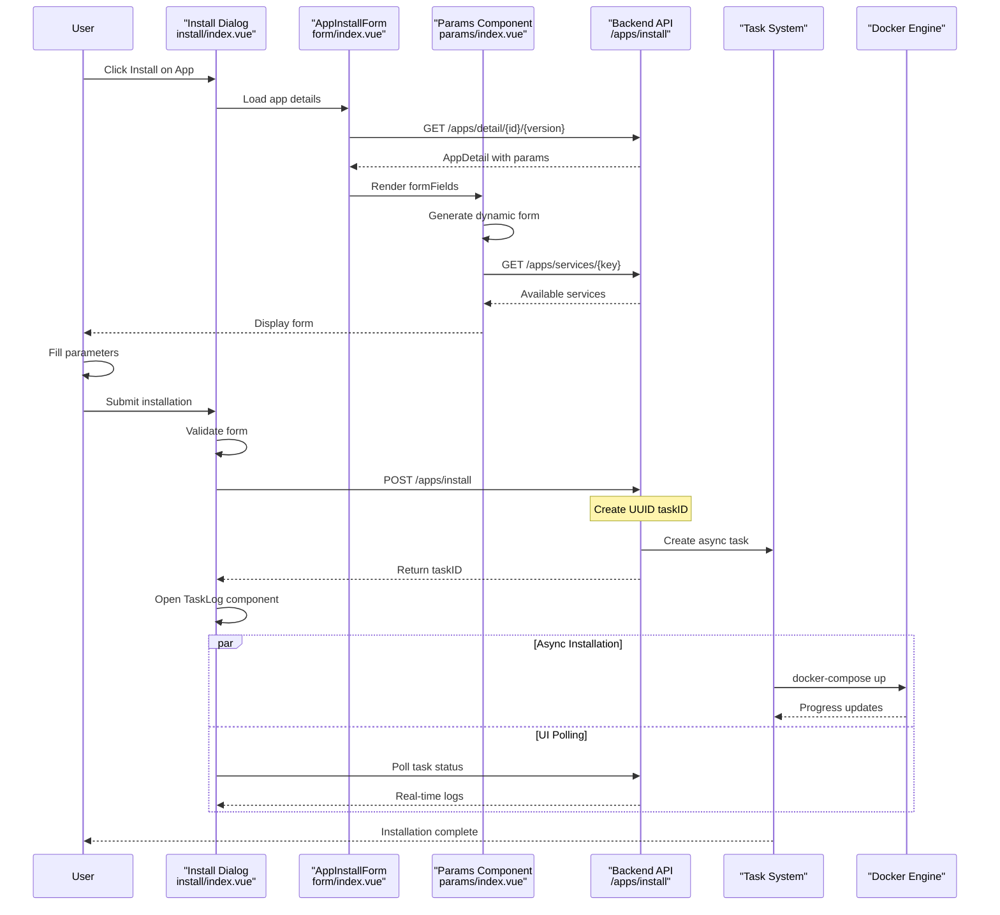

**Sources:** [frontend/src/views/app-store/detail/install/index.vue:1-140](), [frontend/src/views/app-store/detail/params/index.vue:1-323](), [frontend/src/api/modules/app.ts:36-38]()

---

## Dynamic Parameter Form Generation

The system generates installation forms dynamically from app metadata stored in the `AppDetail.params.formFields` array. Each field descriptor defines the parameter type, validation rules, and rendering behavior.

### Form Field Types

The parameter system supports multiple field types, each rendered with appropriate UI components:

| Field Type | Component | Description | Example Use Case |
|------------|-----------|-------------|------------------|
| `text` | `el-input` | Text input | Application name, domain |
| `password` | `el-input` (password) | Password with visibility toggle | Admin password |
| `number` | `el-input[type=number]` | Numeric input | Port number, replica count |
| `select` | `el-select` | Static dropdown | Timezone selection |
| `service` | `el-select` | Dynamic service selector | MySQL instance selection |
| `apps` | Cascading `el-select` | App-then-service selector | Select app type, then instance |

**Form Field Structure**

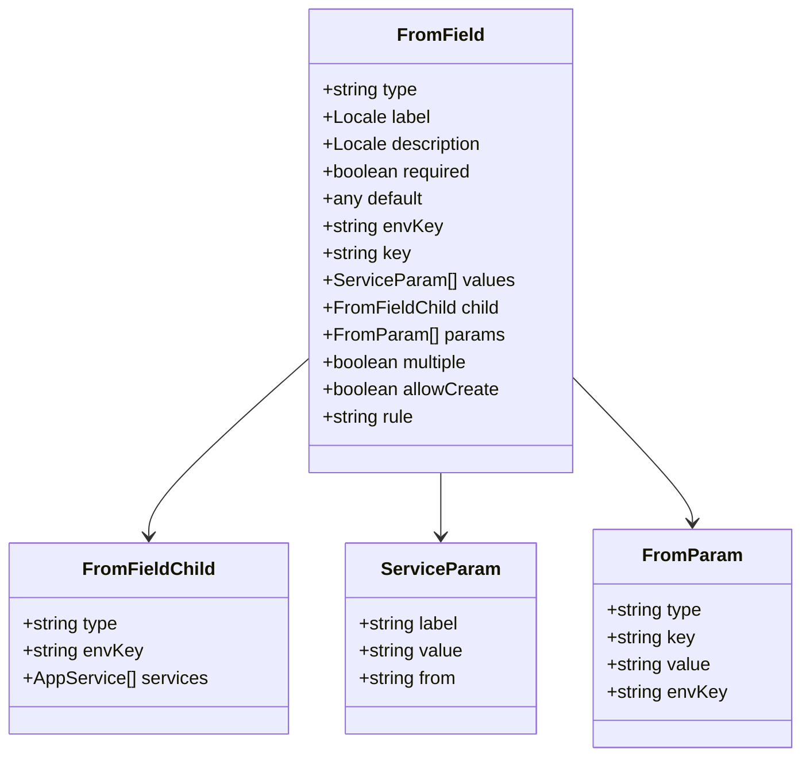

**Sources:** [frontend/src/api/interface/app.ts:95-130](), [frontend/src/views/app-store/detail/params/index.vue:2-132]()

### Parameter Processing

The `params/index.vue` component processes form fields and generates the UI dynamically:

**Parameter Rendering Logic**

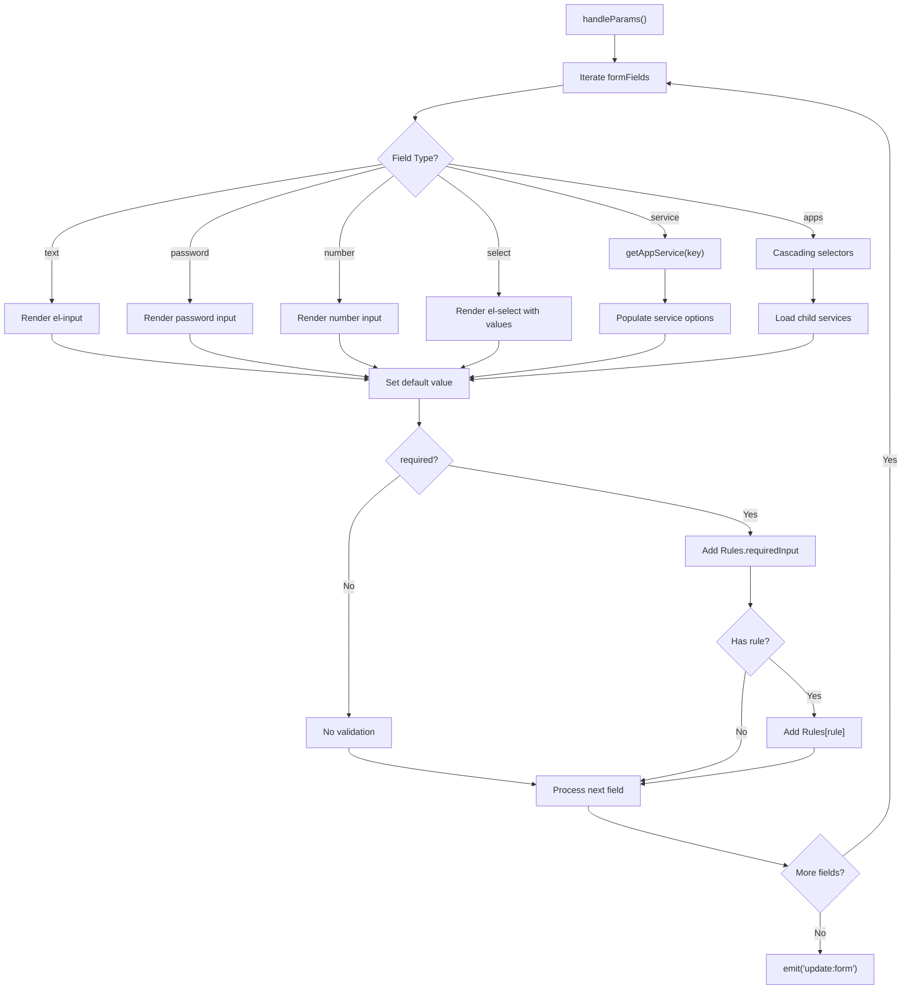

**Sources:** [frontend/src/views/app-store/detail/params/index.vue:205-259]()

**Random Value Generation**

For fields marked with `random: true`, the system generates unique values:

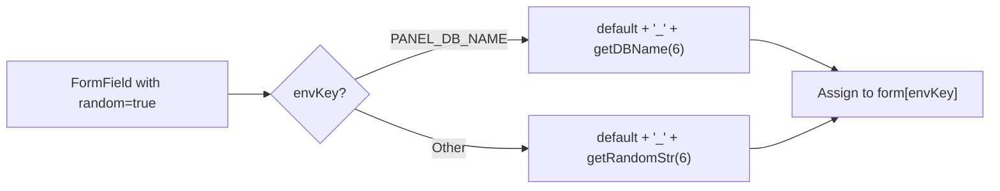

**Sources:** [frontend/src/views/app-store/detail/params/index.vue:213-221]()

---

## Service Dependency Management

Apps can declare dependencies on other installed applications (typically databases) using the `service` and `apps` field types. The system automatically discovers available service instances and injects connection parameters.

### Service Discovery

**Service Loading Process**

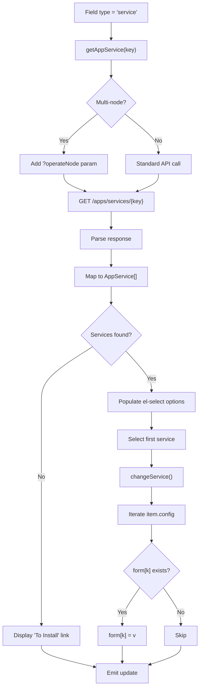

**AppService Structure**

Each service instance returns connection information:

```typescript
interface AppService {
    label: string;      // Display name (e.g., "mysql-1")
    value: string;      // Service identifier
    config?: Object;    // Connection parameters to inject
    from?: string;      // "local" or "remote"
    status: string;     // "Running", "Stopped", etc.
}
```

**Sources:** [frontend/src/api/interface/app.ts:267-273](), [frontend/src/views/app-store/detail/params/index.vue:261-298](), [frontend/src/api/modules/app.ts:88-91]()

### Database Connection Injection

When a database service is selected, the system automatically injects connection parameters:

**Database-Specific Handling**

For MySQL/MariaDB services, the system additionally loads character set options:

```mermaid
flowchart LR
    SelectDB["Select MySQL/MariaDB"] --> SetFormat["form.format = 'utf8mb4'"]
    SetFormat --> LoadOptions["loadFormatCollations(database)"]
    LoadOptions --> ParseFormats["Parse format options"]
    ParseFormats --> Display["Display format selector"]
    Display --> SelectFormat["User selects format"]
    SelectFormat --> LoadCollations["Load collations for format"]
    LoadCollations --> DisplayCollations["Display collation selector"]
```

**Sources:** [frontend/src/views/app-store/detail/params/index.vue:121-131](), [frontend/src/views/app-store/detail/params/index.vue:308-318]()

### Cascading Service Selection

The `apps` field type creates a two-level selector: first select the app type (e.g., "mysql", "postgresql"), then select a specific instance:

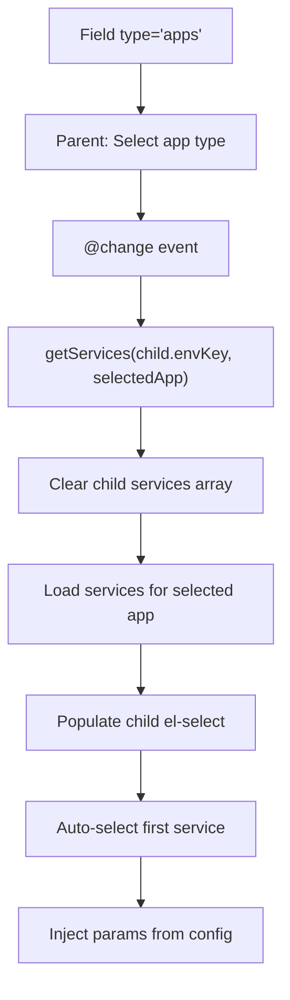

**Sources:** [frontend/src/views/app-store/detail/params/index.vue:59-118](), [frontend/src/views/app-store/detail/params/index.vue:245-249]()

---

## Advanced Configuration Options

The installation form provides advanced options for resource management, networking, and Docker Compose customization.

### Resource Limits

**CPU and Memory Configuration**

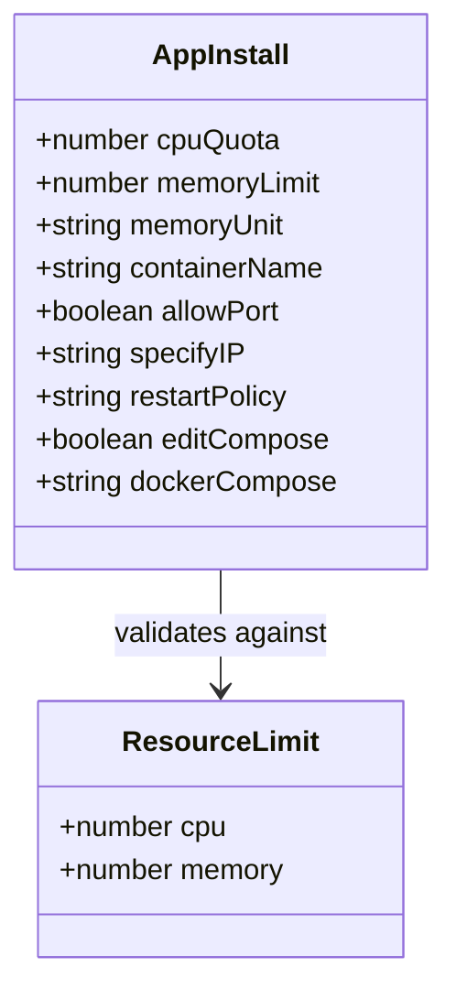

**Validation Rules:**
- CPU Quota: 0-999 cores (0 = unlimited)
- Memory Limit: 0-9999999999 with unit (MB/GB)
- System queries available resources via `loadResourceLimit()` API

**Sources:** [frontend/src/views/app-store/detail/install/index.vue:42-62](), [frontend/src/views/app-store/installed/detail/index.vue:418-431]()

### Port Mapping Configuration

**Port Exposure Options**

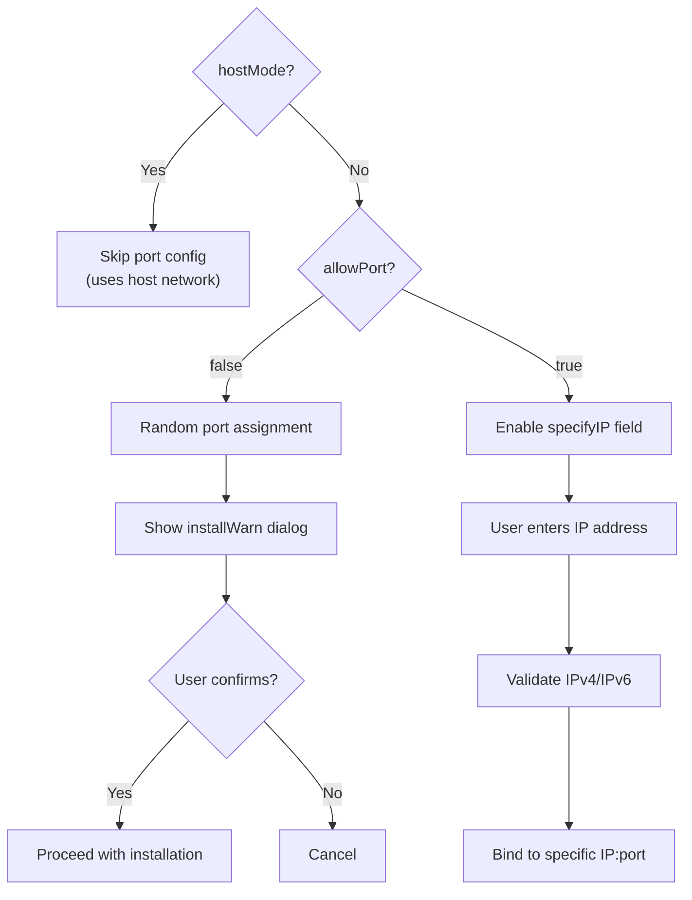

**Sources:** [frontend/src/views/app-store/detail/install/index.vue:90-101](), [frontend/src/views/app-store/installed/detail/index.vue:76-88]()

### Docker Compose Customization

Users can edit the Docker Compose file before installation:

**Compose Editing Workflow**

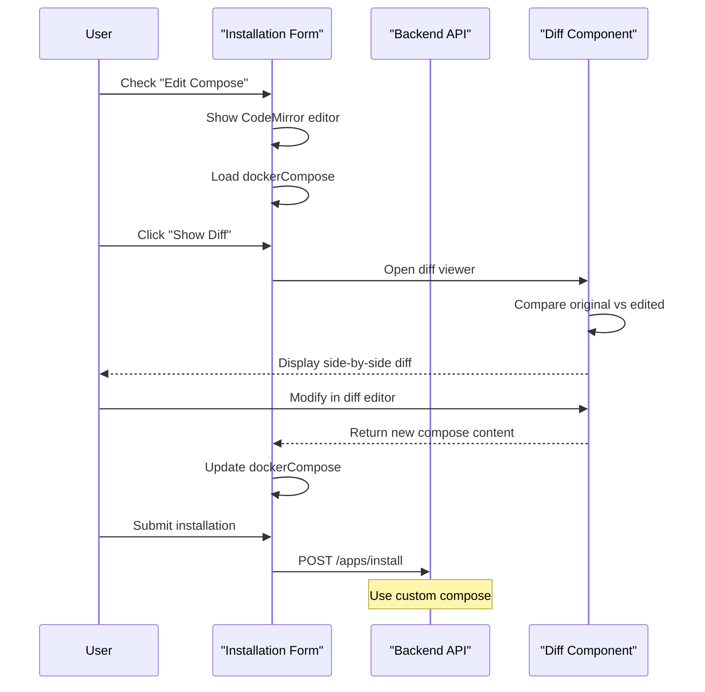

**Sources:** [frontend/src/views/app-store/detail/install/index.vue:78-81](), [frontend/src/views/app-store/installed/detail/index.vue:124-134]()

### Container Restart Policy

Available restart policies mapped to Docker's restart options:

| Policy Value | Docker Behavior |
|--------------|-----------------|
| `no` | Never restart |
| `always` | Always restart |
| `on-failure` | Restart on non-zero exit (maps to `on-failure:5`) |
| `unless-stopped` | Restart unless manually stopped |

**Sources:** [frontend/src/views/app-store/installed/detail/index.vue:89-96](), [frontend/src/views/app-store/installed/detail/index.vue:327-330]()

---

## Multi-Node Deployment

The system supports batch installation to multiple nodes simultaneously (requires Pro license).

**Multi-Node Installation Flow**

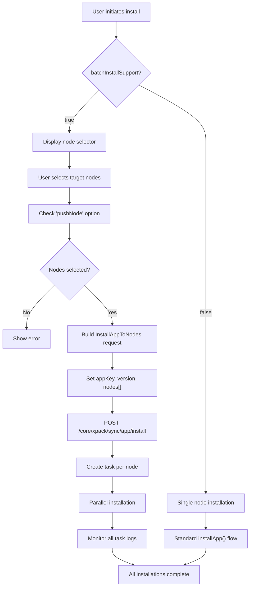

**InstallAppToNodes Structure**

```typescript
interface InstallAppToNodes extends AppInstall {
    nodes: string[];      // Array of node identifiers
    appKey: string;       // Application key
    version: string;      // Version to install
}
```

**Sources:** [frontend/src/api/interface/app.ts:358-363](), [frontend/src/api/modules/app.ts:140-142](), [frontend/src/views/app-store/detail/install/index.vue:109-111]()

---

## Installation Execution

The actual installation is performed asynchronously using the task system, allowing users to monitor progress without blocking the UI.

### Task Creation and Tracking

**Installation Task Flow**

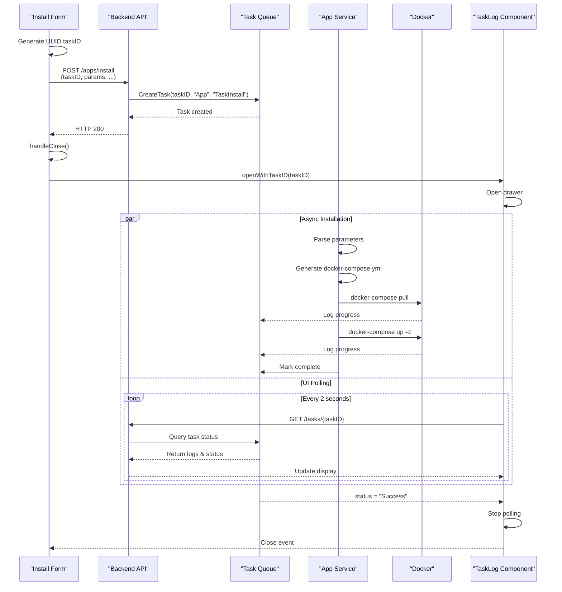

**UUID Generation**

The frontend generates a UUID for each installation to track the async operation:

```javascript
const taskID = newUUID();  // Uses v4 UUID
submitData.taskID = taskID;
```

**Sources:** [frontend/src/views/app-store/detail/install/index.vue:103-121](), [frontend/src/api/modules/app.ts:36-38]()

### Installation API Endpoints

| Endpoint | Method | Purpose | Timeout |
|----------|--------|---------|---------|
| `/apps/install` | POST | Single node installation | Default |
| `/core/xpack/sync/app/install` | POST | Multi-node batch installation | Default |

**Request Structure (AppInstall)**

```typescript
interface AppInstall {
    appDetailId: number;    // Version detail ID
    params: any;            // User-provided parameters
    taskID: string;         // UUID for tracking
    name: string;           // Installation name
    cpuQuota?: number;      // CPU limit
    memoryLimit?: number;   // Memory limit
    memoryUnit?: string;    // "M" or "G"
    containerName?: string; // Custom container name
    allowPort?: boolean;    // Enable port binding
    specifyIP?: string;     // IP for port binding
    restartPolicy?: string; // Container restart policy
    editCompose?: boolean;  // Using custom compose
    dockerCompose?: string; // Custom compose content
    pullImage?: boolean;    // Pull images before install
    format?: string;        // DB format (MySQL)
    collation?: string;     // DB collation (MySQL)
}
```

**Sources:** [frontend/src/api/interface/app.ts:133-138](), [frontend/src/views/app-store/detail/install/index.vue:42-62]()

### TaskLog Component Integration

The `TaskLog` component provides real-time installation monitoring:

**TaskLog Opening Methods**

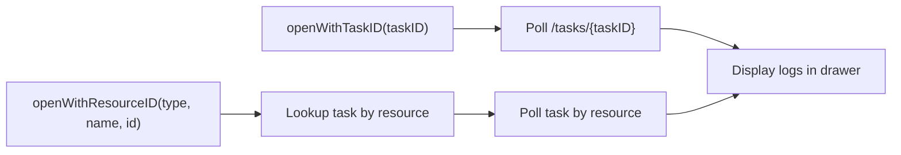

**Sources:** [frontend/src/views/app-store/detail/install/index.vue:123-125](), [frontend/src/views/app-store/apps/index.vue:171-173]()

---

## Validation and Error Handling

The system performs client-side validation before submitting installations and provides detailed error feedback.

### Form Validation Rules

**Common Validation Rules Applied**

```mermaid
classDiagram
    class ValidationRules {
        +requiredInput
        +requiredSelect
        +appName
        +port
        +paramCommon
        +paramComplexity
        +containerName
        +ipv4orV6
    }

    class AppNameRule {
        +pattern: /^(?![_-])[a-zA-Z0-9_-]{1,29}[a-zA-Z0-9]$/
        +message: "Invalid app name"
    }

    class PortRule {
        +range: 1-65535
        +type: number
        +message: "Invalid port"
    }

    class ContainerNameRule {
        +pattern: /^[a-zA-Z0-9]{1}[a-zA-Z0-9_.-]{1,127}$/
        +message: "Invalid container name"
    }

    ValidationRules --> AppNameRule
    ValidationRules --> PortRule
    ValidationRules --> ContainerNameRule
```

**Sources:** [frontend/src/global/form-rules.ts:319-330](), [frontend/src/global/form-rules.ts:452-463](), [frontend/src/global/form-rules.ts:509-520]()

### Pre-Installation Validation

**Validation Sequence**

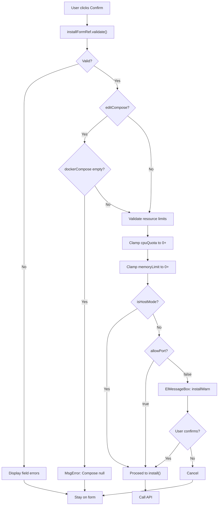

**Sources:** [frontend/src/views/app-store/detail/install/index.vue:72-101]()

### Error Messages

Installation errors are displayed through multiple mechanisms:

**Error Display Paths**

| Error Source | Display Method | Location |
|--------------|----------------|----------|
| Form validation | Inline field errors | Below each field |
| API errors | Toast message | Top-right corner |
| Compose validation | MsgError dialog | Center screen |
| Task failures | TaskLog component | Task log drawer |

**Sources:** [frontend/src/views/app-store/detail/install/index.vue:78-81](), [frontend/src/views/app-store/detail/install/index.vue:103-121]()

---

## Parameter Persistence and Editing

After installation, parameters can be viewed and edited through the installed app detail panel.

**Parameter Edit Workflow**

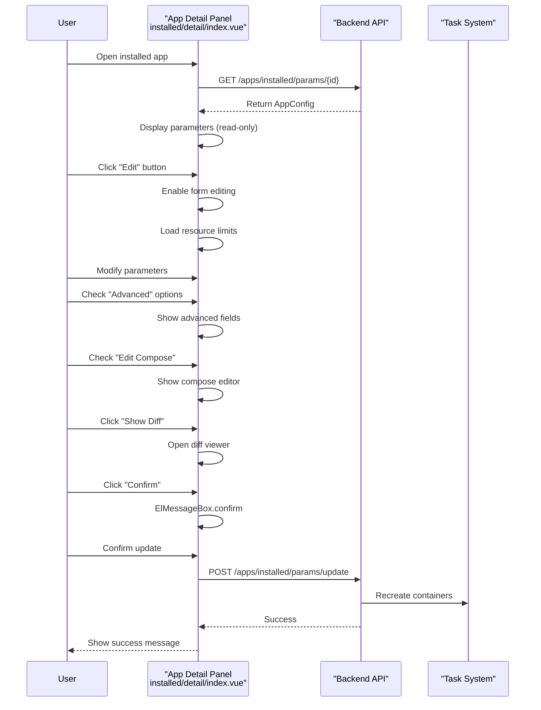

**Sources:** [frontend/src/views/app-store/installed/detail/index.vue:1-434](), [frontend/src/api/modules/app.ts:102-108]()

### Parameter Modification Restrictions

Some parameters are editable post-installation while others are read-only:

**Editable Parameters:**
- Resource limits (CPU, memory)
- Port bindings (via `allowPort`)
- Restart policy
- Container name
- Docker Compose (via `editCompose`)

**Read-Only Parameters:**
- Installation name
- App key
- Version (requires upgrade operation)
- Environment variables (some may be editable depending on `edit` flag)

**Sources:** [frontend/src/views/app-store/installed/detail/index.vue:42-64](), [frontend/src/api/interface/app.ts:295-309]()

---

## Code Entity Reference

### Key Vue Components

| Component Path | Primary Responsibility |
|----------------|------------------------|
| `frontend/src/views/app-store/detail/install/index.vue` | Main installation dialog, orchestrates installation flow |
| `frontend/src/views/app-store/detail/form/index.vue` | Installation form container (referenced but not provided) |
| `frontend/src/views/app-store/detail/params/index.vue` | Dynamic parameter form generation from metadata |
| `frontend/src/views/app-store/apps/index.vue` | App store listing and search |
| `frontend/src/views/app-store/installed/detail/index.vue` | View/edit installed app parameters |
| `frontend/src/views/app-store/installed/upgrade/index.vue` | App upgrade with compose diff viewing |

### Key API Functions

| Function | Location | Purpose |
|----------|----------|---------|
| `installApp()` | `frontend/src/api/modules/app.ts:36-38` | Install app to single node |
| `installAppToNodes()` | `frontend/src/api/modules/app.ts:140-142` | Install app to multiple nodes (Pro) |
| `getAppDetail()` | `frontend/src/api/modules/app.ts:27-30` | Fetch app version details and params |
| `getAppService()` | `frontend/src/api/modules/app.ts:88-91` | List available service instances |
| `getAppInstallParams()` | `frontend/src/api/modules/app.ts:102-104` | Get installed app configuration |
| `updateAppInstallParams()` | `frontend/src/api/modules/app.ts:106-108` | Update installed app parameters |

### Key TypeScript Interfaces

| Interface | Location | Description |
|-----------|----------|-------------|
| `App.AppInstall` | `frontend/src/api/interface/app.ts:133-138` | Installation request structure |
| `App.AppDetail` | `frontend/src/api/interface/app.ts:72-84` | App version details with params |
| `App.FromField` | `frontend/src/api/interface/app.ts:99-114` | Form field descriptor |
| `App.AppService` | `frontend/src/api/interface/app.ts:267-273` | Service instance descriptor |
| `App.AppConfig` | `frontend/src/api/interface/app.ts:295-309` | Installed app configuration |
| `App.InstallAppToNodes` | `frontend/src/api/interface/app.ts:358-363` | Multi-node installation request |

### Validation Rule Constants

| Rule | Location | Pattern/Range |
|------|----------|---------------|
| `Rules.appName` | `frontend/src/global/form-rules.ts:869-873` | `^(?![_-])[a-zA-Z0-9_-]{1,29}[a-zA-Z0-9]$` |
| `Rules.port` | `frontend/src/global/form-rules.ts:831-838` | 1-65535 |
| `Rules.containerName` | `frontend/src/global/form-rules.ts:874-878` | `^[a-zA-Z0-9]{1}[a-zA-Z0-9_.-]{1,127}$` |
| `checkNumberRange(0, 999)` | `frontend/src/global/form-rules.ts:478-487` | CPU quota validation |

**Sources:** [frontend/src/global/form-rules.ts:698-944]()

---

